# Chapter 02 — Linear and Associative Data Structures

**Domain:** D01 — Computer Science Foundations  
**Status:** draft; awaiting learner review  
**Prerequisite:** [Chapter 01](01-cost-models-and-correctness.md)

## Learning goals

Explain abstract data types versus concrete representations; analyze arrays, linked lists, stacks, queues, deques, maps and sets; reason about collisions, identity, mutation, cache locality and cost models; and choose structures according to requirements without imposing technical choices on project PRDs.

## 1. Abstract data type versus implementation

An **abstract data type (ADT)** specifies operations and their observable meaning. A FIFO **queue**, for example, supports adding an item and removing the oldest remaining item. Its implementation could use a ring buffer, linked list or another representation. The ADT describes *what*, while the representation determines memory layout and computational costs.

Before picking a structure, ask: Which operations occur most? How large can input grow? Is order significant? Are duplicates permitted? Are identifiers compared by value or identity? How much memory is available? Is latency worst-case or average-case critical?

Asymptotic costs below generally refer to a mathematical data-structure model, not an ECMAScript performance guarantee.

## 2. Arrays and dynamic arrays

A conventional dynamic array has a number of used slots (length) and allocated slots (capacity). Indexed access is Θ(1) in this model; append is amortized Θ(1) under geometric capacity growth. Inserting near the beginning shifts existing elements and costs Θ(n) in the worst case.

| Operation | Conventional dynamic-array model |
|---|---|
| Access valid index | Θ(1) |
| Search unsorted items | worst-case Θ(n) |
| Append | amortized Θ(1); resizing can cost Θ(n) |
| Insert/delete at front | Θ(n) |
| Iterate n items | Θ(n) |
| Reserved capacity | potentially Θ(n) |

Example:

```ts
const values = ["a", "b", "c"];
values.push("d");
values.splice(1, 0, "x");
console.log(values); // ["a", "x", "b", "c", "d"]
```

JavaScript `Array` is a language abstraction, not a promised packed vector. It can be sparse and engines may change element representations. The ECMAScript standard does not promise the complexity table above for all `Array` operations. `Uint8Array` and related typed arrays expose fixed-length indexed numeric storage over buffers, but are not general replacements for arrays of objects.

**Locality:** scanning tightly packed memory can improve cache behavior relative to dereferencing separately allocated nodes. Big O alone does not reveal cache misses, allocation or garbage-collection costs.

## 3. Linked lists

A singly linked node stores a value and a reference to its successor:

```text
head -> [A,next] -> [B,next] -> [C,null]
```

A doubly linked list additionally stores a predecessor reference. Inserting *after a known predecessor* is Θ(1) but **finding** that predecessor by index is Θ(n). Removing the last element of a singly linked list usually needs the predecessor; with a doubly linked list and tail pointer it is Θ(1).

| Operation | Singly linked list with head and tail |
|---|---|
| Insert at head | Θ(1) |
| Append at tail | Θ(1) |
| Search by value | Θ(n) |
| Read index k | Θ(k) |
| Remove head | Θ(1) |
| Remove tail | Θ(n), generally |

```ts
type Node<T> = { value: T; next: Node<T> | null };

class LinkedQueue<T> {
  private head: Node<T> | null = null;
  private tail: Node<T> | null = null;
  size = 0;

  enqueue(value: T): void {
    const node: Node<T> = { value, next: null };
    if (this.tail) this.tail.next = node;
    else this.head = node;
    this.tail = node;
    this.size++;
  }

  dequeue(): T | undefined {
    if (!this.head) return undefined;
    const { value, next } = this.head;
    this.head = next;
    if (!next) this.tail = null;
    this.size--;
    return value;
  }
}
```

**Invariant:** `size === 0` implies both head and tail are null. For nonempty lists, tail refers to the final node and `tail.next === null`. Walk through empty → enqueue → dequeue → empty: forgetting to clear tail corrupts the representation.

This example uses `undefined` to signal empty, so a richer return type is needed if consumers must distinguish an empty queue from an item whose value is undefined.

## 4. Stacks, queues and deques

A **stack** is LIFO (last in, first out): `push`, `pop`, `peek`. Common uses include undo operations and depth-first traversal.

A **queue** is FIFO (first in, first out): `enqueue`, `dequeue`, `peek`. Uses include bounded work buffers and breadth-first traversal.

A **deque** supports insertion and removal at both ends. This is an interface definition, not a claim about underlying data layout.

```ts
const stack: string[] = [];
stack.push("A", "B");
console.log(stack.pop()); // "B"
```

An array with repeated front removal (`shift`) may incur substantial movement in common implementations. A fixed-capacity **ring buffer** offers constant-time modeled operations by wrapping indices modulo capacity:

```ts
class RingQueue<T> {
  private slots: (T | undefined)[];
  private head = 0;
  private count = 0;

  constructor(readonly capacity: number) {
    if (!Number.isSafeInteger(capacity) || capacity < 1) throw new RangeError();
    this.slots = new Array<T | undefined>(capacity);
  }

  enqueue(value: T): void {
    if (value === undefined) throw new TypeError("undefined is reserved");
    if (this.count === this.capacity) throw new Error("queue full");
    this.slots[(this.head + this.count) % this.capacity] = value;
    this.count++;
  }

  dequeue(): T | undefined {
    if (!this.count) return undefined;
    const value = this.slots[this.head];
    this.slots[this.head] = undefined; // release reference
    this.head = (this.head + 1) % this.capacity;
    this.count--;
    return value;
  }

  get size(): number { return this.count; }
}
```

Invariants: `0 <= count <= capacity`, and `0 <= head < capacity`. Try capacity 2: enqueue A/B, dequeue A, enqueue C, dequeue B/C. A valid bounded queue must specify an observable overflow policy: reject, block/wait, drop, or an agreed alternative. The code rejects; a future PRD must describe the behavior but let Codex choose a solution.

**Visual question:** How can FIFO order continue when the insertion index wraps?



**Figure 1 — Logical order survives physical wraparound.** Each box shows the same two physical slots after a completed operation in the existing `RingQueue` example. The next insertion index is `(head+count)%capacity`: `(1+1)%2=0`. B remains oldest even though C occupies slot 0. No elements shift. The queue is full again, so the next enqueue rejects under this example’s policy; no concurrency guarantee is implied. [Reference](https://ocw.mit.edu/courses/6-006-introduction-to-algorithms-spring-2020/resources/mit6_006s20_r02/).

[Full-size SVG](../assets/02-linear-and-associative-data-structures/ring-buffer-wraparound.svg) · [Editable Mermaid source](../assets/02-linear-and-associative-data-structures/ring-buffer-wraparound.mmd)

## 5. Maps, sets and hash tables

A **map** associates a unique key with a value. A **set** holds unique members. A hash table is one possible implementation of these ADTs. A hash function maps a key into a table position; **collisions** occur when distinct keys compete for a position.

Two broad collision approaches are **separate chaining** (multiple entries per bucket) and **open addressing** (probe other positions). The **load factor** is occupied entries divided by available table capacity. Higher loads can raise collision costs.

With suitable hashing and resizing assumptions, expected lookup/insert/delete often approaches O(1), while adversarial collisions and resize operations can be much slower. **Amortized** refers to cost over a sequence; **average** requires assumptions about inputs or randomness.

ECMAScript does *not* require `Map` to use a hash table. It specifies observable semantics and average sublinear access, not a particular implementation. JavaScript `Map` and `Set` preserve insertion iteration order and use **SameValueZero** key equality.

```ts
const a = { id: 1 };
const b = { id: 1 };
const map = new Map<object, string>();
map.set(a, "found");
console.log(map.get(a)); // "found"
console.log(map.get(b)); // undefined: distinct references

const set = new Set<number>([NaN, NaN, +0, -0]);
console.log(set.size); // 2
```

Two objects with identical fields are different map keys unless they are the **same reference**. For number keys, `NaN` matches itself and `+0` and `-0` count as one.

Plain JavaScript objects differ from `Map`: they use string/symbol property keys, have prototype behavior (unless created with `Object.create(null)`) and have different enumeration semantics. Do not merge arbitrary untrusted property names into sensitive objects; prototype pollution is covered in Domain 09.

## 6. Full-workload trade-offs

Suppose a backend tracks jobs by ID in arrival order.

- **Correctness:** ID membership and FIFO order might both matter.
- **Workload:** 10,000 enqueues, many membership checks, occasional removals.
- **Potential trade-off:** a single structure may make one operation cheap and another costly. Multiple structures can help, but introduce a consistency invariant: every active queued job must have corresponding membership and stale membership must not block legitimate work.
- **Failure:** updating membership but not the queue after an error can lose or duplicate work.

The important lesson isn't “always use a Set plus Queue.” It's to state operations and invariants, measure the workload, then decide. In an implementation project, Codex explores the mechanism.

### Overload calculation

If producers enqueue 1,000 jobs/sec while consumers complete 700/sec, backlog grows roughly 300 jobs/sec while rates stay stable. In one minute that is approximately 18,000 additional queued items. No faster queue representation alone fixes a sustained capacity mismatch. Resource bounds and overflow behavior become product-level requirements.

## 7. Complexity versus actual performance

Compare these simplified costs:

| Structure | Membership | Add to front | Read index k | Main risk |
|---|---|---|---|---|
| Dynamic array | Θ(n) worst case | Θ(n) | Θ(1) model | shifts/resizing |
| Linked list | Θ(n) | Θ(1) | Θ(k) | reference chasing |
| Hash-table model | expected O(1) | not a sequence operation | not applicable | collisions/load |
| Ring queue (fixed size) | Θ(n) to scan | not supported | logical O(1) within bounds | bounded capacity |

Memory, garbage collection, key distribution and CPU cache locality can reverse practical performance comparisons. Benchmark with the same Node.js version, inputs, machine, warm-up and correctness checks. Test both hits and misses, different collection sizes and peak memory. Never infer Node.js implementation details solely from a general algorithm textbook.

## 8. Exercises

1. Explain why “linked-list insertion takes O(1)” can be misleading when the position is given as index 10,000.
2. Trace the head, tail and size of `LinkedQueue` after enqueue A, enqueue B, dequeue twice.
3. For ring capacity 3, enqueue A/B, dequeue, enqueue C/D. Give the logical order and head/count.
4. What happens if `RingQueue` reaches capacity? Describe three possible product policies, including user-observable behavior.
5. Predict the result of `new Map([[{id:1}, "X"]]).get({id:1})`. Explain.
6. Why can expected O(1) hash lookup deteriorate? Distinguish collisions, bad distribution and resizing.
7. Design a benchmark comparing array scanning with a membership structure using 100, 10,000 and 1,000,000 IDs, with hit/miss ratio, duplicate distribution, memory and repeated samples.
8. A queue and membership set are updated inconsistently. Write a sequence that produces a stale entry or duplicate.
9. Why does a sustained arrival rate above processing capacity cause memory pressure, regardless of chosen queue ADT?
10. Compare JavaScript Array, typed array and a conventional mathematical dynamic-array model. Which guarantees should not be confused?

### Answers and assessment rubric

1. Finding the position is Θ(n); only rewiring after locating a predecessor can take Θ(1).
2. After two enqueues head=A, tail=B, size=2; after one dequeue head=tail=B, size=1; after second both null, size=0.
3. Logical order B, C, D; head=1, count=3 with wraparound.
4. Reject with explicit error, wait/backpressure, or drop with clearly specified semantics; each changes system behavior.
5. `undefined`: keys have distinct object identities.
6. Colliding keys require extra work; expected bounds assume distribution/algorithm properties and don't rule out pathological inputs.
7. Record fixed environment, verified equivalent results, input distributions, warm-up, repeated latency samples, throughput/memory, variance and uncertainty.
8. If an ID is added to set but enqueue fails, a later enqueue can be falsely rejected; reverse mismatch can permit duplicates.
9. Growing backlog consumes resources; bounded admission or greater throughput is needed under stable overload.
10. JavaScript Array may be sparse, typed arrays expose fixed-length numeric buffer views; textbook costs do not equal language performance guarantees.

### Self-assessment

Can you distinguish ADT from representation, explain the complexity qualifications for linked lists and hashing, trace queue wraparound, reason about JavaScript object identity, and identify an invariant when two collections represent one logical state? Revisit unclear sections before progressing.

## References and boundaries

- ECMAScript specification: https://tc39.es/ecma262/
- MDN Array: https://developer.mozilla.org/en-US/docs/Web/JavaScript/Reference/Global_Objects/Array
- MDN Map: https://developer.mozilla.org/en-US/docs/Web/JavaScript/Reference/Global_Objects/Map
- MDN Set: https://developer.mozilla.org/en-US/docs/Web/JavaScript/Reference/Global_Objects/Set
- Cormen et al., *Introduction to Algorithms* — elementary data structures and hashing.
- Sedgewick & Wayne, *Algorithms* — structure choices and costs.

**Coverage audit:** arrays ✓; linked lists ✓; stacks/queues/deques ✓; ring buffers ✓; maps/sets ✓; hashing/collisions/load ✓; key identity ✓; complexity and locality ✓; examples ✓; exercises and rubric ✓. **Pending:** learner review, execution verification, applied benchmarks.

Chapter 03 will cover trees, heaps and graphs. This chapter is educational, not an instruction to use any specific architecture in an external project's PRD.
