# Chapter 02 — Variables, Scope and Closures

**Domain:** D02 — JavaScript & TypeScript  
**Status:** approved_by_learner  
**Learning assessment:** deferred until explicit study phase  
**Examples:** educational; not independently executed

## Outcomes and prerequisites

Prerequisites: Chapter 01 values, references and primitive/object distinctions. This chapter teaches how lexical bindings are created, initialized, resolved and captured; how closures preserve access to state; how scope affects backend correctness; and what differs between JavaScript runtime rules and TypeScript static checks.

The learner should eventually be able to trace `let`, `const` and `var`; identify temporal dead zones; explain closure capture and reference lifetimes; predict loop-callback behavior; and diagnose state leaks across requests.

## 1. Bindings are not values

A variable is a name associated with a binding in an environment. Assignment updates a mutable binding; it does not necessarily mutate a value. Objects can be mutated through a `const` binding because `const` prohibits rebinding, not object changes.

```js
const settings = { retries: 2 };
settings.retries = 3; // allowed
// settings = {};     // TypeError if executed
let counter = 1;
counter = 2;          // allowed
```

An assignment to a separate binding may still point to the same object, so aliasing matters:

```js
const first = { enabled: true };
const second = first;
second.enabled = false;
console.log(first.enabled); // false
```

## 2. Lexical scope and name resolution

JavaScript uses lexical scope: the nesting of source-code environments determines which binding an identifier resolves to. A function can access an outer binding even after that outer function finishes returning, as long as the closure remains reachable.

```js
const label = "outer";
function show() {
  const label = "inner";
  return label;
}
show(); // "inner"
```

Blocks introduced by braces support `let` and `const` bindings. Function parameters form bindings too; closures read the nearest accessible binding, not the most recently invoked function's arbitrary local state. Shadowing is legal in nested scopes but can obscure meaning.

## 3. let, const and var

- `const`: block-scoped, requires initialization when declared, and cannot be reassigned.
- `let`: block-scoped, may be assigned later; accessing it before initialization throws.
- `var`: scoped to the containing function or, at script top level, the relevant global environment; its declaration is initialized to `undefined` before its assignment executes.

```js
function demo() {
  console.log(oldValue); // undefined
  var oldValue = 5;

  // console.log(newValue); // ReferenceError: TDZ
  let newValue = 5;
  return newValue;
}
```

A `var` declared within a block remains function-scoped:

```js
function example() {
  if (true) {
    var x = 1;
    let y = 2;
  }
  console.log(x); // 1
  // console.log(y); // ReferenceError
}
```

Prefer `const` by default for bindings that do not change, `let` where reassignment is intended, and avoid `var` in new application code. These are readability choices, not a claim that `const` makes objects immutable.

## 4. Hoisting, creation and the temporal dead zone

“Hoisting” is an informal term for observable behavior arising from how bindings are established before statements execute. It does **not** mean the engine physically moves source lines.

Function declarations are normally callable before their textual declaration within the same applicable scope, whereas function expressions stored in `let`/`const` cannot be used before those bindings initialize.

```js
greet(); // "hello"
function greet() {
  console.log("hello");
}

// run(); // ReferenceError due to TDZ
const run = () => {};
```

The temporal dead zone (TDZ) is the period after entering the scope and before a lexical binding has been initialized. Even `typeof` on a TDZ binding throws, unlike `typeof` on an entirely undeclared name in ordinary contexts.

```js
// console.log(typeof pending); // ReferenceError
let pending = 1;
console.log(typeof missingName); // "undefined"
```

An inner lexical declaration can shadow an outer binding throughout the inner block, including before initialization.

## 5. Closures: function plus lexical environment

A closure retains access to bindings from the lexical environment where its function was created. The captured binding can be updated; a closure need not freeze the value from creation time.

```js
function makeCounter() {
  let count = 0;
  return {
    increment() { count += 1; return count; },
    read() { return count; }
  };
}
const counter = makeCounter();
counter.increment(); // 1
counter.increment(); // 2
counter.read();      // 2
```

Each invocation of `makeCounter` creates a separate lexical environment. Functions returned by the *same* invocation can share its state; functions returned by different invocations do not share those local bindings.

This supports encapsulation but is not automatically an authorization or confidentiality guarantee: public methods can expose or change data by design.

**Visual question: Which returned methods share count, and which counter is independent?**



**Closures share bindings within one invocation.** After the two increments above, A’s methods share the updated binding. A second makeCounter() call starts a separate count at 0. Arrows mean binding access, not physical memory placement or an exact retention graph. Closure capture keeps access to state; it does not snapshot the initial number or guarantee authorization. [Mechanism reference](https://developer.mozilla.org/en-US/docs/Web/JavaScript/Guide/Closures).

[Full-size SVG](../assets/02-variables-scope-and-closures/closure-binding-sharing.svg) · [Editable Mermaid source](../assets/02-variables-scope-and-closures/closure-binding-sharing.mmd)

## 6. Capture in loops and asynchronous callbacks

`var` loop bindings commonly cause unexpected capture, because callbacks may all refer to the same function-scoped variable. `let` in a `for` loop creates per-iteration bindings under the language's loop semantics.

```js
const callbacksVar = [];
for (var i = 0; i < 3; i++) {
  callbacksVar.push(() => i);
}
callbacksVar.map(fn => fn()); // [3, 3, 3]

const callbacksLet = [];
for (let j = 0; j < 3; j++) {
  callbacksLet.push(() => j);
}
callbacksLet.map(fn => fn()); // [0, 1, 2]
```

The essential issue is *which binding* a closure captures, not whether a callback is asynchronous. Scheduling details and promise queues are handled in Chapters 08–10 and Node-specific scheduling in D03.

## 7. Function scope, blocks and module scope

Functions establish their own parameter/local environments. Blocks establish lexical boundaries. ES modules have module scope: a top-level declaration in a module is not automatically a property of the global object.

```js
// settings.mjs
const secretLabel = "module-local";
export const publicLabel = "visible to importers";
```

Imports create bindings governed by module semantics, which are not ordinary copied variables. Live bindings, module evaluation and circular imports are covered in Chapter 06.

Be careful with sloppy script mode versus strict mode, modules and host environments. For example, the relation between top-level `var` and the global object differs by context. D02 explains language rules; exact Node module resolution and loader internals belong in D03.

## 8. Scope, memory and closure lifetimes

If a returned function remains reachable, any captured state it needs can remain reachable too. This may be necessary or may accidentally retain large objects.

```js
function makeLookup(records) {
  return id => records.find(item => item.id === id);
}
const findRecord = makeLookup(largeRecordList);
```

The callback conceptually retains access to `records` as long as it remains reachable. Do not claim that every unused local is necessarily retained: runtime optimization and garbage collection details vary. Diagnose retention using actual measurements later, in D03.

Closures aren't memory leaks by themselves. Problems arise when retained state outlives its intended use, such as long-lived handlers preserving obsolete per-request data.

## 9. Backend case study: accidental shared state

Module-scoped mutable state can be shared across requests served within one module instance. A function-local variable instead belongs to each invocation.

```js
let lastCustomerId; // demonstration of potentially shared module state

function unsafeHandle(request) {
  lastCustomerId = request.customerId;
  return () => lastCustomerId;
}

function saferHandle(request) {
  const customerId = request.customerId;
  return () => customerId;
}
```

If another request changes `lastCustomerId`, the first returned callback reads the changed shared binding. The safer version captures request-local data. But it can still retain sensitive data beyond its intended lifetime; ownership and cleanup remain important. Scope alone does not replace explicit authorization, input validation or lifecycle design.

## 10. TypeScript perspective

TypeScript checks binding reassignment and lexical visibility during compilation, but its annotations do not alter JavaScript closure semantics at runtime.

```ts
function createAccumulator(start: number) {
  let total = start;
  return (delta: number) => (total += delta);
}
const add = createAccumulator(10);
add(3); // 13
```

TypeScript's `readonly` and `as const` influence static checks and inferred types; they do not automatically deep-freeze arbitrary objects at runtime. Broad coverage of inference and narrowing appears in Chapters 11–13.

## 11. Subtleties and counterexamples

**Closure captures binding, not an unchanging snapshot:**

```js
let status = "pending";
const read = () => status;
status = "done";
read(); // "done"
```

**Snapshot explicitly when needed:**

```js
let status2 = "pending";
const snapshot = status2;
const readSnapshot = () => snapshot;
status2 = "done";
readSnapshot(); // "pending"
```

**Shadowing in TDZ:**

```js
const outer = "safe";
{
  // console.log(outer); // ReferenceError: resolves inner binding in TDZ
  const outer = "inner";
}
```

**const does not ensure concurrency safety:** `const state = { count: 0 }` prevents reassignment of the binding; it neither makes `state.count` immutable nor guarantees atomic increments across concurrent actors.

## 12. Common mistakes and debugging guidance

- Assuming `const` freezes the object or collection it references.
- Assuming a closure snapshots values at creation time.
- Using `var` in callbacks without considering shared binding behavior.
- Referring to a lexical binding inside its TDZ, including through `typeof`.
- Mistaking function scope for block scope.
- Treating top-level module variables as request-local.
- Forgetting that a retained callback may prolong a captured object's reachability.
- Assuming TypeScript changes runtime scope or GC behavior.

To diagnose a bug, identify the declaration site, lexical environment, shadowing, creation of callbacks, lifetime of the captured variable and whether several operations share one binding.

## 13. Exercises for future learning

1. Explain the observed values of `callbacksVar` and `callbacksLet`; identify captured bindings.
2. Predict whether reading `typeof pending` before `let pending` initializes throws.
3. Write two independent counters with `makeCounter` and reason about their isolation.
4. Contrast a closure returning the current `let` binding with a closure returning a copied primitive snapshot.
5. Find the request-isolation bug in `unsafeHandle` and explain why `saferHandle` helps.
6. Decide whether a `const` object can have a nested property changed, and why.
7. Trace what an inner `const outer` does to name resolution earlier in that inner block.
8. Explain why a long-lived callback can retain a large dataset and what empirical evidence would be useful to test the concern.

**Short answer guide:** (1) [3,3,3] vs [0,1,2]; (2) ReferenceError; (3) separate environments per call; (4) binding versus snapshot; (5) module-shared binding; (6) yes, binding is constant, object may be mutable; (7) inner TDZ; (8) reachable captures may keep required data alive, confirm through profiling.

The exercises are **not active tests** while the learner is in the handbook-authoring phase.

## 14. References and version notes

- [ECMAScript specification — Environment Records](https://tc39.es/ecma262/#sec-environment-records)
- [ECMAScript specification — Lexical Environments](https://tc39.es/ecma262/#sec-lexical-environments)
- [MDN — Closures](https://developer.mozilla.org/en-US/docs/Web/JavaScript/Guide/Closures)
- [MDN — let](https://developer.mozilla.org/en-US/docs/Web/JavaScript/Reference/Statements/let)
- [MDN — const](https://developer.mozilla.org/en-US/docs/Web/JavaScript/Reference/Statements/const)
- [MDN — var](https://developer.mozilla.org/en-US/docs/Web/JavaScript/Reference/Statements/var)
- [TypeScript Handbook — Variable Declarations](https://www.typescriptlang.org/docs/handbook/variable-declarations.html)

This chapter concerns broadly established language semantics, not any specific Node or compiler version. Runtime implementation details and memory profiling belong in D03.

## 15. Coverage and editorial review

**Covered:** bindings and reassignment; lexical resolution; block/function/module scope; hoisting/TDZ; closure semantics and instance isolation; loop captures; object retention; backend shared state; TS/runtime distinction; edge cases and future exercises.

**Pending:** learner editorial review and independent execution verification of educational examples. No assessment results or implementation claims are implied.
