# Chapter 03 — Functions and Invocation

**Domain:** D02 — JavaScript & TypeScript  
**Status:** approved_by_learner  
**Study and assessment:** deferred until the learner explicitly begins studying  
**Example execution:** not independently verified

## Outcomes and prerequisites

Requires Chapter 01 (values/references) and Chapter 02 (scope/closures). This lesson develops a precise model of function creation, invocation, arguments, `this`, higher-order functions and recursion. Learners will eventually be able to trace callback invocation, choose function forms for an API, avoid losing receiver context, and design clear backend utility boundaries.

## 1. Functions as values and callables

JavaScript functions are callable objects: they can be assigned to variables, passed as arguments, returned, and stored on other objects. A declaration introduces a function binding; an expression produces a function value.

```js
function sum(a, b) { return a + b; } // declaration
const multiply = function (a, b) { return a * b; }; // expression
const subtract = (a, b) => a - b; // arrow
const operation = sum;
operation(2, 3); // 5
```

Function declarations and functions assigned to lexical bindings differ in initialization/TDZ behavior. Functions can be closures: they retain access to lexical bindings as Chapter 02 explained. An arrow function is not just shorter syntax; it differs from ordinary functions in receiver and construction behavior.

## 2. Invocation, arguments and return

A call evaluates the callee and arguments, establishes parameter bindings, executes its body and yields a return value or throws. Absent an explicit returned value, a normal function returns `undefined`. Arguments are evaluated before the call in left-to-right order.

```js
function describe(name, enabled = true) {
  return { name, enabled };
}
describe("A");             // { name: "A", enabled: true }
describe("A", undefined);  // same default
describe("A", null);       // { name: "A", enabled: null }
```

Default parameters apply for missing or `undefined`, not `null`, `false` or `0`. Parameter initializers have their own scope rules; avoid assuming they may access later function-body declarations.

JavaScript does not require that argument count equal parameter count. Extra arguments can be ignored, and missing ones receive `undefined` unless a default applies. A TypeScript signature may enforce an intended call shape statically, but does not change these runtime semantics.

## 3. Rest, spread and destructuring

Rest parameters collect additional arguments into an array. Spread expands an iterable into arguments or uses object property spread for a shallow copy.

```js
function total(...values) {
  return values.reduce((result, value) => result + value, 0);
}
total(1, 2, 3); // 6
const items = [4, 5];
total(...items); // 9

function createUser({ id, role = "viewer" }) {
  return { id, role };
}
createUser({ id: "u1" });
```

Object destructuring from `null` or `undefined` throws; defaults on individual fields do not fix an absent enclosing object. An object spread is shallow, not a deep copy. Destructured parameter shapes must still be validated at untrusted boundaries.

## 4. Ordinary functions, methods and `this`

For an ordinary function, `this` generally depends on **how it is called**, not merely where it was defined. Property-call syntax supplies a receiver; extracting a method can lose that receiver.

```js
"use strict";
const meter = {
  value: 2,
  read() { return this.value; }
};
meter.read(); // 2
const detached = meter.read;
// detached(); // TypeError: this is undefined in strict mode
```

`this` is not equivalent to lexical variables such as `meter`, and it is not necessarily the object whose source text contains the method. Sloppy-mode and host-specific defaults differ; use strict/module expectations explicitly.

**Visual question: Why does the same read function work as a method and fail when detached?**



**Call syntax supplies the ordinary-function receiver.** These are two alternative calls to the same ordinary method, shown vertically for reading. Detaching copies the function value without permanently binding meter. Strict mode is essential to the undefined receiver shown here. Arrows and bound functions have different receiver rules, explained below. [Mechanism reference](https://developer.mozilla.org/en-US/docs/Web/JavaScript/Reference/Operators/this).

[Full-size SVG](../assets/03-functions-and-invocation/receiver-at-call-site.svg) · [Editable Mermaid source](../assets/03-functions-and-invocation/receiver-at-call-site.mmd)

## 5. Arrow functions and lexical `this`

Arrow functions capture `this` from the surrounding lexical context; `call`, `apply` and `bind` cannot replace an arrow's lexical receiver. Arrow functions lack their own `arguments` and cannot be invoked with `new`.

```js
const counter = {
  count: 0,
  increment() {
    const step = () => { this.count += 1; };
    step();
    return this.count;
  }
};
counter.increment(); // 1
```

Avoid an arrow as an object method when you intend a receiver from `obj.method()`. Conversely, lexical receiver capture is often useful for callbacks created inside methods.

## 6. call, apply and bind

These operations explicitly supply the receiver of an ordinary function. `call` takes separate arguments; `apply` takes an array-like argument collection; `bind` creates a new function with bound receiver and optionally bound leading arguments.

```js
"use strict";
function present(prefix) { return prefix + this.label; }
const item = { label: "ready" };
present.call(item, "Status: ");       // "Status: ready"
present.apply(item, ["Status: "]);    // "Status: ready"
const bound = present.bind(item, "Status: ");
bound(); // "Status: ready"
```

Binding is not automatically a safe authorization boundary; it only changes invocation semantics. A bound function can retain the receiver and its reachable object graph as long as that function remains reachable.

## 7. arguments, rest and function metadata

Ordinary non-arrow functions have an `arguments` object that exposes supplied arguments. It is array-like, not an Array. Prefer rest parameters for most new code.

```js
function inspect() {
  return { count: arguments.length, isArray: Array.isArray(arguments) };
}
inspect("x", "y"); // { count: 2, isArray: false }
```

`function.length` approximates declared parameters before the first default and excludes rest parameters; it is not an input-validation guarantee. `function.name` and source text can aid diagnostics but should not be treated as stable product identifiers.

## 8. Higher-order functions and callbacks

A higher-order function accepts or returns a function. Array `map`, `filter` and `reduce` are familiar examples, but callbacks also appear in middleware, event handlers and async APIs.

```js
function withLogging(operation, log) {
  return function (...args) {
    log("start");
    try {
      return operation(...args);
    } finally {
      log("finished");
    }
  };
}
```

This wrapper illustrates synchronous invocation. If `operation` returns a Promise, `finally` above runs **before** that asynchronous work settles. Designing an async-aware wrapper requires waiting for settlement under an explicit contract—covered in Chapter 08. It also invokes `operation` without preserving a method receiver; choose wrapping semantics intentionally.

## 9. Error propagation and function contracts

A function can return, throw, or produce asynchronous outcomes if it returns a Promise. These cases must not be conflated. Exceptions propagate through ordinary synchronous calls until handled; callback contracts must distinguish a returned value from a thrown failure.

```js
function parsePort(value) {
  if (typeof value !== "string" || !/^[0-9]+$/.test(value)) {
    throw new TypeError("port must be decimal digits");
  }
  const port = Number(value);
  if (!Number.isInteger(port) || port < 1 || port > 65535) {
    throw new RangeError("invalid port");
  }
  return port;
}
```

A typed signature is not runtime validation. The policy above accepts some leading zeros; exact accepted syntax is a contract choice.

## 10. Recursion and termination

A recursive function calls itself directly or indirectly. Every correct terminating recursive solution needs a base case and a measure that progresses toward it. Call-stack space and maximum supported depth matter, and JavaScript environments do not universally guarantee tail-call optimization.

```js
function countDown(n) {
  if (!Number.isInteger(n) || n < 0) throw new RangeError("n");
  if (n === 0) return 0;
  return 1 + countDown(n - 1);
}
countDown(3); // 3
```

For untrusted or huge depths, iterative solutions or explicit worklists may avoid stack overflow. See D01 for complexity, recursion proofs and graph traversal.

## 11. Closures, factories and composition

A factory can return functions that share private state:

```js
function makeLimiter(max) {
  let used = 0;
  return function reserve() {
    if (used >= max) return false;
    used += 1;
    return true;
  };
}
const reserve = makeLimiter(2);
reserve(); // true
reserve(); // true
reserve(); // false
```

This is a single-execution-context teaching example, **not** a concurrency-safe capacity allocation service. State isolation, synchronization and reliable retries require more than lexical privacy. Closures can be powerful for dependency injection and composition, but ensure shared versus per-request state is intentional.

## 12. TypeScript function types

TypeScript can describe parameter and return types, callbacks and generic relationships; those are compile-time constraints only.

```ts
type Mapper<Input, Output> = (input: Input) => Output;

function applyAll<T, U>(items: readonly T[], map: Mapper<T, U>): U[] {
  return items.map(map);
}

const result = applyAll([1, 2], n => String(n)); // string[]
```

Distinguish a callback's type signature from its runtime semantics: a typed function can still throw; a type assertion doesn't validate input; and a function accepted structurally can have side effects. Full generics and overload modeling are covered in Chapters 11–13.

## 13. Common mistakes and trade-offs

- Believing `this` always means the object containing the function's definition.
- Detaching a method and assuming the original receiver is preserved.
- Using arrow functions as methods that require dynamic receiver binding.
- Confusing `arguments` with a true array or with a rest parameter.
- Forgetting that default arguments trigger on `undefined`, not `null`.
- Treating callback exceptions and returned Promise rejections as interchangeable.
- Wrapping async functions with a synchronous `finally` and assuming it observes completion.
- Deeply recursing on attacker-controlled data without stack-depth consideration.
- Assuming function closure privacy supplies durable, cross-request atomicity.

## 14. Exercises for later study (not an active assessment)

1. Explain the three calls to `describe` and the role of `undefined` in defaults.
2. Predict the result of extracting `meter.read` into `detached` under strict mode.
3. Rewrite a callback that unintentionally loses its receiver using `bind` or a lexical wrapper.
4. Contrast `arguments` with `...args`.
5. Explain why `withLogging(asyncOperation)` logs “finished” before the asynchronous operation finishes.
6. Convert a simple recursive counter into an iterative implementation and explain stack usage.
7. Determine whether the `makeLimiter` factory is adequate for a real capacity-limited service under concurrent access and why.
8. Explain which guarantees the `Mapper<T,U>` type does and does not provide at runtime.

**Answer guide:** defaults apply for missing/`undefined`; receiver is lost in strict detached calls; `bind` fixes ordinary-function receiver, lexical wrappers can also preserve context; rest creates an array; synchronous finally does not await Promise settlement; iterative counters can use bounded stack; a closure alone doesn't ensure cross-context safety; TypeScript types are erased.

## 15. References and version notes

- [ECMAScript — Function Definitions](https://tc39.es/ecma262/#sec-function-definitions)
- [ECMAScript — Function Objects](https://tc39.es/ecma262/#sec-ecmascript-function-objects)
- [MDN — Functions](https://developer.mozilla.org/en-US/docs/Web/JavaScript/Guide/Functions)
- [MDN — Arrow Function Expressions](https://developer.mozilla.org/en-US/docs/Web/JavaScript/Reference/Functions/Arrow_functions)
- [MDN — this](https://developer.mozilla.org/en-US/docs/Web/JavaScript/Reference/Operators/this)
- [MDN — Function.prototype.bind](https://developer.mozilla.org/en-US/docs/Web/JavaScript/Reference/Global_Objects/Function/bind)
- [TypeScript Handbook — More on Functions](https://www.typescriptlang.org/docs/handbook/2/functions.html)

These are standard language semantics. The educational examples have not been independently executed; the chapter makes no deployment or implementation claim.

## 16. Editorial review gate

Covered: function declarations and expressions; argument/parameter mechanics; default/rest/spread; ordinary/arrow receiver rules; call/apply/bind; higher-order callbacks; error behavior; recursion; closure factories; TypeScript function signatures; backend-relevant failure cases.

**Pending:** learner editorial approval, example execution verification and any requested corrections. Study assessments and portfolio implementation remain separate.
