# Chapter 08 — Promises and Async/Await

**Domain:** D02 — JavaScript & TypeScript  
**Status:** approved_by_learner  
**Study assessments:** deferred until the learner explicitly starts studying  
**Examples:** educational, not independently executed

## Prerequisites and outcomes

Builds on D02 Chapters 01–07: functions, scope, modules and exceptions. The learner will eventually reason about Promise settlement, resolution, thenables, chaining, asynchronous continuation, failure propagation, concurrent composition, cleanup and uncertain results. ECMAScript language behavior is covered here; Node-specific event-loop phases belong in D03.

## 1. Promise states and adoption

Promises can be pending, fulfilled or rejected. Settlement is irreversible. Resolving a Promise with another pending Promise adopts its eventual outcome; being *resolved* need not mean already fulfilled.

~~~js
let finish;
const inner = new Promise(resolve => { finish = resolve; });
const outer = new Promise(resolve => resolve(inner));
// outer follows inner while inner remains pending
finish("ready");
~~~

Thenables have a callable then property. Their behavior may be user-defined, so treating a thenable as a harmless record is unsafe.

**Visual question: Can outer already follow inner while still being pending?**

**Resolution can lock an outcome while settlement waits.** The example takes the fulfillment branch when finish("ready") runs; rejection is the alternative if inner were rejected. Resolving here fixes what outer follows, so later attempts to resolve or reject outer cannot change that choice. These boxes describe this adoption case, not a fourth Promise state or a complete thenable-resolution algorithm. Settlement is eventual via Promise jobs, not necessarily immediate at finish(). [Mechanism reference](https://tc39.es/ecma262/#sec-promise-objects).

[Full-size SVG](../assets/08-promises-and-async-await/promise-adoption.svg) · [Editable Mermaid source](../assets/08-promises-and-async-await/promise-adoption.mmd)

## 2. Synchronous executors, asynchronous reactions

~~~js
console.log("A");
const p = new Promise(resolve => {
  console.log("B");
  resolve(5);
});
p.then(() => console.log("D"));
console.log("C");
// A, B, C, D
~~~

Promise constructors call executors synchronously; settlement handlers run asynchronously. A synchronous exception thrown by the executor rejects its Promise, but failures from unrelated future callbacks are not automatically captured.

**Visual question: Why does C appear before D even though p is already fulfilled?**

**The executor runs now and the reaction runs later.** This is the exact A/B/C/D example above: the executor is synchronous, whereas a then handler runs in a later job even for an already fulfilled Promise. The diagram gives causal order, not elapsed time, CPU parallelism, or ordering against timers, I/O or process.nextTick. Handler registration does not call the handler inline. [Mechanism reference](https://tc39.es/ecma262/#sec-performpromisethen).

[Full-size SVG](../assets/08-promises-and-async-await/promise-reaction-order.svg) · [Editable Mermaid source](../assets/08-promises-and-async-await/promise-reaction-order.mmd)

## 3. Chaining and recovery

Each then returns a *new* Promise. A returned value fulfills the downstream Promise; returned thenables are adopted; a thrown exception rejects it. A catch that returns normally recovers to fulfillment. Finally usually preserves the original result, except when its own cleanup throws or rejects.

~~~js
Promise.resolve(2)
  .then(x => x * 3)
  .then(() => { throw new Error("failed"); })
  .catch(e => e.message)
  .then(console.log); // "failed"
~~~

Ignoring separate Promise branches can leave rejections unhandled. Distinguish the source Promise from each derived Promise.

## 4. Async functions and await

Async functions always return Promises. Returned values resolve them; thrown exceptions reject them. Await suspends only the enclosing async continuation, not an entire runtime thread, and rejection at await behaves like a throw.

~~~js
async function load(fetchValue) {
  try {
    const value = await fetchValue();
    return { ok: true, value };
  } catch {
    return { ok: false, reason: "load_failed" };
  }
}
~~~

A synchronous try/catch around a non-awaited Promise does not catch that Promise's rejection.

## 5. Promise jobs and host boundaries

Promise reactions and await continuations are jobs generally integrated into the host microtask mechanism. Ordinary synchronous statements finish before subsequent queued Promise reactions. Relative ordering with Node timers, I/O and process.nextTick is host-specific and studied in D03.

## 6. Independent and dependent asynchronous work

Dependent work needs sequencing; independent operations can begin before waiting. Promise.all requires all to fulfill (or rejects on a member rejection) but does not cancel siblings. Promise.allSettled returns all settlements. Promise.any takes the first fulfillment (or AggregateError if none fulfills); Promise.race adopts the first settlement, whether fulfilled or rejected.

~~~js
async function loadBoth(fetchA, fetchB) {
  return Promise.all([fetchA(), fetchB()]);
}
~~~

Concurrent work is not necessarily multithreaded CPU parallelism. Starting multiple promises and awaiting them one by one can cause a rejection to remain unobserved while awaiting an earlier promise.

## 7. Errors and lifetime of resources

~~~js
async function withResource(open) {
  const resource = await open();
  try {
    return await resource.perform();
  } finally {
    await resource.close();
  }
}
~~~

Return-await is intentional here: it keeps the resource in use until the operation settles. Cleanup failure can obscure the primary failure, so a real implementation needs a policy for preserving both.

## 8. Timeouts, cancellation and uncertain outcomes

A race against a timer can end *waiting* but does not necessarily cancel the underlying operation. If a remote state-changing command timed out, its actual effect may still have occurred. Model confirmed, rejected and uncertain results separately; reconciliation and safe retry require explicit contracts (Chapter 09).

## 9. TypeScript runtime boundary

~~~ts
async function parseCount(read: () => Promise<string>): Promise<number> {
  const raw = await read();
  if (!/^[0-9]+$/.test(raw)) throw new Error("invalid count");
  const count = Number(raw);
  if (!Number.isSafeInteger(count)) throw new Error("out of range");
  return count;
}
~~~

Promise<number> is a compile-time contract, not runtime verification of arbitrary external data. Promise rejection types are not expressed by the generic argument.

## 10. Frequent errors

Confusing resolution and fulfillment; assuming executors are asynchronous; treating then as mutation of the original Promise; ignoring rejection branches; misinterpreting Promise.all rejection as cancellation; treating concurrency as CPU parallelism; equating timeout with business failure; and releasing resources before work settles.

## 11. Future-study exercises

Explain the states of adopted pending promises, A/B/C/D ordering, how catch changes downstream settlement, the differences among all/allSettled/any/race, why timeout leaves authoritative uncertainty, and why the example uses return-await in finally. **These exercises are deferred; no assessment is administered during authoring.**

## 12. References and review record

- [ECMAScript Promise Objects](https://tc39.es/ecma262/#sec-promise-objects)
- [ECMAScript Async Functions](https://tc39.es/ecma262/#sec-async-function-definitions)
- [MDN Using Promises](https://developer.mozilla.org/en-US/docs/Web/JavaScript/Guide/Using_promises)
- [MDN async function](https://developer.mozilla.org/en-US/docs/Web/JavaScript/Reference/Statements/async_function)

**Learner editorial approval:** 2026-10-12. **Code examples independently verified:** no. **Assessment:** deferred. **Implementation:** not started.
