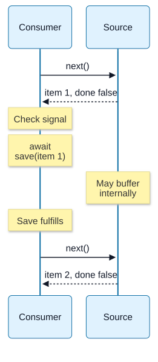

# Chapter 10 — Iteration, Streams and Event Abstractions

**Domain:** D02 — JavaScript & TypeScript  
**Status:** approved_by_learner  
**Learning assessment:** deferred until explicitly started  
**Examples:** educational; not independently executed

## Goals and prerequisite knowledge

Builds on Chapters 05, 08 and 09: iteration protocols, Promises, composition and cancellation. Explain synchronous and asynchronous producers, iterable consumption, generators, event subscription, backpressure, lifecycle cleanup and failures. This is the language-level abstraction lesson; Node.js Readable/Writable streams, EventEmitter behavior and platform details are reserved for D03.

## 1. Push versus pull

A **pull** consumer asks for the next item; an event **push** producer notifies subscribers as data becomes available. Neither is inherently superior. Pull can make demand explicit, while push may require buffering, dropping, blocking or backpressure when consumers cannot keep up.

A product contract should state whether each item must be received, whether dropping is acceptable, which order is guaranteed and what happens when a consumer exits. Do not infer lossless delivery from a callback interface.

## 2. Iterator and iterable protocols

An iterator has a next method producing an iteration result: { value, done }. An iterable implements Symbol.iterator to supply an iterator.

~~~js
const sequence = {
  *[Symbol.iterator]() {
    yield "a";
    yield "b";
  }
};
for (const item of sequence) console.log(item);
~~~

A generator's execution pauses at yield and resumes on next. Generator creation itself does not materialize all values. Iteration is not necessarily repeatable: some iterables return a fresh iterator while others are consumable only once.

## 3. Generator return and throw

Generators can receive input through next(value), process throw(error) and perform cleanup on return(value), subject to their state. The first next argument to a not-yet-started generator does not become an earlier yield expression result.

~~~js
function* values() {
  try {
    yield 1;
    yield 2;
  } finally {
    console.log("closed");
  }
}
const iterator = values();
iterator.next();   // { value: 1, done: false }
iterator.return(); // triggers finally
~~~

Cleanup is important for external resources, but do not confuse a generator finally block with guaranteed external transaction rollback.

## 4. AsyncIterator and async generators

An asynchronous iterable supplies Symbol.asyncIterator and an iterator whose next returns a Promise-like result. for-await-of waits for the next value and can process async generators one item at a time.

~~~js
async function* pages(fetchPage) {
  let number = 0;
  while (true) {
    const page = await fetchPage(number++);
    if (page.done) return;
    yield page.items;
  }
}
async function countItems(fetchPage) {
  let count = 0;
  for await (const items of pages(fetchPage)) count += items.length;
  return count;
}
~~~

The termination condition is an illustrative API contract, not a universal pagination rule. Async iteration does not guarantee a bounded amount of memory if pages are huge or the consumer accumulates every page.

## 5. Early termination and cleanup

Breaking out of for-of or for-await-of invokes iterator close behavior when appropriate, including its return method. For async iteration, cleanup may be awaited. A custom consumer or a broken iterator may not provide equivalent guarantees.

~~~js
async function takeFirst(source) {
  for await (const item of source) {
    return item;
  }
  return undefined;
}
~~~

Returning out of the loop initiates iterator closing. Resource ownership should still be explicit, especially when processing errors compete with cleanup failures.

## 6. Streams and backpressure as concepts

A stream communicates a sequence of chunks over time. Backpressure is a mechanism or agreement that prevents producers from outrunning consumers indefinitely. Important product choices: maximum in-flight data, pacing, pause/resume, cancellation, errors, completion and handling partial output.

Do not assume all streams use identical protocols. Web Streams, Node.js streams, async iterables and custom event APIs have different mechanics. Specific ReadableStream, writable queues, highWaterMark, pipeline and Node stream lifecycle APIs belong to the runtime-focused D03 lesson.

## 7. Consumer-driven pacing

A for-await consumer can process one item and await its operation before asking for the next:

~~~js
async function processAll(source, save, signal) {
  for await (const item of source) {
    signal.throwIfAborted();
    await save(item);
  }
}
~~~

This bounds the **number of saves started by this loop** to one at a time, but does not prove the source buffers nothing internally or that each item is small. If save succeeds remotely and the response is lost, an exception does not prove the remote effect failed.

**Visual question: What does this loop bound, and what can the source still buffer?**

**Awaiting each save delays the next pull.** This traces the successful path of processAll. Only one save started by this loop is active at a time; the source can have its own buffers and items can be large. On an in-loop throw or early return, the applicable iterator-close protocol looks for return() and awaits async closing. Neither pacing nor closing proves remote rollback or a total memory bound. [Mechanism reference](https://developer.mozilla.org/en-US/docs/Web/JavaScript/Reference/Statements/for-await...of).

[Full-size SVG](../assets/10-iteration-streams-and-event-abstractions/paced-consumer.svg) · [Editable Mermaid source](../assets/10-iteration-streams-and-event-abstractions/paced-consumer.mmd)

## 8. Event subscriptions and lifetimes

An event-style API registers a callback and may deliver multiple observations. Consumers need an unsubscribe strategy, especially for long-lived services.

~~~js
function watch(source, onData) {
  const unsubscribe = source.subscribe(onData);
  return () => unsubscribe();
}
~~~

The example assumes subscribe returns an unsubscribe function; actual APIs differ. A callback may be invoked while its owner is no longer logically interested unless the subscription lifecycle is managed. Removing a listener does not necessarily undo queued events.

## 9. Bridging events to asynchronous iteration

An event-to-iterator adapter must define buffering, ordering, overflow policy, completion, errors and cancellation. A naive unbounded array of queued events can become a memory leak. A bounded buffer alone isn't sufficient without specifying what happens when full: pause the producer, reject/stop, drop oldest/newest, or report data loss.

A pull-based consumer observing a push source requires an explicit policy on gaps. Avoid presenting an adaptation as reliable just because it implements Symbol.asyncIterator.

## 10. Error and completion channels

An iterator's done result communicates normal completion; an exception or rejected next communicates failure. Events may use a distinct error channel, an error callback, or none. When translating between abstractions, preserve the distinction among normal end, failure, cancellation request, effective cancellation and unresolved outcome.

For external output, a successful local iteration does not automatically guarantee durable remote storage. Define which condition counts as completion.

## 11. TypeScript protocols

~~~ts
async function total(source: AsyncIterable<number>): Promise<number> {
  let sum = 0;
  for await (const item of source) {
    if (!Number.isFinite(item)) throw new Error("nonfinite item");
    sum += item;
  }
  return sum;
}
~~~

TypeScript's AsyncIterable<number> describes a static contract and does not validate arbitrary runtime input. Rejections and cleanup failure types are not represented by the generic parameter.

## 12. Backend case study: large file import

An operator submits a large set of records. The product must show progress, accepted/rejected counts, partial failures, cancellation and recoverable output. A design that accumulates every record before processing can violate memory expectations. A paced consumer may reduce peak working data, but throughput, chunk boundaries, input integrity and partial failure behavior still require specification. This connects to D01 P04 without mandating a file API or framework.

## 13. Pitfalls

- Treating all event interfaces as lossless queues.
- Assuming generators automatically guarantee bounded resource usage.
- Leaving listeners active after a request ends.
- Not calling or awaiting iterator cleanup.
- Using unlimited event buffering to bridge push to pull.
- Treating an upstream done state as durable downstream success.
- Equating cancellation of observation with cancellation of remote effects.
- Assuming TypeScript iterable types validate received item values.
- Ignoring producer failure or cleanup rejection.

## 14. Future-study exercises with guidance

1. Compare push and pull when the producer is faster than the consumer. (Explicit pacing versus overflow policy.)
2. Explain when generator finally executes after break. (Iterator closing through return when applicable.)
3. Explain why a for-await loop is not automatically memory-bounded. (Internal buffers, large items and accumulation.)
4. Define the outcomes of bounded event buffering. (Pause, reject, drop or notify.)
5. Design a subscription cleanup contract. (Unsubscribe at defined lifetime; state delivery guarantees.)
6. Distinguish normal iteration completion and failure. (done versus throw/reject.)
7. Explain why an AsyncIterable<number> cannot validate remote JSON. (Types erased.)
8. Explain how response loss affects a record saved during iteration. (Unknown authoritative outcome.)

All exercises are deferred until the learner begins studying.

## 15. References and version notes

- [ECMAScript — Iteration](https://tc39.es/ecma262/#sec-iteration)
- [MDN — Iteration protocols](https://developer.mozilla.org/en-US/docs/Web/JavaScript/Reference/Iteration_protocols)
- [MDN — for await...of](https://developer.mozilla.org/en-US/docs/Web/JavaScript/Reference/Statements/for-await...of)
- [MDN — async function*](https://developer.mozilla.org/en-US/docs/Web/JavaScript/Reference/Statements/async_function*)
- [MDN — Streams API](https://developer.mozilla.org/en-US/docs/Web/API/Streams_API) (host example; not universal language semantics)
- [TypeScript — Iterators and Generators](https://www.typescriptlang.org/docs/handbook/iterators-and-generators.html)

Host stream implementations and Node EventEmitter behaviors are taught in D03. No sample execution independently verified.

## 16. Editorial gate

**Covered:** sync/async iterators, generators, return/cleanup, push/pull, stream and backpressure concepts, events/subscriptions, event-to-iterator adaptation, errors/completion, TypeScript and backend examples.

**Pending:** learner editorial approval. Projects, PRDs and implementation not started.
