# Chapter 12 — Unions, Narrowing and Domain Modeling

**Domain:** D02 — JavaScript & TypeScript  
**Status:** approved_by_learner  
**Learning assessments:** deferred until learner starts studying  
**Examples:** educational; not independently executed

## Goals and prerequisites

Requires Chapter 11 (types, structural compatibility, unknown, never), plus runtime object, function and error fundamentals. This chapter develops safe narrowing, discriminated unions, exhaustive state handling, nullable data contracts, modeling legal transitions, and practical domain boundary patterns. The emphasis is on making invalid states harder to represent *statically* while acknowledging that runtime checks and business authorization remain necessary.

## 1. A union is a set of alternatives

A union describes a value that may satisfy one of several types. Only operations safe for every alternative are initially available.

~~~ts
function label(value: string | number): string {
  return typeof value === "string" ? value.trim() : String(value);
}
~~~

A union is not necessarily a tagged runtime object and cannot automatically tell the program which alternative arrived over HTTP. Narrowing establishes evidence in control flow for selecting operations safely.

## 2. Built-in narrowing mechanisms

TypeScript analyzes checks such as typeof, equality against literal values, null checks, instanceof and property checks. Each has its limitations.

~~~ts
function normalize(value: string | null | undefined) {
  if (value == null) return "missing"; // checks null AND undefined
  return value.trim();
}

function describe(value: Date | string): string {
  return value instanceof Date ? value.toISOString() : value;
}
~~~

The `value == null` check is an intentional, narrow use of loose equality. A Date instance can still hold an invalid date; instanceof does not validate its semantic range. The `in` operator may narrow based on property existence but doesn't guarantee a property's runtime value type.

## 3. Truthiness is not a precise validation rule

~~~ts
function printLength(text: string | null) {
  if (!text) return; // excludes null AND empty string
  console.log(text.length);
}
~~~

Truthiness can accidentally eliminate valid empty strings, zero amounts or false flags. Use explicit predicates when absence, empty and zero have different business meanings.

## 4. Discriminated unions

Give each alternative a common literal-valued discriminator and type-specific fields. The checker can then narrow reliably.

~~~ts
type Booking =
  | { status: "pending"; requestedAt: string }
  | { status: "confirmed"; specialistId: string; startsAt: string }
  | { status: "cancelled"; reason: string };

function summarize(booking: Booking): string {
  switch (booking.status) {
    case "pending": return "Awaiting confirmation";
    case "confirmed": return booking.specialistId;
    case "cancelled": return booking.reason;
  }
}
~~~

This avoids allowing a pending record to carry a confirmed-only field through the typed API. It does **not** ensure that persisted data, JSON or unsafe casts actually obey the declared union.

**Visual question: What type remains after each returning status branch?**

**Branches narrow the checker’s view of Booking.** This equivalent decision view of summarize shows control-flow analysis over an already typed Booking; it is not a lifecycle transition graph. The JavaScript status comparisons still run, while TypeScript uses them to narrow fields statically. Each return removes that path from later control flow. A new variant requires revisiting handling; never-based exhaustive checking is shown below. Unknown JSON still needs parsing. [Mechanism reference](https://www.typescriptlang.org/docs/handbook/2/narrowing.html).

[Full-size SVG](../assets/12-unions-narrowing-and-domain-modeling/control-flow-narrowing.svg) · [Editable Mermaid source](../assets/12-unions-narrowing-and-domain-modeling/control-flow-narrowing.mmd)

## 5. Exhaustiveness and never

~~~ts
function assertNever(value: never): never {
  throw new Error("Unexpected variant");
}

function statusText(value: Booking): string {
  switch (value.status) {
    case "pending": return "Pending";
    case "confirmed": return "Confirmed";
    case "cancelled": return "Cancelled";
    default: return assertNever(value);
  }
}
~~~

Adding a new Booking variant causes a compile-time error at the default branch under appropriate checker conditions. At runtime, the fallback still detects malformed or unrecognized data. Exhaustiveness protects an internal typed model, not arbitrary external input.

## 6. Optional fields versus explicit state variants

An overly broad type can admit contradictory combinations:

~~~ts
type LooseBooking = {
  status: "pending" | "confirmed";
  specialistId?: string;
  startsAt?: string;
};
~~~

It permits a confirmed booking without an assigned specialist. A discriminated union expresses stronger state-dependent requirements. However, not every small record deserves an elaborate union; the choice should reflect material invariants and maintenance complexity.

## 7. Domain transitions as typed commands

A state union can be combined with commands and runtime guards to make business transitions explicit.

~~~ts
type Pending = Extract<Booking, { status: "pending" }>;
type Confirmed = Extract<Booking, { status: "confirmed" }>;

function confirm(
  pending: Pending,
  specialistId: string,
  startsAt: string
): Confirmed {
  if (!specialistId || !startsAt) throw new Error("required fields");
  return { status: "confirmed", specialistId, startsAt };
}
~~~

This example illustrates an output shape, not full booking correctness: a real product must validate slot authority, identity, concurrency, timezone and policy at operation boundaries. Type narrowing alone cannot enforce those conditions, and the pending input is not proof of up-to-date state.

## 8. Unknown at the external boundary

~~~ts
type PaymentResult =
  | { kind: "success"; receiptId: string }
  | { kind: "rejected"; code: string };

function parsePaymentResult(input: unknown): PaymentResult {
  if (typeof input !== "object" || input === null || Array.isArray(input)) {
    throw new TypeError("Expected object");
  }
  const record = input as Record<string, unknown>;
  if (record.kind === "success" && typeof record.receiptId === "string") {
    return { kind: "success", receiptId: record.receiptId };
  }
  if (record.kind === "rejected" && typeof record.code === "string") {
    return { kind: "rejected", code: record.code };
  }
  throw new TypeError("Unknown result");
}
~~~

Parse data into a trusted internal model rather than asserting unknown input as PaymentResult. Whether extra fields are permitted, IDs are normalized or error codes are enumerated should be determined by the product contract.

## 9. User-defined type guards and assertion functions

~~~ts
function isString(value: unknown): value is string {
  return typeof value === "string";
}
function assertString(value: unknown): asserts value is string {
  if (typeof value !== "string") throw new TypeError("Expected string");
}
~~~

A user-defined predicate is a *promise made by its implementation to the checker*. An incorrect predicate can fabricate false confidence. Test predicates against invalid, missing, nested and adversarial inputs. Assertions also do not make mutable data stay valid after some other actor mutates it.

## 10. Aliases, mutation and narrowing invalidation

Control-flow narrowing is based on source-level reasoning; the external world may change a shared object between validation and use. Closures and aliases can mutate referenced properties. Avoid using one initial shallow check to justify every later use of mutable external records. Parse into an owned shape, apply invariants close to operation boundaries, and take snapshots where product semantics demand them.

~~~ts
type Config = { mode: "fast" | "safe" };
function run(config: Config): string {
  const mode = config.mode;
  return mode === "fast" ? "F" : "S";
}
~~~

Here copying a primitive mode creates a stable local snapshot, but this does not magically make a cross-request business operation atomic.

## 11. Intersections and composition of constraints

An intersection `A & B` describes values satisfying both shapes; unlike a union it combines requirements.

~~~ts
type Audited = { createdAt: string };
type Identified = { id: string };
type RecordView = Audited & Identified;
~~~

Conflicting constraints can collapse a field to never or make the type impossible to populate. Excessively complex intersections can obscure contracts. Avoid using types as a substitute for actual domain specification.

## 12. Branded identifiers and identity distinctions

~~~ts
declare const customerIdBrand: unique symbol;
type CustomerId = string & { readonly [customerIdBrand]: true };

function parseCustomerId(raw: unknown): CustomerId {
  if (typeof raw !== "string" || !/^c_[a-z0-9]+$/.test(raw)) {
    throw new TypeError("Invalid customer ID");
  }
  return raw as CustomerId;
}
~~~

A brand can discourage mixing customer and specialist identifiers inside checked TypeScript code. It is erased at runtime; assertions can bypass it. The parser and authorization boundary provide the real protection.

## 13. Backend case study: asynchronous job outcome

~~~ts
type JobOutcome<T> =
  | { kind: "pending"; attemptId: string }
  | { kind: "succeeded"; value: T }
  | { kind: "rejected"; reason: string }
  | { kind: "uncertain"; attemptId: string };

function userMessage<T>(outcome: JobOutcome<T>): string {
  switch (outcome.kind) {
    case "pending": return "In progress";
    case "succeeded": return "Completed";
    case "rejected": return "Not accepted";
    case "uncertain": return "Checking authoritative result";
    default: return assertNever(outcome);
  }
}
~~~

Distinguish *pending* from *uncertain*: one can describe ongoing work while the other describes loss of authoritative knowledge. These semantics must be settled at product scope. The generic value `T` and discriminant do not imply actual network correctness or durable storage.

## 14. Common mistakes

- Treating a union as runtime data validation.
- Using truthiness to decide whether zero, false or empty values are absent.
- Modeling dependent state with unrelated optional fields.
- Casting unknown JSON to a trusted discriminated union.
- Assuming a user-defined type predicate is verified by the compiler.
- Treating a branded ID as authorization or cryptographic integrity.
- Assuming exhaustive switching proves an actual remote response cannot contain an unfamiliar status.
- Ignoring shared mutation and stale data after narrowing.
- Overdesigning domain unions without meaningful invariants.

## 15. Future-study exercises with answer guide

1. Explain why `value == null` deliberately accepts two nullish types. (Null and undefined.)
2. Contrast truthiness narrowing with explicit null checks for an empty string. (Truthiness excludes legitimate empty values.)
3. Rewrite LooseBooking as a discriminated union. (Status-dependent required fields.)
4. Add a fourth Booking variant and identify how assertNever surfaces missing handling. (Compile-time never mismatch.)
5. Explain why an incorrect isString predicate can be dangerous. (The checker trusts its declared guard.)
6. Compare `string & brand` to runtime ID validation. (Compile-time distinction versus real parsing.)
7. Explain why a confirmed typed booking still needs operation-boundary validation. (Staleness, ownership and external effects.)
8. Distinguish pending and uncertain job states. (Progress known versus outcome knowledge missing.)

Exercises are reference material for the future study phase, not active testing.

## 16. References and review gate

- [TypeScript Handbook — Narrowing](https://www.typescriptlang.org/docs/handbook/2/narrowing.html)
- [TypeScript Handbook — Everyday Types](https://www.typescriptlang.org/docs/handbook/2/everyday-types.html)
- [TypeScript Handbook — Creating Types from Types](https://www.typescriptlang.org/docs/handbook/2/types-from-types.html)
- [TypeScript Handbook — Utility Types](https://www.typescriptlang.org/docs/handbook/utility-types.html)
- [TypeScript TSConfig — strictNullChecks](https://www.typescriptlang.org/tsconfig/strictNullChecks.html)

**Covered:** union semantics, narrowing, discriminated state, exhaustiveness, intersections, guards, brands, runtime parsing, mutation hazards and backend domain examples.

**Pending:** learner editorial approval and independent execution verification. Project catalog, PRDs and implementations not started.
