# Chapter 13 — Generics, Constraints and Advanced Types

**Domain:** D02 — JavaScript & TypeScript  
**Status:** approved_by_learner  
**Assessments:** deferred until explicit learning phase  
**Examples:** educational; not independently executed

## Outcomes and prerequisites

Requires Chapter 11 (type fundamentals), Chapter 12 (narrowing/domain models), and earlier JavaScript chapters. Explain generic relationships, constraints, inference, indexed access, mapped and conditional types, distributivity, utility types, template-literal types, overloads and safe API modeling. Recognize how excessive type-level complexity can obscure the actual runtime contract.

## 1. Generics express relationships, not just flexibility

A generic type parameter preserves connections among argument types and return types.

~~~ts
function identity<T>(value: T): T {
  return value;
}
const text = identity("ready"); // inferred string literal or widened type by context

function first<T>(items: readonly T[]): T | undefined {
  return items[0];
}
~~~

Compare with `any` (loses checking) and `unknown` (does not preserve the exact relationship). Generic inference depends on call context and signatures; a generic does not create runtime validation.

## 2. Multiple type parameters and constraints

~~~ts
function pair<K, V>(key: K, value: V): [K, V] {
  return [key, value];
}

function getId<T extends { id: string }>(item: T): string {
  return item.id;
}
~~~

An `extends` constraint restricts admissible static shapes; it doesn't inspect untrusted objects at runtime. Minimize type parameters that appear only once without preserving a useful relation.

## 3. keyof and indexed access

~~~ts
function getProperty<T extends object, K extends keyof T>(
  obj: T,
  key: K
): T[K] {
  return obj[key];
}
const entry = { id: "a", active: true };
const isActive = getProperty(entry, "active"); // boolean
~~~

`keyof` describes available property keys statically, and `T[K]` links the selected key to its value. It does not stop prototype getters or object mutation from affecting runtime behavior.

**Visual question: How does K connect a permitted property name to T[K]?**

![For entry with string id and boolean active, keyof T is id or active. Choosing active makes K active and T[K] boolean; runtime execution is ordinary obj[key].](../assets/13-generics-constraints-and-advanced-types/generic-key-value-relation.svg)

**The chosen key determines the returned type.** The solid arrows are type relationships for getProperty(entry, "active"), not runtime stages. K extends keyof T rejects an unknown key in checked calls and links the result to the selected property type. It does not inject runtime guards, prevent getters, or ensure an external object still matches T. [Mechanism reference](https://www.typescriptlang.org/docs/handbook/2/generics.html).

[Full-size SVG](../assets/13-generics-constraints-and-advanced-types/generic-key-value-relation.svg) · [Editable Mermaid source](../assets/13-generics-constraints-and-advanced-types/generic-key-value-relation.mmd)

## 4. Generic interfaces and reusable result contracts

~~~ts
type Result<T, E> =
  | { ok: true; value: T }
  | { ok: false; error: E };

function success<T>(value: T): Result<T, never> {
  return { ok: true, value };
}
~~~

Generic results can model expected business outcomes, but runtime exceptions can still happen. Avoid declaring every possible thrown exception as if a generic union were an exhaustive runtime guarantee.

## 5. Conditional types

~~~ts
type ElementOf<T> = T extends readonly (infer U)[] ? U : never;
type A = ElementOf<string[]>; // string
type B = ElementOf<number>;   // never
~~~

Conditional types select types depending on a relationship. `infer` extracts type information within a conditional branch. These operations run in the *type system*, not at runtime.

## 6. Distributive conditionals

A conditional involving a naked type parameter often distributes across unions.

~~~ts
type Wrap<T> = T extends unknown ? { value: T } : never;
type Distributed = Wrap<string | number>;
// { value: string } | { value: number }

type WrapTogether<T> = [T] extends [unknown] ? { value: T } : never;
type NotDistributed = WrapTogether<string | number>;
// { value: string | number }
~~~

Tuple wrapping controls distributivity. This distinction is particularly important when designing utilities over discriminated unions.

**Visual question: Why do Wrap and WrapTogether produce different object alternatives?**

**Distribution changes where the union appears.** These are two alternative type calculations from the same input union, arranged vertically. A naked type parameter in this conditional distributes; wrapping the checked parameter in a tuple suppresses that distribution. The output types retain different relationships even where accepted simple values overlap. This computes types only: it creates no objects and performs no runtime branching. [Mechanism reference](https://www.typescriptlang.org/docs/handbook/2/conditional-types.html).

[Full-size SVG](../assets/13-generics-constraints-and-advanced-types/conditional-distribution.svg) · [Editable Mermaid source](../assets/13-generics-constraints-and-advanced-types/conditional-distribution.mmd)

## 7. Mapped types and modifiers

~~~ts
type Optional<T> = { [K in keyof T]?: T[K] };
type ImmutableTopLevel<T> = { readonly [K in keyof T]: T[K] };
type Mutable<T> = { -readonly [K in keyof T]: T[K] };
~~~

Mapped types transform property declarations without altering runtime objects. Optional and readonly modifiers have nuanced behavior under compiler settings and do not deeply validate or freeze data.

## 8. Key remapping and template literal types

~~~ts
type GetterNames<T> = {
  [K in keyof T as K extends string ? `get${Capitalize<K>}` : never]: () => T[K]
};
type Fields = { id: string; active: boolean };
type Getters = GetterNames<Fields>;
// { getId: () => string; getActive: () => boolean }
~~~

Template literal types produce sets of strings at compile time, useful for structured event names or prefixed identifiers. Avoid enormous unions or fragile string conventions that are harder to maintain than straightforward declarations.

## 9. Built-in utility types

Important utilities include `Partial<T>`, `Required<T>`, `Readonly<T>`, `Pick<T,K>`, `Omit<T,K>`, `Record<K,V>`, `Exclude<T,U>`, `Extract<T,U>`, `NonNullable<T>`, `ReturnType<F>`, `Parameters<F>` and `Awaited<T>`.

~~~ts
type User = { id: string; label: string; active: boolean };
type UserPreview = Pick<User, "id" | "label">;
type UserPatch = Partial<Pick<User, "label" | "active">>;
~~~

A `Partial` patch type permits omission statically; it does not decide whether `undefined` means “unchanged” or “clear field.” Define those semantics at product scope.

## 10. Function overloads versus unions

Overloads can document relationships when return types depend on distinct call signatures:

~~~ts
function normalize(value: string): string;
function normalize(value: string[]): string[];
function normalize(value: string | string[]): string | string[] {
  return typeof value === "string"
    ? value.trim()
    : value.map(x => x.trim());
}
~~~

The implementation must handle the actual runtime input. Overloads are not separate JavaScript implementations, and their declared call signatures must accurately reflect accepted behavior. Prefer a union signature when it is clearer and preserves adequate type information.

## 11. Variance and callback soundness

Type compatibility depends on where a type parameter occurs: returned outputs, accepted inputs or both. In function parameters, substituting a handler for a more general handler can be unsafe; strict function checking mitigates many cases, with method-specific nuances.

~~~ts
type Handler<T> = (value: T) => void;
type Animal = { name: string };
type Dog = Animal & { bark(): void };
const dogHandler: Handler<Dog> = dog => dog.bark();
// Do not pass this where any Animal might be supplied.
~~~

Variance behavior varies by declaration and compiler setting. Avoid promising complete soundness from TypeScript's structural checker.

## 12. Backend contracts: typed transport does not validate payloads

~~~ts
type Page<T> = { items: T[]; nextCursor: string | null };
type Service = { id: string; name: string };

function parseService(value: unknown): Service {
  if (typeof value !== "object" || value === null || Array.isArray(value)) {
    throw new TypeError("service must be a record");
  }
  const record = value as Record<string, unknown>;
  if (typeof record.id !== "string" || typeof record.name !== "string") {
    throw new TypeError("service fields invalid");
  }
  return { id: record.id, name: record.name };
}
~~~

A `Page<Service>` type conveys a relationship inside trusted code. An API response typed with `as Page<Service>` may still be malformed at runtime; parse the envelope and each item at a boundary.

## 13. Limits and maintainability

Advanced type machinery can increase checker cost, degrade error messages and make onboarding harder. Choose simple type aliases and discriminated unions before recursive conditional types when both express the contract. Measure type-checker performance for deeply nested generic patterns. Separate compile-time guarantees, runtime validation, authorization, transaction consistency and durable effects.

## 14. Common mistakes

- Replacing meaningful generics with any.
- Adding generic parameters that do not describe a relationship.
- Mistaking extends constraints for runtime guards.
- Forgetting conditional distribution over unions.
- Assuming Partial implies a universally defined PATCH policy.
- Treating mapped readonly as deep runtime immutability.
- Believing overload signatures automatically constrain runtime callers.
- Assuming complex types can represent all side effects or thrown failures.
- Creating sophisticated type gymnastics where a direct model is clearer.

## 15. Future-study exercises and answer guide

1. Explain why `getProperty` links returned type to the key. (K indexes T.)
2. Compare unknown, any and a generic for identity. (Only generic preserves relationships.)
3. Predict distributive and non-distributive Wrap types. (Variants versus combined union.)
4. Model an optional update payload, and distinguish omission from clearing. (Requires explicit policy.)
5. Explain why a mapped readonly type doesn't freeze objects. (Erased static checks.)
6. Choose between overload and union signatures for two parsing modes. (Clarity and caller relationships.)
7. Explain why `Page<Service>` doesn't validate JSON. (No runtime effect.)
8. Identify the callback soundness problem with Handler<Dog> where Handler<Animal> is required. (Might receive an Animal without bark.)

Exercises remain deferred; they are not current learner assessments.

## 16. References and editorial gate

- [TypeScript Handbook — Generics](https://www.typescriptlang.org/docs/handbook/2/generics.html)
- [TypeScript Handbook — Conditional Types](https://www.typescriptlang.org/docs/handbook/2/conditional-types.html)
- [TypeScript Handbook — Mapped Types](https://www.typescriptlang.org/docs/handbook/2/mapped-types.html)
- [TypeScript Handbook — Template Literal Types](https://www.typescriptlang.org/docs/handbook/2/template-literal-types.html)
- [TypeScript Handbook — Utility Types](https://www.typescriptlang.org/docs/handbook/utility-types.html)
- [TypeScript Handbook — More on Functions](https://www.typescriptlang.org/docs/handbook/2/functions.html)

**Covered:** generic inference, constraints, indexed access, conditional types and infer, distributivity, mapped types, key remapping, utilities, overloads, variance, runtime boundary and trade-offs.

**Pending:** learner editorial approval; example execution verification. Learning assessments and projects remain separate.
