# Chapter 15 — Runtime Validation and Boundary Safety

**Domain:** D02 — JavaScript & TypeScript  
**Status:** approved_by_learner  
**Learning assessments:** deferred until the learner starts studying  
**Examples:** educational and not independently executed

## Learning outcomes and prerequisites

Requires D02 Chapters 01, 04, 07 and 11–14: JavaScript values, objects, errors, TypeScript types and narrowing. Learners should eventually be able to distinguish compile-time types from runtime trust, parse unknown input, define precise boundary policies, model validation failures, and prevent silent coercion, unsafe assertions and data-shape mismatches.

## 1. Type safety stops at runtime boundaries

TypeScript erases most types when producing JavaScript. A function parameter typed as a domain object does not prove that an HTTP body, file, environment variable, external API response or message actually matches it.

~~~ts
type Customer = { id: string; age: number };
function display(c: Customer) { return c.id; }
// JSON.parse() can produce any runtime shape, regardless of assertions.
~~~

Treat external values as unknown and establish trust through validation. Even internally typed values may become stale or mutable; trusted shape is not equivalent to authorization or current business-state validity.

## 2. Parse rather than assert

A type assertion does not perform a conversion or check:

~~~ts
const claimed = JSON.parse('{"age":"not-a-number"}') as { age: number };
// Claimed type differs from actual runtime value.
~~~

A parser verifies incoming data and returns a new shape whose properties satisfy the intended contract.

~~~ts
type CustomerInput = { name: string; age: number };

function parseCustomerInput(value: unknown): CustomerInput {
  if (typeof value !== "object" || value === null || Array.isArray(value)) {
    throw new TypeError("Expected record");
  }
  const record = value as Record<string, unknown>;
  if (typeof record.name !== "string" || record.name.trim() === "") {
    throw new TypeError("Invalid name");
  }
  if (typeof record.age !== "number" || !Number.isSafeInteger(record.age) ||
      record.age < 0 || record.age > 130) {
    throw new RangeError("Invalid age");
  }
  return { name: record.name.trim(), age: record.age };
}
~~~

The age interval is an illustrative product rule, not universal truth. This implementation does not inspect extra fields or hostile getters/proxies, which may require additional defensive handling at specific boundaries.

**Visual question: What must pass before parseCustomerInput constructs its result?**

**Only executed checks establish this parser’s input contract.** This is the parser above, for ordinary data records. The name check requires a nonblank string; the age check requires a safe integer from 0 to 130. Invalid name throws first, then invalid age. The result copies the checked primitive fields and leaves extra input fields out. The illustrative age policy is not universal; the parser does not check authorization, current state, hostile accessors or proxies. A type assertion alone follows none of these branches. [Mechanism reference](https://www.typescriptlang.org/docs/handbook/2/everyday-types.html#type-assertions).

[Full-size SVG](../assets/15-runtime-validation-and-boundary-safety/runtime-parser-boundary.svg) · [Editable Mermaid source](../assets/15-runtime-validation-and-boundary-safety/runtime-parser-boundary.mmd)

## 3. Separate syntax, representation and business rules

For every field, define acceptable input syntax, canonical representation and domain limits. A numeric string, a number and a blank string are different values. Number("") becoming zero does not justify accepting a blank quantity. Define whether trimming and digit normalization are permitted.

~~~ts
function parseCount(value: unknown): number {
  if (typeof value !== "string" || !/^[1-9][0-9]*$/.test(value)) {
    throw new TypeError("Expected positive decimal text");
  }
  const number = Number(value);
  if (!Number.isSafeInteger(number) || number > 1000) {
    throw new RangeError("Count outside range");
  }
  return number;
}
~~~

Parse first, validate limits second; never silently accept a partial numeric string. Arithmetic precision and money units require distinct representation policies.

## 4. Missing, undefined, null and explicit updates

A record may omit a property, contain a property whose value is undefined, or explicitly supply null. These cases can have different semantics in PATCH commands.

~~~ts
function hasOwnKey(record: Record<string, unknown>, key: string): boolean {
  return Object.hasOwn(record, key);
}
~~~

JSON does not represent undefined as an ordinary property value. A product's update contract must say whether absence means leave unchanged, null means clear, and false/zero/empty string are valid replacement values. Do not substitute a blanket truthiness check.

## 5. Nested data and collection validation

Checking that a value is an array does not prove its members match the expected schema.

~~~ts
type Item = { sku: string; quantity: number };

function parseItems(raw: unknown): Item[] {
  if (!Array.isArray(raw)) throw new TypeError("items must be array");
  if (raw.length > 100) throw new RangeError("too many items");
  return raw.map((item): Item => {
    if (typeof item !== "object" || item === null || Array.isArray(item)) {
      throw new TypeError("item must be record");
    }
    const record = item as Record<string, unknown>;
    if (typeof record.sku !== "string" ||
        !/^[A-Z0-9_-]+$/.test(record.sku) ||
        typeof record.quantity !== "number" ||
        !Number.isSafeInteger(record.quantity) ||
        record.quantity <= 0) {
      throw new TypeError("invalid item");
    }
    return { sku: record.sku, quantity: record.quantity };
  });
}
~~~

Caps on number of items and sizes reduce accidental resource exhaustion. The exact bounds must come from product and operational requirements; real systems also need body-size controls outside this parser.

## 6. Unknown field policies and canonicalization

Choose whether to reject unexpected properties, ignore them, or preserve a documented extension space. Returning a newly constructed validated record can avoid accidentally propagating untrusted extra fields. But if extra fields signal a client mismatch, silent stripping can conceal errors. Canonicalization should be specified and idempotent where possible, including Unicode normalization and locale-sensitive data handling where relevant.

## 7. Discriminated messages and versions

~~~ts
type Event =
  | { kind: "created"; id: string }
  | { kind: "cancelled"; id: string; reason: string };

function parseEvent(value: unknown): Event {
  if (typeof value !== "object" || value === null || Array.isArray(value)) {
    throw new TypeError("not an event");
  }
  const x = value as Record<string, unknown>;
  if (typeof x.id !== "string") throw new TypeError("invalid id");
  if (x.kind === "created") return { kind: "created", id: x.id };
  if (x.kind === "cancelled" && typeof x.reason === "string") {
    return { kind: "cancelled", id: x.id, reason: x.reason };
  }
  throw new TypeError("unknown event variant");
}
~~~

Unrecognized discriminants may represent malformed input or a newer protocol version. The compatibility policy should be explicit. Once parsed, exhaustive switch handling is valuable, but the union itself does not validate raw network data.

## 8. Schemas and validation libraries: concepts, not tool selection

A schema system can express allowed shapes, coercions, refinements, error paths and inferred static types. Code-first and schema-first approaches involve trade-offs in portability, duplication, runtime cost and compatibility. This handbook does not select a specific library. Keep domain policies visible rather than burying decisions in library defaults.

## 9. Authentication, authorization and trust

Validation answers “is the input structurally and semantically admissible?” Authentication establishes a claimed identity; authorization decides whether that identity can perform the operation on the current resource. Well-formed input can still request an unauthorized action. Neither TypeScript nor schema validation provides authorization, transaction isolation or replay safety automatically.

## 10. Error messages without information disclosure

Return stable field/path and reason codes suitable for legitimate clients without exposing server stack traces, secret values or internal data. Errors should support correction while resisting accidental leakage. Logs may need redaction. Avoid echoing entire invalid payloads, especially when they can contain credentials or personal information.

~~~ts
type ValidationIssue = {
  path: readonly (string | number)[];
  code: "required" | "invalid_type" | "invalid_format" | "out_of_range";
};
type ParseResult<T> =
  | { ok: true; value: T }
  | { ok: false; issues: ValidationIssue[] };
~~~

Typed issue structures can make responses predictable, but the parser must implement actual checks.

## 11. Asynchronous boundaries and TOCTOU

A value validated before awaiting remote work can become stale. Validation at input boundaries is necessary but often insufficient; ownership, availability and mutable domain state need checks at the authoritative operation boundary.

For example, a valid-looking slot selection may no longer be available when booking is confirmed. A schema check cannot make confirmation atomic. Product-level invariants and implementation-specific concurrency controls are separate concerns.

## 12. Dates, IDs and precise numeric data

Avoid pretending that string types guarantee valid dates or identifiers. A date string can have an appropriate pattern yet denote an impossible date. Currency, integer identifiers and large quantities may exceed binary64 precision. Specify formats, units, timezone semantics, allowed ranges and canonical storage/transport representation. Use suitable parsers and domain checks; do not assume Date.parse accepts one universal business format.

## 13. Defensive input lifecycle

Define the trusted boundary, apply safe transport size limits, parse unknown input, validate structure and semantic rules, construct a canonical internal representation, authorize the requested action, and revalidate volatile facts before irreversible effects. Normalize only according to a documented contract; don't silently convert errors into accepted data.

## 14. Frequent errors

- Believing an `as Type` assertion validates JSON.
- Allowing implicit numeric coercion without defining accepted syntax.
- Validating array membership only at the container level.
- Using truthiness for optional zero/false/empty values.
- Confusing field validation with authorization or current resource availability.
- Trusting a client-generated role or price because it has the correct type.
- Echoing sensitive payloads in validation errors.
- Ignoring unknown variants or version compatibility.
- Assuming type narrowing guarantees an object remains unchanged after async work.
- Omitting length, depth and size limits for untrusted nested data.

## 15. Future-study exercises

1. Explain why `JSON.parse(...) as Customer` is unsafe. (Static assertion does no validation.)
2. Define a precise parser for `"0"`, `""`, `null` and `undefined` under an optional quantity field. (Depends on documented policy; don't conflate.)
3. Identify what `Array.isArray` does not guarantee. (Member shapes.)
4. Explain unknown-field policies and their trade-offs. (Reject, strip, preserve documented extension.)
5. Model a safe discriminated event parser including unknown kinds. (Runtime checks and compatibility policy.)
6. Explain why a validated booking request still needs a current slot/authorization check. (State can change, authority is separate.)
7. Compare compile-time readonly and a trusted immutable snapshot. (Types don't freeze objects.)
8. Explain safe error reporting for malformed credentials. (Stable generic feedback, no secret echo.)

These are reference exercises for a future learning phase, not active assessments.

## 16. References and editorial gate

- [TypeScript Handbook — Narrowing](https://www.typescriptlang.org/docs/handbook/2/narrowing.html)
- [TypeScript Handbook — Everyday Types](https://www.typescriptlang.org/docs/handbook/2/everyday-types.html)
- [TypeScript Handbook — Object Types](https://www.typescriptlang.org/docs/handbook/2/objects.html)
- [MDN — JSON.parse](https://developer.mozilla.org/en-US/docs/Web/JavaScript/Reference/Global_Objects/JSON/parse)
- [MDN — Number.isSafeInteger](https://developer.mozilla.org/en-US/docs/Web/JavaScript/Reference/Global_Objects/Number/isSafeInteger)
- [OWASP — Input Validation Cheat Sheet](https://cheatsheetseries.owasp.org/cheatsheets/Input_Validation_Cheat_Sheet.html)

**Covered:** erased types, unknown input, parsing, coercion, missing/null, nested arrays, unknown fields, discriminated messages, schema abstraction, authorization separation, error safety, stale facts and domain representations.

**Pending:** learner editorial approval and independent execution verification. No product PRDs or implementation work started.
