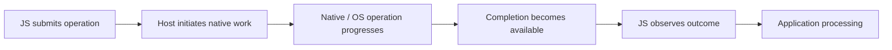

# Chapter 01 — Runtime Architecture and Execution Boundaries

**Domain:** D03 — Node.js Internals  
**Competency:** D03-C01  
**Editorial status:** approved_by_learner — explicitly confirmed on 2026-10-12.  
**Curriculum approval:** learner confirmed the 18-chapter plan on 2026-10-12.  
**Educational example execution:** see Section 14 for exact environment and observations.  
**Assessment / project implementation:** deferred / no verified implementation (see [D03 status](../README.md)).

## Outcomes and prerequisites

After studying this chapter, a learner should be able to explain what Node.js adds to a JavaScript engine, trace an asynchronous operation across JavaScript, native/runtime and OS boundaries, distinguish concurrency from parallel JavaScript execution, and identify which resource might be delaying an observed result.

Prerequisites: D01's [OS and scheduling](../../01-computer-science-foundations/lessons/07-operating-systems-and-scheduling.md), [memory](../../01-computer-science-foundations/lessons/08-memory-models-and-management.md) and [concurrency](../../01-computer-science-foundations/lessons/10-concurrent-execution.md); D02's [Promises](../../02-javascript-typescript/lessons/08-promises-and-async-await.md) and [async composition](../../02-javascript-typescript/lessons/09-asynchronous-composition-and-cancellation.md). Exercises below are material for future study, not an assessment being administered now.

## 1. First principles: a language needs an execution environment

JavaScript defines language behavior: values, functions, expressions and Promise semantics. It does not, by itself, give an application a filesystem, a network socket, a process lifecycle or an OS-specific way to wait for I/O.

An **engine** executes JavaScript and manages its language-level objects. A **runtime** combines an engine with host facilities and rules for making those facilities accessible. Node.js embeds V8, exposes JavaScript APIs and native integrations, and coordinates external work and JavaScript execution. V8 is also used outside Node; recognizing the engine name does not identify the complete host behavior.

For example, invoking a filesystem API begins with ordinary JavaScript executing on a thread. It can validate arguments and initiate native work. When the operation completes, the application still needs an opportunity to execute the JavaScript that consumes its result. Submission, completion and observation are different events.

This separation explains a common incident: storage appears healthy, yet application responses arrive late. The delay may be in external work, waiting for a native worker, waiting for JavaScript to regain execution, or processing the completed result. “The file read was slow” is a hypothesis, not a conclusion from one end-to-end duration.

## 2. Responsibilities: who does what?

| Layer / term | Responsibility in this chapter's model | What it does not establish |
|---|---|---|
| JavaScript application | Calls APIs; validates business inputs; transforms results; owns its synchronous computations | An async-looking function is not automatically offloaded. |
| V8 engine | Executes JavaScript; maintains engine-managed objects, compilation and garbage collection | V8 alone is not Node's filesystem or process API. |
| Node host/API layer | Exposes built-ins, connects JavaScript and native operations, integrates execution and lifecycle | A Promise return type does not reveal the implementation path. |
| Native binding | Boundary connecting a host API to native/runtime functionality | Crossing into native code does not guarantee asynchronous execution. |
| libuv | Supplies an event loop and platform abstractions; coordinates relevant I/O and native work | It is not a general executor for arbitrary application JavaScript. |
| Operating system | Schedules threads/processes; provides filesystem, networking and platform services | Readiness is not proof that the application's result handler has run. |
| External system | Disk/device, remote endpoint or other resource involved in an operation | Remote success does not prove the caller observed success. |

The table is a responsibility map, not a literal sequence that every API follows. Some operations stay within JavaScript; others use V8, native libraries, OS facilities or several layers. Do not draw a mandatory “all work goes through libuv's pool” arrow.

libuv distinguishes long-lived **handles** from usually shorter-lived **requests**. Its loop is associated with a thread; its native work pool is a different resource. Network readiness and filesystem work need different execution-path models, with platform/version details checked for the selected operation. [libuv design overview](https://docs.libuv.org/en/v1.x/design.html).

**Visual question:** Which responsibilities belong to V8, and which require the Node host?



*Figure D03-V01 — This responsibility map complements the operation trace below. A synchronous host call can block its caller; a native boundary does not imply offload. Arrows label relationships, not a mandatory call stack. Native libraries, explicit Workers and OS details are omitted; the pool is only one possible native resource. [Reference](https://nodejs.org/en/learn/asynchronous-work/dont-block-the-event-loop).*

[Full-size SVG](../assets/01-runtime-architecture-and-execution-boundaries/runtime-responsibility-boundaries.svg) · [Editable Mermaid source](../assets/01-runtime-architecture-and-execution-boundaries/runtime-responsibility-boundaries.mmd).

## 3. Process, thread, isolate and execution turn

A **process** is an OS-managed running program with resources such as address space and file descriptors. A **thread** is an execution path scheduled by the OS inside a process. A **V8 isolate** separates engine-managed JavaScript state; it is not synonymous with an OS process or a security sandbox.

A typical application begins with a main JavaScript execution thread and event loop. A Node process can also have native worker threads, engine support threads and explicitly created JavaScript Workers. Thus “Node is single-threaded” is incomplete. The useful claim is narrower: a synchronous segment of JavaScript on one execution thread does not run alongside another ordinary callback on that same thread.

An **execution turn**, as used here, is a conceptual segment in which that thread is running JavaScript before control returns to the host. This is not a complete scheduling specification. Promise jobs and Node's queues need the precise treatment in Chapters 03–04.

If callback A performs a long synchronous calculation, callback B on the same JavaScript thread must wait. The OS may preempt A and run another OS thread, but that does not let B jump into A's JavaScript call stack. Other native work can make progress while B remains unable to run.

Explicit `worker_threads` Workers execute JavaScript in independent threads with separate isolates. Ordinary objects are not simply shared across their heaps; communication, cloning, transfer and explicitly shared memory have distinct rules. Workers share a process and are not equivalent to separate-process isolation. [Node Worker documentation](https://github.com/nodejs/node/blob/main/doc/api/worker_threads.md). Full mechanisms and failure boundaries belong to Chapters 11–12.

## 4. Concurrency, parallelism and asynchronous interfaces

**Concurrency** means several operations are in progress during overlapping intervals. **Parallelism** means work executes at the same time on different execution resources. A program can manage many outstanding I/O operations while executing its ordinary JavaScript callbacks sequentially on one thread.

An **asynchronous interface** lets a caller observe a result later instead of waiting synchronously for the whole operation. It does not promise zero synchronous cost. Argument checking, copying, allocation or request preparation may happen during submission. Result decoding, Promise continuations and business calculations still consume execution time.

| Operation shape | Where to look for work | Where ordinary application result handling runs |
|---|---|---|
| A synchronous JS loop or JSON transformation | Calling JavaScript execution thread | Same thread |
| A synchronous host call | Calling path waits for its work; may block the loop | Same thread after return |
| An asynchronous file API | Host/native filesystem path; documented pool behavior and platform details | Calling environment when completion is made available |
| Nonblocking socket I/O | OS networking facilities and loop integration | Its JavaScript execution environment |
| A native async CPU API, such as asynchronous PBKDF2 | Native work path, documented thread-pool use | Its JavaScript execution environment |
| An explicit JavaScript Worker | Separate JavaScript execution thread/isolate | Worker for its local work; parent for received messages |

The existence of native async CPU work is why “CPU work always blocks Node” is also too broad. CPU-intensive *JavaScript on the current execution thread* blocks that thread's other callbacks. A native API may deliberately send computation elsewhere. Always inspect the specific API. [Node filesystem documentation](https://github.com/nodejs/node/blob/main/doc/api/fs.md), [Node crypto documentation](https://github.com/nodejs/node/blob/main/doc/api/crypto.md).

## 5. Trace a file operation from call to observation

Consider `readFile(path, 'utf8')` from `node:fs/promises`:

1. Application JavaScript calls the host API.
2. The host initiates an asynchronous filesystem operation and returns a Promise representing its eventual outcome.
3. Filesystem work advances outside the application's ordinary JavaScript callback execution. Native queueing, OS scheduling and storage behavior can affect progress.
4. Completion becomes available to Node's JavaScript environment, allowing the Promise's outcome to be published.
5. A registered continuation runs when that environment processes it.
6. The continuation may decode/transform/validate data and perform additional work.

This is a causal sketch, not a count of internal syscalls or a guaranteed number of callbacks. A high-level read can involve several underlying operations; errors can occur before or during I/O. The API's success says that its requested operation succeeded, not that later business processing succeeded.

A useful path diagram is:



While C progresses, the JavaScript thread can perform other work **if it returns control or has another suitable opportunity to execute it**. If it instead enters a long synchronous loop, D can become ready without E running immediately. The diagram intentionally omits event-loop phase ordering; Chapter 03 adds that detail.

## 6. Worked example A: identify the actual runtime

Save this as `runtime-manifest.mjs` and run `node runtime-manifest.mjs`:

```js
import process from 'node:process';
import { isMainThread, threadId } from 'node:worker_threads';

console.log(JSON.stringify({
  node: process.version,
  v8: process.versions.v8,
  uv: process.versions.uv,
  platform: process.platform,
  arch: process.arch,
  isMainThread,
  threadId
}, null, 2));
```

The output identifies the Node, V8 and libuv versions visible to this process, plus its platform/architecture and current JavaScript Worker identity. [Process version properties](https://github.com/nodejs/node/blob/main/doc/api/process.md).

**Expected relationship:** running the file as an ordinary main script reports `isMainThread: true` and `threadId: 0`. Version strings vary by installation. This is not a census of every OS thread in the process.

**Why this matters:** two machines can both “run Node” while using different engine/libuv versions or platform facilities. Capture this small manifest before investigating a reproduction. Do not dump all environment variables into a report: they can contain secrets, and are unnecessary for this example.

**Limit:** these fields cannot prove which internal path a particular read used, how many native workers exist, or whether the process is unconstrained by a container/OS limit.

## 7. Worked example B: completed work can wait for observation

Save as `read-and-block.mjs`. It reads its own small source file, so no external dataset is required:

```js
import { readFile } from 'node:fs/promises';
import { performance } from 'node:perf_hooks';

const start = performance.now();
const events = [];
function record(event, extra = {}) {
  const entry = {
    event,
    elapsedMs: Number((performance.now() - start).toFixed(1)),
    ...extra
  };
  events.push(entry);
  console.log(JSON.stringify(entry));
}

record('start');
const outcome = readFile(new URL(import.meta.url), 'utf8').then(
  text => record('read-observed', { characters: text.length }),
  error => {
    record('read-failed', { code: error.code ?? 'unknown' });
    throw error;
  }
);
record('submitted');

const until = performance.now() + 120;
while (performance.now() < until) {
  // Deliberately monopolize this JS thread for a bounded demonstration.
}
record('blocking-segment-ended');

try {
  await outcome;
} catch {
  process.exitCode = 1;
}
```

**Expected ordering relationship:** `start` → `submitted` → `blocking-segment-ended` → the read's observed success/failure. There is no exact millisecond promise. The read's JavaScript continuation cannot execute inside the synchronous loop.

The call was asynchronous, yet the application voluntarily occupied its own result-processing resource. Changing a synchronous filesystem API to an async one would not remove that separate loop.

**What the trace proves:** in this run, the continuation was observed after the blocking segment. **What it does not prove:** that native file work had already finished before the loop ended. We did not instrument native completion time. A slow read and a busy loop can coexist; this program alone cannot apportion their contributions.

The busy loop is intentionally bad demonstration code, bounded to about 120 milliseconds of elapsed time; do not use it to emulate production waiting. The file is read as a whole, which is acceptable for this tiny fixture, not a recommendation for unbounded user datasets. Stream and pressure mechanisms arrive later.

## 8. Worked example C: an async function can still monopolize JavaScript

Save as `async-cpu.mjs`:

```js
import { performance } from 'node:perf_hooks';

async function calculate() {
  console.log('calculation-entered');
  const until = performance.now() + 120;
  let iterations = 0;
  while (performance.now() < until) {
    iterations += 1;
  }
  console.log('calculation-ended');
  return iterations;
}

console.log('before-call');
const pending = calculate();
console.log('call-returned');
console.log('iterations', await pending);
```

**Expected order:** `before-call`, `calculation-entered`, `calculation-ended`, `call-returned`, then `iterations` with a positive count. That count is not a benchmark score.

`calculate` has no suspension point inside its calculation. Its synchronous body runs before control returns to the caller, even though its result is wrapped in a Promise. Moving the same work after an `await` would move *when* it runs, not automatically *where* it runs.

Likewise, wrapping synchronous computation in `Promise.resolve().then(...)` schedules JavaScript; it does not turn the libuv pool into a JavaScript executor. Yielding repeatedly only to Promise jobs is not a general fairness guarantee for I/O callbacks. Detailed queue behavior belongs to Chapter 04.

Possible future responses to a real CPU problem include reducing unnecessary work, bounding input, partitioning computation with appropriate scheduling or explicitly isolating it. Each has costs: yielding retains total work, Worker communication has overhead, and more parallel work can saturate CPU or memory. This chapter selects no production solution.

## 9. Why callbacks can be delayed: a queueing model

Model an operation's observed duration as:

```text
submission/preparation
+ waiting for the relevant execution resource
+ underlying work
+ completion delivery / JS scheduling
+ result handling
```

These are conceptual contributions, not always disjoint intervals that can be directly added from independent clocks. A whole-file read may involve repeated work and completion steps. Native activity and other application work can overlap.

Two distinct congestion patterns:

- **JavaScript congestion:** many or long callbacks occupy one execution thread; already available results wait for application execution.
- **Native-resource congestion:** operations queue for a finite native pool or external resource while the JavaScript thread may remain relatively free.

Node's official guide discusses both resources as possible bottlenecks. Diagnose the resource before trying to tune it. [Don't block the event loop or worker pool](https://nodejs.org/learn/asynchronous-work/dont-block-the-event-loop).

Calling the libuv native pool a “Worker pool” must not be confused with explicitly creating `worker_threads` Workers. Their job is different. More JavaScript Workers do not automatically create independent filesystem pools; thread-pool details are covered in Chapter 10.

## 10. Backend case study: a delayed import result

An operator uploads a supported file. The application asynchronously reads it, then parses and validates a large text payload in one synchronous step. Other lightweight requests become slow during validation.

Separate the candidate explanations:

| Hypothesis | Useful evidence | Why end-to-end duration is insufficient |
|---|---|---|
| Input/storage is slow | Compare submission/observation for a small controlled read; inspect relevant I/O evidence | Observation can wait behind JavaScript. |
| JS parsing/validation dominates | Record separate start/end around transformation; inspect CPU evidence | “Async import” can contain a synchronous transform. |
| Native pool is busy | Compare unrelated pool-backed operations under controlled workload | Loop responsiveness does not prove native capacity. |
| Memory pressure contributes | Examine memory trends and applicable GC diagnostics | A growing allocation is not automatically a leak. |

Start with cheap, bounded observations and change one factor at a time. Reduce input size while retaining its shape; separate reading from parsing; record runtime identity. Avoid interpreting one improvement as universal proof, and avoid measuring with so much logging that the instrument itself dominates.

The product-level invariant remains: a failed or interrupted import must not be shown as a validated success. Runtime knowledge helps evaluate a technical proposal; it does not allow an agent to add new product capabilities or ignore approved limits.

## 11. Advanced boundaries: guarantees, observations and isolation

**A public contract** is documented behavior an application can rely on under its stated conditions. **An implementation detail** describes one version/platform's internal path. **An observation** describes what happened in an experiment. Treating the third as the first creates fragile explanations.

A Promise result does not guarantee ordering relative to every unrelated timer or I/O completion. A native API can perform synchronous preparation. An operation that was submitted may fail later; a timeout at the caller is not proof the underlying operation stopped. Cancellation has API-specific support and outcome rules.

Native code is not inherently nonblocking. A synchronous native computation can hold the calling execution path. External work is not inherently parallel JavaScript: the application must explicitly choose a JavaScript execution boundary when that is needed.

Separate isolates reduce accidental sharing of ordinary JavaScript object state; they do not certify trust isolation. Explicit shared memory and process-wide resources cross that intuitive boundary. This is why “put it in a Worker” is neither a complete security policy nor a universal performance fix.

## 12. Common mistakes and corrections

| Mistake | Correction |
|---|---|
| Node.js and V8 mean the same thing | Identify engine responsibilities separately from host facilities. |
| One JavaScript thread means the process has one thread | Scope the statement to an execution environment; native/engine/Worker threads differ. |
| `async` offloads CPU work | Identify the suspension points and actual execution resource. |
| Every asynchronous operation uses libuv's native pool | Check the specific API, version and platform. |
| A result callback measures only storage time | It includes the delay before JS observes the result. |
| An idle loop means the whole application is idle | Native/external queues can still be full. |
| Native code is always faster and asynchronous | Its synchronous cost and execution path still matter. |
| A repeated trace establishes a universal order | State the documented guarantee and experimental scope. |
| Larger pools or more Workers always solve latency | Check resource saturation, queueing and transfer/startup costs. |
| A successful file read proves the user workflow succeeded | Later validation, processing and delivery can fail. |

## 13. Future-study exercises and answer rubric

1. **Responsibility trace:** classify reading a file, parsing its text and sending a result to another execution environment.  
   **Rubric:** distinguish host/native/OS read work from JS parsing and explicitly chosen communication. Do not require a prescribed storage or Worker architecture.

2. **Counterexample:** explain why a function declared `async` can delay every other callback on its thread.  
   **Expected reasoning:** its synchronous calculation still occupies that execution path; Promise return type is not offload.

3. **Trace interpretation:** Example B reports the result at 125 ms. What can you conclude about disk latency?  
   **Expected answer:** no isolated disk-latency conclusion; JS was intentionally occupied. The native completion timestamp is unknown.

4. **Failure attribution:** replace the read target with a nonexistent local filename. Which stages and evidence distinguish “read rejected” from “callback never got an opportunity to run”?  
   **Rubric:** a recorded rejection code is direct outcome evidence; absent observation alone cannot establish whether I/O or JS scheduling is responsible.

5. **Parallelism comparison:** compare one main-thread transform, a native async computation and an explicit JS Worker.  
   **Rubric:** identify who executes the work, who observes the result, which data/ownership boundary applies, and why the boundaries are not interchangeable.

6. **Reproducibility:** design a minimal environment/evidence record for the import case study.  
   **Rubric:** exact runtime/dependency versions, platform/architecture, module context, workload shape/size, start/end event definitions and measurement limitations; exclude secrets.

7. **Scope discipline:** a runtime experiment suggests a Worker might help a planned product. Does it approve Worker use or expand that product's supported workloads?  
   **Expected answer:** neither. Technical choice belongs in the separate implementation workflow; product-boundary changes require learner approval.

These rubrics are authored learning material. No learner answers, score or mastery certification is recorded.

## 14. Execution evidence, references and quality review

**Documentation checked on 2026-10-12:** official Node.js repository docs through Context7 (`/nodejs/node`) for filesystem/native async work, Worker boundaries and process identity; libuv design and Node's blocking guide directly. Main-branch API links can evolve; the explicit execution environment below anchors the examples. No source-internal call graph is asserted for an unrecorded Node commit.

**Example environment:** `Node v26.4.0`, V8 `14.6.202.34-node.21`, libuv `1.52.1`; `darwin/arm64`, Darwin kernel `25.1.0`; main-script ESM (`.mjs`); local fixtures executed on 2026-10-12. This records the available test runtime, not a latest-release/LTS claim or a mandated future project version..

| Example | Verification target | Observed result |
|---|---|---|
| A — manifest | Main-script identity and selected version fields | Main thread true, threadId 0; selected version fields matched the manifest above. |
| B — read plus blocking | Ordered observation and successful read of the local fixture | start 0 ms → submitted 4.4 ms → blocking-segment-ended 124.5 ms → read-observed 125.6 ms (866 fixture characters); relation passed, timing is one observation. |
| C — async CPU | Synchronous body completes before call returns | before-call → calculation-entered → calculation-ended → call-returned → iterations 5791700; relation passed, count is not a throughput guarantee. |

All three fenced JavaScript programs were extracted and run as standalone `.mjs` educational fixtures. Verification checks their relevant relationships, not fixed timings or throughput. These local runs are example evidence only, not an implemented portfolio product, a learner assessment, a cross-platform guarantee or proof of production safety.

Additional official entry points for the next chapters: [Node API reference](https://nodejs.org/docs/latest/api/), [V8 documentation](https://v8.dev/docs), [event-loop guide](https://nodejs.org/en/learn/asynchronous-work/event-loop-timers-and-nexttick), [performance hooks](https://github.com/nodejs/node/blob/main/doc/api/perf_hooks.md).

| Quality criterion | Chapter evidence / limit |
|---|---|
| Progressive explanation | Sections 1–5 establish layers and execution before examples and diagnosis. |
| Defined terminology and mechanism | Sections 2–5 define host/engine/native/OS, process/thread/isolate and submission/completion/observation. |
| Practical and counterexamples | Three executed examples; explicit async-CPU counterexample and import case study. |
| Edge cases and trade-offs | Read rejection, JS/native congestion, preparation cost, ownership/isolation and instrumentation limits. |
| Exercises and answer guidance | Seven future-study exercises; no active assessment. |
| References and version honesty | Official references, dated checks and exact execution manifest. |
| Coverage and gaps | D03-C01 authored and learner-approved editorially; D03 catalog and five educational Project Charters approved; no verified implementation or assessed competency. |

**Remaining coverage:** startup details → Chapter 02; loop/queue order → 03–04; events → 05; byte and file ownership → 06–07; stream internals → 08–09; pool contention → 10; Worker/process lifecycle and shared-memory synchronization → 11–12; runtime module loading → 13; V8/GC → 14; async context → 15; failure/shutdown → 16; detailed profiling → 17; integrated investigations → 18. This chapter does not claim exhaustive Node internals, native-addon safety or formal correctness.

**Review outcome:** author quality-gate review completed and learner editorial approval explicitly confirmed on 2026-10-12. D03 educational authoring is complete; see [current D03 status](../README.md). Learner assessment remains deferred.
