# Chapter 02 — Startup, Configuration and Runtime Identity

**Domain:** D03 — Node.js Internals  
**Competency:** D03-C02  
**Editorial status:** approved_by_learner — learner explicitly approved on 2026-10-12.  
**Prerequisite approval:** learner approved Chapter 01 on 2026-10-12.  
**Educational execution evidence:** Section 14 records the actual environment and checked scenarios.  
**Assessment / project implementation:** deferred / no verified implementation (see [D03 status](../README.md)).

## Outcomes and prerequisites

A learner should be able to reconstruct the relevant conditions of a Node invocation, distinguish host options from application arguments, explain why a relative path changes with working directory, validate environment-derived values, and identify whether a failure happened before or after application entry.

Prerequisites: [Chapter 01 — Runtime Architecture and Execution Boundaries](01-runtime-architecture-and-execution-boundaries.md), D02 [values and coercion](../../02-javascript-typescript/lessons/01-values-types-and-coercion.md) and [module boundaries](../../02-javascript-typescript/lessons/06-modules-and-package-boundaries.md). This chapter covers startup reasoning; complete CJS/ESM loading mechanics are reserved for Chapter 13.

## 1. First principles: the source file is not the whole program invocation

A program is launched with an executable, arguments, an inherited environment and a working directory. The launcher may be a terminal, another process or an operating-system service. Identical source can behave differently when any of those inputs differ.

Consider:

```text
node [Node options] entry-file [application arguments]
```

This is the ordinary file-entry shape, not every CLI mode. Evaluation, standard-input and other invocation modes have their own rules.

Before the entry's ordinary application statements execute, Node must interpret applicable startup settings and arrange runtime/module execution. Some options stop without running the application; others cause startup to fail or arrange preloaded code. “The first line of my entry did not log” does not prove that Node never started: it may have failed in configuration, preloading or dependency evaluation.

Use a causal sketch:


The diagram is a conceptual ordering of responsibilities. It is not a source-level bootstrap call graph, and configuration can be read at more than one layer. Version-specific flags can affect several stages. Node's CLI documentation is authoritative for the selected runtime. [Node command-line reference](https://github.com/nodejs/node/blob/main/doc/api/cli.md).

## 2. Terminology and evidence: six questions to ask

| Question | Useful observation | Limitation |
|---|---|---|
| Which executable actually started this process? | `process.execPath` | Shell aliases and command names alone are not the resolved executable. |
| What was the original launch label? | `process.argv0` | A label is not proof of executable identity. |
| Which ordinary file entry and application tokens were passed? | `process.argv` | Tokens are strings; they are not parsed business configuration. |
| Which Node-specific CLI options were passed? | `process.execArgv` | Not a complete report of all effective configuration sources. |
| Where does a cwd-relative path begin? | `process.cwd()` | It can differ from the entry/module directory. |
| Which runtime/dependency/platform versions are visible? | `process.version`, selected `process.versions`, `platform`, `arch` | Version metadata does not measure CPU limits, native queues or workload behavior. |

For an ordinary file-entry invocation, `argv[0]` is the executable path, `argv[1]` identifies the entry and subsequent elements are application arguments. Node-specific options preceding the entry are exposed separately through `execArgv`. [Process documentation](https://github.com/nodejs/node/blob/main/doc/api/process.md).

The tool launching a process can add settings the user did not type. A version manager changes executable selection; a wrapper can inject arguments; inherited `NODE_OPTIONS` can affect startup. Diagnose the actual process rather than inferring everything from the visible command.

## 3. Working directory versus module location

The **current working directory** belongs to the process. A relative path such as `./settings.json` passed to a filesystem operation is interpreted relative to that directory. Launching an absolute entry path does not automatically change cwd to the entry's directory.

An ESM module's `import.meta.url` identifies the module itself. `new URL('./settings.json', import.meta.url)` describes a resource relative to that module's URL. It is a different policy from “find a file under the operator's current directory.” [ES module metadata](https://github.com/nodejs/node/blob/main/doc/api/esm.md), [filesystem path forms](https://github.com/nodejs/node/blob/main/doc/api/fs.md).

Neither policy is universally correct:
- A CLI working on the user's chosen directory may intentionally use cwd-relative paths.
- A packaged module reading its own bundled fixture may intentionally use module-relative resources.
- A configured input path may need an explicitly documented base instead of either implicit assumption.

Module URLs are URLs, not arbitrary OS pathname strings. Preserve URL/path distinctions and use the documented conversion APIs where conversion is needed. Avoid concatenating a URL with filesystem separators or manually decoding special characters.

`process.chdir()` changes process-level cwd where supported; it does not relocate the module. Changing cwd midway through asynchronous work can make later relative operations target a different resource. This chapter does not recommend mutable cwd as a configuration mechanism.

**Visual question:** Why can the same absolute entry find a different cwd-relative resource?



*Figure D03-V02 — The two paths are alternative policies, not fallback search steps. Launching the same module from another cwd changes the upper resolution but preserves the module-relative URL. Neither constructed location proves a file exists. This conceptual map uses an ordinary file module; URL conversion and platform path rules still apply. [Reference](https://nodejs.org/docs/latest-v24.x/api/esm.html#importmetaurl).*

[Full-size SVG](../assets/02-startup-configuration-and-runtime-identity/cwd-versus-module-base.svg) · [Editable Mermaid source](../assets/02-startup-configuration-and-runtime-identity/cwd-versus-module-base.mmd).

## 4. Worked example A: launch identity and argument boundaries

Save as `launch-identity.mjs`:

```js
import process from 'node:process';
import { resolve } from 'node:path';

console.log(JSON.stringify({
  node: process.version,
  v8: process.versions.v8,
  uv: process.versions.uv,
  platform: process.platform,
  arch: process.arch,
  execPath: process.execPath,
  argv0: process.argv0,
  entry: process.argv[1] ?? null,
  applicationArguments: process.argv.slice(2),
  nodeCliArguments: process.execArgv,
  cwd: process.cwd(),
  cwdResource: resolve('fixture.txt'),
  moduleResource: new URL('./fixture.txt', import.meta.url).href
}, null, 2));
```

Invoke it with a harmless Node flag followed by an application token:

```text
node --trace-warnings launch-identity.mjs --mode=demo
```

**Expected relationships:** `--trace-warnings` is in `nodeCliArguments`; `--mode=demo` is an application token. Node does not supply this application's `--mode` parser.

Now launch the same absolute file path from two different directories. `cwdResource` changes; `moduleResource` continues to identify the fixture next to that module. The fixture need not exist to demonstrate resolution; this code only constructs paths.

**Counterexample:** `node launch-identity.mjs --trace-warnings` passes that token to the application. Its spelling does not retroactively make it a Node startup option. Conversely, an unrecognized option in Node's option position can fail before this script prints anything.

**Reproducibility limit:** printing these fields is useful, but real arguments and paths can contain sensitive information. This educational invocation uses only synthetic values; a production diagnostic record needs deliberate allowlisting/redaction.

## 5. Environment values are inputs, not typed configuration

`process.env` exposes the process environment to JavaScript. Present values are generally strings; an absent property reads as `undefined`. The text `"false"` is a nonempty string, so testing it directly as a condition treats it as truthy. The text `"0"` is also not a typed number.

Define a configuration contract before converting:
1. Which variables are recognized?
2. Is absence allowed, and what default applies?
3. Is an empty string different from absence?
4. Which textual forms are accepted?
5. What bounds and cross-field conditions must hold?
6. When is configuration captured, and can it change?
7. What can safely appear in errors and logs?

Use `??` for an absence default when an empty string must remain invalid. A permissive conversion such as `Number('')` can turn an empty value into zero; `parseInt('4workers', 10)` can accept a prefix you did not intend. Conversion success and product validity are separate questions.

Do not rely on implicit non-string assignment to `process.env`; Node documents that conversion behavior as deprecated. Deleting a variable and assigning the text `"undefined"` are different operations. [Environment API behavior](https://github.com/nodejs/node/blob/main/doc/api/process.md).

## 6. Worked example B: parse a bounded application configuration

Save as `configuration.mjs`:

```js
function parseConfiguration(env) {
  const countText = env.APP_WORKERS ?? '4';
  if (!/^[1-9]\d*$/.test(countText)) {
    throw new Error('APP_WORKERS must be a positive decimal integer');
  }
  const workers = Number(countText);
  if (!Number.isSafeInteger(workers) || workers > 100) {
    throw new Error('APP_WORKERS must be between 1 and 100');
  }

  const featureText = env.APP_FEATURE ?? 'false';
  if (featureText !== 'true' && featureText !== 'false') {
    throw new Error('APP_FEATURE must be true or false');
  }
  return Object.freeze({ workers, featureEnabled: featureText === 'true' });
}

try {
  const configuration = parseConfiguration(process.env);
  console.log(JSON.stringify(configuration));
} catch (error) {
  console.error(error.message);
  process.exitCode = 1;
}
```

The fictional setting is just a count for demonstrating parsing. It does not create Worker threads, choose concurrency or approve limits for any real product.

**Expected cases:**

| Input | Result |
|---|---|
| Both absent | `{"workers":4,"featureEnabled":false}` |
| `APP_WORKERS=7`, `APP_FEATURE=false` | Numeric 7 and Boolean false |
| Empty worker count | Rejected, rather than silently defaulted |
| `4workers`, `1.5`, `0`, `101` | Rejected |
| Feature text `yes` | Rejected |

The example rejects whitespace, leading zeros and case variants intentionally. A different product may accept them, but must define that normalization rather than inherit incidental coercion.

`Object.freeze` prevents changes to this flat object's properties. It is not recursive freezing of nested configuration and is not a security boundary. Parsing once gives downstream code a consistent snapshot; it does not stop other code from mutating environment variables.

This example has no imported application module with startup side effects. In a real ESM entry, static dependencies can execute before the entry body's validation. If dependent initialization must wait for configuration, design that sequencing explicitly; adding a check near the top of the entry is not by itself proof that no prior side effect occurred.

## 7. Loading an env file: precedence is part of behavior

In the documented Node CLI, `--env-file` loads variables from a specified file relative to cwd. Existing process-environment values take precedence over the same keys in the file. With multiple env files, later files override earlier files for keys supplied by those files. A missing required file causes failure. Flag availability and env-file syntax must be checked against the selected Node version. [Env-file CLI rules](https://github.com/nodejs/node/blob/main/doc/api/cli.md).

For the synthetic example, create these two files next to `configuration.mjs`:

```text
# base.env
APP_WORKERS=3
APP_FEATURE=false
```

```text
# override.env
APP_WORKERS=5
APP_FEATURE=true
```

From that directory:

```text
node --env-file=base.env --env-file=override.env configuration.mjs
```

With those keys absent from the inherited environment, expected output is count 5 and feature true. If the launcher instead supplies `APP_WORKERS=8`, count 8 wins, while feature still comes from the later file.

The example uses the native Node loader, not a third-party dotenv package. Other loaders may have different precedence. Native env files can also contain variables that configure Node, including `NODE_OPTIONS`; loading an untrusted file is not merely parsing harmless application labels.

Setting a value in `process.env` later is not equivalent to providing it during startup. Some runtime/native settings are read early, cached or used to initialize a resource. Check that variable's contract; do not generalize from an ordinary application variable that your own code rereads.

## 8. Node options and application policy are different layers

`NODE_OPTIONS` lets a launcher supply supported Node options through the environment. Node restricts which options are allowed there. The documented `process.allowedNodeEnvironmentFlags` exposes the permitted set for the running runtime. A permitted option is not automatically appropriate for a particular service.

For matching singleton options, a direct CLI value overrides its `NODE_OPTIONS` value. Repeatable options can accumulate; documented preload flags are an example. Therefore “CLI always erases the environment configuration” is false. Use the rule for the specific option and version. [NODE_OPTIONS and precedence](https://github.com/nodejs/node/blob/main/doc/api/cli.md).

`execArgv` is not a normalized audit of all effective options from every source. An env-derived setting, a wrapper and defaults can influence runtime behavior without being reconstructable from that array alone. Record the launch method and an allowlisted description of relevant sources when diagnosing a difference.

Runtime tuning changes how the process executes; application policy defines accepted behavior. Increasing a runtime memory setting does not authorize a product to accept larger datasets. Changing startup options does not close an unresolved product decision or certify a performance improvement.

## 9. Worked example C: preloaded code runs before entry

This is a deliberately transparent demonstration with two local files.

Save `preload.cjs`:

```js
globalThis.demoPreloaded = true;
console.log('preload-ran');
```

Save `preload-entry.mjs`:

```js
console.log(JSON.stringify({
  event: 'entry-ran',
  preloaded: globalThis.demoPreloaded === true
}));
```

Run:

```text
node --require ./preload.cjs ./preload-entry.mjs
```

**Expected observation:** `preload-ran`, then the entry's report with `preloaded: true`. Without the preload option, the entry reports false.

This proves the ordering of this specific preload and entry fixture. It does not provide the whole Node bootstrap order, nor does it specify all dependencies' evaluation order. CommonJS/ESM interoperation is used here only as a small startup observation; Chapter 13 explains loading.

A preload can install hooks, establish instrumentation or execute arbitrary initialization. Its failures can prevent entry execution. Its code should be trusted and explicitly recorded. `globalThis` mutation is visible in this fixture's execution environment, not a recommendation for production configuration ownership.

Other preload modes such as `--import` have their own resolution, ordering and version/stability rules. Do not assume all preload flags are interchangeable or ignore their propagation to other execution contexts.

## 10. Diagnosing startup failures by stage

| Stage | Possible symptom | First evidence to inspect |
|---|---|---|
| Launcher/executable selection | Wrong runtime or executable not found | Launcher configuration and resolved executable |
| Option/env-file handling | No entry output; startup diagnostic and nonzero status | Exact relevant options, cwd and required file presence |
| Preload/dependency evaluation | Entry not reached; error from earlier module | Preload list, stack origin, module context |
| Configuration parsing | Controlled error before intended application work | Variable names, permitted formats and source precedence |
| Application initialization | Valid configuration but resource unavailable | Operation-specific outcome and lifecycle evidence |

Exit status alone is not enough to identify the stage. A configuration error and a later resource failure can both return nonzero. Pair status with a bounded diagnostic and the defined observation points.

Avoid masking a required value with a default simply to make startup proceed. Defaults are policy decisions; a missing critical dependency or unsafe address should not silently become a different configuration.

The examples set `process.exitCode` for handled errors. They do not claim to implement complete graceful shutdown. Pending handles and asynchronous cleanup require Chapter 16's lifecycle treatment.

## 11. Backend case study: it works from a terminal but fails under a launcher

A small import tool reads `./rules.json`. An engineer launches it from the repository directory and it succeeds. A scheduled launcher uses the same absolute entry path but a different cwd; the tool cannot find the rules.

Trace the discrepancy before changing product behavior:
1. Confirm executable/runtime identity in both runs.
2. Record cwd and the configured path policy.
3. Determine which file the relative path actually addresses.
4. Check whether an env file is also being resolved relative to cwd.
5. Inspect relevant inherited options and preloads without dumping secrets.
6. Decide whether rules are a bundled module resource, an operator-provided cwd file, or an explicit configured path.

A module-relative resource might fix one case but break an intentional “operate on this directory” workflow. The correct choice follows the product's documented contract. Do not silently search multiple directories and accept whichever file happens to exist: that makes provenance and reproducibility harder.

A second discrepancy can be environment precedence: editing an env file appears ineffective because the launcher already supplies the same key. The fix is to identify the effective source, not to keep changing the file blindly.

## 12. Advanced nuances and common mistakes

| Misconception | Correction |
|---|---|
| The shell command name proves runtime identity | Observe the resolved executable and versions inside the process. |
| A token beginning with `--` is always a Node flag | Its position and invocation mode matter. |
| An absolute entry path sets cwd | Entry identity and working directory are separate inputs. |
| Environment values are already numbers/Booleans | Define textual parsing and bounds. |
| Empty input and absent input are the same | Decide this deliberately; avoid accidental defaults. |
| Loading a file always overwrites inherited env | Native Node precedence says otherwise for existing keys. |
| Changing env at runtime reconfigures every subsystem | Early initialization/caching can make that false. |
| The top of the entry is the first user code to run | Preloads and dependency evaluation can come first. |
| `execArgv` completely describes effective configuration | Relevant environment/wrapper/default sources need separate evidence. |
| Runtime tuning changes approved product scope | Product limits and technical execution settings have separate authority. |

OS environment naming/case behavior, shell quoting and launch wrappers introduce platform-specific details. A container or service can also constrain CPU, memory and file access independently of reported runtime versions. This chapter's exact examples are one platform's executions, not universal launch recipes.

## 13. Exercises reserved for future study

1. **Invocation classification:** in `node --trace-warnings app.mjs --mode=demo`, identify runtime and application tokens.  
   **Answer:** the warning option is Node-specific; mode belongs to the app. A parser is still needed for mode.

2. **Path counterexample:** launch Example A from two directories. Explain the two resource fields.  
   **Rubric:** cwd-relative resolution changes; module-relative URL stays anchored to the same module; neither proves file existence.

3. **Coercion bug:** why is `if (process.env.APP_FEATURE)` wrong for the text `false`?  
   **Answer:** it tests string truthiness, not the intended Boolean contract.

4. **Precedence:** base file says 3, override says 5 and inherited env says 8. What count should Example B use?  
   **Answer:** 8 under native Node env-file rules; without inherited value, 5.

5. **Failure stage:** a required env file is missing and the entry has no output. What is justified?  
   **Rubric:** inspect startup stderr/status and file/cwd evidence; absence of entry output alone does not identify the cause.

6. **Initialization:** explain why validating config after static imports is not automatically a guard against module side effects.  
   **Answer:** dependency evaluation can precede entry-body validation; explicit initialization sequencing is needed.

7. **Product boundary:** may a larger runtime memory option silently increase a PRD's advertised input limit?  
   **Answer:** no; proposed capability changes require learner approval.

No learner response, grade or competency certification is recorded.

## 14. Verification, references and coverage review

**Documentation checked:** 2026-10-12, Context7 `/nodejs/node`, official process/CLI docs for launch identity, permitted startup options, env-file precedence and value conversion. Source links target evolving official docs; the execution manifest below anchors tested behavior. Full bootstrap implementation is not asserted without a recorded source revision.

**Execution environment:** `Node v26.4.0`, V8 `14.6.202.34-node.21`, libuv `1.52.1`; `darwin/arm64`, Darwin kernel `25.1.0`; ESM entries (`.mjs`), CommonJS preload (`.cjs`), synthetic local env files; executed on 2026-10-12. This is the available test runtime, not a latest/LTS claim or project requirement..

| Educational check | Observed result |
|---|---|
| A — arguments and paths | Three invocations passed: runtime/application tokens separated; changing cwd changed cwdResource but not moduleResource; post-entry --trace-warnings stayed an application token. |
| B — default and valid parsing | Absent keys yielded 4/false; explicit 7 and false yielded number 7 and Boolean false. |
| B — malformed values | Five count forms (empty, 4workers, 1.5, 0, 101) and feature yes were rejected with exit status 1 and no success output. |
| B — native env-file precedence / missing required file | Later-file values yielded 5/true; inherited count 8 overrode the file while feature remained true; missing required env file failed with no application success output. |
| C — preload versus entry | With --require, preload-ran preceded entry-ran/true; without it, entry reported false. |

**16 execution scenarios passed.** The standalone JavaScript code fences were extracted and executed in local fixtures. Checks verify explicit relationships and outcome handling. They do not certify all CLI flags, all platforms, launcher security, product implementation or learner mastery.

Additional official references: [ESM](https://github.com/nodejs/node/blob/main/doc/api/esm.md), [filesystem](https://github.com/nodejs/node/blob/main/doc/api/fs.md), [URL](https://github.com/nodejs/node/blob/main/doc/api/url.md). Deep module resolution → Chapter 13; thread-pool/Worker initialization details → 10–12; shutdown → 16; production launch/deployment architecture → later domains.

| Quality gate | Evidence and limits |
|---|---|
| Progressive mechanism and terminology | Sections 1–3 establish launch layers and identity before examples. |
| Practical examples and counterexamples | Argument-position, cwd/module, validation, env precedence and preload fixtures. |
| Failure modes and trade-offs | Missing files, malformed settings, initialization side effects and provenance. |
| Exercises and answer guidance | Seven future-study questions; no current assessment. |
| Version/reference honesty | Exact runtime, dated official checks and scoped observations. |
| Coverage | D03-C01 and D03-C02 learner-approved editorially; no product, assessment or implementation coverage is inferred. |

**Author quality review:** completed against handbook quality gates. D03 educational authoring is complete; see [current D03 status](../README.md). A chapter's editorial approval does not approve a runtime configuration for an external project.
