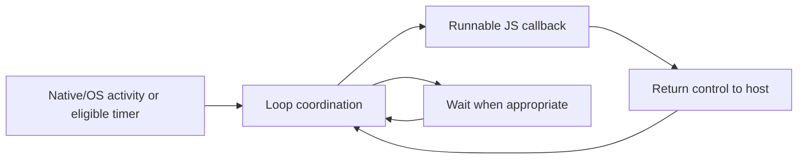

# Chapter 03 — The Event Loop and I/O Lifecycle

**Domain:** D03 — Node.js Internals  
**Competency:** D03-C03  
**Editorial status:** approved_by_learner — learner authorized progression after the Chapter 03 review request on 2026-10-12.  
**Prerequisite review:** learner authorized progression after the Chapter 02 review request on 2026-10-12; Chapter 02 is recorded as editorially approved.  
**Educational execution:** Section 14 records actual tests and their limits.  
**Assessment / project implementation:** deferred / not_started.

## Outcomes and prerequisites

A learner should be able to explain how an event loop coordinates callbacks and external I/O, distinguish readiness from completion and JavaScript observation, describe the purposes of its phases, and diagnose why a responsive-looking async API can still produce delayed results.

Prerequisites: [Chapter 01](01-runtime-architecture-and-execution-boundaries.md) for execution boundaries and [Chapter 02](02-startup-configuration-and-runtime-identity.md) for runtime identity/module context. D01 [I/O](../../01-computer-science-foundations/lessons/09-file-systems-and-io.md) and [liveness](../../01-computer-science-foundations/lessons/11-liveness-and-coordination.md) provide the systems background.

This chapter introduces timer/check context to explain phases. Detailed nextTick/Promise queue interactions, nested scheduling and CJS/ESM ordering are Chapter 04. Exercises remain future-study material.

## 1. First principles: coordinate work without waiting synchronously for each result

A sequential blocking program submits an operation and waits on the calling path until it finishes. An event-driven program can submit work, return control and later respond to available outcomes. The loop provides opportunities for those responses to run.

The event loop is not the disk, the network or a second JavaScript engine. It coordinates available work in its execution environment. Native operations and OS facilities may progress while the main JavaScript thread is doing something else. The application's callback still needs that thread to execute it.

A loop can also wait efficiently when there is no immediately runnable work but relevant I/O is outstanding. That native wait is different from application JavaScript spinning in a loop: one lets the OS wake the process for relevant activity, while the other consumes the JavaScript execution opportunity.

The important engineering question is therefore not simply “is the function async?” It is: **what is pending, what resource advances it, and what must happen before the application can observe the result?**

## 2. Terminology: six events that should not be collapsed

| Term | Meaning in a trace | What it does not imply |
|---|---|---|
| Submission | Application asks an API to begin work | Work has started on the device or native worker. |
| Pending operation | Result has not yet been observed or completed at the relevant layer | JavaScript is occupied throughout. |
| Readiness | An OS/transport resource indicates an operation can make progress | A complete application message or successful business outcome exists. |
| Native completion | Underlying work has reached its native outcome | The application's callback already ran. |
| Callback dispatch / observation | JavaScript begins processing the outcome | All later processing is successful. |
| Resource closure | A resource's lifecycle reaches its documented closed condition | External effects were rolled back or data became durable. |

Use qualified labels such as “read callback entered” rather than “disk finished” when the observation is a JavaScript timestamp. Each clock and layer answers a different question.

**Handle** and **request** are libuv lifecycle abstractions, not interchangeable names for a JavaScript function. Active referenced resources, active requests and closure processing contribute to loop liveness. Network I/O uses platform-specific facilities; native filesystem work has a different execution path. A loop is associated with a thread and can wait for relevant I/O events. [libuv design](https://docs.libuv.org/en/v1.x/design.html).

## 3. The phases: responsibilities, not a global ordering oracle

A phase diagram explains categories of work:

| Phase / category | Main purpose |
|---|---|
| Pending callbacks | Certain I/O callbacks deferred from earlier processing |
| Idle / prepare | Internal coordination |
| Poll | Retrieve/process I/O events and wait when appropriate |
| Check | Execute setImmediate callbacks |
| Close callbacks | Process some handle-close callbacks |
| Timers | Execute eligible timeout/interval callbacks |

These labels do not put every JavaScript continuation into one public FIFO queue. The host also integrates nextTick and Promise-job processing at execution boundaries.

The official Node guide describes the libuv 1.45 change associated with Node 20: per-iteration timers run after polling, with an initial timer pass retained for compatibility. Older explanations that ignore the version can mislead. This chapter's loop model is intentionally simplified; it does not prescribe an exact bootstrap or native-call sequence. [Node event-loop guide](https://nodejs.org/learn/asynchronous-work/event-loop-timers-and-nexttick).

The useful diagram emphasizes dependencies rather than a misleading universal sequence:



One callback can register future work or perform long synchronous processing before returning control. New native activity can arrive during that interval. The diagram does not imply a callback can interrupt another synchronous JavaScript stack on the same thread.

## 4. Poll waiting: healthy idleness versus starvation

When runnable I/O-related work exists, the loop can dispatch it. When there is no suitable work now, it can wait according to its outstanding resources and scheduling constraints. Pending immediates and timer eligibility influence whether and how long waiting is appropriate.

Three situations can look superficially similar in a high-level log:

1. **Healthy waiting:** the program is waiting for an external event and has nothing useful to process yet.
2. **JavaScript obstruction:** a callback monopolizes execution, so other ready outcomes wait.
3. **Native-resource waiting:** work has not completed because a pool, device or external endpoint is busy.

A quiet console does not distinguish them. A callback log is application observation, not an instrument for all native activity. Conversely, a busy CPU is not conclusive proof of a blocked main loop; work may run in native threads or explicit JavaScript Workers.

The loop's internal processing limits are not a way to interrupt an arbitrary long JavaScript callback. Application code still needs to bound work or use an appropriate execution strategy. Chapter 10 examines native pool contention; Chapter 17 examines diagnostic evidence.

## 5. Readiness versus completion: sockets and files need different models

For a nonblocking socket, availability of readable data means the transport can make progress. It does not mean the peer's entire logical message has arrived. A write accepted by an API does not automatically mean a peer application consumed it. Framing, buffering and confirmation belong to the relevant protocol/API.

Asynchronous filesystem APIs instead initiate native file operations and deliver their outcomes through Node's execution environment. The documented callback APIs use the underlying Node thread pool for filesystem operations. A whole-file read is a high-level operation that may involve multiple underlying steps. It is not one universal poll event corresponding to one disk transfer. [Node filesystem API](https://github.com/nodejs/node/blob/main/doc/api/fs.md).

This is why an educational diagram should not say “every async API is an OS socket event” or “every async API runs in a pool.” Name the operation and platform/version constraints. CPU-based native APIs, DNS paths and socket readiness can have different bottlenecks.

Neither path moves the application's ordinary JavaScript result processing into the native pool. The result handler can still parse, copy or validate data synchronously and delay unrelated callbacks.

The following handoff map answers: **what can progress outside JavaScript, and what must wait for JavaScript to yield?**



*Figure 1 — Submission, native progress and JavaScript observation are separate boundaries. Follow either illustrative native path, then the two prerequisites for dispatch: an available outcome and return of JavaScript control to the host. Socket facilities vary by platform (readiness or completion); the filesystem path represents documented asynchronous file APIs using native pool work. Native progress may overlap JavaScript execution; loop handling and the result callback require JavaScript to yield. Arrows express dependencies, not elapsed time, a universal native mechanism, or global callback ordering; timers and detailed host queues are omitted. See [libuv design](https://docs.libuv.org/en/v1.x/design.html) and the [Node filesystem implementation considerations](https://nodejs.org/docs/latest-v24.x/api/fs.html#threadpool-usage).*

[Full-size SVG](../assets/03-event-loop-and-io-lifecycle/async-io-handoff.svg) · [Editable Mermaid source](../assets/03-event-loop-and-io-lifecycle/async-io-handoff.mmd).

## 6. Timers express eligibility, not a precise deadline

A timeout requests a future callback opportunity. The Node timers API explicitly does not promise exact callback timing or a universal callback order. Invalid/extreme delays are also normalized according to that API; do not treat a raw delay number as an unvalidated deadline policy. [Node timers documentation](https://github.com/nodejs/node/blob/main/doc/api/timers.md).

After the threshold is reached, other execution and OS scheduling can delay observation. A timeout callback cannot preempt a synchronous segment already running on its JavaScript thread.

This matters when a product promises “the request times out in 100 ms.” There are several possible meanings:
- mark the caller's wait as expired when application code can observe expiry;
- stop accepting a result after a measured deadline;
- request cancellation of underlying work;
- guarantee that all underlying work stopped.

A timer alone does not make those meanings equivalent. Cancellation has API-specific behavior; a caller timeout is not proof of native failure or absence of external effects.

## 7. Worked example A: an eligible timer waits behind JavaScript

Save as `timer-and-work.mjs`:

```js
import { performance } from 'node:perf_hooks';

const start = performance.now();
function log(event) {
  console.log(JSON.stringify({
    event,
    elapsedMs: Number((performance.now() - start).toFixed(1))
  }));
}

setTimeout(() => log('timer-observed'), 10);
log('work-started');
const until = performance.now() + 80;
while (performance.now() < until) {
  // Bounded obstruction solely for this educational counterexample.
}
log('work-ended');
```

**Expected relationship:** work-started → work-ended → timer-observed. Do not assert an exact observed millisecond value. The timer becomes eligible while the synchronous segment is occupying the thread, but its callback cannot run inside that segment.

**What this demonstrates:** a requested timer delay is not a preemption mechanism. **What it does not demonstrate:** the full timer phase schedule, fairness across unrelated work, or a production latency distribution.

The fixture uses a small bounded busy loop, not an endless starvation example. Remove it from real applications; it is not a sleeping mechanism. The source of delay here is deliberately known, unlike a production incident.

## 8. Worked example B: scheduling context changes the relevant relationship

Save as `after-read.mjs`:

```js
import { readFile } from 'node:fs';

const target = process.argv[2] ?? new URL(import.meta.url);
readFile(target, 'utf8', (error, text) => {
  if (error) {
    console.log(JSON.stringify({
      event: 'read-failed',
      code: error.code ?? 'unknown'
    }));
    process.exitCode = 1;
    return;
  }
  console.log(JSON.stringify({
    event: 'read-callback',
    characters: text.length
  }));
  setTimeout(() => {
    console.log(JSON.stringify({ event: 'timeout-after-read' }));
  }, 0);
  setImmediate(() => {
    console.log(JSON.stringify({ event: 'immediate-after-read' }));
  });
});
```

Run `node after-read.mjs`. Both scheduling calls occur inside the same successful file-I/O callback. For this simple documented context, the immediate is observed before the newly scheduled timeout. The result is **not** a rule that every immediate anywhere outranks every existing timer. Moving calls to top-level startup changes the context and removes this basis for assuming the same order. [Node event-loop guide](https://nodejs.org/learn/asynchronous-work/event-loop-timers-and-nexttick).

**Expected trace:** read-callback → immediate-after-read → timeout-after-read. The exact read time and byte-processing path are not measured.

**Failure variant:** `node after-read.mjs missing-fixture.txt` reports read-failed and exits nonzero when that file is absent. It does not schedule the two success-path callbacks. This keeps failed native work distinguishable from a successful read with later processing delays.

The script reads only its own tiny fixture in the successful case. Whole-file allocation is not a recommendation for unbounded imports. Streams and buffering are Chapters 08–09.

## 9. Resource liveness: why some pending callbacks never run

The loop does not run forever just because an arbitrary JavaScript object contains a callback. An active referenced timer normally helps keep the process alive. Calling its `unref()` removes that timer's requirement to keep the loop active. If nothing else requires continued activity, the process can exit before the timer's callback runs. [Timeout ref/unref](https://github.com/nodejs/node/blob/main/doc/api/timers.md).

This is a liveness policy, not cancellation. The timer may still run if other referenced activity keeps the process alive long enough. Ref status is also not a general ownership or cleanup guarantee.

A pending ordinary Promise alone is not a native resource that necessarily keeps the process running. Special entry/module behavior, including unresolved top-level await, needs separate treatment; do not use that statement to predict every invocation's exit status.

A file operation's completion and a server's closure also have their own contracts. For example, `net.Server.close()` stops accepting new connections and waits for existing connections to end before reporting that the server is closed. It is not “kill all connections now.” [Server close documentation](https://github.com/nodejs/node/blob/main/doc/api/net.md).

Do not classify every JavaScript event named `close` into one native phase. Different APIs and graceful versus abrupt paths can schedule observations differently. The lifecycle contract is more useful than guessing a phase from the event's name.

## 10. Worked example C: compare ref and unref without forcing exit

Save as `timer-liveness.mjs`:

```js
const mode = process.argv[2] ?? 'ref';
if (mode !== 'ref' && mode !== 'unref') {
  throw new Error('Expected ref or unref');
}

const timer = setTimeout(() => {
  console.log(JSON.stringify({ event: 'timer-ran', mode }));
}, 100);

if (mode === 'unref') timer.unref();
console.log(JSON.stringify({
  event: 'timer-created',
  mode,
  hasRef: timer.hasRef()
}));
```

Run two standalone processes:

```text
node timer-liveness.mjs ref
node timer-liveness.mjs unref
```

In the referenced case, expect timer-created/true followed by timer-ran. In this deliberately isolated unreferenced fixture, expect timer-created/false and exit without timer-ran. The observation is scoped to a process without other ongoing activity; it is not a guarantee that unref prevents callback execution.

The example does not call `process.exit()` to obtain that result. Doing so would demonstrate forced termination rather than loop liveness. Neither mode models complete service shutdown or confirms that cleanup succeeded.

## 11. Backend case study: slow responses despite quick storage

An application schedules a health-check timer while processing several completed reads. Each read callback performs a large synchronous transformation. The operator observes a delayed health result and calls the storage system slow.

Build competing explanations:
- The read work itself may be slow.
- Native work may be queued before it starts.
- Completed results may wait for JavaScript.
- Each result handler may monopolize execution.
- Allocation or GC may add delay.
- Instrumentation may be costly.

A useful investigation records named boundaries: submit, callback-enter, transform-start, transform-end and response-observed. Those timestamps cannot directly reveal native completion time unless another source measures it.

Reduce synchronous processing per callback in a controlled experiment while keeping input shape and other conditions comparable. An improvement supports that hypothesis; it does not prove storage was always fast. Separately vary outstanding native work to examine resource contention. Use the diagnostic tools introduced in later chapters rather than inventing a cause from one output log.

The product's behavior remains authoritative: a delayed or uncertain result must not be relabeled as definitive success or rejection. Technical scheduling changes cannot silently change cancellation semantics, accepted input limits or advertised guarantees.

## 12. Advanced nuances and misconceptions

| Misconception | Better reasoning |
|---|---|
| Every callback belongs to one global FIFO | Identify the API, registration context and applicable scheduling contract. |
| Poll waiting is the same as JS busy waiting | Native waiting for events differs from occupying execution with a loop. |
| A timer deadline interrupts current JS | Timers need a later opportunity to execute. |
| One loop diagram predicts all module output | Host queues, entry context, version and native outcomes matter. |
| Ready socket data is a complete business message | Readiness, framing, consumption and confirmation differ. |
| Read callback time is native I/O completion time | It is application observation unless the native layer is separately instrumented. |
| unref cancels a timer | It changes liveness requirements, not callback eligibility itself. |
| Server close means all existing connections are killed | Check the API's drain/closure contract. |
| Internal fairness limits rescue long user callbacks | Arbitrary synchronous JS is not preempted by a loop phase diagram. |

Long nextTick/microtask chains can obstruct progress even without one large loop. Chapter 04 analyzes the queue boundaries; this chapter deliberately avoids a blanket “nextTick always beats Promise” slogan, especially across CJS/ESM entry contexts.

Node/libuv versions and platform mechanisms can affect a low-level description. Explain the documented API relationship first, qualify source details and keep observed timing separate from guarantees.

## 13. Future-study exercises and answer rubric

1. **Readiness trace:** a socket becomes readable. What remains before an application-level request is complete?  
   **Rubric:** JS observation, data consumption/framing and later business validation; readiness alone is insufficient.

2. **Timer counterexample:** why can Example A's 10 ms request be observed much later?  
   **Answer:** synchronous JS occupies the thread; eligibility does not preempt it.

3. **Scheduling context:** move Example B's timers outside its read callback. May you retain the exact ordering assertion?  
   **Answer:** no; the documented I/O-callback context supporting that assertion has changed.

4. **Error path:** what evidence distinguishes an absent file from a late success callback?  
   **Answer:** an observed failure code and nonzero outcome; a missing callback log by itself is inconclusive.

5. **Resource lifetime:** explain why unref is different from clearTimeout or forced process exit.  
   **Rubric:** remove liveness requirement versus cancel scheduling versus terminate the process; consider other active resources.

6. **Diagnosis:** how would you separate native waiting from long result processing?  
   **Rubric:** define observation points and controlled workload changes; acknowledge that JS timestamps alone do not reveal native completion.

7. **Scope:** may a runtime proposal guarantee exact timer-based cancellation for an approved product?  
   **Answer:** not without the product/API evidence and necessary learner decision; timeout observation and stopping underlying effects differ.

No learner answers, scores or assessment results are recorded.

## 14. Execution evidence, references and quality review

**Documentation checked on 2026-10-12:** Context7 `/nodejs/node` for timers, I/O callback and server-close contracts; official Node event-loop guide and libuv design directly for phase/poll/version context. Retrieved broad queue snippets were not treated as universal CJS/ESM ordering guarantees.

**Execution environment:** `Node v26.4.0`, V8 `14.6.202.34-node.21`, libuv `1.52.1`; `darwin/arm64`, Darwin kernel `25.1.0`; main-script ESM (`.mjs`), local fixtures, executed on 2026-10-12. This is an observed execution environment, not a latest-release/LTS claim or a mandated project runtime.

| Fixture | Observed relationship / outcome |
|---|---|
| A — timer plus bounded obstruction | work-started at 0.1 ms → work-ended at 87.7 ms → timer-observed at 87.9 ms; relationship passed, timings are one local observation. |
| B — successful I/O callback | Three independent runs observed read-callback → immediate-after-read → timeout-after-read; each read 595 fixture characters. |
| B — missing-file path | Missing fixture reported read-failed/ENOENT with exit status 1; no success-path immediate/timeout events. |
| C — referenced / unreferenced timer | Ref case: timer-created/hasRef true then timer-ran; isolated unref case: timer-created/hasRef false and normal exit without timer-ran. |

Three standalone educational JavaScript fixtures were extracted and run in **seven execution scenarios**. Tests check causal relationships and success/failure handling, not exact timing, phase instrumentation or a cross-platform latency promise. This is educational code evidence, not an implemented project or learner competency claim.

Additional official references: [process](https://github.com/nodejs/node/blob/main/doc/api/process.md), [timers](https://github.com/nodejs/node/blob/main/doc/api/timers.md), [filesystem](https://github.com/nodejs/node/blob/main/doc/api/fs.md), [net](https://github.com/nodejs/node/blob/main/doc/api/net.md). Detailed queue ordering → Chapter 04; events → 05; file/stream ownership → 07–09; pool contention → 10; shutdown → 16; diagnostics → 17.

| Quality criterion | Evidence / limit |
|---|---|
| Progressive explanation | Responsibilities and terminology precede phases, examples and diagnosis. |
| Mechanisms and counterexamples | Readiness/completion distinction, phase purposes, delayed timer and context-specific ordering. |
| Failure/lifetime reasoning | Missing file, ref/unref, close semantics and unknown-outcome limits. |
| Practical examples | Three executed fixtures; seven checked scenarios. |
| Exercises and answers | Seven future-study exercises; no present grading. |
| Version/reference honesty | Exact execution manifest and qualified libuv timer-placement change. |
| Coverage and gaps | D03-C03 approved_by_learner; Chapters 01–03 editorially approved; no PRD or project evidence. |

**Review outcome:** author quality-gate review completed; learner authorized progression after the Chapter 03 review request on 2026-10-12. Chapter 03 is editorially approved. Next: Chapter 04 — Scheduling Queues and Timers — is authored/in_review and requires learner review before Chapter 05.
