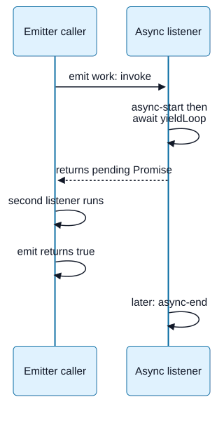

# Chapter 05 — EventEmitter and Callback Contracts

**Domain:** D03 — Node.js Internals  
**Competency:** D03-C05  
**Editorial status:** approved_by_learner — learner explicitly approved Chapter 05 on 2026-10-12.  
**Prerequisite review:** learner authorized progression after the Chapter 04 review request on 2026-10-12; Chapter 04 is recorded as editorially approved.  
**Educational execution:** Section 14 records executed fixtures and their limits.  
**Assessment / project implementation:** deferred / no verified implementation (see [D03 status](../README.md)).

## 1. Outcomes and prerequisites

Explain synchronous event dispatch, listener ownership and callback timing. Trace reentrancy and changes to subscriptions during emission. Distinguish listener invocation from asynchronous completion, identify error channels, and avoid missed events when bridging to Promises. Diagnose accumulated listeners without treating a warning threshold as a memory limit.

Prerequisites: [Chapter 04 — Scheduling queues and timers](04-scheduling-queues-and-timers.md), D02 [event and iteration abstractions](../../02-javascript-typescript/lessons/10-iteration-streams-and-event-abstractions.md), and [errors and resource lifetimes](../../02-javascript-typescript/lessons/07-exceptions-errors-and-resource-lifetimes.md). D02 supplies language abstractions; this chapter supplies Node-specific dispatch and lifecycle contracts. Streams and pressure are Chapters 08–09, async context is Chapter 15, and comprehensive failure policy is Chapter 16.

EventEmitter is useful when an object reports several named occurrences to interested listeners. It does not itself supply replay, persistence, admission control, end-to-end acknowledgement or distributed delivery guarantees. Decide which behavior an application needs before selecting an abstraction.

## 2. From occurrence to listener invocation

An **event name** identifies an occurrence category, usually a string or symbol. A **listener** is a function subscribed to that name on a particular emitter. **Emission** asks that emitter to invoke the applicable listeners with the supplied arguments. A **subscription** is the registration plus the responsibility to keep or remove it.

The normal dispatch model is synchronous: listener calls happen during `emit`, in the configured listener order. Adding `on` normally appends; `prependListener` can place a listener first. Ordinary function listeners receive the emitter as `this`; arrow functions retain their lexical `this`. Prefer explicit dependencies when that distinction would otherwise be hidden. The [official events reference](https://github.com/nodejs/node/blob/main/doc/api/events.md) defines these API behaviors.

Event delivery does not clone a payload. If an early listener mutates a passed object, a later listener can observe that mutation. Registration order can therefore affect behavior, but relying on hidden mutation makes a fragile contract. Document ownership and whether listeners may change or retain data. Buffer ownership will make this concern concrete in Chapter 06.

For an ordinary event, `emit` returns a boolean about registered listeners. It is not a Promise for all business effects and does not aggregate listener return values. No listener normally means no delivery and a false result; `error` has special behavior examined below. A true result cannot establish that a remote write finished, that every listener succeeded or that any durable record exists.

## 3. Example A — synchronous reentrancy and state visibility

**Reentrancy** means code calls back into a component before the original operation has returned. It does not require another thread. Save as `state-visibility.mjs` and run with `unsafe` and `safe` arguments in separate processes.

```javascript
import { EventEmitter } from 'node:events';
const mode = process.argv[2];
if (!['unsafe', 'safe'].includes(mode)) throw new Error('invalid mode');
const emitter = new EventEmitter();
const operation = { phase: 'idle' };
emitter.on('started', function () {
  console.log('listener', operation.phase, this === emitter);
});

function begin() {
  console.log('begin');
  if (mode === 'safe') operation.phase = 'running';
  emitter.emit('started');
  if (mode === 'unsafe') operation.phase = 'running';
  console.log('returned', operation.phase);
}
begin();
```

Unsafe mode exposes idle during the started listener even though the operation ultimately becomes running. Safe mode exposes running before returned is printed. Both verify ordinary function `this` binding. The listener could call an operation method rather than merely inspect state; that call would also happen before begin returned.

Publishing after establishing the state invariant avoids this particular inconsistent observation. It does not solve every reentrant transition: consider a listener that cancels, throws, emits another event or starts another operation. Specify which transitions are allowed. A queued notification changes timing and may eliminate this immediate callback, but it also changes the observable API contract; do not silently substitute it in an approved product.

The important sequence is state change → notification → listener execution → return. A label such as started is only useful when its documented meaning matches what listeners can actually observe.

## 4. Registration, removal and one-time listeners

`on` persists across emissions until removed. `once` applies to one invocation of that registered listener, not to the emitter's entire lifetime. It is removed before its invocation, which matters when that callback emits the same event recursively. The same function can be registered more than once; one removal removes at most one registration.

Removing a listener changes later emissions. It does not retract a listener already included in the active emission. That distinction is especially visible when an early listener removes a later one. A retained reference is necessary for precise removal: a newly created arrow function is a different function from the one originally registered.

The `newListener` notification occurs before insertion, so listeners registered from that hook can affect order. `removeListener` is reported after removal. Treat those hooks as advanced instrumentation with their own reentrancy implications; do not assume subscription bookkeeping is invisible application code. Introspection such as `listenerCount` or `eventNames` describes a moment in time, not ownership or future completion.

## 5. Example B — removal during emission and recursive once

Save as `mutation-once.mjs`. Two independent emitters keep the mechanisms separate.

```javascript
import { EventEmitter } from 'node:events';

const first = new EventEmitter();
function later() { console.log('later'); }
first.on('pulse', () => {
  console.log('remover');
  first.off('pulse', later);
});
first.on('pulse', later);
first.emit('pulse');
console.log('again');
first.emit('pulse');

const second = new EventEmitter();
second.once('pulse', (label) => {
  console.log('once', label);
  second.emit('pulse', 'nested');
});
second.on('pulse', (label) => console.log('persistent', label));
second.emit('pulse', 'outer');
console.log('remaining', second.listenerCount('pulse'));
```

The first emission prints remover then later; the second prints only remover. In the second emitter, once outer precedes persistent nested, then persistent outer. Remaining is 1. The nested emission happens within the outer once callback, before the outer dispatch reaches its persistent listener. The once listener does not recurse into itself because its registration was already removed.

Reason about each emission independently. “The listener was removed” is incomplete without saying whether it was part of a dispatch already in progress. Similarly, a one-time listener may cause other listeners to run repeatedly through reentrant emissions even though it itself ran once. This fixture is finite; uncontrolled self-emission can exhaust the stack or monopolize execution.

## 6. Async listeners, thrown errors and error events

An async function starts synchronously but can continue after its first suspension. EventEmitter invokes it as a listener; ordinary dispatch does not await its returned Promise. Later listeners can run and `emit` can return while its effect is still pending. Registration order is therefore invocation order, not a guarantee of asynchronous completion order.

Separate these paths:

| Path | Relevant outcome |
|---|---|
| Listener throws synchronously | Exception propagates through the active emit call; later listeners need not run. |
| Listener returns a rejected Promise | A Promise failure; ordinary emit is not an awaiting caller. |
| Emitter emits `error` with a handler | A special named notification delivered to that handler. |
| Emitter emits `error` without a handler | A thrown error; uncaught in the fixture below, it terminates the child process. |
| Only `errorMonitor` is installed | Observation does not consume the error or replace an error handler. |

A synchronous throw in an ordinary listener is not automatically converted into an `error` emission. Conversely, simply adding an error listener does not catch every Promise rejection from every listener. With the instance's `captureRejections` option, rejected listener Promises are routed through the documented rejection hook or error event. This routes failures; it does not make emit await success or serialize effects. Keep the error handler synchronous to avoid a new asynchronous rejection cycle. The [rejection-capture documentation](https://github.com/nodejs/node/blob/main/doc/api/events.md#capture-rejections-of-promises) states these boundaries.

## 7. Example C — dispatch return and distinct failure channels

Save as `async-errors.mjs`. Each mode runs in an isolated process. The unhandled modes intentionally fail without a recovery handler.

```javascript
import { EventEmitter, errorMonitor } from 'node:events';
import { setImmediate as yieldLoop } from 'node:timers/promises';
const mode = process.argv[2];
const emitter = new EventEmitter({ captureRejections: mode === 'capture' });

if (mode === 'await') {
  emitter.on('work', async () => {
    console.log('async-start');
    await yieldLoop();
    console.log('async-end');
  });
  emitter.on('work', () => console.log('second'));
  console.log('returned', emitter.emit('work'));
} else if (mode === 'capture') {
  emitter.on('error', (error) => console.log('captured', error.message));
  emitter.on('work', async () => { throw new Error('async-failure'); });
  console.log('returned', emitter.emit('work'));
} else if (mode === 'throw') {
  emitter.on('work', () => { throw new Error('sync-failure'); });
  emitter.on('work', () => console.log('unexpected-second'));
  emitter.emit('work');
} else if (mode === 'unhandled' || mode === 'monitor') {
  if (mode === 'monitor') {
    emitter.on(errorMonitor, (error) => console.log('monitored', error.message));
  }
  emitter.emit('error', new Error('emitted-failure'));
} else {
  throw new Error('invalid mode');
}
```

Await mode prints async-start → second → returned true → async-end. The word await is only a mode name: no dispatch-level wait was installed. Capture mode prints returned true before captured async-failure. Throw mode exits nonzero without unexpected-second. Unhandled mode exits nonzero; monitor mode first prints monitored emitted-failure and also exits nonzero.

A caller who needs one completion outcome should use a contract that exposes it, such as an explicitly returned Promise or an error-first callback. Multiple independent event subscribers may be appropriate for notifications, but they do not automatically define one combined operation result. Do not infer success from emit's boolean or absence of an error log.

**Visual question:** What has completed when await mode prints returned true?



*Figure D03-V04 — This sequence traces only Example C’s await mode. Both lifelines execute JavaScript on the same thread; the listener lane is a call boundary, not another thread. emit invokes listeners synchronously and ignores their returned Promises. true reports listener presence. The later continuation completes after the immediate boundary in this fixture; elapsed time and other emissions are omitted. [Reference](https://nodejs.org/docs/latest-v24.x/api/events.html#asynchronous-vs-synchronous).*

[Full-size SVG](../assets/05-eventemitter-and-callback-contracts/listener-invocation-versus-completion.svg) · [Editable Mermaid source](../assets/05-eventemitter-and-callback-contracts/listener-invocation-versus-completion.mmd).

## 8. Example D — avoid missed events when awaiting

An ordinary emitter does not replay earlier events for late listeners. Promise resumption happens after the emitting stack completes, so sequential awaits may register the second listener too late. Save as `waits.mjs`.

```javascript
import { EventEmitter, once } from 'node:events';
const mode = process.argv[2];
const emitter = new EventEmitter();
const controller = new AbortController();

async function consume() {
  try {
    if (mode === 'missed') {
      console.log('first', ...(await once(emitter, 'first')));
      await once(emitter, 'second', { signal: controller.signal });
      throw new Error('unexpected second delivery');
    } else if (mode === 'correct') {
      const first = once(emitter, 'first');
      const second = once(emitter, 'second');
      const values = await Promise.all([first, second]);
      console.log('both', values[0][0], values[1][0]);
    } else if (mode === 'error' || mode === 'abort') {
      await once(emitter, 'first', { signal: controller.signal });
      throw new Error('unexpected fulfillment');
    } else {
      throw new Error('invalid mode');
    }
  } catch (error) {
    if (mode === 'missed' || mode === 'abort') {
      if (error.name !== 'AbortError') throw error;
      console.log('aborted', error.name);
    } else if (mode === 'error' && error.message === 'wait-failure') {
      console.log('rejected', error.message);
    } else throw error;
  }
  console.log('listeners', emitter.listenerCount('first'),
    emitter.listenerCount('second'), emitter.listenerCount('error'));
}

const consuming = consume();
setImmediate(() => {
  if (mode === 'error') emitter.emit('error', new Error('wait-failure'));
  else if (mode === 'abort') controller.abort();
  else {
    emitter.emit('first', 'A');
    emitter.emit('second', 'B');
    if (mode === 'missed') setImmediate(() => controller.abort());
  }
});
await consuming;
```

Missed mode observes first A but never the earlier second B; a later immediate abort bounds the wait. Correct mode registers both subscriptions before either emission and observes both A B. Error mode reports rejected wait-failure. Abort mode reports aborted AbortError. Every path ends with listener counts 0 0 0 for the subscriptions used here.

`events.once` resolves with an array of event arguments. For a wait on an ordinary event, an error event can reject that wait; waiting specifically for error is a different contract. Abort cancels this observation, not necessarily the emitter's underlying operation. See the [once and multiple-event caveats](https://github.com/nodejs/node/blob/main/doc/api/events.md#eventsonceemitter-name-options).

Promise.all waits for registered observations; it cannot retroactively restore a missed event. More generally, Promise.race selects an outcome but does not automatically remove losing subscriptions. Give each unfinished wait a cancellation/cleanup path, and account for the case where an event never occurs. No persistent event history or delivery guarantee is added by these Promise helpers.

## 9. Listener ownership and memory retention

A long-lived emitter can retain a listener, which can retain objects through its closure. Repeatedly registering request-scoped listeners without cleanup can make finished requests remain reachable. Listener counts alone do not measure retained bytes, but a growth pattern can identify a lifecycle mistake worth investigating.

By default, more than ten listeners on one event produces a diagnostic warning. This is not a hard subscription limit: additional listeners can still be registered. Raising the threshold may be reasonable for an intentionally large fan-out, but it does not fix missing cleanup. Determine who registered each listener, how long it should live and who removes it. Use heap/retention evidence later in Chapter 14 rather than treating every warning as proof of a leak.

`removeAllListeners` can remove another component's registrations on a shared emitter. Prefer removing the functions owned by the component. A one-time listener cleans itself up when its event occurs, but a never-occurring event still needs a stop condition. Closing a connection, timing out a wait, aborting a request and releasing an application listener are distinct lifecycle actions.

## 10. Example E — precise cleanup and warning evidence

Save as `lifetime.mjs`. Cleanup mode demonstrates an owned subscription disposer. Warning mode lowers the threshold locally to exercise the diagnostic without changing the global default.

```javascript
import { EventEmitter } from 'node:events';
const mode = process.argv[2];
const emitter = new EventEmitter();

if (mode === 'cleanup') {
  function subscribe(id) {
    const listener = () => console.log('request', id);
    emitter.on('update', listener);
    return () => emitter.off('update', listener);
  }
  const stopA = subscribe('A');
  const stopB = subscribe('B');
  console.log('before', emitter.listenerCount('update'));
  stopA();
  emitter.emit('update');
  stopA();
  stopB();
  console.log('after', emitter.listenerCount('update'));
  function duplicate() {}
  emitter.on('duplicate', duplicate);
  emitter.on('duplicate', duplicate);
  emitter.off('duplicate', duplicate);
  console.log('duplicate-left', emitter.listenerCount('duplicate'));
  emitter.off('duplicate', duplicate);
} else if (mode === 'warning') {
  process.once('warning', (warning) => {
    console.log('warning', warning.name, warning.type, warning.count);
  });
  emitter.setMaxListeners(2);
  emitter.on('update', () => {});
  emitter.on('update', () => {});
  emitter.on('update', () => {});
  console.log('registered', emitter.listenerCount('update'));
  setImmediate(() => {
    emitter.removeAllListeners('update');
    console.log('cleaned', emitter.listenerCount('update'));
  });
} else throw new Error('invalid mode');
```

Cleanup mode prints before 2 → request B → after 0 → duplicate-left 1. Repeating stopA is harmless in this fixture. Warning mode registers three listeners despite a threshold of two, reports MaxListenersExceededWarning/update/3 and finishes with cleaned 0. Its warning is intentional, not a passed memory-usage test. removeAllListeners is scoped to a private fixture emitter; that is not a recommendation to wipe shared subscriptions.

## 11. Example F — consistent error-first callback timing

A callback contract should state its argument shape, when it may run, whether it runs once, how errors are represented and who owns returned data. The common error-first convention uses `(error, value)`; it is a convention, not behavior automatically enforced by Node for arbitrary functions.

Save as `callback-contract.mjs`. A cache hit and a miss must not unexpectedly switch between synchronous and asynchronous delivery.

```javascript
const mode = process.argv[2];
if (!['bad', 'good', 'missing'].includes(mode)) throw new Error('invalid mode');
const cache = new Map([['known', 42]]);
function lookup(key, callback) {
  if (cache.has(key)) {
    const value = cache.get(key);
    if (mode === 'bad') callback(null, value);
    else queueMicrotask(() => callback(null, value));
  } else {
    setImmediate(() => callback(new Error('not-found')));
  }
}
console.log('before');
lookup(mode === 'missing' ? 'absent' : 'known', (error, value) => {
  if (error) console.log('callback-error', error.message);
  else console.log('callback-value', value);
});
console.log('returned');
```

Bad mode prints callback-value 42 before returned; good mode prints it after returned. Missing mode also prints its callback-error after returned. This provides consistent deferral in the good/missing paths, not identical phase ordering or latency. If callers depend on a specific queue relationship, document and test that additional contract explicitly.

An exactly-once completion callback needs coordination across competing success, failure and cancellation paths. A local guard may prevent duplicate notification, but it does not undo effects or prove exactly-once external execution. Exceptions thrown by caller-supplied callbacks need an explicit policy too: an asynchronous invocation cannot be caught by a try/catch around the earlier registration call. Do not accidentally invoke the callback again after catching an exception from the callback itself.

## 12. Events, iteration and pressure boundaries

The module-level `events.on` helper bridges events to an async iterator; it is different from the emitter instance's `on` registration method. Iteration can serialize the consumer's work while incoming events continue arriving. An ordinary EventEmitter has no inherent producer pacing protocol.

Some iterator pressure options require a source implementing pause/resume. A plain emitter does not gain those methods or a memory bound merely because a consumer uses for-await. Specify who can slow production, what is buffered, what happens on failure or early exit, and how subscriptions are released. Chapters 08–09 cover streams and bounded pressure in depth. An emitter and a stream can share notification conventions while exposing different resource and consumption contracts.

EventTarget is another API with different registration and error semantics. Do not transplant EventEmitter's special error-event rule or listener-return assumptions to it. This chapter's executed examples use EventEmitter only; a complete EventTarget comparison is outside the current checkpoint.

## 13. Backend diagnosis, misconceptions and future study

Imagine a shared status emitter with a new listener for every request. A request finishes, yet its listener remains. Later updates trigger duplicate work and listener-count warnings. A controlled investigation records registration/removal counts, identifies owning request lifetimes and compares retention evidence after cleanup. Disabling warnings changes visibility, not ownership.

| Mistake | Better reasoning |
|---|---|
| Events are automatically asynchronous | Trace listener invocation inside emit. |
| An async listener makes emit await | Invocation and eventual completion are separate. |
| true means processing succeeded | The boolean identifies listener presence for ordinary events. |
| off retracts current dispatch | Separate current emission from later emissions. |
| once means every other listener runs once | It governs one registration, including before recursive emission. |
| errorMonitor handles an error | Monitoring and consuming the error are different. |
| A sequential await catches every event | Register observations before relevant emissions. |
| A warning is a hard resource cap | Diagnose lifecycle and retained objects. |
| Abort stops the source's effects | Verify the source operation's own cancellation contract. |

Future-study exercises:

1. Modify Example A so its listener calls another component method. **Rubric:** identify the invariant visible during reentry, allowed transitions and exception path.
2. Predict Example B without running it. **Rubric:** explain both the active-emission membership and removal-before-once-invocation boundaries.
3. May async-end finish before a later listener's awaited effect? **Answer:** invocation order alone cannot determine asynchronous completion order.
4. Explain captureRejections versus errorMonitor. **Rubric:** rejected-Promise routing versus observation without consuming error; neither creates completion aggregation.
5. Why does Example D miss second while the emitter did emit it? **Rubric:** distinguish emission from timely subscription; identify the Promise continuation gap.
6. How would a Promise.race wait release losing subscriptions? **Rubric:** specify ownership and cancellation for each unfinished wait; selection alone is insufficient.
7. Is raising max listeners a fix for duplicate request callbacks? **Answer:** not without establishing intended subscription lifetimes and cleanup.
8. Compare Example F's consistent deferral with identical timing. **Rubric:** after-return guarantee differs from queue, phase and latency guarantees.
9. Could switching to events alter an approved product's acknowledgement or cancellation behavior? **Answer:** no silent change; product boundaries and consequential user decisions stay authoritative.

No learner answers or grades are recorded; assessment remains deferred.

## 14. Execution evidence, references and quality review

**Documentation checked on 2026-10-12:** Context7 `/nodejs/node` for dispatch/removal, errors/rejections and Promise waits; the [official events document](https://github.com/nodejs/node/blob/main/doc/api/events.md) directly for listener hooks, binding, warning thresholds and iterator pressure prerequisites. Internal source snippets were not treated as a universal public contract.

**Execution environment:** Node `v26.4.0`, V8 `14.6.202.34-node.21`, libuv `1.52.1`; `darwin/arm64`, Darwin kernel `25.1.0`. Standalone `.mjs` child processes with bounded timeouts. Deliberate uncaught errors and listener warnings run in isolated fixtures. The local runtime identity is execution evidence, not a mandated product runtime or latest-release claim.

| Fixture | Observed checked outcome |
|---|---|
| A — state visibility | Two modes passed: unsafe listener observed idle; safe listener observed running; ordinary function this matched emitter. |
| B — mutation/once | Removal affected the second emission; recursive once ran once, persistent listener observed nested then outer; remaining listener count 1. |
| C — async/errors | Five modes passed: dispatch returned before async completion; capture routed rejection; throw/unhandled/monitor modes intentionally exited 1; later throw-mode listener did not run. |
| D — event waits | Four modes passed: sequential wait missed second event and aborted; concurrent registrations caught A/B; error rejected; abort cancelled wait. Final relevant listener counts all 0. |
| E — subscription lifetime | Two modes passed: precise cleanup left 0 update listeners; one duplicate remained after one removal; warning mode registered 3 above its local threshold 2, reported expected warning and cleaned to 0. |
| F — callback timing | Three modes passed: bad cache-hit callback ran before return; good hit and missing-result callbacks ran after return with expected value/error. |

Six educational fixtures passed seventeen execution scenarios. Checks cover sequence, normal/intentional failure outcomes and cleanup counts; they do not establish cross-platform guarantees, latency bounds, retained-memory sizes, learner competence or implemented-product evidence.

| Quality criterion | Evidence and limits |
|---|---|
| Progressive mechanism | Occurrence/registration precede synchronous dispatch, reentrancy and lifetime. |
| Practical counterexamples | Inconsistent visible state, removal during emit, missed events and mixed callback timing. |
| Error contracts | Synchronous throws, rejected listener Promises, special error event and non-consuming monitor. |
| Ownership/cleanup | Precise disposers, duplicate registration, aborted waits and warning thresholds. |
| Pressure and completion | Events do not imply pacing, replay or aggregate asynchronous success. |
| Exercises | Nine future-study exercises and rubrics; no grading. |
| Honest gaps | Stream pressure, EventTarget details, async context, heap proof and fatal recovery deferred. |

**Review outcome:** author quality-gate review completed; learner explicitly approved Chapter 05 on 2026-10-12. D03 educational authoring is complete; see [current D03 status](../README.md).
