# Chapter 06 — Buffers, Bytes and Text Encoding

**Domain:** D03 — Node.js Internals  
**Competency:** D03-C06  
**Editorial status:** approved_by_learner — learner explicitly approved Chapter 06 on 2026-10-12.  
**Prerequisite review:** learner explicitly approved Chapter 05 on 2026-10-12.  
**Educational execution:** Section 13 records executed fixtures and their limits.  
**Assessment / project implementation:** deferred / no verified implementation (see [D03 status](../README.md)).

## 1. Outcomes and prerequisites

Distinguish text from its byte representation, identify shared storage and copied content, and account for ownership across asynchronous boundaries. Choose initialized storage, use the correct byte window, decode UTF-8 across arbitrary chunk boundaries, and detect incomplete or malformed data without inventing a product policy.

Prerequisites: D01 [memory models](../../01-computer-science-foundations/lessons/08-memory-models-and-management.md), D02 [values and types](../../02-javascript-typescript/lessons/01-values-types-and-coercion.md), and D03 [callback contracts](05-eventemitter-and-callback-contracts.md). Files and handles follow in Chapter 07; streams and pipelines in 08–09; transfer/shared memory in 11; memory diagnostics in 14. This chapter uses small in-memory fixtures, not a file or network implementation.

## 2. Text, code units and bytes

A **byte** holds eight bits. A **byte sequence** is ordered binary data. An **encoding** maps text to bytes and defines how bytes become text. A JavaScript string is not a Buffer: its length counts UTF-16 code units, not UTF-8 bytes, Unicode scalar values or user-perceived characters.

For `A€🙂Z`, JavaScript length is 5 while UTF-8 occupies 9 bytes. A supplementary character needs a surrogate pair in JavaScript and four bytes in UTF-8. Combining marks and other sequences can also make a visible character span several code points. A text limit therefore needs an explicit unit. A requirement stated in characters does not automatically become a byte limit, and vice versa.

Use `Buffer.byteLength(text, 'utf8')` when reasoning about the UTF-8 representation; `Buffer.from(text, 'utf8')` creates those bytes. Decoding with a different encoding can change interpretation without changing the underlying data. Hex and base64 represent bytes as printable text, with additional size overhead; they do not prove that the original bytes are valid UTF-8.

The [Buffer reference](https://github.com/nodejs/node/blob/main/doc/api/buffer.md) documents conversions and supported encodings. Avoid relying on coercion or permissive decoding as input validation. An accepted conversion need not establish that every source character was meaningful or that the input met a product's canonical-format rules.

## 3. Objects, storage and byte windows

`ArrayBuffer` supplies backing storage. A typed array describes a view over some range of that storage with a particular element type. `Buffer` is a Uint8Array subclass with Node-specific byte and encoding methods. The object holding a view and the storage it references are different things.

| Operation | Ownership effect to verify |
|---|---|
| `buf.subarray(start, end)` | Shares the original byte storage over a smaller range. |
| `Buffer.from(existingBuffer)` | Copies the exposed Buffer content. |
| `Buffer.from(arrayBuffer, byteOffset, length)` | Shares an explicit byte window of backing storage. |
| `Buffer.from(uint8Array)` | Copies that view's element values into bytes. |
| `Buffer.from(widerTypedArray)` | Converts element values to bytes; not a raw multi-byte serialization. |
| `Buffer.copyBytesFrom(typedArray)` | Copies the underlying bytes of the selected elements. |

A Buffer's `buffer` can expose backing storage larger than its visible range, including pooled allocation storage. Preserve `byteOffset` and `byteLength` when handing off that range. Passing `.buffer` alone may accidentally include unrelated bytes before or after it.

Buffer's legacy `slice` shares storage, unlike the copying behavior of Uint8Array's slice; the docs recommend `subarray` for the Buffer view case. Use operations that make sharing or copying explicit. Two different Buffer objects can alias the same bytes; different object identity does not imply independent data.

## 4. Example A — aliasing versus an independent snapshot

Save as `ownership.mjs`. The examples use initialized data and deterministic changes.

```javascript
import { Buffer } from 'node:buffer';

const original = Buffer.from([10, 20, 30, 40]);
const view = original.subarray(1, 3);
const snapshot = Buffer.from(view);
view[0] = 99;
console.log('original', original.join(','));
console.log('view', view.join(','));
console.log('snapshot', snapshot.join(','));

const backing = new ArrayBuffer(6);
new Uint8Array(backing).set([1, 2, 3, 4, 5, 6]);
const window = new Uint8Array(backing, 2, 2);
const bounded = Buffer.from(window.buffer, window.byteOffset, window.byteLength);
const broad = Buffer.from(window.buffer);
bounded[0] = 77;
console.log('bounded', bounded.join(','));
console.log('broad', broad.join(','));
console.log('window', window.join(','));
```

Original becomes 10,99,30,40; view becomes 99,30; snapshot remains 20,30. The second example's bounded range is 77,4, while broad includes 1,2,77,4,5,6. Window sees the same mutation. The explicit backing allocation makes the extra range deterministic; this is not a demonstration of reading arbitrary pooled memory.

Choose a view when sharing is intentional and the owner keeps the bytes stable for the required lifetime. Choose a content copy when a later mutation must not change an observation. Copies have allocation and CPU cost. A copy preserves byte values at a point in time; it does not validate them, make them immutable or solve synchronization with concurrently shared storage.

**Visual question:** Why does view change original while snapshot keeps 20,30?



*Figure D03-V05 — Ownership relationships after Example A’s mutation, not physical addresses. subarray shares the range; Buffer.from(view) copied it before mutation. A small view can retain a larger backing allocation. The second half of the example separately demonstrates byteOffset and byteLength; pooled capacity and allocation strategy are not pictured. [Reference](https://nodejs.org/docs/latest-v24.x/api/buffer.html#buffers-and-typedarrays).*

[Full-size SVG](../assets/06-buffers-bytes-and-text-encoding/buffer-view-and-copy.svg) · [Editable Mermaid source](../assets/06-buffers-bytes-and-text-encoding/buffer-view-and-copy.mmd).

## 5. Retention and asynchronous handoff

Suppose a request stores a small subarray of a large payload in a long-lived cache. The small view can keep its backing storage reachable. Its visible length is therefore insufficient evidence of the total retained allocation. Copying the required bytes can release that particular large-storage dependency once no other references remain; it does not guarantee immediate garbage collection or a particular RSS decrease.

Another failure occurs when a producer reuses a scratch Buffer before an asynchronous consumer finishes. A queued listener or pending write can later observe changed bytes. Define who may mutate, how long the data is needed, and whether the recipient receives a snapshot or a borrowed view. EventEmitter does not clone the payload, as Chapter 05 explained.

Object freezing is not a general ownership protocol for byte storage. A mutable alias, a native operation or shared-memory access needs its own lifetime and synchronization reasoning. Worker transfers and SharedArrayBuffer introduce additional boundaries that Chapter 11 will examine. No such cross-thread behavior is tested here.

## 6. Example B — element conversion versus raw bytes

Save as `typed-array.mjs`. Do not mistake a wider typed array's elements for a portable binary format.

```javascript
import { Buffer } from 'node:buffer';

const words = new Uint16Array([0x1234, 0xabcd]);
const values = Buffer.from(words);
const rawCopy = Buffer.copyBytesFrom(words);
const rawView = Buffer.from(words.buffer, words.byteOffset, words.byteLength);
console.log('values', values.toString('hex'));
console.log('raw-length', rawCopy.length);
console.log('raw-equal', rawCopy.equals(rawView));
const firstByte = rawCopy[0];
rawView[0] ^= 0xff;
console.log('copy-stable', rawCopy[0] === firstByte);
console.log('view-changed', rawView[0] !== firstByte);
console.log('values-stable', values.toString('hex'));
```

The converted values are 34cd, one byte per element after conversion. Raw-copy length is 4; it initially equals the raw view, then stays unchanged when that view changes. The raw byte layout depends on the host's typed-array representation, so this fixture intentionally checks equality and independence rather than asserting one portable raw hex sequence.

For a defined binary field, choose its width, signedness and byte order explicitly. Buffer read/write methods with BE or LE make byte order visible. Treat range validation, payload length and decoding policy as separate decisions. Dumping a native typed array's backing bytes does not by itself define an interoperable protocol.

## 7. Initialized storage and the exposed range

`Buffer.alloc(size)` zero-fills by default. `Buffer.allocUnsafe(size)` does not guarantee initialized contents, so every exposed byte must be initialized before use. Some small allocations can use shared pool storage; the exact pool size or allocation strategy is not a product guarantee or a test target here.

Never print, compare, transmit or hash unwritten allocUnsafe bytes to demonstrate what happens to be there. Their contents are unspecified and may reveal prior data. Deterministic sentinels are sufficient for teaching accidental overexposure. Zero-filled memory is easier to reason about, but exposing unused capacity can still violate a record-length contract even when the extra bytes are zero.

An operation may write fewer bytes than the allocated capacity. Keep capacity, initialized length and valid-result length separate. A later file read's `bytesRead`, for example, identifies valid returned content; Chapter 07 develops partial I/O and ownership. Numeric allocation sizes derived from external input also require validation and a meaningful resource limit before allocating.

## 8. Example C — initialization and partial output

Save as `allocation.mjs` and run with `zero`, `initialized` and `partial`. No mode observes uninitialized bytes.

```javascript
import { Buffer } from 'node:buffer';
const mode = process.argv[2];
if (mode === 'zero') {
  const bytes = Buffer.alloc(8);
  console.log('zeroed', bytes.every((value) => value === 0), bytes.length);
} else if (mode === 'initialized') {
  const bytes = Buffer.allocUnsafe(8);
  bytes.fill(0x2a);
  console.log('initialized', bytes.toString('hex'));
} else if (mode === 'partial') {
  const bytes = Buffer.alloc(8, 0x58);
  const written = bytes.write('OK', 'utf8');
  console.log('lengths', written, bytes.length);
  console.log('overexposed', bytes.toString('utf8'));
  console.log('valid', bytes.subarray(0, written).toString('utf8'));
} else throw new Error('invalid mode');
```

Zero mode reports true and capacity 8. Initialized mode reports eight 2a bytes, all explicitly filled first. Partial mode has two valid bytes in capacity eight: the full deterministic allocation prints OKXXXXXX, while the valid range prints OK. The suffix is a constructed sentinel, not leaked process memory.

This counterexample is about output boundaries as well as confidentiality. A completely initialized buffer can still expose bytes that are not part of the result. If the valid range must outlive or be independent of the scratch allocation, consider copying that range rather than retaining a borrowed view.

## 9. UTF-8 decoding across chunks

A transport or file chunk is not necessarily a text boundary. A multi-byte UTF-8 character can be split between chunks. Decoding each chunk independently can introduce replacement characters where the complete byte sequence would decode correctly.

Concatenating all bytes before decoding can preserve a valid sequence, but it requires retaining the complete input. An incremental decoder retains the unfinished encoding state between writes. `StringDecoder` supplies that behavior; at end, remaining incomplete data is handled according to its documented replacement behavior. End-of-input is meaningful: do not discard the decoder's final output. See the [StringDecoder reference](https://github.com/nodejs/node/blob/main/doc/api/string_decoder.md).

The WHATWG `TextDecoder` API supports streaming and a fatal UTF-8 option that reports invalid input instead of silently replacing it. Finish the stream with a final decode call so a truncated final sequence cannot remain unnoticed. This is an encoding-validation choice, not JSON validation, message framing, Unicode normalization or application acceptance. The [Node TextDecoder documentation](https://github.com/nodejs/node/blob/main/doc/api/util.md#class-utiltextdecoder) defines options and build-support caveats.

Use one decoder per independent logical byte sequence. Sharing state between unrelated requests can mix their bytes. Flushing after every arbitrary chunk loses the intended incremental boundary. Keep the original bytes when byte-exact identity matters; decoding and re-encoding malformed input may not reproduce it.

## 10. Example D — every partition and incomplete input

Save as `decode.mjs`. Partitions mode enumerates all 256 ways to place boundaries between the nine bytes of A€🙂Z. Other modes exercise final truncation and an invalid byte.

```javascript
import { Buffer } from 'node:buffer';
import { StringDecoder } from 'node:string_decoder';
import { TextDecoder } from 'node:util';
const mode = process.argv[2];

if (mode === 'partitions') {
  const text = 'A€🙂Z';
  const bytes = Buffer.from(text, 'utf8');
  let checked = 0;
  let naiveFailures = 0;
  for (let mask = 0; mask < 2 ** (bytes.length - 1); mask += 1) {
    const chunks = [];
    let start = 0;
    for (let boundary = 1; boundary < bytes.length; boundary += 1) {
      if (mask & (1 << (boundary - 1))) {
        chunks.push(bytes.subarray(start, boundary));
        start = boundary;
      }
    }
    chunks.push(bytes.subarray(start));
    const decoder = new StringDecoder('utf8');
    const actual = chunks.map((chunk) => decoder.write(chunk)).join('') + decoder.end();
    if (actual !== text) throw new Error('incremental decoding mismatch');
    if (chunks.map((chunk) => chunk.toString('utf8')).join('') !== text) naiveFailures += 1;
    checked += 1;
  }
  console.log('lengths', text.length, bytes.length, Buffer.byteLength(text, 'utf8'));
  console.log('partitions', checked, 'naive-failures', naiveFailures);
} else if (mode === 'incomplete') {
  const prefix = Buffer.from([0xe2, 0x82]);
  const replacement = new StringDecoder('utf8');
  console.log('pending', JSON.stringify(replacement.write(prefix)));
  console.log('flushed', JSON.stringify(replacement.end()));
  const strict = new TextDecoder('utf-8', { fatal: true });
  console.log('strict-pending', JSON.stringify(strict.decode(prefix, { stream: true })));
  try {
    strict.decode();
    throw new Error('unexpected strict success');
  } catch (error) {
    if (!(error instanceof TypeError)) throw error;
    console.log('strict-rejected', error.name);
  }
} else if (mode === 'invalid') {
  const invalid = Buffer.from([0xff]);
  console.log('replacement', JSON.stringify(invalid.toString('utf8')));
  try {
    new TextDecoder('utf-8', { fatal: true }).decode(invalid);
    throw new Error('unexpected strict success');
  } catch (error) {
    if (!(error instanceof TypeError)) throw error;
    console.log('strict-rejected', error.name);
  }
} else throw new Error('invalid mode');
```

All partitions reconstruct the valid sample with StringDecoder. Independent chunk decoding fails for partitions that split its multi-byte characters. Incomplete mode initially returns empty text, then a replacement character on StringDecoder end; the fatal decoder waits while streaming and rejects at final flush. Invalid mode shows replacement decoding versus rejection directly.

The finite enumeration is stronger than testing one convenient split, but it does not prove behavior for every Unicode sequence, decoder option or encoding. BOM handling, normalization and supported legacy encodings require their own requirements and evidence. This chapter intentionally uses UTF-8 and small fixed inputs.

## 11. Example E — explicit binary length and decoding boundaries

Save as `frame.mjs`. This is a toy two-byte-length record for education, not a selected project protocol or production parser. Its illustrative payload bound is 16 bytes, not a proposed product limit.

```javascript
import { Buffer } from 'node:buffer';
import { TextDecoder } from 'node:util';
const mode = process.argv[2];

function parse(bytes) {
  if (bytes.length < 2) throw new Error('incomplete-header');
  const length = bytes.readUInt16BE(0);
  if (length > 16) throw new Error('too-large');
  if (bytes.length !== 2 + length) throw new Error('length-mismatch');
  return new TextDecoder('utf-8', { fatal: true }).decode(bytes.subarray(2));
}
const payload = Buffer.from('€', 'utf8');
const complete = Buffer.alloc(2 + payload.length);
complete.writeUInt16BE(payload.length, 0);
payload.copy(complete, 2);

let input;
if (mode === 'valid') input = complete;
else if (mode === 'truncated') input = complete.subarray(0, 3);
else if (mode === 'oversized') input = Buffer.from([0x01, 0x00]);
else if (mode === 'malformed') input = Buffer.from([0x00, 0x01, 0xff]);
else throw new Error('invalid mode');
try {
  console.log('decoded', parse(input));
} catch (error) {
  console.log('rejected', error instanceof TypeError ? 'invalid-utf8' : error.message);
  process.exitCode = 1;
}
```

Valid mode reconstructs €. Truncated mode fails the byte-count check, oversized mode fails the illustrative length bound, and malformed mode fails UTF-8 decoding. A full header is not evidence of a full payload; a full payload is not evidence of valid text. The read byte order must match the format definition. Replacing BE with LE changes the advertised length even though the input bytes stay identical.

The fixture receives one complete candidate byte range. A real chunk consumer must decide when to retain incomplete data, extract one or many records, reject input, stop reading and release resources. Concatenating repeatedly can create avoidable copying cost; holding every chunk forever can retain unbounded memory. Those composition and pressure problems belong to the upcoming file/stream chapters, without imposing a product implementation now.

## 12. Backend diagnosis, misconceptions and future study

Imagine an import showing corrupted text only when the input arrives in small chunks. Check whether each chunk is decoded independently, whether decoder state belongs to one input and whether final output is flushed. Reproduce the symptom at byte boundaries with a known valid sample before blaming the source encoding. Separately check incomplete or invalid source bytes; repairing split decoding cannot make genuinely invalid UTF-8 valid.

For unexpectedly retained memory, identify views held by caches or callbacks and their backing allocations. Visible slice length is only one observation. Compare an explicit copy of the required content under controlled lifetimes, then use memory evidence in Chapter 14. A stable result in a small fixture is not proof of production memory bounds.

| Mistake | Better reasoning |
|---|---|
| String length equals network byte length | State the encoding and count its bytes. |
| A new Buffer object has independent storage | Determine whether construction creates a copy or a view. |
| `.buffer` names only visible bytes | Carry byteOffset and byteLength. |
| Wider typed-array conversion preserves raw layout | Separate element conversion from copying underlying bytes. |
| allocUnsafe is safe if its prefix was written | Initialize every exposed byte and restrict the valid range. |
| A small view retains only its visible bytes | Account for reachable backing storage. |
| Every chunk is valid standalone text | Preserve incremental decoder state. |
| Replacement decoding proves input validity | Choose and verify a strict or tolerant policy explicitly. |
| Valid UTF-8 means a valid business record | Encoding, framing, schema and acceptance are separate boundaries. |

Future-study exercises:

1. Explain why A€🙂Z has lengths 5 and 9. **Rubric:** UTF-16 code units versus encoded bytes, including the supplementary character.
2. Predict Example A after changing a view byte. **Rubric:** identify aliases and distinguish the independent content copy.
3. A callback retains a 20-byte view of a large input. What might stay reachable? **Answer:** its backing storage, subject to other references; visible length is not retained allocation size.
4. Why is Buffer.from a Uint16Array not a portable two-byte-per-element serialization? **Rubric:** element conversion versus raw bytes; explicit format byte order.
5. Explain Example C's valid length separately from initialization. **Answer:** initialized suffix bytes can still lie outside the logical result.
6. Why must an incremental decoder be flushed at end? **Rubric:** account for pending incomplete sequences and the chosen replacement/rejection behavior.
7. Does the 256-partition test prove all Unicode behavior? **Answer:** it covers every partition of one specific byte sequence only.
8. Distinguish Example E's length check and encoding validation. **Rubric:** complete range does not establish valid UTF-8 or accepted application data.
9. Can an educational 16-byte bound become an approved project's payload limit automatically? **Answer:** no; product limits and consequential acceptance policies require the learner's decision.

No learner answers or grades are recorded. Study assessments remain deferred.

## 13. Execution evidence, references and quality review

**Documentation checked on 2026-10-12:** Context7 `/nodejs/node` for Buffer ownership/initialization and incremental decoding; official [Buffer](https://github.com/nodejs/node/blob/main/doc/api/buffer.md), [StringDecoder](https://github.com/nodejs/node/blob/main/doc/api/string_decoder.md) and [TextDecoder](https://github.com/nodejs/node/blob/main/doc/api/util.md#class-utiltextdecoder) documents checked directly. Moving documentation URLs and the exact local execution environment are separate evidence. Internal allocation/source snippets were not used to assert a fixed layout or performance guarantee.

**Executed environment:** Node `v26.4.0`, V8 `14.6.202.34-node.21`, libuv `1.52.1`; `darwin/arm64`, Darwin kernel `25.1.0`. Standalone ESM `.mjs` child processes with bounded timeouts. No uninitialized bytes printed or otherwise exposed. Raw typed-array byte layout is checked relationally rather than assumed portable.

| Fixture | Checked outcome |
|---|---|
| A — views/copies/windows | View mutation changed original, independent snapshot stayed 20,30; bounded range stayed within two bytes while broad included all six initialized backing bytes. |
| B — typed arrays | Converted values 34cd versus four copied raw bytes; raw copy initially equalled view, then remained stable after view mutation. |
| C — allocations | Three modes passed: eight zero bytes; fully initialized 2a bytes; valid length 2 versus capacity 8, deterministic suffix exposed only by full-range output. |
| D — incremental UTF-8 | Three modes passed: all 256 valid-sample partitions reconstructed; naive per-chunk decoding differed in 248; incomplete final input and invalid byte exercised replacement versus fatal rejection. |
| E — toy binary record | Four modes passed: valid € decoded; truncated, oversized and malformed records deliberately exited 1 with distinct rejection outcomes. |

Five educational fixtures passed twelve execution scenarios, including 256 valid-sample partitions and intentional record-rejection outcomes. These checks establish fixture relationships, not cross-platform verification, heap-retention measurements, zero-copy performance, learner competence or implemented-project evidence.

| Quality criterion | Evidence and limits |
|---|---|
| Progressive mechanism | Text/bytes precede backing storage, ownership and incremental state. |
| Practical counterexamples | Aliasing, overbroad window, element conversion, unused capacity and split decoding. |
| Initialization/ownership | Safe deterministic output, explicit views/copies and asynchronous lifetime discussion. |
| Error boundaries | Final truncation, invalid UTF-8, byte-count mismatch and illustrative size rejection. |
| Backend application | Chunk-dependent corruption and retained-storage diagnosis without architecture mandate. |
| Exercises | Nine future-study questions with rubrics; assessment deferred. |
| Honest gaps | Shared-memory concurrency, streams, normalization, legacy encoding matrix and heap proof deferred. |

**Review outcome:** author quality-gate review completed; learner explicitly approved Chapter 06 on 2026-10-12. D03 educational authoring is complete; see [current D03 status](../README.md).
