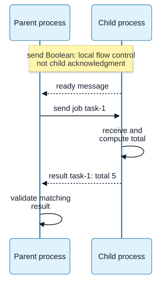

# Chapter 12 — Child Processes, IPC and Cluster Boundaries

**Domain:** D03 — Node.js Internals  
**Competency:** D03-C12  
**Editorial status:** approved_by_learner — learner explicitly approved on 2026-10-13.  
**Prerequisite review:** D03 Chapters 01–11 editorially approved; Chapter 11 explicitly approved on 2026-10-13.  
**Educational execution evidence:** Section 17 records exact Node v22.16.0/Linux test fixtures and scoped observations.  
**Learner assessment / project implementation:** deferred / not_started.

## 1. Learning outcomes, boundaries and prerequisites

After studying this chapter, a learner should be able to:

1. Distinguish an OS **process boundary** from a JavaScript Worker thread, libuv work pool, event loop or asynchronous subprocess handle.
2. Compare `spawn`, `exec`, `execFile`, `fork` and synchronous counterparts by shell involvement, buffered versus streaming output and IPC support.
3. Treat command arguments, executable selection, working directory, inherited environment and shell interpretation as separate trust and reproducibility boundaries.
4. Consume `stdout` and `stderr` with pressure-aware lifecycle handling; distinguish the process's exit status from the final closure of pipes.
5. Explain child-process messaging, serialization, `send()` flow control and why a sent message is not a business acknowledgment.
6. Explain signal requests, aborted waits, process termination and external side effects without assuming cleanup or rollback.
7. Describe `node:cluster` as a set of **separate Node processes sharing server listening resources**, not shared heap/state or an automatically managed distributed service.

Prerequisites: [Chapter 02 — Startup and Runtime Identity](02-startup-configuration-and-runtime-identity.md), [Chapter 08 — Readable/Writable Stream Mechanics](08-readable-and-writable-stream-mechanics.md), [Chapter 09 — Pipelines, Transforms and Cancellation](09-pipelines-transforms-and-cancellation.md) and [Chapter 11 — Worker Threads and Data Ownership](11-worker-threads-and-data-ownership.md). D01 provides process, concurrency and resource-lifecycle reasoning; D02 provides error, Promise and runtime-value models.

**Scope boundary:** these are **educational Node host/runtime mechanisms**, not an implementation blueprint. This lesson chooses no shell, external executable, worker/process topology, deployment stack, process count, queue, retry policy, cross-machine load balancer or product-specific capacity guarantee. Production deployments and comprehensive reliability policy are later domains.

## 2. First principles: crossing a process boundary

An operating-system process has its own address space, process identity and relevant OS resources. Creating a child process does **not** make its JavaScript global variables, heap objects, timers or module cache magically shared with the parent. The parent and child can communicate through explicit channels: pipes, sockets, inherited descriptors and Node's optional IPC channel.

A process is a **different unit of failure and resource accounting** from a thread, but it is not a complete security barrier. Both processes can have the same user identity, filesystem access, environment-derived secrets or external network permissions. A child may fail or exit while the parent continues, yet effects outside that child may remain. A fatal host-wide failure or an incorrectly managed subprocess tree may affect both.

Conceptual sequence:

```text
Parent JS       Node child_process      Child OS process       Parent JS
   |       start program + argv             |                    |
   | -------------------------------------> |                    |
   |        ChildProcess handle             |                    |
   | <------------------------------------- |                    |
   |                       stdout/stderr bytes -----------------> |
   |                       optional IPC messages --------------> |
   |                       exit status and stream closure -----> |
   |  parent interprets partial results / errors / cancellation |
```

Submission, successful spawn, child readiness, output bytes, IPC acknowledgment, OS exit and cleanup are separate stages. An asynchronous `spawn()` avoids blocking the parent's event loop while **waiting for the child to run**, but parsing arguments and setting up resources still costs synchronous work. The child's actual computation uses OS-scheduled execution resources. Creating ten processes does not imply ten unconstrained CPU cores.

## 3. Compare the subprocess interfaces

| API | Executed work and shell | How output is normally consumed | IPC | Typical failure trap |
|---|---|---|---|---|
| `spawn(program, args, options)` | Launches named program with argument vector; **no shell by default** | Incremental `stdout`/`stderr` streams | Optional configured `stdio` IPC channel | Forgetting to drain pipes, handle spawn errors or inspect close |
| `exec(command, options, callback)` | Runs a command **through a shell** | Buffers stdout/stderr until callback; `maxBuffer` applies | Not automatically a Node application IPC conversation | Concatenating untrusted shell text; unexpectedly large output |
| `execFile(file, args, options, callback)` | Direct executable by default; can opt into shell | Buffers until callback; `maxBuffer` applies | Not automatically a Node application IPC conversation | Mistaking direct argv safety for unrestricted program trust |
| `fork(modulePath, args, options)` | Launches another **Node process**, not a POSIX memory-cloning fork | Configurable `stdio` plus established IPC | Yes, built-in Node messaging | Assuming `send()` means processed, or that memory is shared |
| `spawnSync`, `execSync`, `execFileSync` | Synchronous variants | Return or throw after child completes | No ordinary async ChildProcess lifecycle | **Block the caller's event loop** for their full duration |

Use the API that expresses the educational behavior under examination; no single form is universally “best.” The shell is itself a command interpreter and changes quoting, expansion, pipelines and executable resolution. Invoking a direct executable with a discrete argument array avoids **shell interpretation by default**, but does not validate a dangerous program, its own flags or filesystem access. See the [version-pinned Node child_process API](https://nodejs.org/download/release/v22.16.0/docs/api/child_process.html).

### Startup identity belongs in the evidence

The executed file and arguments are influenced by the launch context: `process.execPath`, `cwd`, `env`, `PATH`, OS permissions, platform and optional shell. `fork()` usually uses the parent's Node executable by default and has `execArgv`/environment configuration; it does **not** copy the parent's JS heap.

Avoid copying all of `process.env` into diagnostics or child processes without purpose: inherited secrets and loader flags can change behavior. The correct resource and permission policy depends on the eventual product.

## 4. Three stream channels and three lifecycle events

A common `stdio` arrangement is `['pipe','pipe','pipe']`: child stdin is a Writable from the parent's view; stdout and stderr are Readables. The option may instead inherit an existing descriptor, ignore a channel or establish IPC. If stdout/stderr are set to pipes but never drained, bounded OS and stream buffers may fill and the child can stall.

Distinguish:

- **`'spawn'`**: the child has been successfully spawned, **not** that its entry application is ready or that its business task completed.
- **`'error'`**: failed to spawn, failed to kill/send, or other ChildProcess errors. A failed spawn may emit `error` without an `exit` event; handle both without double settlement.
- **`'exit'`**: the child process ended; **stdout/stderr may still have unread data** and their streams may not have closed.
- **`'close'`**: the ChildProcess event emitted after the child ended **and the stdio streams are closed**. It follows `exit` or `error`, but does not mean every application operation or remote effect succeeded.

`code` and `signal` convey different exit reasons: if a process is terminated by a signal, code may be `null`; if it exits normally, signal is typically `null`. Values and signal support can vary by OS. A child process returning code 0 is evidence about its exit status, **not** a proof of a remote database commit.

## 5. Example A — stdout, stderr, exit and close

Save as `a-spawn.mjs`:

```js
import { spawn } from 'node:child_process';
import process from 'node:process';

const code = [
  "process.stdout.write('output\\n');",
  "process.stderr.write('diagnostic\\n');",
  'process.exitCode = 7;'
].join('');

const child = spawn(process.execPath, ['-e', code], {
  stdio: ['ignore', 'pipe', 'pipe'],
  shell: false
});
const events = [];
let out = '';
let err = '';

child.stdout.setEncoding('utf8');
child.stderr.setEncoding('utf8');
child.stdout.on('data', chunk => { out += chunk; });
child.stderr.on('data', chunk => { err += chunk; });
child.on('error', error => { events.push('error:' + error.code); });
child.on('exit', (code, signal) => {
  events.push('exit:' + code + ':' + signal);
});
child.on('close', (code, signal) => {
  events.push('close:' + code + ':' + signal);
  console.log(JSON.stringify({ out: out.trim(), err: err.trim(), events }));
  if (code !== 7 || out.trim() !== 'output' ||
      err.trim() !== 'diagnostic') process.exitCode = 1;
});
```

Run `node a-spawn.mjs`. In three verified Linux runs:

```json
{"out":"output","err":"diagnostic","events":["exit:7:null","close:7:null"]}
```

The child itself intentionally sets a **nonzero status 7**, while the parent demo exits 0 because it successfully recognized the expected negative child outcome. The example shows separate output channels and the observed `exit` before `close` sequence. You should not infer that all streams are fully consumed at `exit`; this parent waits for `close`. In a real program, bound how much output is retained rather than appending arbitrary amounts to strings. See Chapter 08 for pressure-aware streaming.

## 6. Example B — direct argument passing versus buffered-output limits

Save as `b-execfile.mjs`:

```js
import { execFile } from 'node:child_process';
import { promisify } from 'node:util';
import process from 'node:process';

const call = promisify(execFile);
const literal = 'name; $(echo not-executed)';

const { stdout } = await call(process.execPath,
  ['-e', 'process.stdout.write(process.argv[1])', literal],
  { shell: false, maxBuffer: 1024 });

let maxBuffer = 'none';
try {
  await call(process.execPath,
    ['-e', "process.stdout.write('x'.repeat(16384))"],
    { maxBuffer: 1024 });
} catch (error) {
  maxBuffer = error.code;
}

console.log(JSON.stringify({ stdout, maxBuffer }));
if (stdout !== literal ||
    maxBuffer !== 'ERR_CHILD_PROCESS_STDIO_MAXBUFFER') {
  process.exitCode = 1;
}
```

Run `node b-execfile.mjs`. All three observed runs returned:

```json
{"stdout":"name; $(echo not-executed)","maxBuffer":"ERR_CHILD_PROCESS_STDIO_MAXBUFFER"}
```

The shell-like characters are passed as **one literal argument**, not evaluated as command substitution or a second command, because `execFile` starts the executable directly with `shell: false`. The second call deliberately exceeds its small **1024-byte** output limit and reports `ERR_CHILD_PROCESS_STDIO_MAXBUFFER`; buffering APIs can terminate a child on output overflow.

**Trust boundary:** do **not** interpolate untrusted text into `exec('...')` or `spawn(..., { shell: true })`. Escaping for every shell/platform is error-prone. Passing argv separately reduces one kind of injection risk, but an executable's own arguments (including path flags) can still authorize dangerous operations. The bounded demo string is synthetic and does not execute any attacker-controlled program.

**Portability:** on Windows, batch files such as `.bat`/`.cmd` require special shell handling; `execFile` alone may not run them. Shell syntax and quoting differ across Unix shells and Windows command interpreters. Avoid presenting Unix argv examples as an unrestricted cross-platform recipe.

## 7. Example C — fork IPC and advanced serialization

A Node `fork()` creates a separate **Node.js process** with an IPC channel. In Node's default IPC serialization mode, JSON-compatible messaging is common; the `serialization: 'advanced'` option supports a wider range of built-in value types. The received graph is **deserialized into the other process** and is not a live shared object reference.

Save as `c-fork.mjs`:

```js
import { fork } from 'node:child_process';
import { fileURLToPath } from 'node:url';

if (typeof process.send === 'function') {
  process.send({ kind: 'ready', pid: process.pid });
  process.on('message', message => {
    if (message.kind !== 'job') return;
    const total = [...message.items.values()].reduce((a, b) => a + b, 0);
    process.send({ kind: 'result', id: message.id, total, pid: process.pid });
  });
} else {
  const child = fork(fileURLToPath(import.meta.url), [], {
    stdio: ['ignore', 'ignore', 'inherit', 'ipc'],
    serialization: 'advanced'
  });
  let result;
  let accepted = false;
  child.on('error', error => {
    console.error(error);
    process.exitCode = 1;
  });
  child.on('message', message => {
    if (message.kind === 'ready') {
      accepted = child.send({
        kind: 'job', id: 'task-1', items: new Map([['a', 2], ['b', 3]])
      });
    } else if (message.kind === 'result') {
      result = message;
      child.disconnect();
    }
  });
  child.on('exit', (code, signal) => {
    console.log(JSON.stringify({
      accepted,
      differentPid: result?.pid !== process.pid,
      id: result?.id,
      total: result?.total,
      code,
      signal
    }));
    if (code !== 0 || result?.total !== 5 ||
        result?.id !== 'task-1') process.exitCode = 1;
  });
}
```

Run `node c-fork.mjs`. Three verified runs yielded:

```json
{"accepted":true,"differentPid":true,"id":"task-1","total":5,"code":0,"signal":null}
```

**What was observed:** the parent received a `ready` signal from a different process ID, sent a `Map` through **advanced serialization**, received a correlated `task-1` result, then disconnected IPC and observed normal child exit. The exercise confirms local IPC behavior for one finite message, not durable delivery.

**Crucial caveat:** `child.send(...)` returning `true` is **not** a business-level acknowledgment. It reflects the state of the local IPC sending path/backlog, not that the child accepted, completed or persisted a task. `send()` can return `false` if disconnected or when queued backlog is excessive; an optional callback refers to sending, not application processing. With numerous tasks, add explicit IDs and a bounded admission/result protocol. Sending a Node socket/server handle is possible in supported modes, but **buffered data already inside a socket does not automatically move with the handle**. Those responsibilities require a separate design.

**Scope of the demo:** one in-flight request, no timeout, kill/retry logic or exactly-once guarantee. If the child exits before replying, the parent must reconcile unknown task status; this minimalist example does not implement that policy.

**Visual question:** What additional evidence does task-1’s result provide beyond send returning true?



*Figure D03-V11 — Example C’s successful application exchange. The local send return is not a receiver acknowledgment and has no implied ordering against the child’s execution. The later task-1 result is explicit task-level evidence, still not a durable commit. Advanced serialization creates receiver values rather than sharing a heap. IPC disconnection and child exit follow in the fixture; exit/close and stream drainage are separate boundaries. No fairness, replay or exactly-once guarantee is drawn. [Reference](https://nodejs.org/docs/latest-v24.x/api/child_process.html#subprocesssendmessage-sendhandle-options-callback).*

[Full-size SVG](../assets/12-child-processes-ipc-and-cluster-boundaries/ipc-send-versus-result.svg) · [Editable Mermaid source](../assets/12-child-processes-ipc-and-cluster-boundaries/ipc-send-versus-result.mmd).

## 8. Example D — output backpressure can stop a child

A pipe has finite OS capacity. Node's Readable/Writable stream abstractions also have bounded buffer thresholds. A subprocess that produces data faster than its parent consumes it can stall or accumulate memory; ignoring `stdout` while it is piped is not a safe “discard” policy.

Save as `d-backpressure.mjs`:

```js
import { spawn } from 'node:child_process';
import { fileURLToPath } from 'node:url';
import process from 'node:process';

if (process.argv[2] === 'child') {
  let sent = 0;
  let pressure = 0;
  const target = 16;
  function writeMore() {
    while (sent < target) {
      sent++;
      if (!process.stdout.write(Buffer.alloc(65536, 120))) {
        pressure++;
        process.stdout.once('drain', writeMore);
        return;
      }
    }
    process.stderr.write(JSON.stringify({ sent, pressure }) + '\n');
    process.stdout.end();
  }
  writeMore();
} else {
  const child = spawn(process.execPath,
    [fileURLToPath(import.meta.url), 'child'],
    { stdio: ['ignore', 'pipe', 'pipe'] });
  let bytes = 0;
  let report = '';

  child.stderr.setEncoding('utf8');
  child.stderr.on('data', part => { report += part; });
  child.stdout.pause();
  setTimeout(() => {
    child.stdout.on('data', chunk => { bytes += chunk.length; });
    child.stdout.resume();
  }, 100);
  child.on('error', error => { console.error(error); process.exitCode = 1; });
  child.on('close', code => {
    const stats = JSON.parse(report.trim());
    console.log(JSON.stringify({
      bytes, writes: stats.sent, sawPressure: stats.pressure > 0, code
    }));
    if (bytes !== 16 * 65536 || stats.sent !== 16 ||
        code !== 0) process.exitCode = 1;
  });
}
```

Run `node d-backpressure.mjs`. In all three verified runs:

```json
{"bytes":1048576,"writes":16,"sawPressure":true,"code":0}
```

The child emitted **1 MiB** in 16 chunks; the parent intentionally delayed reading by about 100 ms. The child noticed at least one `write()` returning `false` and awaited `drain` before continuing. All bytes were consumed before the final close event.

**What is *not* proven:** `write() === false` alone does **not** identify whether the OS pipe is full; it can reflect Node's stream buffer/highWaterMark pressure before a kernel pipe blocks. The elapsed delay is not an accurate pipe-capacity measurement. Parent and child buffering together do not impose a universal process-memory ceiling. A real program should stream to a bounded sink, enforce output budgets and own timeout/error/cleanup paths. If output is intentionally unnecessary, configure the appropriate `stdio` channel as `ignore`.

## 9. Example E — signal request, process exit and cleanup

A signal request asks the operating system to act on a process. It is not a successful task result, resource cleanup confirmation or rollback. A child's `kill()` API can return a boolean indicating that signaling was accepted at its own boundary, yet the process may terminate later or handle the signal.

Save as `e-signal.mjs`:

```js
import { spawn } from 'node:child_process';
import process from 'node:process';

const child = spawn(process.execPath,
  ['-e', "process.stdout.write('ready\\n'); setInterval(() => {}, 1000)"],
  { stdio: ['ignore', 'pipe', 'pipe'] });

let issued = false;
child.stdout.setEncoding('utf8');
child.stdout.once('data', chunk => {
  if (chunk.includes('ready')) issued = child.kill('SIGTERM');
});
child.on('error', error => { console.error(error); process.exitCode = 1; });
child.on('close', (code, signal) => {
  console.log(JSON.stringify({ issued, code, signal }));
  if (!issued || signal !== 'SIGTERM') process.exitCode = 1;
});
```

Run `node e-signal.mjs`. All three Linux observations:

```json
{"issued":true,"code":null,"signal":"SIGTERM"}
```

The parent waits for a tiny **startup observation** before signaling, so it avoids sending `SIGTERM` to a child whose application has not even printed its readiness marker. On this Linux environment, the child terminated by signal; thus `code` was `null`.

**Limits:** other platforms and process handlers can behave differently. A signal can be caught or ignored under some conditions; support differs across OSes, especially Windows. Sending a signal to one PID does not guarantee its grandchildren or external operations stop. A graceful service shutdown needs ownership, bounded deadlines and outcome reconciliation; Chapter 16 covers the larger runtime lifecycle.

Do not equate the `'ready'` text used here with an application's full operational readiness. It is a deliberately minimal deterministic fixture marker.

## 10. Example F — cluster workers share a listening resource, not a heap

`node:cluster` starts multiple **Node processes** and coordinates sharing of server listening resources. The primary and each worker have separate process IDs and heaps. Depending on platform and scheduling policy, the primary can distribute accepted connections or workers can participate in accepting them; do not infer a fixed order or fair ratio of requests from `cluster.fork()`.

Save as `f-cluster.mjs`:

```js
import cluster from 'node:cluster';
import http from 'node:http';
import process from 'node:process';

if (cluster.isPrimary) {
  const children = [cluster.fork(), cluster.fork()];
  let port;
  const ids = new Set();
  const timeout = setTimeout(() => {
    process.exitCode = 1;
    for (const child of children) child.kill();
  }, 5000);

  for (const worker of children) worker.on('message', msg => {
    if (msg.kind !== 'listening' || port !== undefined) return;
    port = msg.port;
    (async () => {
      for (let i = 0; i < 12; i++) {
        const body = await new Promise((resolve, reject) => {
          http.get({ host: '127.0.0.1', port, agent: false }, response => {
            let data = '';
            response.setEncoding('utf8');
            response.on('data', chunk => { data += chunk; });
            response.on('end', () => resolve(data));
          }).on('error', reject);
        });
        ids.add(Number(body));
      }
      console.log(JSON.stringify({
        samePort: port > 0,
        respondingPids: ids.size,
        separateFromPrimary: !ids.has(process.pid)
      }));
      if (!ids.size || ids.has(process.pid)) process.exitCode = 1;
      for (const child of children) child.send({ kind: 'stop' });
    })().catch(error => {
      console.error(error);
      process.exitCode = 1;
      for (const child of children) child.kill();
    });
  });

  let exits = 0;
  for (const worker of children) worker.on('exit', () => {
    if (++exits === children.length) clearTimeout(timeout);
  });
} else {
  const server = http.createServer((_req, res) => res.end(String(process.pid)));
  server.listen(0, '127.0.0.1', () => {
    process.send({ kind: 'listening', port: server.address().port });
  });
  process.on('message', msg => {
    if (msg.kind === 'stop') server.close(() => process.disconnect());
  });
}
```

Run `node f-cluster.mjs` on a host permitting loopback TCP sockets and two child processes. In **three local Linux runs**, the fixture reported:

```json
{"samePort":true,"respondingPids":2,"separateFromPrimary":true}
```

The educational checks observed **two different child PIDs** handling 12 short loopback HTTP requests on **one shared ephemeral listening port**. The primary did not handle those requests. This demonstrates separate-process identity and the cluster sharing mechanism on this platform/version.

**Not guaranteed by this fixture:** exactly equal connection distribution, sticky sessions, process restart, zero lost connections on exit, cross-machine load balancing, durable user sessions, consistent per-worker memory, production HTTP readiness or security isolation. The number of responding PIDs in 12 requests can vary on a loaded host; one worker receiving all 12 is not proof that cluster is broken. The fixture depends on loopback sockets and uses a five-second emergency timer, **not** a general server graceful-shutdown policy.

Cluster uses `fork()`-style Node child processes and IPC/handle transfer internally. It does not create a thread-shared `Map` across workers or automatically implement application-level state synchronization, retries, health management or deployment orchestration. Consult the [Node v22.16.0 cluster documentation](https://nodejs.org/download/release/v22.16.0/docs/api/cluster.html) for platform-dependent scheduling behavior.

## 11. Negative-path fixture — nonexistent executable

Launching a program can fail **before** any child application code exists. Save as `g-missing.mjs`:

```js
import { spawn } from 'node:child_process';

const child = spawn('__handbook_missing_executable_20261013__', [], {
  shell: false,
  stdio: 'ignore'
});
const events = [];

child.on('error', error => events.push('error:' + error.code));
child.on('exit', (code, signal) =>
  events.push('exit:' + code + ':' + signal));
child.on('close', (code, signal) => {
  events.push('close:' + code + ':' + signal);
  console.log(JSON.stringify(events));
  if (!events.some(item => item === 'error:ENOENT')) process.exitCode = 1;
});
```

Three Linux observations:

```json
["error:ENOENT","close:-2:null"]
```

The parent test completed successfully because it **expected** the spawn error. In this case **no `exit` event** was observed, but a later `close` event occurred. The numeric close code `-2` is a runtime/platform observation, **not** a portable sentinel to hardcode. In real error paths guard cleanup against duplicate settlement via both `error` and `close` and preserve the actual failure reason. Never log a failed launch as “child returned a nonzero business exit” without checking whether the OS process was created.

## 12. IPC messages and control-plane semantics

Process IPC is a transport, not a task database. A robust mental model separates:

```text
submitted → send operation → received → validated/admitted
     → work started → completed → outcome observed → acknowledged
```

Those arrows are **application-protocol states**, not automatic guarantees of Node's `send()`. The process can exit between any two observations. With `serialization: 'json'` (default) and `'advanced'` modes, supported value types and behavior differ; advanced serialization does **not** imply shared memory. It also may be unsuitable for arbitrary class instances/custom prototypes.

The sending channel has finite capacity. `send()` returning `false` can indicate connection closure or backed-up messages; the callback reports sending-side completion/error, **not** that the receiver committed the task. The caller must avoid unbounded unsent message accumulation and control message sizes.

Some special IPC `cmd` values beginning with `NODE_` are reserved internally by Node; do not craft application protocols that collide with them. Message handlers require validation: a process child is a distinct program/version and could emit malformed, surprising or incomplete results. Task identity should not be confused with process ID: a process can handle multiple tasks, and task retries can run in different processes.

**Resource handles:** supported `sendHandle` mechanisms can pass server/socket handles between Node processes. The handle's lifetime and buffered data ownership matter; possession of a handle is not proof of complete earlier traffic transfer. This chapter does not implement handle passing; cluster's server-sharing behavior is introduced only as a conceptual consumer of related mechanisms.

## 13. Signals, cancellation and the uncertain-outcome problem

A subprocess may exit because it naturally completed, returned a nonzero exit code, received a termination signal, was killed by the OS due to resource pressure, failed during startup, lost IPC or was interrupted by the parent. The parent must not collapse these cases into “failed task, safe to retry.”

A timeout option, `AbortSignal`, `subprocess.kill()`, `disconnect()`, stream closure and an OS process-group kill are **different actions**. Their exact support, effect and teardown semantics vary. Some cancel a wait, some ask for child termination, some close only the messaging channel. None universally rolls back already-written files, externally sent messages or remote transactions.

For a bounded operational protocol, ask: who owns cancellation and the timer? What does successful local signal delivery mean? Who will drain stdout/stderr? Is there a subprocess tree? What if an IPC acknowledgment arrives after the deadline? Which side can prove an external side effect was not committed? These are product/service questions, **not** solved by changing the API call.

A child whose work was interrupted may hold partial output on disk or leave an external request in flight. A safe higher-level design must reconcile **unknown** outcomes before replay where duplicates matter. This lesson does not choose a retry policy for any PRD.

## 14. Backend case study — a report generator appears to hang

A backend launches an external reporting tool. The tool writes progress to stderr and exports a large result to stdout. A parent waits only for `'exit'` without consuming the stdout stream; output stalls and the child appears “hung.” A naive operator proposes more Node Workers or increasing libuv's worker pool.

Competing explanations: a bounded stdout pipe filled; the child is still doing real CPU work; its process is waiting on disk; it is blocked by the parent not consuming data; command shell expansion altered paths; exit occurred but pipes remain open through a descendant; or the intended tool never spawned.

**Evidence plan:**
1. Record executable path, argv **shape** (redact secrets), cwd, relevant environment and shell/stdio configuration.
2. Capture when `spawn`, output chunks, `exit` and `close` were observed; bound output bytes and inspect stderr errors.
3. Determine whether the child is still running and whether stdout/stderr are being drained.
4. Differentiate process exit code/signal from output validation and persistence.
5. Under a controlled small fixture, compare continuous consumption versus intentionally paused consumption; do not run unbounded data.
6. If cancellation occurs, record which step was requested and whether external effects remain unknown.

The correct cause follows evidence; “it is asynchronous” does not rule out bounded buffers or a blocking external program. This is an explanatory case study, **not** a product specification or a recommendation to choose external CLI execution over an in-process library.

## 15. Advanced nuances and portability

**OS variability.** Unix executable/permission rules, shells, signal handlers, process groups and Windows batch file invocation differ. POSIX `fork(2)` is not what Node's `child_process.fork()` means. Windows signals may be emulated/restricted; a signal in the lesson is a Linux-specific observation.

**Shell child trees.** Running `exec()` through a shell can add another process between the parent and the eventual command. Signaling only the direct child may leave descendants alive; `detached` and process-group behavior are OS-specific and must not be casually standardized. Never execute untrusted command lines as a convenience.

**IPC and object fidelity.** JSON and advanced serialization are not transparent mirrors of the sending process's heap. `Map`, Buffer-like data, dates, errors and class instances have distinct rules. Transferable/shared-memory ownership from Chapter 11 does **not** automatically carry over to child-process IPC as though processes shared a V8 heap.

**Spawning cost.** Each additional Node child starts a separate process/runtime with memory and startup cost; multiplying process count does not create unconstrained CPUs or automatically speed all I/O.

**Cluster routing.** Scheduling policies and load distribution differ by platform. Node cluster does not provide sticky session affinity, shared in-memory sessions, failover guarantees, autoscaling or application-level request replay. The primary's and workers' lifecycles must be owned explicitly.

**Liveness.** IPC, readable streams and child handles can keep event loops/processes running; `ref()`, `unref()` and `disconnect()` change lifecycle semantics, not task correctness. Accidentally dropping a reference can allow a process to end before a task is acknowledged.

**Output decoding.** Pipes carry bytes; arbitrary stream chunks can split UTF-8 code points or application records. Using `setEncoding('utf8')` handles character decoding in these tiny fixtures, not protocol framing for general subprocess outputs. Readability, closure, acknowledgment and durable persistence are separate boundaries.

## 16. Frequent mistakes and exercises reserved for later study

| Common mistake | Correct model |
|---|---|
| `fork()` clones a live JavaScript object heap | Node fork launches another Node process; explicit serialization/IPC is needed. |
| `exec()` and `execFile()` interpret commands identically | `exec` uses a shell; `execFile` launches a file directly by default. |
| Passing an argv array validates every option | It prevents default shell interpolation, not dangerous executable semantics. |
| `exit` proves streams were drained | `close` follows stream closure; even that doesn't prove business success. |
| `send()` returned true, so child committed | Local send/backlog signal is not receiver acknowledgment or durable work. |
| `kill()` guarantees cleanup | Signal request is not a cleanup or rollback proof. |
| `close` code 0 means externally completed | Local process exit/stream completion is not a remote transaction commitment. |
| A cluster shares JavaScript session Maps across workers | Workers are separate processes with independent heaps. |
| Two responding cluster workers imply fair long-term distribution | Small observation is not a scheduling fairness guarantee. |
| Pipe pressure means increase libuv pool size | Stdio is a separate OS/stream flow-control bottleneck. |

**Exercises (not administered):**

1. **Choose an API.** Compare launching an external tool with unbounded output versus a tiny bounded-output utility. **Rubric:** `spawn` streaming versus `execFile` buffering; explicit budgets, errors, shell boundary and cancellation.
2. **Explain ordering.** A child emits `exit` but stdout still has bytes. What should the parent await? **Answer:** continue consuming streams and observe `close` for child stdio closure, then validate output and outcomes.
3. **Injection question.** What is the risk in `exec('utility ' + userInput)`? **Answer:** shell interpretation of untrusted text; separate executable and validated argv are safer but not sufficient for all security.
4. **IPC uncertainty.** `send()` returned true, then the child exited before a result. Is replay harmless? **Answer:** not inferable; distinguish local sending, receipt, execution and external effects.
5. **Output saturation.** Why can an external tool stop while the parent's Node event loop still responds? **Answer:** the tool may block on an undrained stdout/stderr pipe even if the parent can run other callbacks.
6. **Signal semantics.** Interpret `{code:null,signal:'SIGTERM'}` from the Linux fixture. **Answer:** the child ended due to that signal; no proof of business rollback or child-process-tree cleanup.
7. **Cluster boundary.** Why must session state not be stored solely in each process's in-memory `Map` if requests may reach different workers? **Answer:** per-process heaps aren't shared; correct product requirements need a separately approved state strategy later.
8. **Evidence quality.** A 12-request cluster demo reports only one worker PID. Is shared port necessarily broken? **Answer:** no; inspect listener/child status and actual host scheduling; distribution ratio isn't guaranteed.
9. **Portable errors.** One platform emits `ENOENT` and close code `-2`. Can that number be a public business error code? **Answer:** no; describe the failure with a deliberate application-level code and retain source evidence.
10. **Process versus thread.** When might process separation be useful beyond CPU offload? **Rubric:** independent heaps/executable/runtime/lifecycle/resource boundaries, but not perfect sandboxing; technical choice remains open.

No learner answered these exercises during the authoring phase, and this chapter records **no grade, assessed competence or implemented project**.

## 17. Verification, official sources and remaining gaps

**Documents checked on 2026-10-13:**

- [Node.js v22.16.0 child_process API](https://nodejs.org/download/release/v22.16.0/docs/api/child_process.html): `spawn`, `exec`, `execFile`, `fork`, stdio, errors, exit/close, signals, IPC send/flow control, advanced serialization and platform-specific shell behavior.
- [Node.js v22.16.0 cluster API](https://nodejs.org/download/release/v22.16.0/docs/api/cluster.html): separate process workers, shared listening resources, scheduling approaches and worker lifecycle.
- [Node.js v22.16.0 stream API](https://nodejs.org/download/release/v22.16.0/docs/api/stream.html): `write()` false/`drain` and stream consumption behavior.
- [Node.js v22.16.0 process API](https://nodejs.org/download/release/v22.16.0/docs/api/process.html): process identities and signals.

**Execution environment:** Node **v22.16.0**, V8 **12.4.254.21-node.26**, libuv **1.49.2**, Linux x64; 2026-10-13. Each of the seven **standalone ESM educational fixtures** (`a-spawn.mjs` through `g-missing.mjs`) was run **three independent times**, for **21 verified executions**. The cluster fixture uses two child Node processes and loopback TCP; the others use local synthetic byte/string inputs and subprocesses. No external network destinations, production file modifications or real user secrets are involved.

| Executed fixture | Observed outcomes in three runs | Critical limit |
|---|---|---|
| A — `spawn`, stdio and lifecycle | Child printed `output`/`diagnostic`, exited code 7, parent observed `exit` then `close` | Not a guarantee of application success, arbitrary event timing or unlimited output buffering |
| B — `execFile` | Literal `name; $(echo not-executed)` passed intact; deliberate output overflow emitted `ERR_CHILD_PROCESS_STDIO_MAXBUFFER` | No test of arbitrary executables/OS shells; buffered-output limit is not a universal security budget |
| C — `fork` IPC | `accepted:true`, distinct child PID, correlated `task-1` with total 5, clean exit 0 | `send` true not receiver acceptance, durable delivery or exactly-once |
| D — output backpressure | 16 × 65,536 byte writes; 1,048,576 bytes consumed; `sawPressure:true`; child exit 0 | `write()` false reflects stream pressure, **not proof kernel pipe capacity** |
| E — signal | `issued:true`, `code:null`, `signal:'SIGTERM'` | Linux observation only; not guaranteed cross-platform or child-tree cleanup |
| F — two-process cluster | One loopback ephemeral port used; requests reached **two different child PIDs**; no primary PID response | No guarantee of fairness, portability, session coordination or real traffic handling |
| G — missing executable | `error:ENOENT`, then `close:-2:null`; no `exit` event observed | Exact negative close code is platform/runtime-specific |

The fixture logs are scoped evidence of **observable behavior**, not proof of native OS-syscall sequence, port-distribution policy, safe arbitrary shell usage, transport reliability, durable output, production readiness or learner mastery. No actual process-tree kill tests on multiple OSes, multi-MiB UTF-8 framing, production load, nested children or remote cluster were conducted.

| Author quality gate | Evidence / limitation |
|---|---|
| First principles and cross-domain boundaries | Sections 1–4 distinguish process/thread, command invocation, pipes and event lifecycles. |
| Runnable practical examples | Sections 5–11 supply seven tested fixtures, including negative path, pressure, IPC and cluster. |
| Ownership/error/uncertainty | Sections 12–15 separate transport, child exit, cancellation and external side effects. |
| Security/performance and portability | Sections 3, 6, 8, 13–15 show injection, bounded output, OS shell/signal differences and process costs. |
| Exercises/answer rubric | Section 16; no actual learning assessment. |
| Documented references and versioned verification | This section and links above; observations restricted to Node v22.16.0/Linux x64. |
| Coverage matrix | D03-C11 learner-approved editorially; D03-C12 authored/in_review; no D03 PRD or product implementation evidence. |

**Remaining gaps:** exhaustive OS process-group semantics, actual process supervisor implementation, high-availability deployment, real-file descriptor transfer, native IPC internals, benchmarked production clustering, and policy for remote side effects. Those are not silently required by this lesson. Deeper error/shutdown lifecycles → Chapter 16; comprehensive diagnostics → Chapter 17; architecture/platform systems → later domains.

**Author quality review:** complete against `docs/quality-gates.md` and approved D03 curriculum scope. **Learner editorial approval:** explicitly confirmed on 2026-10-13. Chapter 13 — Module Resolution and Runtime Loading — is now authored/in_review and awaits learner approval before Chapter 14. Learning assessment and implementation remain deferred.
