# Chapter 15 — Async Context and Diagnostic Causality

**Domain:** D03 — Node.js Internals  
**Competency:** D03-C15  
**Editorial status:** approved_by_learner — explicitly confirmed by learner on 2026-10-13.  
**Prerequisite approval:** Chapters 01–14 of D03 learner-approved; Chapter 14 explicitly approved on 2026-10-13.  
**Educational execution:** Section 17 records five independent ESM fixtures run three times each (15/15 expected outcomes) on Node v22.16.0 / Linux x64.  
**Learning assessment / product implementation:** deferred / not_started.

## 1. Outcomes, boundaries and prerequisites

By the end of this chapter a learner should be able to:

1. Distinguish **the asynchronous execution context** from a request identifier, a JavaScript global, an OS thread or a business transaction.
2. Explain `AsyncLocalStorage` (ALS) store lifetime, `run()` and `getStore()`, including propagation through native Promises, timers and other async resources.
3. Show how context can be **lost** when a callback is invoked in an unrelated execution context or a third-party asynchronous abstraction does not preserve its creation context.
4. Compare `AsyncLocalStorage.bind()`, `snapshot()` and `AsyncResource.runInAsyncScope()` without assuming they are interchangeable in every case.
5. Explain the difference between an **EventEmitter's synchronous listener invocation** and a bound callback that intentionally restores its origin context.
6. Demonstrate that ALS context does **not automatically cross Worker-thread, child-process or network boundaries**; propagation there requires an explicit, validated protocol.
7. Separate **diagnostic correlation**, temporal ordering and **proof of causality**; identify missing evidence in realistic backend traces.
8. State how to avoid mutable-context leaks, sensitive logging, incorrect authorization decisions and unbounded resource retention.

Prerequisites: [D03 Chapter 04 — Scheduling Queues and Timers](04-scheduling-queues-and-timers.md), [Chapter 05 — EventEmitter and Callback Contracts](05-eventemitter-and-callback-contracts.md), [Chapter 11 — Worker Threads and Data Ownership](11-worker-threads-and-data-ownership.md), [Chapter 12 — Child Processes, IPC and Cluster Boundaries](12-child-processes-ipc-and-cluster-boundaries.md), plus D02 [Promises/async](../../02-javascript-typescript/lessons/08-promises-and-async-await.md) and D01 concurrency/correctness.

**Boundary:** this is an educational examination of Node's context and causality mechanisms. It does **not** choose a request tracing vendor, production middleware, authentication system, log retention policy, security architecture, worker pool, queue or business-level event protocol for a portfolio PRD. Full production instrumentation is outside D03; Chapter 17 consolidates runtime diagnostics and D16 owns production observability systems.

## 2. First principles: association is not a global variable

A backend handles interleaved operations. Request A can start a query, request B can start a query, and A's callback can run much later. A module-global `currentRequestId` changes when B begins and is not a reliable association for A's continuation.

What we want is **an association between an execution context and a store of application-chosen metadata**:

```text
A submitted work
   ├─ async callback A1   -> context { id: A }
   └─ Promise chain A2    -> context { id: A }

B submitted work
   ├─ timer callback B1   -> context { id: B }
   └─ Promise chain B2    -> context { id: B }
```

This is a diagram of *intended association*, **not** a promise that these callbacks execute in any specific order. Context propagation does not make operations serial, synchronize data, grant the right to impersonate another request or establish a global causal timeline.

`AsyncLocalStorage` in `node:async_hooks` allows code to retrieve the store associated with the current async execution via `getStore()`. It builds on Node's asynchronous resource tracking; application code normally should use ALS instead of manually implementing lower-level async hooks.

**Important distinction:** there is no implicit global "request context" magically understood by Node. The application selects a store, chooses its starting boundary and defines what an ID means. The runtime can carry that association through supported async resources; it cannot infer a user's identity, a correct distributed transaction state or the truth of a log message.

## 3. The ALS execution contract: `run()` and `getStore()`

At an ordinary request boundary:

```js
import { AsyncLocalStorage } from 'node:async_hooks';

const als = new AsyncLocalStorage();

function withDiagnosticContext(id, work) {
  const store = Object.freeze({ id });
  return als.run(store, work);
}

withDiagnosticContext('example-42', () => {
  console.log(als.getStore().id); // example-42
});
console.log(als.getStore()); // undefined (in this simple outer scope)
```

`run(store, callback)` invokes the callback **synchronously** within the new context; it returns the callback's return value. Async resources *created within* that context can later observe the same store, even after `run` has returned. The store is not accessible to unrelated code merely because one request once created it.

`getStore()` may return **undefined** outside a context. The store can be any JavaScript value, including a mutable object. `Object.freeze` protects this small flat example's direct properties, not nested objects or every possible backing resource. ALS associates the value with an execution context; it does **not** deep-copy, freeze or authorize that value.

Each ALS instance maintains independent context storage. Two ALS instances can coexist, such as one for tracing and one for diagnostic feature state, but that is not evidence that a particular design needs multiple instances. Disposal and lifetime need deliberate ownership: `asyncLocalStorage.disable()` exits/disables contexts for that instance and is marked **experimental** in the pinned Node release; it is *not* a routine request-end switch.

**Do not use `enterWith()` casually:** unlike the scoped `run()` callback, `enterWith(store)` changes the remainder of the current synchronous execution and may affect later EventEmitter listeners called on that stack. In Node v22.16.0, `enterWith` is marked experimental; prefer `run()` for educational request scoping. [Node v22.16.0 ALS docs](https://nodejs.org/download/release/v22.16.0/docs/api/async_context.html).

## 4. Worked example A — two interleaved operations retain separate context

Save as `a-isolation.mjs`:

```js
import { AsyncLocalStorage } from 'node:async_hooks';
import assert from 'node:assert/strict';

const als = new AsyncLocalStorage();
const seen = [];

async function work(id, delay) {
  return als.run(Object.freeze({ id }), async () => {
    seen.push(id + ':start:' + als.getStore().id);
    await new Promise(resolve => setTimeout(resolve, delay));
    seen.push(id + ':after:' + als.getStore().id);
    await Promise.resolve();
    seen.push(id + ':promise:' + als.getStore().id);
  });
}

await Promise.all([work('A', 8), work('B', 2)]);
assert.equal(als.getStore(), undefined);
for (const id of ['A', 'B'])
  for (const phase of ['start', 'after', 'promise'])
    assert.ok(seen.includes(id + ':' + phase + ':' + id));

console.log(JSON.stringify({
  isolated: true, outside: als.getStore() ?? null, seen
}));
```

Run `node a-isolation.mjs`. One recorded local output (repeated in three runs):

```json
{"isolated":true,"outside":null,"seen":["A:start:A","B:start:B","B:after:B","B:promise:B","A:after:A","A:promise:A"]}
```

**Supported claim:** both async chains saw their own IDs before and after a timer and Promise continuation. The unrelated outer execution had no store.

**Not guaranteed:** B always finishing before A, or a numeric delay serving as an execution deadline. Timers can be delayed by host load and scheduling; the assertions check **association**, not absolute callback order. `Promise.all()` aggregates outcomes without making the operations sequential.

## 5. EventEmitter context: listening and invoking are different acts

An `EventEmitter` calls ordinary listeners synchronously when `emit()` runs. Simply registering a listener *while* an ALS store exists does not automatically guarantee that the listener executes later under that registration-time store. If `emit()` occurs under unrelated or missing context, an unbound ordinary listener observes the **emitter's calling execution context**.

There are cases where that is correct: a listener may need the context of the **current emission**, not that of registration. In other cases, especially callbacks representing a request-specific task, the registration context is the intended owner and needs explicit binding.

In the tested Node release, the static APIs `AsyncLocalStorage.bind(fn)` and `AsyncLocalStorage.snapshot()` are **stable as of Node v22.15.0**. They capture the current execution context for later use. This is a version-dependent status; check the target release. [Async context API stability history](https://nodejs.org/download/release/v22.16.0/docs/api/async_context.html).

## 6. Worked example B — demonstrate context loss and capture

Save as `b-emitter.mjs`:

```js
import { AsyncLocalStorage } from 'node:async_hooks';
import { EventEmitter } from 'node:events';
import assert from 'node:assert/strict';

const als = new AsyncLocalStorage();
const bus = new EventEmitter();
const observed = [];

als.run({ id: 'A' }, () => {
  bus.on('done', () =>
    observed.push(['plain', als.getStore()?.id ?? null]));
  bus.on('done', AsyncLocalStorage.bind(() =>
    observed.push(['bound', als.getStore()?.id ?? null])));
});

const snapshot = als.run({ id: 'B' }, () =>
  AsyncLocalStorage.snapshot());

bus.emit('done'); // outside A and B
const snapResult = als.run({ id: 'C' }, () =>
  snapshot(() => als.getStore()?.id ?? null));

assert.deepEqual(observed, [['plain', null], ['bound', 'A']]);
assert.equal(snapResult, 'B');
console.log(JSON.stringify({
  observed, snapResult, outside: als.getStore() ?? null
}));
```

Three independent runs printed:

```json
{"observed":[["plain",null],["bound","A"]],"snapResult":"B","outside":null}
```

The ordinary listener emitted outside a store observes `null` in the report. `AsyncLocalStorage.bind()` causes its callback to execute under the captured A context despite the later external emission. `snapshot()` captures B's execution context and later runs the supplied function under B even though the invocation happens inside C.

**Do not globally bind all EventEmitter listeners:** a listener that should inherit the *emitter's* current request could be incorrectly associated with an earlier registrant. Capturing context is a semantic decision about **ownership and diagnostic attribution**, not a universal remedy.

**Additional failure boundary:** an untrusted emitter or callback can still pass false IDs in message payloads. A bound context helps correlation, **not validation or authorization**.

**Visual question:** Why does the plain listener see no store while the bound listener sees A?



*Figure D03-V15 — The branches are two listener invocations in Example B, not parallel execution or two threads. Plain listeners inherit the emission’s calling context; the bound callback intentionally restores the context captured in A. Binding changes attribution semantics and can retain data, so it is not a universal listener policy. ALS associates values, does not freeze stores, and does not cross Worker/process boundaries automatically or prove authorization or distributed causality. [Reference](https://nodejs.org/docs/latest-v24.x/api/async_context.html#static-method-asynclocalstoragebindfn).*

[Full-size SVG](../assets/15-async-context-and-diagnostic-causality/emitter-context-capture.svg) · [Editable Mermaid source](../assets/15-async-context-and-diagnostic-causality/emitter-context-capture.mmd).

## 7. `AsyncResource`: connecting custom lifecycle to execution context

Most ordinary Node Promise/timer APIs preserve ALS context without custom code. A library that stores a callback and later invokes it through a foreign event loop, custom thenable or manual queue can lose its original association. A lower-level tool is `AsyncResource`: create a resource **under the intended origin context** and later invoke a callback through `resource.runInAsyncScope()`.

Conceptually:

```text
A context -> create AsyncResource A -> enqueue task callback A
B context -> create AsyncResource B -> enqueue task callback B
Global/unrelated drain -> run A within resource A context
                        -> run B within resource B context
```

`runInAsyncScope(fn, thisArg, ...args)` temporarily enters that async resource's execution context, calls the function and restores the previous context. `emitDestroy()` reports the lifecycle's destroy event and should be called **once** when the resource is finished. These are mechanisms for tracked association; they do not serialize work, implement an application queue or guarantee task success.

`AsyncLocalStorage.snapshot()` can be simpler than allocating a custom `AsyncResource` for some small cases. `AsyncResource` is useful when the custom abstraction needs a distinct named resource and lifecycle relationships for diagnostics. Do not build an entire worker/queue infrastructure solely to demonstrate ALS.

## 8. Worked example C — repair a manually drained task queue

Save as `c-resource.mjs`:

```js
import { AsyncLocalStorage, AsyncResource } from 'node:async_hooks';
import assert from 'node:assert/strict';

const als = new AsyncLocalStorage();
const jobs = [];

function queueTask(id) {
  als.run({ id }, () => {
    const resource = new AsyncResource('EducationalJob');
    jobs.push({
      resource, task: () => als.getStore()?.id ?? null
    });
  });
}
queueTask('A');
queueTask('B');

const outside = als.getStore() ?? null;
const withoutBinding = jobs.map(item => item.task());

const restored = jobs.map(item => {
  try { return item.resource.runInAsyncScope(item.task); }
  finally { item.resource.emitDestroy(); }
});

assert.deepEqual(withoutBinding, [null, null]);
assert.deepEqual(restored, ['A', 'B']);
console.log(JSON.stringify({ outside, withoutBinding, restored }));
```

Three independent runs printed:

```json
{"outside":null,"withoutBinding":[null,null],"restored":["A","B"]}
```

Here `jobs` is an intentionally tiny synchronous educational list, **not** a persistent queue. Invoking those closures directly from outside any request context loses their association. `runInAsyncScope()` restores the context captured when the custom `AsyncResource` was created. The resource's destroy hook is emitted when this fixture completes the task.

**Failure counterexample:** if you construct all `AsyncResource` instances while **outside** A and B, then merely pass them callback closures from inside A/B, those resources can capture the wrong context. Binding must occur at the right creation boundary. The default `triggerAsyncId` and diagnostic relationships depend on that source context; adding arbitrary `asyncId` numbers will not make the relationship true.

**Resource caveat:** robust dispatch needs guaranteed single completion/cleanup, bounded task lifetime and error handling. The demonstration omits async exceptions, task cancellation, retries and persistent storage, and deliberately prescribes no production queue.

## 9. A Worker is a different async-context domain

Chapter 11 introduced Workers as independent JavaScript threads and V8 isolates. An `AsyncLocalStorage` store in the parent's isolate does **not** automatically appear in the Worker's ALS instance. The Worker and any child process also need their own local runtime context.

You may **explicitly transmit a validated correlation value** as `workerData` or a message and then initialize a local ALS store in that Worker. That is a **logical association protocol** across boundaries, not automatic propagation of the original JavaScript execution context. A sender-provided `traceId` is not proof of customer identity or permission, and processes/machines can have different clocks.

It is also wrong to assume a parent callback listening to `worker.on('message')` executes under whichever logical request caused a particular message. Multiple tasks may share one Worker: an explicit task identity is needed for attribution.

## 10. Worked example D — explicit Worker propagation

Save as `d-worker.mjs`:

```js
import { Worker, isMainThread, workerData, parentPort }
  from 'node:worker_threads';
import { AsyncLocalStorage } from 'node:async_hooks';
import assert from 'node:assert/strict';

const als = new AsyncLocalStorage();

if (!isMainThread) {
  const before = als.getStore() ?? null;
  const inside = als.run(
    Object.freeze({ id: workerData.id }),
    () => als.getStore().id
  );
  parentPort.postMessage({ before, inside });
} else {
  const result = await als.run({ id: 'A' }, () =>
    new Promise((resolve, reject) => {
      const worker = new Worker(new URL(import.meta.url), {
        workerData: { id: 'explicit-A' }
      });
      let message;
      worker.once('message', value => { message = value; });
      worker.once('error', reject);
      worker.once('exit', code =>
        code === 0 && message
          ? resolve(message)
          : reject(Error('worker incomplete:' + code)));
    }));

  assert.deepEqual(result, {
    before: null, inside: 'explicit-A'
  });
  console.log(JSON.stringify({
    result, parentOutside: als.getStore() ?? null
  }));
}
```

Three runs on the pinned Linux/Node release printed:

```json
{"result":{"before":null,"inside":"explicit-A"},"parentOutside":null}
```

**Supported claim:** the Worker's independently created ALS instance initially reports no context, then observes the explicitly received value inside its own `run()` boundary.

**Not proved:** automatic propagation, durable task completion, Worker-pool protocol correctness or trust in the value. This fixture starts a new Worker and uses one synthetic task with a bounded message. A reusable Worker handling many requests must not rely on one global changing context; use explicit identities and task-specific scopes. `exitCode === 0` is not generally equivalent to a domain transaction commit.

## 11. Store mutability and long-lived resource retention

ALS stores are **ordinary JavaScript values**. Node does not deep-clone them each time a callback accesses them. A reference to a mutable store can be changed by code outside the ALS scope, and callbacks holding the same reference observe those changes.

That can become a correctness bug if a system stores mutable permission flags, a mutable current user or a shared per-request `Map` without access boundaries. The answer is not “ALS is a security context.” Authentication/authorization must be validated by explicit trusted rules at operation boundaries; trace metadata is not an authority.

Long-lived timers, listeners or unresolved tasks can also keep store data reachable. Putting a huge payload, credentials or a socket directly in a context may extend sensitive-object lifetime and cause memory retention. Prefer small, **data-minimized, validated** correlation metadata and explicit cleanup of owned async resources. Object freezing is useful for a small flat diagnostic record but is not a cryptographic or cross-process trust boundary.

## 12. Worked example E — a mutable store can change after `run()`

Save as `e-mutation.mjs`:

```js
import { AsyncLocalStorage } from 'node:async_hooks';
import assert from 'node:assert/strict';

const als = new AsyncLocalStorage();
const mutable = { id: 'original' };

let resolve;
const completed = new Promise(r => { resolve = r; });
als.run(mutable, () => {
  setImmediate(() => {
    console.log('seenAfterMutation', als.getStore().id);
    resolve(als.getStore().id);
  });
});
mutable.id = 'changed';

const result = await completed;
assert.equal(result, 'changed');

const stable = await als.run(
  Object.freeze({ id: 'immutable' }),
  async () => {
    await Promise.resolve();
    return als.getStore().id;
  }
);
assert.equal(stable, 'immutable');
console.log(JSON.stringify({
  result, stable, outside: als.getStore() ?? null
}));
```

Three runs printed:

```text
seenAfterMutation changed
{"result":"changed","stable":"immutable","outside":null}
```

`run()` associated **the same object reference**, not a snapshot of the original string. Updating `mutable.id` after `run()` returned affected the scheduled callback. This is a counterexample to the misconception that context propagation itself makes data immutable.

`Object.freeze` makes the second flat store non-writable, but nested references could still mutate; if you need immutable snapshots across a network or process, that is a separate serialization/validation decision.

## 13. Correlation is not proof of causal ordering

Imagine these events:

```text
Parent request: trace=A; sends message to Worker
Worker: receives message with trace=A
Parent: timeout event logs trace=A
Worker: completes work, sends result
Parent: receives result, logs trace=A
```

A common `traceId` indicates that records are *claimed to belong to the same logical workflow*. It does not prove:

- Which physical event happened first on separate machines with unsynchronized clocks.
- That a timeout stopped the Worker's operation.
- That every logged callback represents one unique business attempt.
- That an IPC `send()` completed receiver-side work.
- That the result was applied or persisted.
- That no unlogged event occurred.
- That a forged or stale correlation value represents a trusted user.

Within one process, the order of synchronous operations can establish some **happens-before** relations. Across async and process/network boundaries, evidence needs **explicit submission, receipt, validation, completion and acknowledgment events**, plus trustworthy identity and local ordering. Wall-clock timestamp sort is not a substitute for these relationships. A span hierarchy is a useful diagnostic model only if parent/child and timing relationships are recorded correctly; an arbitrary common ID alone is not a distributed causal proof.

Use a falsifiable evidence model:

| Question | Required observation | Unsupported inference |
|---|---|---|
| Did the app submit a job? | Local submission event with task identity | Worker accepted/started it. |
| Did worker code run? | Worker-side receipt and execution events | External side effects committed. |
| Did ALS preserve request association? | `getStore()` checks at each relevant callback | Authorization or trace completeness. |
| Which result matched which request? | Explicit task ID mapping and validated result | Implicit order of replies. |
| Was a timeout observed? | Local deadline event and task state | Work automatically cancelled or rolled back. |
| Did two distributed events have causal order? | Evidence of message send/receive sequence, clocks and relevant protocol | Ordering by independently sampled wall clocks alone. |

**Security:** a diagnostic ID is metadata, not a credential. Incoming trace headers or IPC IDs may be attacker-controlled and must be validated/normalized before use. Never make an authorization decision merely because `als.getStore().userId` contains a value. Avoid emitting raw headers, credentials, PII or secrets into traces. Operational context should be finite and safely redacted.

## 14. Troubleshooting a lost context

The official Node `async_context` guide recommends finding the boundary where `getStore()` stops producing the expected value. A disciplined sequence:

1. Confirm the trusted entry actually called `run()` for the intended operation and retained the returned Promise/error path.
2. Inspect `getStore()` **before and after** the suspicious asynchronous abstraction or callback invocation.
3. Identify who created the async resource and under which context.
4. Distinguish a native Promise chain from a custom thenable, manual queue, EventEmitter or external IPC boundary.
5. When a callback-based library is involved, consider `util.promisify()` **if its callback contract actually matches** the pattern; it is not a universal fix for multi-event, multi-result APIs.
6. If the callback must retain its origin context, consider a scoped `AsyncLocalStorage.bind()` / `snapshot()`, or `AsyncResource` for a custom lifecycle. Do not globally rebind unrelated listeners.
7. Test **two concurrent/interleaved operations**, not one happy path, and make failures explicit.
8. Validate that the diagnostic fix does not create a memory leak, keep callbacks alive indefinitely, or propagate secrets to unexpected consumers.

Use minimal redacted data in debug output. `asyncId` and `triggerAsyncId` from lower-level async hooks can help investigate relationships, but those identifiers are runtime-local resource identifiers, **not** durable job IDs or globally ordered causal sequence numbers. Building low-level hooks has overhead and hazards such as recursive logging; Node recommends ALS for application context propagation.

## 15. Backend case study — an invoice trace is attributed to the wrong customer

A Node API handles two invoice preview requests concurrently. An application-global `currentCustomer` variable is changed by each request. A PDF generator invokes a saved callback later, and the log reports the wrong customer ID. The team suggests adding ALS and then treats the stored customer ID as authority to charge an account.

There are **two separate problems**:

**Diagnostic association:** the global variable is inappropriate for interleaved callbacks. ALS can associate a small correlation token with the request's async chain. If the PDF generator uses a custom queue or foreign callback bridge, the expected context may still be lost and needs explicit binding/AsyncResource semantics. Worker/process messages need validated task-level correlation, not implicit thread-local propagation.

**Security and business correctness:** charging a customer requires independently enforced authorization, reliable account selection and transaction outcome handling. ALS **cannot establish** who the authenticated customer is, nor guarantee that a late result is still authorized after an identity or permission change. A trace ID does not make an invoice payment idempotent or durable.

A diagnostic acceptance plan would separately check:

- Two concurrently submitted requests preserve their *own* diagnostic IDs across awaits/timers.
- A manual callback path demonstrates the actual loss and scoped restoration.
- A Worker receives correlation only through an explicit message, not copied ambient context.
- Failed, cancelled and late results are mapped to the correct task IDs without fabricating a successful business outcome.
- No raw personal/customer/payment information is added to the trace store or leaked into output.
- The source of customer authority remains the operation boundary, not the diagnostic store.

This study **does not add invoice/payment scope** to any handbook PRD or prescribe middleware and tracing tooling.

## 16. Common misconceptions and future study exercises

| Misconception | Correct explanation |
|---|---|
| “ALS is a global variable scoped to the last request.” | It associates stores with async execution contexts; interleaved chains can remain distinct. |
| “`run()` makes its store immutable.” | It carries a value/reference; application code can still mutate the same object. |
| “A listener registered under A always fires under A.” | Ordinary EventEmitter listeners execute in the `emit()` calling context unless deliberately bound. |
| “`bind()` should wrap every callback.” | The correct context may be the emitter/current task, not registration origin. |
| “`AsyncResource` is required for every Promise.” | Native async/await usually preserves ALS; custom bridges sometimes need intervention. |
| “A Worker inherits its parent's ALS object.” | Worker has its own isolate/context; explicit data propagation is needed. |
| “Same trace ID proves the events happened in the displayed order.” | Correlation lacks cross-thread/process clock and happens-before proof. |
| “A trace ID authorizes a database write.” | Trace metadata is not authentication or authorization. |
| “Calling `disable()` after every request clears all async work safely.” | It disables the ALS instance's contexts, not a per-request lifecycle cleanup strategy. |
| “`enterWith()` is equivalent to a scoped `run()`.” | `enterWith()` persists for the remainder of the synchronous execution and can affect later listeners. |
| “No context means the operation did not run.” | It may have run under an unrelated async resource and lost attribution. |
| “A process or IPC boundary preserves JS execution context transparently.” | Transmit explicit correlation metadata with validation and task identity. |

**Exercises reserved for the later learning phase** (not administered):

1. **Interleaving:** requests A and B each schedule timers/Promises. What must be asserted? **Answer:** A callbacks observe A and B observe B, without claiming exact execution order.
2. **EventEmitter:** listener created under A, emitted outside. What does an unbound listener read? **Answer:** no ALS store in the fixture; a bound listener can restore A.
3. **Snapshot:** call a snapshot captured in B while running under C. Which store should a function executed through it observe? **Answer:** B in the supported version.
4. **Custom queue:** why did a raw callback return no ID in Example C? **Answer:** it ran in the unrelated draining context; the AsyncResource captured at task creation restored the intended store.
5. **Workers:** can a child `getStore()` magically return the parent's store? **Answer:** no. A logical ID must be transmitted/validated and locally scoped.
6. **Mutable record:** a callback sees `changed` rather than `original` in Example E. Why? **Answer:** store reference is shared, not an immutable snapshot.
7. **Causality:** can two spans with trace ID A sorted by wall-clock timestamp prove server-to-worker order? **Answer:** not alone; need send/receive/happens-before evidence and clock limitations.
8. **Authorization:** when may ALS-stored metadata replace a security check? **Answer:** never by itself; enforce authorization using trusted data and operation policy.
9. **Memory:** why should a trace store avoid holding full request bodies, sockets or passwords? **Answer:** long-lived resources can retain context/store data; privacy and memory exposure.
10. **Workflow:** does an educational ALS example mandate tracing middleware in a portfolio product PRD? **Answer:** no; product intent/observable behavior and later technical discovery have separate authority.

No learner answers, scores, graded evidence or product implementation have been recorded.

## 17. Verification manifest, official references and coverage review

**Official documentation checked on 2026-10-13** using the exact Node release line:

- [Node.js v22.16.0 — Asynchronous context tracking](https://nodejs.org/download/release/v22.16.0/docs/api/async_context.html): ALS run/getStore, static bind/snapshot (stable in v22.15.0), enterWith and disable caveats, troubleshooting context loss, AsyncResource runInAsyncScope and emitDestroy.
- [Node.js v22.16.0 — Worker threads](https://nodejs.org/download/release/v22.16.0/docs/api/worker_threads.html): per-Worker isolate and explicit workerData/message boundaries.
- [Node.js v22.16.0 — Async hooks](https://nodejs.org/download/release/v22.16.0/docs/api/async_hooks.html): lower-level resource tracking and caution for custom hook use.
- [Node.js v22.16.0 — Events](https://nodejs.org/download/release/v22.16.0/docs/api/events.html): EventEmitter synchronous listeners and event semantics.

**Executed environment:** 2026-10-13; Node **v22.16.0**, V8 **12.4.254.21-node.26**, libuv **1.49.2**; Linux/x64; standalone ESM `.mjs` educational fixtures; synthetic IDs only. Source code in Sections 4, 6, 8, 10 and 12 was saved and each fixture invoked **three independent times** with `node <fixture>.mjs`, for **15/15 locally passing runs**. The runnable fixtures contain scoped Node `assert` checks and print JSON summaries; no external network services, production resource modifications or user secrets.

| Fixture | Three-run expected outcome | What the check does not establish |
|---|---|---|
| `node a-isolation.mjs` | A and B each retained their ID after timers and Promises; outside ALS store absent; three successes | Every callback ordering or unconditional timer deadline |
| `node b-emitter.mjs` | Unbound listener observed `null`; bound callback observed A; snapshot called in C observed B; three successes | A universal listener binding policy or automatic authorization |
| `node c-resource.mjs` | Manual queue drain saw `[null,null]`; `AsyncResource` scope restored `['A','B']`; three successes | Production queue robustness, durable task results or all custom thenables |
| `node d-worker.mjs` | Worker ALS initially null, then explicitly initialized to `explicit-A`; three successes | Automatic cross-thread ALS transfer, reliable distributed tracing or secure identity |
| `node e-mutation.mjs` | Mutable store observed `changed`; frozen flat store observed `immutable`; three successes | Deep immutability, memory lifetime of arbitrary records or secure trust boundary |

**Honest gaps:** no direct child-process IPC test, HTTP request middleware, distributed clocks, trace backend, diagnostics-channel implementation, AsyncLocalStorage memory benchmark, `AsyncResource` under production worker-pool load, or authorization system test was conducted. Cross-process causal propagation is **explained conceptually**, not claimed as executed proof. Node v22-specific API stability and fixture behavior do not certify Node v26/macOS or every prior Node release.

| Lesson quality gate | Evidence / limits |
|---|---|
| Progressive first-principles teaching | Sections 1–3: context association vs global mutable state vs authority |
| At least two runnable examples, including failures | Sections 4–12: five tested fixtures; deliberate loss, external Worker scope and mutable-store counterexamples |
| Scheduling/cancellation nuance | Sections 9, 13–15: task and causal associations without false ordering guarantees |
| Security, errors and resource lifetimes | Sections 11, 13–15: mutable stores, diagnostic IDs not credentials, privacy and retention |
| Backend case study and transfer | Section 15; educational case not a project requirement |
| Exercises, official docs and environment | Sections 16–17; 15/15 checked fixture invocations, assessments deferred |
| Global coverage | D03-C14 and D03-C15 learner-approved editorially (Chapter 15 explicitly approved 2026-10-13); D03 project catalog/PRDs and implementation not_started |

**Author editorial quality review:** completed against `docs/quality-gates.md` and the learner-approved D03-C15 curriculum. **Learner editorial approval:** explicitly confirmed on 2026-10-13. Chapter 16 — Runtime Failures and Graceful Shutdown — is authored/in_review and awaits a separate learner approval before Chapter 17. Learning assessments and product implementation remain deferred.
