# Chapter 16 — Runtime Failures and Graceful Shutdown

**Domain:** D03 — Node.js Internals  
**Competency:** D03-C16  
**Editorial status:** approved_by_learner — learner explicitly approved on 2026-10-13.  
**Prerequisites:** Chapters 01–15 of D03 learner-approved; Chapter 15 explicitly approved on 2026-10-13.  
**Educational execution:** Section 18 records seven independent ESM fixtures run three times each: **21/21 expected-outcome checks**, Node v22.16.0 / Linux x64.  
**Learning assessments / project implementation:** deferred / not_started.

## 1. Outcomes, prerequisites and scope

After this chapter the learner should be able to:
1. Classify **operational errors**, validation failures, unhandled rejections, thrown exceptions, emitter errors and process-fatal conditions without collapsing them into one retry policy.
2. Explain the distinct purposes of `try/catch`, rejected Promises, `EventEmitter`'s `error` event, `unhandledRejection`, `uncaughtExceptionMonitor` and `uncaughtException`.
3. Predict what `process.exit()`, `process.exitCode`, `beforeExit` and `exit` do to pending asynchronous work.
4. Treat signals, readiness, admission, draining, resource closure, deadlines and forced termination as separate lifecycle transitions.
5. Demonstrate an in-flight HTTP request completing after the server stopped accepting new connections; distinguish successful drain from an emergency cutoff.
6. Explain why cancellation, missing acknowledgment, process exit and an externally committed effect have different outcome authority.
7. Design a **diagnostic evidence plan**, without preselecting a production architecture or pretending the sample is a complete shutdown framework.

Prerequisites: [EventEmitter contracts](05-eventemitter-and-callback-contracts.md), [filesystem ownership](07-filesystem-io-and-resource-ownership.md), [pipelines/cancellation](09-pipelines-transforms-and-cancellation.md), [Worker failure lifecycles](11-worker-threads-and-data-ownership.md), [child processes/signals](12-child-processes-ipc-and-cluster-boundaries.md) and [async diagnostic context](15-async-context-and-diagnostic-causality.md). D01 covers state machines, liveness and coordination; D02 covers exception and Promise semantics.

**Authority boundary:** This lesson teaches Node's host mechanisms, not an implementation topology, process supervisor, customer-facing availability objective, retry rule, queue, transport contract or deployment platform for any approved product PRD. Security policies, durability promises and numerical shutdown budgets require separate product/implementation discovery and approval. D13 and D15 cover reliability/platform engineering in greater depth.

## 2. First principles: an error belongs to a particular boundary

An error is an **observation of failure at some authority boundary**, not a universal statement that an entire workflow was rolled back.

| Boundary / source | Observable mechanism | What remains unknown |
|---|---|---|
| Synchronous validation/function call | Returned error result or thrown `Error` | Whether earlier side effects occurred |
| Promise-returning operation | Fulfilled/rejected Promise | Whether an external operation committed before rejection |
| EventEmitter-managed socket/stream | `'error'` event, often followed by resource closure | Completeness of earlier bytes or remote effects |
| Unhandled rejection at process level | Node process events and/or fatal handling, dependent on flags/version | Which business tasks need reconciliation |
| Uncaught exception | Fatal process-level exception handling by default | Whether process state or external effects remain consistent |
| SIGTERM / SIGINT | OS sends a signal and Node may emit a signal event | That the requested shutdown completed or all descendants stopped |
| Explicit `process.exit()` | Terminates process as soon as possible | Whether pending async output/cleanup finished |
| Forceful socket/process cutoff | Local resources close or disappear | Whether a remote peer committed any action |

**Three independent questions:** What failed? Where was the failure observed? What business outcome, if any, is authoritative? Distinguish a *handled local error* from an *unknown external result* and from a *successful cleanup*. Retrying after an unknown outcome can duplicate side effects; the host runtime cannot infer a product's replay rules.

Errors expected during normal operation should be handled at their local boundary: validate inputs, inspect callback `error` arguments, reject/await Promises, and attach required `error` listeners to resources. There is no safe universal catch-all that can reconstruct corrupted state.

## 3. Exceptions, rejected Promises and EventEmitter errors

```js
// Three different contracts:
try { JSON.parse('not-json'); } catch (error) { /* local sync error */ }

try { await Promise.reject(new Error('async failure')); }
catch (error) { /* expected Promise rejection */ }

import { EventEmitter } from 'node:events';
const bus = new EventEmitter();
bus.on('error', error => { /* explicitly owned emitter failure */ });
bus.emit('error', new Error('emitter failure'));
```

Wrapping only the **initial submission** of asynchronous work in `try/catch` does not catch a later event emitted on a separate turn. An `EventEmitter` emitting `error` without a listener throws and can terminate the process if not otherwise handled. A listener's presence changes that local emitter behavior; it does **not** declare a remote transaction successful.

Node v22.16.0 documents `--unhandled-rejections=throw` as the default mode, with other flag modes possible. For a reproducible example, Chapter 16's fixture **explicitly passes that flag**. The exact error origin and handling depend on whether user code installs `'unhandledRejection'` or `'uncaughtException'` listeners. A rejection that becomes handled later can emit `rejectionHandled`; that diagnostic event is not a retry plan.

**Fatal boundary:** Node's official docs warn that `'uncaughtException'` should be a last-resort synchronous cleanup/diagnostic path, **not** a substitute for normal error handling. The process may be in an undefined state. Installing a handler overrides Node's default fatal exit behavior, which is dangerous if code continues as though nothing happened. `'uncaughtExceptionMonitor'` can observe without suppressing the default crash path. Do not perform asynchronous recovery promises from `'exit'` or a fatal handler and assume they will complete. [Process event reference](https://nodejs.org/download/release/v22.16.0/docs/api/process.html).

## 4. `beforeExit` is not `exit`, and neither is a request-level drain

`'beforeExit'` is emitted when Node finds the event loop without more work; code there **can schedule additional async work**, potentially prolonging process lifetime. It does **not** fire for some explicit/fatal termination paths such as `process.exit()`.

`'exit'` is emitted just before termination. Its listeners **must be synchronous**; they cannot keep the event loop alive to complete a new timer or network request. `process.exitCode` expresses a desired process status while allowing natural event-loop completion; `process.exit()` requests immediate process termination, potentially truncating asynchronous stdout or other operations.

A pending Promise by itself need not keep the process alive; qualifying referenced handles/requests determine event-loop liveness. A timer set with `unref()` may be pending but not prevent process exit. Therefore “there are Promises in memory” and “Node will wait for them all” are **different and often incorrect** statements.

## 5. Worked example A — distinguish `beforeExit` and `exit`

Save as `a-events.mjs`:

```js
import assert from 'node:assert/strict';
const events = [];
process.on('beforeExit', code => {
  events.push('beforeExit:' + code);
});
process.on('exit', code => {
  events.push('exit:' + code);
  assert.deepEqual(events, ['microtask', 'beforeExit:0', 'exit:0']);
  console.log(JSON.stringify({ events }));
});
Promise.resolve().then(() => events.push('microtask'));
```

Run `node a-events.mjs`. Three independent runs printed:

```json
{"events":["microtask","beforeExit:0","exit:0"]}
```

This fixture observed a microtask, then a `beforeExit` event after the loop emptied, then the synchronous `exit` listener. The event listener writes only a bounded synchronous record; this is **not** an endorsement of business logging or resource cleanup inside `exit`.

**Counterexample:** if a `beforeExit` listener continuously schedules more referenced work, the process may continue running or repeat the event. If `process.exit()` is called instead, `beforeExit` need not run. The precise callback order with additional handles requires actual instrumentation, not extrapolation from this minimal fixture.

## 6. Worked example B — abrupt `process.exit()` versus natural `exitCode`

Save as `b-exit.mjs`:

```js
import { spawnSync } from 'node:child_process';
import assert from 'node:assert/strict';

const forced = spawnSync(process.execPath, ['-e',
  "setTimeout(()=>process.stdout.write('late'),30);process.exit(7)"
], { encoding: 'utf8' });

const natural = spawnSync(process.execPath, ['-e',
  "process.exitCode=7;setTimeout(()=>process.stdout.write('late'),30)"
], { encoding: 'utf8' });

assert.equal(forced.status, 7);
assert.equal(natural.status, 7);
assert.equal(forced.stdout, '');
assert.equal(natural.stdout, 'late');

console.log(JSON.stringify({
  forced: { code: forced.status, stdout: forced.stdout },
  natural: { code: natural.status, stdout: natural.stdout }
}));
```

Run `node b-exit.mjs`. Three observed runs:

```json
{"forced":{"code":7,"stdout":""},"natural":{"code":7,"stdout":"late"}}
```

Both children signaled **process status 7**. The first invoked `process.exit(7)` before its timer; the `late` output never ran. The second set `process.exitCode=7`, then let the referenced timer run and write `late` before natural exit.

**Limit:** this does not imply `exitCode` will magically await every Promise or external operation. It only allows the event loop's normal liveness model. The fixture uses synchronous subprocess launching **inside the educational parent harness**, not a suggested server request path; `spawnSync()` blocks its caller.

For production logging, treat process output buffering as another distinct resource boundary; a forced exit may truncate data. Choose a safe bounded shutdown protocol rather than flushing everything in the `exit` event.

## 7. Worked example C — compare four failure paths in child processes

Save as `c-failures.mjs`:

```js
import { spawnSync } from 'node:child_process';
import assert from 'node:assert/strict';

const cases = [
  { name:'throw', code:"throw new Error('fixture-throw')",
    expected:1, mark:'fixture-throw' },
  { name:'rejection', code:"Promise.reject(new Error('fixture-reject'))",
    expected:1, mark:'fixture-reject' },
  { name:'unhandled-error-event',
    code:"const {EventEmitter}=require('node:events');new EventEmitter().emit('error',new Error('fixture-emitter'))",
    expected:1, mark:'fixture-emitter' },
  { name:'handled-error-event',
    code:"const {EventEmitter}=require('node:events');const e=new EventEmitter();e.on('error',()=>process.stdout.write('handled'));e.emit('error',new Error('fixture-emitter'))",
    expected:0, mark:'handled' }
];

const results = [];
for (const test of cases) {
  const result = spawnSync(process.execPath,
    ['--unhandled-rejections=throw', '-e', test.code],
    { encoding:'utf8' });
  assert.equal(result.status, test.expected, test.name);
  assert.ok((result.stdout + result.stderr).includes(test.mark), test.name);
  results.push({
    case: test.name, code: result.status, observed: true
  });
}
console.log(JSON.stringify(results));
```

Run `node c-failures.mjs`. All three fixture invocations passed the expected exit status/output checks:

```json
[{"case":"throw","code":1,"observed":true},{"case":"rejection","code":1,"observed":true},{"case":"unhandled-error-event","code":1,"observed":true},{"case":"handled-error-event","code":0,"observed":true}]
```

**Negative cases are successful checks of expected failure**, not “successful child operations.” The unhandled rejection mode is **explicitly pinned** with a CLI flag, rather than silently assuming all Node releases launch with the same mode. The emitter listener stops the *unhandled emitter exception*, not necessarily the failed business task. No fatal recovery or continued service after `uncaughtException` is attempted.

## 8. Signals and service lifecycle are different state machines

A service can receive an OS signal and still be processing active requests. A robust explanatory lifecycle separates:

```text
STARTING → READY → DRAINING → CLOSED
              |        |
              |        +→ DEADLINE_EXCEEDED → FORCED_TERMINATION
              |
              +→ FATAL_FAILURE → EXIT/RESTART_AUTHORITY
```

These states describe observable **intent and transitions**, not automatic behavior supplied by Node. A signal handler must be registered for the relevant supported OS signal. Installing a `SIGTERM` or `SIGINT` handler changes Node's normal signal-exit behavior on supported platforms; the application now owns *actually finishing and exiting*. Repeated signals, process supervisors, Windows/Unix differences and signal-related races matter.

Questions to ask at each transition:
- Is the service still **ready** to accept work?
- Have new requests and jobs been **admitted** since draining began?
- Which active requests/workers/streams remain **in flight**?
- Did a given operation complete **locally**, receive an **acknowledgment**, or commit an external effect?
- Which resource owners have closed their handles?
- What deadline was exceeded, and which unknown outcomes still require reconciliation?
- Did the supervisor terminate the process, or did the service finish its own exit path?

A retry policy must not infer “safe to replay” from a local forced shutdown. Where externally visible effects are possible, a missing response after timeout is **unknown**, not automatically failed or rolled back.

**Visual question:** Which transition establishes local closure, and which abandons remaining work?



*Figure D03-V16 — An illustrative service lifecycle that application code must implement, not automatic Node states. The successful branch requires the relevant owners’ observed completion; HTTP server.close alone does not close an entire application. The deadline branch may abandon work and cannot prove rollback. A hard crash or kill can bypass these transitions and user cleanup. Budgets, repeated-signal behavior and supervisor policy remain product and operational decisions. [Reference](https://nodejs.org/docs/latest-v24.x/api/http.html#serverclosecallback).*

[Full-size SVG](../assets/16-runtime-failures-and-graceful-shutdown/drain-versus-forced-cutoff.svg) · [Editable Mermaid source](../assets/16-runtime-failures-and-graceful-shutdown/drain-versus-forced-cutoff.mmd).

## 9. Worked example D — an active HTTP request drains after `server.close()`

Save as `d-drain.mjs`:

```js
import http from 'node:http';
import assert from 'node:assert/strict';

const events = [];
let acceptRequest;
const accepted = new Promise(resolve => { acceptRequest = resolve; });

const server = http.createServer((_req, res) => {
  events.push('request-start');
  acceptRequest();
  setTimeout(() => {
    res.end('finished');
    events.push('response-ended');
  }, 45);
});

server.listen(0,'127.0.0.1');
await new Promise(resolve => server.once('listening',resolve));
const port = server.address().port;

const outcome = new Promise((resolve, reject) => {
  http.get({host:'127.0.0.1', port, agent:false}, response => {
    let body = '';
    response.on('data', part => body += part);
    response.on('end', () => resolve({
      code: response.statusCode, body
    }));
  }).on('error',reject);
});

await accepted;
events.push('draining');

const closeDone = new Promise((resolve, reject) =>
  server.close(error => {
    if (error) return reject(error);
    events.push('server-closed');
    resolve();
  }));

const response = await outcome;
await closeDone;

assert.deepEqual(response, {code:200, body:'finished'});
assert.ok(events.indexOf('draining') <
  events.indexOf('response-ended'));
assert.ok(events.indexOf('response-ended') <
  events.indexOf('server-closed'));
console.log(JSON.stringify({events,response}));
```

Run `node d-drain.mjs`. Three runs reported:

```json
{"events":["request-start","draining","response-ended","server-closed"],"response":{"code":200,"body":"finished"}}
```

**Supported claim:** an HTTP request already being processed completed its local response **after** the server's `close()` call, and the `close` callback arrived after the server finished closing. Calling `close()` stops accepting new connections and, on Node v22, closes idle connections before completing closure; it can wait for active requests.

**Limits:** this one-loopback-request fixture does not prove all requests always complete, that response bytes were consumed by the intended remote customer, or that a database commit occurred. Some upgraded connections (e.g. WebSockets/HTTP2) have separate lifetimes. Real servers also own streams, jobs and other external resources; `server.close()` alone does not close an entire application.

Node's [HTTP `server.close()`](https://nodejs.org/download/release/v22.16.0/docs/api/http.html#serverclosecallback) behavior and idle-connection changes are version-sensitive.

## 10. Worked example E — SIGTERM, request draining and child exit

Save as `e-signal.mjs`:

```js
import { fork } from 'node:child_process';
import http from 'node:http';
import assert from 'node:assert/strict';

if (process.argv[2] === 'child') {
  const logs = [];
  const server = http.createServer((_req,res) => {
    logs.push('request-start');
    process.send({type:'started'});
    setTimeout(() => {
      res.end('done');
      logs.push('response-finished');
    },55);
  });

  process.on('SIGTERM', () => {
    logs.push('sigterm');
    server.close(error => {
      if (error) {
        process.send({type:'error',message:error.message});
        process.exitCode = 1;
        return;
      }
      logs.push('close');
      process.send({type:'drained',logs});
    });
  });

  server.listen(0,'127.0.0.1',() =>
    process.send({type:'listening',port:server.address().port}));
} else {
  const child = fork(new URL(import.meta.url), ['child'], {
    stdio:['ignore','ignore','inherit','ipc']
  });

  let response, started = false, drained;
  const watchdog = setTimeout(() => child.kill('SIGKILL'),2000);

  child.on('message',message => {
    if (message.type === 'listening') {
      response = new Promise((resolve,reject) => {
        http.get({
          host:'127.0.0.1', port:message.port, agent:false
        }, res => {
          let body = '';
          res.on('data', part => body += part);
          res.on('end', () => resolve(body));
        }).on('error',reject);
      });
    } else if (message.type === 'started') {
      started = true;
      child.kill('SIGTERM');
    } else if (message.type === 'drained') {
      drained = message.logs;
    }
  });

  const exit = await new Promise((resolve,reject) => {
    child.on('error',reject);
    child.on('exit',(code,signal) => resolve({code,signal}));
  });
  clearTimeout(watchdog);

  const body = await response;
  assert.equal(started,true);
  assert.deepEqual(exit,{code:0,signal:null});
  assert.equal(body,'done');
  assert.ok(drained.includes('sigterm'));
  assert.ok(drained.indexOf('response-finished') <
    drained.indexOf('close'));

  console.log(JSON.stringify({started,body,exit,drained}));
}
```

Run `node e-signal.mjs` on a Linux host permitting loopback sockets and process signals. Three checked runs reported:

```json
{"started":true,"body":"done","exit":{"code":0,"signal":null},"drained":["request-start","sigterm","response-finished","close"]}
```

The child first confirmed that it was actually handling an HTTP request. The parent then sent `SIGTERM`; the child signal handler initiated a close and allowed the active response to finish before the child exited **normally with code 0**. Because the signal was handled by application code, it did **not** take the default signal-terminated process path in this experiment.

**Not a production signal handler:** this fixture has one request, a local IPC parent/child, no repeated-signal race, no IPC error/drained-message acknowledgment protocol, and a deliberately bounded two-second emergency watchdog in the parent. The supervisor could kill the process at any time; the presence of a `sigterm` log does not prove the work was complete. Do not use the local exit code or a final log line as proof of a remote transaction commit. Windows and container/supervisor behavior may differ.

## 11. Worked example F — shutdown deadline can precede resource closure

A graceful drain that never ends is not necessarily better than an abrupt exit. A server may have a stuck request, open stream, idle resource or crashed task. A deadline can force an *observed local* teardown while leaving business results unknown.

Save as `f-deadline.mjs`:

```js
import http from 'node:http';
import assert from 'node:assert/strict';

let began;
const started = new Promise(resolve => { began = resolve; });
const sockets = new Set();

const server = http.createServer((_req,_res) => began());
server.on('connection', socket => {
  sockets.add(socket);
  socket.once('close', () => sockets.delete(socket));
});

server.listen(0,'127.0.0.1');
await new Promise(resolve => server.once('listening',resolve));

const req = http.get({
  host:'127.0.0.1',port:server.address().port,agent:false
});
req.on('error', () => {}); // expected after forced socket closure

await started;
let settled = false;
const closing = new Promise((resolve,reject) =>
  server.close(error => {
    if (error) return reject(error);
    settled = true;
    resolve();
  }));

await new Promise(resolve => setTimeout(resolve,25));
assert.equal(settled,false);

// Educational deadline: terminate owned active sockets.
for (const socket of sockets) socket.destroy();

await closing;
assert.equal(settled,true);
console.log(JSON.stringify({
  beforeDeadlineClosed:false,
  afterForceClosed:settled
}));
```

Three observed runs:

```json
{"beforeDeadlineClosed":false,"afterForceClosed":true}
```

The handler deliberately never finishes its HTTP response. The server's `close()` does not complete while that active connection remains. After a **25 ms educational threshold**, the demo destroys tracked sockets and the local server then closes.

**Critical distinction:** `server.closeAllConnections()` in Node's HTTP API can forcibly close active HTTP connections, but does **not** close upgraded protocols such as WebSocket or HTTP/2. It should be called **after** `server.close()` to reduce acceptance races. This fixture uses a tracked socket set instead, solely to exhibit the lifecycle boundary. It does not test `closeAllConnections()`, graceful HTTP2/WS draining, a remote peer, or actual external side effects. `server.closeIdleConnections()` is also a separate method; from Node v19, ordinary `server.close()` handles idle keep-alive connections. See [Node v22 HTTP close helpers](https://nodejs.org/download/release/v22.16.0/docs/api/http.html#servercloseallconnections).

For real services, a deadline plus forceful shutdown is an **availability/product policy choice** and must include explicit uncertain-outcome handling. The 25 ms threshold is a minimal reproducible fixture constant, **not** a recommended shutdown budget.

## 12. Worked example G — an aborted wait does not cancel unrelated work

Save as `g-abort.mjs`:

```js
import { setTimeout as delay } from 'node:timers/promises';
import assert from 'node:assert/strict';

const ac = new AbortController();
const pending = delay(100,'success',{signal:ac.signal})
  .catch(error => error.name);

ac.abort();
const outcome = await pending;
assert.equal(outcome,'AbortError');

let otherWorkFinished = false;
await delay(10).then(() => { otherWorkFinished = true; });

console.log(JSON.stringify({outcome,otherWorkFinished}));
```

Run `node g-abort.mjs`. Three runs printed:

```json
{"outcome":"AbortError","otherWorkFinished":true}
```

The specific abortable timers/promises API reported a local `AbortError`. The **separate** 10 ms timer still ran. This fixture proves the abort was scoped to the operation to which its signal was passed; it does not prove anything about aborting an already-running filesystem operation, native worker task, stream pipeline, IPC command, customer request or remote transaction. Those APIs need their **own** documented support and ownership semantics.

A local Promise timeout or cancelled wait is not universal evidence that the work it *used to await* cannot still produce effects.

## 13. Graceful shutdown as a resource-ownership protocol

Treat shutdown as a coordinated, bounded procedure, not a single API call:

1. **Record and attribute the trigger.** A deployment signal, deliberate operator action, fatal runtime error and local resource exhaustion are different triggers. Some should not attempt recovery in the same process.
2. **Stop admitting new work at the appropriate boundaries.** HTTP readiness and server listening are not the only admission points; queued jobs, file imports, workers or external streams can still begin tasks.
3. **Decide what to do with in-flight work.** Some work can finish, some can be cancelled cooperatively, and some may be in an **unknown** state. Don't invent success or rollback from local closure.
4. **Close owned resources.** HTTP listeners, upgraded sockets, timers, workers, message channels, DB clients and streams have distinct lifetimes and error callbacks.
5. **Observe completion and errors.** A resolved close callback has API-specific scope. It may not prove final remote durability, customer receipt, or absent side effects.
6. **Enforce an explicit deadline where required.** A supervisor may apply its own kill window; exceeding it can convert a controlled drain into a forced cutover. Keep the deadline's provenance and outcome evidence.
7. **Choose process exit status and handoff.** `process.exitCode` can indicate an unsuccessful controlled exit, but the process only exits naturally after remaining referenced work finishes; a last-resort supervisor exit has different guarantees.

A process can hold many resources; “HTTP server close completed” and “the entire process has no handles” are distinct. A **stopped readiness check** is also not proof that upstream traffic has stopped; in a distributed environment routing and propagation delays can matter. These later systems are deliberately outside this runtime chapter.

## 14. Fatal errors and signal handling: do not manufacture a recovery promise

**Uncaught exception:** Node explicitly warns that continuing normal operation after an uncaught exception is unsafe; limit handlers to last-resort synchronous diagnostic/cleanup and allow the process to terminate or be restarted by an external authority. An `uncaughtExceptionMonitor` can observe without overriding the default crash path.

**Unhandled rejections:** behavior depends on version, launch flags and installed listeners. For a particular process, verify the exact `--unhandled-rejections` mode; don't teach that every Promise rejection always yields a warning, and don't make `unhandledRejection` a global “ignore errors” hook. Handle expected Promise failures where ownership and context are known.

**Error events:** Emitter `error` listeners prevent the default throw from *that emission*, but still need application-level interpretation and lifecycle cleanup. Swallowing `error` without recording a failure can conceal data loss.

**Signals:** on supported platforms a registered handler replaces the default handling for that signal. Repeated signals, absent handlers, OS-specific support and parent/supervisor deadlines are distinct; a signal is a **request or notification**, not a transaction protocol.

**Hard termination:** OS `SIGKILL`, forced container eviction, crash and power failure do not run user-space JavaScript cleanup. No shutdown design can promise that every `finally` handler will execute under these conditions.

Do not treat every shutdown as a chance to run arbitrarily complex network logging from a fatal signal/exception boundary; the logger may itself be broken or depend on resources that are already closing.

## 15. Backend incident: invoice created but HTTP response never arrived

A backend accepts a request to issue an invoice. The external provider confirms an invoice number, but before the response reaches the caller, the backend receives `SIGTERM`. The HTTP server begins draining; a user times out and retries.

**Why runtime behavior alone is insufficient:** the HTTP response being absent does **not** mean the provider failed to create the invoice. A successful `server.close()` callback proves only closure at that server boundary, not whether the remote side effect was committed or observed. A short local cancellation threshold changes the **observer**, not the authority of the provider's operation.

Competing explanations:
- The provider committed; response was lost during local draining or connection failure.
- The provider did not commit; the application received a definitive failure.
- The provider committed but the client timed out before the reply.
- The application lost its local task identity after a crash.
- A retry duplicates work because an operation identifier was not preserved.

A sound **evidence plan** (not an imposed PRD design): capture a stable task identity, local request admission, submission, provider acknowledgment where available, client response attempt, shutdown phase transitions and final reconciliation. Correlate messages cautiously: a trace ID helps *associate* observations but does not establish remote commitment or global ordering (Chapter 15).

The product needs explicitly approved first-version rules for which outcomes may be retried, what counts as authoritative, what happens on uncertain results, and when the user is shown an incomplete operation. The current handbook does **not** prescribe an idempotency scheme, database, queue or backend architecture for this hypothetical invoice product.

## 16. Common misconceptions and corrections

| Misconception | Better model |
|---|---|
| “All async errors can be caught around initial submission.” | Later callback events and Promise rejections have their own boundaries. |
| “Adding `uncaughtException` makes continuing normal service safe.” | After an uncaught exception process state can be undefined; prefer termination/restart authority. |
| “Unhandled rejections are only warnings on all Node releases.” | Default/flags/listeners determine behavior; Node v22 defaults to `throw`. |
| “`beforeExit` runs before every process termination.” | Explicit/fatal paths may bypass it. |
| “`exit` is a place to await final async cleanup.” | Only synchronous operations can reliably run there. |
| “`process.exitCode` waits for every Promise.” | It allows normal event-loop liveness; dangling Promises alone need not keep Node alive. |
| “`process.exit()` flushes timers and network output.” | It can terminate before asynchronous work executes or drains. |
| “Signal handler observed SIGTERM, so cleanup succeeded.” | Signal receipt and cleanup completion are different events. |
| “`server.close()` ends all active requests immediately.” | It stops new connections; active work can drain. |
| “`server.closeAllConnections()` closes all protocols.” | Upgraded HTTP2/WebSocket connections are excluded by documented semantics. |
| “A closed socket proves remote work did not happen.” | External effects may be committed independently of local observer. |
| “AbortSignal cancels everything a Promise ever awaited.” | Cancellation support is API- and operation-specific. |
| “Process exit 0 proves all business tasks completed.” | Exit is local process status, not application/remote transaction authority. |
| “One successful shutdown fixture proves zero-downtime deployments.” | Operational guarantees require broader load, routing, failure and supervisor evidence. |

## 17. Exercises and self-assessment rubric — deferred

The following are **future learning exercises**, not a test administered to the learner:

1. **Error boundaries:** explain the difference between a thrown JSON parse error, a rejected Promise and an unhandled EventEmitter `error`. **Rubric:** local synchronous catch, awaited Promise catch, emitter listener/resource scope.
2. **Fatal recovery:** why should an `uncaughtException` listener not simply log and resume a server? **Answer:** the process may be in undefined state; global handler overrides default exit behavior and can't guarantee correctness.
3. **Natural exit:** why did the `exitCode` child print `late` while the `process.exit()` child did not? **Answer:** first ended before the timer, second let referenced work drain; neither implies waiting on every Promise.
4. **Process events:** which event may schedule more async work, `beforeExit` or `exit`? **Answer:** `beforeExit` can extend lifetime; `exit` is synchronous-only.
5. **HTTP drain:** an in-flight response finished after `server.close()`. Does that contradict the API? **Answer:** no; server stops accepting and can wait for active connections.
6. **Deadline:** after destroying a stalled connection, what do you know about an external payment? **Answer:** nothing definitive merely from the socket closure.
7. **Signals:** the test child was sent SIGTERM but exited with `code:0,signal:null`. Why? **Answer:** installed handler performed a controlled close and natural exit; signal receipt did not directly kill it.
8. **Cancellation:** why did the independent timer run after the other timer rejected with AbortError? **Answer:** signal scoped to the first operation; no universal cancellation of unrelated tasks.
9. **Multiple resources:** list additional resources a server may own after `server.close()`. **Rubric:** upgraded connections, workers, streams, timers, jobs, DB connections, IPC clients.
10. **Product authority:** is increasing a shutdown timeout a permissible silent change to an approved guaranteed recovery window? **Answer:** no, if customer-visible product policies/limits change, secure learner approval at appropriate product kickoff.
11. **Version sensitivity:** how should you test the same shutdown example on Windows or Node v26? **Rubric:** record exact runtime/platform, identify signal and HTTP API changes, rerun controlled fixtures, avoid claiming portability from Linux result.
12. **Unknown outcome:** propose an evidence plan when a job finishes externally but the local process dies before replying. **Rubric:** stable task identity, submission/completion/reconciliation evidence, no unconditional safe retry.

No learner answers or grade were collected. A passed educational fixture does not certify learner competence or deliver an implemented product.

## 18. Verification, official references and coverage review

**Official Node.js sources checked 2026-10-13**, from the executed release line:
- [Node v22.16.0 Process API](https://nodejs.org/download/release/v22.16.0/docs/api/process.html): `beforeExit`, `exit`, `exitCode`, signals, `uncaughtException`, `uncaughtExceptionMonitor`, `unhandledRejection`, and limitations of forced exit.
- [Node v22.16.0 HTTP API](https://nodejs.org/download/release/v22.16.0/docs/api/http.html): `server.close()`, idle and all-connections helpers, upgraded-connection exclusions and versioned idle handling.
- [Node v22.16.0 net API](https://nodejs.org/download/release/v22.16.0/docs/api/net.html): server/resource close and socket lifecycle.
- [Node v22.16.0 Timers](https://nodejs.org/download/release/v22.16.0/docs/api/timers.html): abortable `timers/promises` delays.
- [Node v22.16.0 Child Process](https://nodejs.org/download/release/v22.16.0/docs/api/child_process.html) and [Events](https://nodejs.org/download/release/v22.16.0/docs/api/events.html): spawn/fork exit evidence and `error` contracts.

**Executed environment:** 2026-10-13, Node **v22.16.0**, V8 **12.4.254.21-node.26**, libuv **1.49.2**, Linux/x64. Each of seven independent `.mjs` educational fixtures was run **three times** using `node <fixture>.mjs`, with an 8-second test-run timeout as an emergency bound. **21/21 top-level fixture runs passed**; fixture C also spawned four controlled negative/positive child cases in each run. Each fixture had deterministic assertions against **causal relationships and expected outcomes**, not exact millisecond performance thresholds. Test sources match the runnable blocks in Sections 5–12; no production services or data were accessed.

| Fixture | Checked observation in all three runs | Scope and limits |
|---|---|---|
| `a-events.mjs` | `["microtask","beforeExit:0","exit:0"]` | Simple natural exit only; no custom liveness work |
| `b-exit.mjs` | Forced exit code 7 never printed `late`; natural exitCode 7 printed `late` | Controlled children, not persistent buffers or every pending Promise |
| `c-failures.mjs` | Throw, unhandled rejection and emitter error exited 1; handled emitter error exited 0 | Rejection mode explicitly `throw`; negative-path success means expected failure |
| `d-drain.mjs` | `request-start → draining → response-ended → server-closed`; HTTP 200 `finished` | One loopback HTTP request; no backend transactions |
| `e-signal.mjs` | Child SIGTERM during request; response `done`; drain event; natural child exit `0/null` | Linux signals + IPC + one request; no external supervisor guarantee |
| `f-deadline.mjs` | Active connection kept `close()` unresolved; destroying socket allowed closure | Forceful local connection teardown; remote effect unknown |
| `g-abort.mjs` | Cancelled timers/promises operation returned `AbortError`; separate timer completed | Abort is API-specific; not universal work cancellation |

**Remaining gaps:** real production signal supervisor, repeated/overlapping signals, unhandled rejection listeners under every CLI mode, Windows signal support, secure diagnostic output buffering, upgraded WebSocket/HTTP2 drains, persistent queue/cancellation, external transaction reconciliation, crash/OOM recovery, network failure under load, and genuine cross-version benchmarking. All are explicit **not tested** limitations, not passing criteria silently claimed. Comprehensive diagnostic tools follow in Chapter 17; integrated incident exercises follow in Chapter 18; system-level reliability/platform requirements are separate domains.

| Chapter quality gate | Evidence and limitation |
|---|---|
| First principles & host failure taxonomy | Sections 2–4 and 8 distinguish local errors, fatal failure, signals and liveness |
| ≥2 executable examples and negative tests | Seven repeated fixtures, including failure modes, forced cutoff and aborted wait |
| Error, security, resource ownership | Sections 8, 13–16 separate graceful/forced, side effects, retries and misleading success |
| Version/OS caveats | Exact Node/Linux evidence and Node v22 docs; no Windows guarantee |
| Backend case and exercises | Sections 15–17; learning assessment not administered |
| Competency/PRD traceability | D03-C15 learner-approved; D03-C16 authored/in_review; D03 project catalog/PRDs and implementation not_started |

**Author quality review:** completed against `docs/quality-gates.md` and the learner-approved D03-C16 curriculum. **Learner editorial approval:** explicitly confirmed on 2026-10-13. Chapter 17 — Runtime Diagnostics and Measurement — has been authored/in_review and awaits separate learner approval before Chapter 18. Learning assessments and project implementation remain deferred.
