# Chapter 17 — Runtime Diagnostics and Measurement

**Domain:** D03 — Node.js Internals  
**Competency:** D03-C17  
**Editorial status:** approved_by_learner — learner explicitly approved on 2026-10-13.  
**Prerequisite editorial approvals:** D03 Chapters 01–16; Chapter 16 explicitly approved by the learner on 2026-10-13.  
**Execution evidence:** Seven educational Node ESM fixtures each independently executed three times (**21/21 expected-outcome runs**) on Node v22.16.0 / Linux x64, detailed in Section 19.  
**Study assessment / project implementation:** deferred / no verified implementation (see [D03 status](../README.md)).

## 1. Learning outcomes and scope

By the end of this chapter, a learner should be able to:

1. Decide whether a question requires **elapsed-time spans**, **event-loop delay**, **event-loop utilization**, **process CPU**, **heap/external memory**, **resource liveness**, a **CPU profile**, a **trace event** or a **diagnostic report**.
2. Explain why a measurement is only as reliable as its **start and end boundaries, clock, scope, sampling window, overhead and missing instrumentation**.
3. Record a scoped `performance.mark()` / `performance.measure()` example, use a `PerformanceObserver`, and clean up listeners and entries.
4. Interpret `monitorEventLoopDelay()` **nanosecond** histogram values separately from `performance.eventLoopUtilization()` and `process.cpuUsage()`.
5. Collect a bounded **Inspector CPU profile** through the local `node:inspector` API and explain why sampling is not a transaction trace or production throughput test.
6. Compare in-process `node:diagnostics_channel` events, process reports and trace events, including privacy and instrumentation-risk boundaries.
7. Use `process.getActiveResourcesInfo()` for a narrow liveness clue without inferring ownership or an exhaustive descriptor inventory.
8. Make falsifiable causal hypotheses for a delayed Node request, report uncertainties explicitly and avoid silently selecting production observability architecture.

Prerequisites: [Chapter 03 — Event Loop and I/O Lifecycle](03-event-loop-and-io-lifecycle.md), [Chapter 10 — Native Asynchronous Work and Thread-Pool Saturation](10-native-asynchronous-work-and-thread-pool-saturation.md), [Chapter 14 — V8 Execution, Memory and Garbage Collection](14-v8-execution-memory-and-garbage-collection.md), [Chapter 15 — Async Context and Diagnostic Causality](15-async-context-and-diagnostic-causality.md), and [Chapter 16 — Runtime Failures and Graceful Shutdown](16-runtime-failures-and-graceful-shutdown.md). D01 supplies measurement, scheduling and scientific-evidence fundamentals.

**What is *not* decided:** a logging library, tracing vendor, APM product, agent, deployment policy, retention window, alert threshold, CPU budget, SLO or changes to any product PRD. This chapter introduces runtime evidence collection, **not** a production monitoring platform. Detailed system-level performance and operations are reserved for D12 and D16.

## 2. First principles: identify the measured interval before interpreting the number

A backend request can span distinct clocks and resources:

```text
request observed -> synchronous JS parsing -> async operation submitted
                                           |
                   (native queue | network | remote execution | OS readiness)
                                           |
callback becomes eligible -> JS callback runs -> response submitted
                                                   |
                                        peer actually receives?
```

An application timer started immediately before `await remoteWork()` and stopped afterward measures **elapsed time as observed in that application**, not the remote work's exclusive execution duration. The elapsed interval can contain queueing, scheduling, network, native work and application continuation time. A remote database's reported execution time may cover a **different** interval.

Name the boundaries:

| Question | Candidate evidence | Boundary not covered |
|---|---|---|
| How long between two local marks? | `performance.now()` / `performance.measure()` | What exactly happened inside the interval |
| Was this JS event loop unable to service callbacks? | `monitorEventLoopDelay()` | Precise culprit, native pool wait, remote execution |
| How often was this loop outside its event provider? | Event Loop Utilization (ELU) | CPU consumption, request progress or success |
| How much CPU did this OS process consume? | `process.cpuUsage()` | Which individual request/task caused all CPU time |
| Which JS functions consumed sampled CPU? | Inspector CPU profile | Every external I/O wait, complete task causality |
| What memory is reported? | `process.memoryUsage()`, `node:v8` | One disjoint sum of all allocations |
| What resources currently influence loop liveness? | `process.getActiveResourcesInfo()` | Handle ownership, leak proof, fully enumerated FD list |
| What happened across an instrumented API boundary? | Context-carrying events/spans | Automatically complete distributed causal graph |
| What broad state was captured at a failure point? | Diagnostic report | Safe public data or full system history |

A trustworthy investigation records the **runtime version, OS, flags, input/workload, time range, sampled identities and uncertainty** before naming a root cause. A dashboard can show a precise number while describing an ambiguous boundary.

## 3. Clocks, units, baselines and comparisons

`Date.now()` is calendar/wall-clock time useful for human timestamps but subject to clock changes and synchronization error. `performance.now()` provides a high-resolution monotonic-style elapsed-time base within its runtime context; `process.hrtime.bigint()` is another high-resolution interval source. Comparing monotonic values recorded on **different processes or hosts** as though they were one global clock can mislead. A timestamp labeled ISO UTC is not proof the emitting machine's clock was synchronized.

`process.cpuUsage()` reports OS CPU time for the **process** in microseconds (`user` and `system`), with an optional previous sample for a delta. A process may consume more aggregate CPU than its elapsed wall time when multiple threads run; conversely, it may spend wall time waiting with almost no CPU use. `performance.now()` measures elapsed time even when the process is not running.

**Do not confuse units:**
- `performance.measure(...).duration`: **milliseconds**.
- `monitorEventLoopDelay()` histogram values (`min`, `max`, `percentile()`, `mean`): **nanoseconds**; divide by `1e6` for milliseconds.
- `process.cpuUsage()`: **microseconds**; divide by `1000` for milliseconds.
- `process.memoryUsage()`: **bytes**; choose and label MiB/GiB conversions.
- Inspector profiles: sample timestamps/intervals and call frames use their own inspector protocol structure; do not label a sample count “milliseconds” without converting according to documentation.

**Baselines matter.** A duration of 40 ms is not independently “good” or “bad.” Define the intended operation, environment, load distribution, error cases and measurement overhead. Compare repeated representative samples and changes in the **distribution**, not just a single mean or a deliberately forced short fixture.

## 4. User Timing: explicit marks, measures and a bounded observer

The Node `node:perf_hooks` module implements User Timing primitives. Marks record named instants and measures derive intervals. A `PerformanceObserver` can receive entries asynchronously, so its callback timing is **not identical** to the instant being measured. Entry data may be retained until cleared; do not create unbounded unique mark names for every request and forget them.

Save as `b-measure.mjs`:

```js
import { performance, PerformanceObserver } from 'node:perf_hooks';
import assert from 'node:assert/strict';

const observed = [];
const obs = new PerformanceObserver(list => {
  for (const e of list.getEntries())
    observed.push({ name: e.name, entryType: e.entryType });
});
obs.observe({ entryTypes: ['measure'] });

performance.mark('educational:start');
await new Promise(resolve => setTimeout(resolve, 12));
performance.mark('educational:end');
const measure = performance.measure(
  'educational:wait', 'educational:start', 'educational:end'
);

await new Promise(resolve => setImmediate(resolve));
assert.ok(measure.duration >= 0);
assert.ok(observed.some(x => x.name === 'educational:wait'));

console.log(JSON.stringify({
  durationMs: +measure.duration.toFixed(1),
  observed: observed.map(x => x.name)
}));
obs.disconnect();
performance.clearMarks();
performance.clearMeasures();
```

Run `node b-measure.mjs`. Three local runs reported measured durations **12.4, 12.3 and 12.3 ms**, each with one observed `educational:wait` entry. This demonstrates a **small local timer interval** and explicit observer cleanup.

It does **not** prove that a timer always runs at 12 ms, that the observer callback ran exactly at the end mark, or that the interval included a real network/DB operation. When designing production spans, use operation-specific identities and bounds rather than retaining all measures in one process-global list.

For a hot function, `performance.timerify()` can also emit function entries, but wrapper and observer overhead matter and sampled/wrapped function entry time is not automatically the full lifecycle of the work it initiated. [Node v22.16.0 Performance Hooks](https://nodejs.org/download/release/v22.16.0/docs/api/perf_hooks.html).

## 5. Event-loop delay and event-loop utilization measure different properties

`monitorEventLoopDelay({ resolution })` samples how late the loop services a monitoring timer. Its histogram is **statistical/sampled**, not an exact record of all callback lateness. The monitoring resolution and environment affect what can be observed. Histogram values use nanoseconds. Long synchronous JS, synchronous native calls, GC pauses and other loop-blocking work can all contribute to delay.

`performance.eventLoopUtilization(previous)` reports the proportion of elapsed loop time spent outside the OS event provider (e.g. outside `epoll_wait` on relevant Linux implementations), expressed as `active`, `idle` and `utilization`. This is **not process CPU percentage**. For example, a blocking synchronous child wait can keep the loop from entering the event provider even while the parent consumes very little CPU.

`monitorEventLoopDelay` and ELU can be read together, but neither identifies native thread-pool saturation on its own. A responsive event loop can still wait for a queued filesystem task or slow upstream service.

### Worked example A — a bounded synchronous interval

Save as `a-delay.mjs`:

```js
import { monitorEventLoopDelay, performance } from 'node:perf_hooks';
import assert from 'node:assert/strict';

const h = monitorEventLoopDelay({ resolution: 10 });
h.enable();
await new Promise(resolve => setTimeout(resolve, 30));
const before = performance.eventLoopUtilization();

const until = performance.now() + 70;
while (performance.now() < until) {} // deliberate bounded blocking

await new Promise(resolve => setTimeout(resolve, 35));
const elu = performance.eventLoopUtilization(before);
h.disable();

const report = {
  samples: Number(h.count),
  maxMs: +(h.max / 1e6).toFixed(1),
  elu: +elu.utilization.toFixed(3)
};
assert.ok(report.samples > 0);
assert.ok(report.maxMs > 20);
assert.ok(report.elu > 0 && report.elu <= 1);
console.log(JSON.stringify(report));
```

Three local runs of `node a-delay.mjs` yielded:

```json
{"samples":6,"maxMs":78.8,"elu":0.667}
{"samples":6,"maxMs":76.5,"elu":0.666}
{"samples":6,"maxMs":77.5,"elu":0.672}
```

**Supported inference:** this bounded test intentionally blocked JavaScript for ~70 ms and the delay monitor observed a long sampling delay (roughly 76–79 ms), while the loop was active for a substantial share of the measured interval.

**Unsupported inferences:** all timers were delayed by exactly 78 ms, the 99th percentile of live production latency is 78 ms, or that ELU `0.667` represents 66.7% CPU utilization. The histogram's six samples are far too few for an operational tail-SLO claim. Deliberately busy-waiting is **harmful demo code**, not a production scheduling technique.

## 6. Counterexample: ELU 1.0 while parent CPU consumption stays low

Save as `g-blocking-native.mjs`:

```js
import { spawnSync } from 'node:child_process';
import { performance } from 'node:perf_hooks';
import assert from 'node:assert/strict';

await new Promise(resolve => setImmediate(resolve));
const before = performance.eventLoopUtilization();
const cpuStart = process.cpuUsage();
const t = performance.now();

const child = spawnSync(
  process.execPath, ['-e', 'setTimeout(()=>{},90)'], { timeout: 3000 }
);

const wall = performance.now() - t;
const elu = performance.eventLoopUtilization(before);
const cpu = process.cpuUsage(cpuStart);
const cpuMs = (cpu.user + cpu.system) / 1000;

assert.equal(child.status, 0);
assert.ok(wall >= 60);
assert.ok(elu.utilization > 0.9);

console.log(JSON.stringify({
  elapsedMs: +wall.toFixed(1),
  parentCpuMs: +cpuMs.toFixed(1),
  elu: +elu.utilization.toFixed(3),
  childCode: child.status
}));
```

Three local runs recorded approximately:

| Observed wall time | Parent CPU time | ELU | Child status |
|---|---|---|---|
| 113.4 ms | 1.6 ms | 1.000 | 0 |
| 114.9 ms | 1.9 ms | 1.000 | 0 |
| 111.5 ms | 1.5 ms | 1.000 | 0 |

The **parent's event loop was blocked** during `spawnSync`, so its measured ELU was near 1. The parent spent little CPU time while **waiting synchronously for a child**. The child's CPU is **not** included in `process.cpuUsage()` of the parent. This is a critical counterexample to “ELU equals CPU.”

The sample process executes `spawnSync()` only as a deliberately **bad server-side blocking behavior** with a finite child timer and 3-second emergency timeout. Never add synchronous subprocess waits to a request handler as an “ELU control.” Exact startup/timer values vary across hosts. [Node v22 perf_hooks](https://nodejs.org/download/release/v22.16.0/docs/api/perf_hooks.html); [child_process](https://nodejs.org/download/release/v22.16.0/docs/api/child_process.html).

**Visual question:** How can the blocking-child example show high ELU and low parent CPU together?



*Figure D03-V17 — A causal explanation of Section 6’s deliberately blocking fixture, not a new measured chart. ELU tracks time outside the loop event provider; process.cpuUsage measures parent process CPU, excluding its child. Both observations can coexist. The child’s timer duration, startup and host scheduling affect elapsed time. For an unknown incident, align scopes/windows and collect discriminating evidence; high ELU alone does not establish a root cause or native-pool saturation. [Reference](https://nodejs.org/docs/latest-v24.x/api/perf_hooks.html#performanceeventlooputilizationutilization1-utilization2).*

[Full-size SVG](../assets/17-runtime-diagnostics-and-measurement/elu-is-not-process-cpu.svg) · [Editable Mermaid source](../assets/17-runtime-diagnostics-and-measurement/elu-is-not-process-cpu.mmd).

## 7. Process CPU versus wall time and live resource hints

Save as `f-resource-cpu.mjs`:

```js
import assert from 'node:assert/strict';

const before = process.cpuUsage();
await new Promise(resolve => setTimeout(resolve, 70));
const idle = process.cpuUsage(before);

const cpuStart = process.cpuUsage();
const start = performance.now();
while (performance.now() - start < 70) { Math.sqrt(225); }
const busy = process.cpuUsage(cpuStart);

const result = {
  idleCpuMs: +((idle.user + idle.system) / 1000).toFixed(1),
  busyCpuMs: +((busy.user + busy.system) / 1000).toFixed(1),
  sawActiveResourceTypes: process.getActiveResourcesInfo().length >= 0
};
assert.ok(result.busyCpuMs > 15);
console.log(JSON.stringify(result));
```

Run `node f-resource-cpu.mjs`. Three runs showed **~0.2 ms process CPU** during the 70 ms sleep and **~76.6–79.2 ms process CPU** during the ~70 ms busy interval. The process may have other runtime threads, so CPU time is not always bounded by wall time. The code does not claim per-request CPU attribution.

`process.getActiveResourcesInfo()` (experimental in the pinned Node line) returns **resource-type names** for active resources keeping the event loop alive. This can help when a process unexpectedly fails to exit, but it does **not** provide a complete list of OS file descriptors, owner stacks, resource IDs or evidence that each resource is leaking. Here the sample only checks the API returns an array; it does not invent a count or assign blame to a particular resource.

Avoid relying on undocumented internal APIs such as `process._getActiveHandles()` as stable instrumentation contracts. Cross-reference [Node process API](https://nodejs.org/download/release/v22.16.0/docs/api/process.html), the Chapter 16 shutdown lifecycle and resource owners before changing behavior.

## 8. A bounded CPU profile answers “where sampled CPU ran”

The `node:inspector` module exposes a programmatic connection to V8's Inspector Protocol. The `Profiler` domain can collect sampled call stacks. CPU profiles help locate **hot functions** during a CPU-heavy interval. They are **not** complete request spans: a blocked syscall, slow database or native pool wait may dominate elapsed time without appearing as high sampled JavaScript CPU.

A **CPU sample** represents a profiler observation, not one millisecond of work or one transaction. Profile node counts include internal/idle/runtime records; profile interpretation needs a tool and the actual protocol timestamps. Sampling affects overhead and fidelity; a 100 ms synthetic computation should never be generalized into a production hotspot ranking.

Save as `d-profiler.mjs`:

```js
import inspector from 'node:inspector';
import { performance } from 'node:perf_hooks';
import assert from 'node:assert/strict';

const session = new inspector.Session();
session.connect();

function post(method, params = {}) {
  return new Promise((resolve, reject) =>
    session.post(method, params, (err, value) =>
      err ? reject(err) : resolve(value)));
}

try {
  await post('Profiler.enable');
  await post('Profiler.start');

  let total = 0;
  const until = performance.now() + 100;
  while (performance.now() < until) {
    total += Math.sqrt(total % 113 + 1);
  }

  const { profile } = await post('Profiler.stop');
  assert.ok(profile.nodes.length > 0);
  assert.ok((profile.samples?.length ?? 0) > 0);

  console.log(JSON.stringify({
    nodes: profile.nodes.length,
    samples: profile.samples.length,
    calculationFinite: Number.isFinite(total)
  }));
} finally {
  await post('Profiler.disable').catch(() => {});
  session.disconnect();
}
```

Run `node d-profiler.mjs`. Three local checks printed **10–12 profile nodes** and **92–94 samples**, with `calculationFinite:true`. No file was written or sent to a remote inspector endpoint.

**Safety boundaries:** exposing an Inspector debugging port to untrusted networks can give others powerful control over the process, including access to application data and code execution. Prefer a controlled local or otherwise secured diagnostic session, preserve an approved incident workflow, and close `Session` objects. CPU/profile artifacts may include source paths and potentially sensitive names; do not publish raw profiles by default. Profiling at higher frequency or across longer windows increases overhead and potentially changes behavior. [Node v22 Inspector](https://nodejs.org/download/release/v22.16.0/docs/api/inspector.html).

## 9. Diagnostic reports: a structured snapshot, not a safe log line

Node's built-in `process.report` can gather structured information about runtime state, stacks, resources and environment. It can be obtained programmatically or configured for specific failure/signal cases. A report is a **snapshot at a trigger boundary**, not a historical trace of everything leading to that condition.

Critically, diagnostic reports **may contain sensitive data** such as environment variables, arguments, paths, process details and application stack information. A raw report belongs in an access-controlled incident channel, **never** a public issue, tutorial output or unrestricted artifact store. Generation also costs memory/time and should be controlled. Do not automatically enable reports for every failure without determining retention/security policy.

Save as `e-report.mjs`:

```js
import assert from 'node:assert/strict';

const report = process.report.getReport(
  new Error('synthetic-diagnostic-trigger')
);
assert.ok(report.header);
assert.ok(report.javascriptStack);
assert.ok(report.resourceUsage);
assert.equal(report.header.event, 'JavaScript API');

console.log(JSON.stringify({
  headerEvent: report.header.event,
  hasStack: !!report.javascriptStack,
  hasResourceUsage: !!report.resourceUsage,
  containsSensitiveMaterialPotentially: true
}));
```

Run `node e-report.mjs`. In all three local executions, the report had header event **`JavaScript API`**, JavaScript-stack and resource-usage sections, but the fixture printed **only boolean presence indicators**, not the report contents. This is intentionally safer than dumping environment and stacks to stdout.

The exact report schema, optional sections, resource counts and collection overhead are version-sensitive. A generated report is not proof of a memory leak, an external service failure or complete resource ownership. [Node v22 Diagnostic Report](https://nodejs.org/download/release/v22.16.0/docs/api/report.html).

## 10. Diagnostics Channel: efficient publication with synchronous subscriber responsibility

`node:diagnostics_channel` allows instrumentation producers and in-process consumers to coordinate named event publication. When a channel has **no subscribers**, a producer can avoid assembling costly diagnostic payloads by checking `hasSubscribers` first. Subscribers are called **synchronously** within the publishing call/context, which makes their CPU time part of the publisher's current execution.

Unlike a durable event broker, Diagnostics Channel does **not** provide persistent message storage, retries, cross-process delivery, or a guarantee that observers run harmlessly. The official API warns that **exceptions thrown by subscriber handlers can trigger `uncaughtException`**. Therefore subscribers are trusted in-process code whose latency, error handling and cleanup require scrutiny.

### Worked example: observable synchronous subscriber and context

Save as `c-channel.mjs`:

```js
import { channel, subscribe, unsubscribe }
  from 'node:diagnostics_channel';
import { AsyncLocalStorage } from 'node:async_hooks';
import assert from 'node:assert/strict';

const als = new AsyncLocalStorage();
const ch = channel('handbook-d03-c17:demo');
const seen = [];
const handler = (message, name) =>
  seen.push({
    name, value: message.value,
    context: als.getStore()?.id ?? null
  });

assert.equal(ch.hasSubscribers, false);
subscribe(ch.name, handler);
assert.equal(ch.hasSubscribers, true);

als.run({ id: 'A' }, () => {
  ch.publish({ value: 42 });
  seen.push({ name: 'after-publish' });
});
assert.equal(seen[0].context, 'A');
assert.equal(seen[0].value, 42);
assert.equal(seen[1].name, 'after-publish');
assert.equal(unsubscribe(ch.name, handler), true);
assert.equal(ch.hasSubscribers, false);

console.log(JSON.stringify({
  subscribedInvocationWasSynchronous: true,
  seen, afterUnsubscribe: ch.hasSubscribers
}));
```

Three independent runs confirmed the subscriber recorded `value:42` in ALS context `A` **before** the publisher appended `after-publish`, and `hasSubscribers` became false after unsubscribe. These observations illustrate synchronous in-process publication **and resource cleanup**.

**Counterexamples:** the named channel is not an HTTP/IPC transport and carries no business durability guarantee. A subscriber that performs long synchronous parsing may **increase event-loop delay** rather than improve diagnostics. A malicious or buggy subscriber may crash or expose the process. Instrumenting every request payload without minimization risks sensitive-data leakage; the example publishes only a tiny synthetic number. [Node v22 Diagnostics Channel](https://nodejs.org/download/release/v22.16.0/docs/api/diagnostics_channel.html).

## 11. Trace events versus tracing systems versus correlation

Node supports **trace events** and categories configurable through launch flags (such as `--trace-events-enabled` with `--trace-event-categories`) and runtime APIs. These events can help examine timeline-oriented runtime behavior, often using compatible visualization tools. Tracing can incur file I/O, overhead and potentially sensitive diagnostic output. Categories and payloads vary by Node/V8 version.

The built-in [Node v22 tracing documentation](https://nodejs.org/download/release/v22.16.0/docs/api/tracing.html) describes category control and Inspector collection. This lesson **does not run trace-event recording**, to avoid creating an artifact that might contain raw process metadata and to keep the fixture suite bounded. That omission is explicit and not counted as test coverage.

A distributed tracing **span** should represent a well-defined operation and its observed start/end; a **trace ID** associates records as *reported by the instrumented code*. Neither a shared ID nor timestamp ordering automatically proves that a remote transaction committed or establishes globally reliable happens-before ordering. For that, correlate actual submission, receipt, acknowledgment and authoritative outcome evidence (Chapter 15).

Trace context is also not authentication or authorization. Propagate only validated and minimal identifiers across a worker/IPC/network boundary; avoid copying credentials, request bodies or raw headers simply because a diagnostic system can accept them.

## 12. Which tool for which failure: a decision guide

**Symptom: request is slow, host CPU is high.** Start with a clearly scoped request interval and representative sampling; compare process CPU and event-loop delay. If current-thread JavaScript CPU appears involved, take a bounded CPU profile. Native/addon/other-worker CPU and external service time need separate measurement. A profile is evidence of *sampled execution*, not all elapsed latency.

**Symptom: timer callback is late but process CPU is low.** Investigate synchronous blocking native calls, child waits or host scheduling as well as CPU/GC. A high ELU and low CPU is possible (Section 6). Avoid blaming a busy JS loop without supporting code paths.

**Symptom: JavaScript loop looks responsive but filesystem results are late.** Inspect the native work-pool mechanism (Chapter 10), storage timing and queueing; ELU cannot measure exact libuv native queue wait. Correlate a controlled competing-native-load experiment with timestamps, not a single self-reported file duration.

**Symptom: memory rises.** Separate managed heap, external/ArrayBuffer memory and process RSS (Chapter 14). Heap snapshots may be expensive, pause the loop, and contain secrets. Memory and CPU diagnostics should not silently enable heap dumps for users.

**Symptom: process does not exit.** Examine owned reference handles/timers/servers and limited resource-type hints. A live resource is not automatically a leak; it may be performing essential work. Chapter 16 covers intentional closure and graceful drain.

**Symptom: missing/wrong request IDs.** Check ALS boundaries, emitter context, callback bridges and explicit Worker/process correlation (Chapter 15). Adding more log lines without fixing context ownership can intensify misleading evidence.

**Symptom: unexpected crash or fatal resource error.** Use controlled reports/stack/profiling evidence if permitted; avoid crash handlers that continue an undefined state. Restart, recovery and product-facing consequences must be decided by the appropriate authority, not inferred from a report.

## 13. Observer effects, privacy and safe evidence

Instrumentation changes the system being measured:

- A `PerformanceObserver` callback itself consumes CPU; retaining every entry increases memory.
- High-frequency `async_hooks` callbacks can have substantial overhead; custom hooks require special care around recursive instrumentation.
- A profiling session samples the execution engine and may alter runtime optimization/timing; interpret controlled comparisons.
- A diagnostic report can expose environment variables, process arguments, stacks and host information.
- Trace-event files and CPU profiles can reveal code paths and customer-specific identifiers.
- Capturing a heap snapshot can stop JavaScript execution, consume substantial memory and expose live object data (Chapter 14).
- Subscriber exceptions in Diagnostics Channel can be process-fatal. A monitoring component can therefore **create** outages.

Minimize data, restrict access and retention, bound collection, and clearly identify observer overhead. Testing a diagnostic mechanism with dummy input does not approve its use on real customer data, production hosts or privileged incidents.

A practical evidence record should include: **measurement name and unit**, exact clock/scope, Node/V8/OS version, tool/flags, workload and duration, redaction policy, number of samples, what failure/success was observed, and **which hypotheses remain unmeasured**.

## 14. Common misconceptions and corrections

| Mistake | Correction |
|---|---|
| “A stopwatch around `await` is database execution time.” | It measures the application's elapsed wait/continuation interval, which can include multiple queues and costs. |
| “Event-loop utilization is process CPU percentage.” | ELU measures loop activity outside the event provider; a blocking synchronous wait can yield ELU 1 with low CPU. |
| “`monitorEventLoopDelay` gives the exact latency of every timer.” | It samples scheduling delay; the histogram's resolution and workload affect values. |
| “`monitorEventLoopDelay` returns milliseconds.” | Histogram duration values are nanoseconds; convert to milliseconds. |
| “A high ELU proves libuv's native pool is full.” | These are different resources; observe native contention separately. |
| “A CPU profile describes all I/O and causal task paths.” | It samples CPU execution; it is not an end-to-end distributed span. |
| “One short benchmark proves a production 99th percentile.” | Need representative load, windows, sufficient samples and repeatability. |
| “The last `getActiveResourcesInfo()` item is the leak.” | The API exposes type names, not complete ownership or leak proof. |
| “A diagnostic report is safe to put in public CI logs.” | Reports may include secrets, args, paths and live diagnostic data. |
| “Diagnostics Channel delivers durable async messages.” | Subscribers run synchronously in-process; no durable/retry guarantees. |
| “A trace ID means the server's operation committed.” | Correlation is not transaction authority or cross-system causal proof. |
| “Inspector on an accessible network is safe by default.” | Debugging access can grant powerful process/data control. |
| “Collecting more instrumentation cannot hurt.” | Profiling, hooks, report capture and logging consume resources and can change behavior. |
| “Student fixture pass = learned competency or implemented product.” | Educational execution evidence, learner assessment and project implementation are separate gates. |

## 15. Backend case study: slow request with contradictory dashboard clues

An API reports 340 ms from request admission to response, while the database reports 25 ms query execution, the event-loop delay histogram shows a short high tail, and a dashboard reports 98% ELU.

**Candidate explanations, not conclusions:**

1. A synchronous native call or child wait blocked loop progression while using little parent CPU (Section 6).
2. JavaScript parsing/serialization consumed CPU, perhaps intermittently; a CPU profile may help.
3. A queued native request (filesystem, DNS lookup or crypto) waited behind another workload.
4. A slow network connection or remote queue consumed elapsed time outside database-reported execution.
5. The measurement includes callback/driver processing or logs after the DB span.
6. The histogram aggregates a different time window or process than the reported request.
7. Misassociated ALS/trace IDs combined records from different requests.
8. A diagnostic agent itself introduced overhead or retained large records.

**Falsifiable plan:**

- First align **request identity, process/Worker identity, time window, clocks and units**; reject mismatched comparisons.
- Instrument clearly named submission/receipt/callback-entry/application-processing intervals with low-cardinality, privacy-safe metadata.
- Observe ELU, sampled loop delay and process CPU for the *same* window; distinguish high ELU from high CPU.
- Use a bounded CPU profile if there is evidence of CPU-bound code; use a controlled native-contention test if there is evidence of pool queueing.
- Compare to operation-specific upstream evidence rather than subtracting arbitrary timer values.
- Record gaps. If the actual native queue interval or remote acknowledgment cannot be measured, say so rather than inventing a root cause.
- Repeat representative requests and vary one suspected bottleneck at a time, including failure/timeout/uncertain-outcome cases.

This case is **educational**, not an implemented monitoring architecture or a promise that the product's latency is acceptable. A product's observability and incident-response decisions must be made in the appropriate later workflow.

## 16. Advanced nuances and boundaries

**Event-loop and Worker scopes:** a Worker has its own event loop and V8 isolate. Reading one thread's loop-delay/utilization does not automatically give a complete process aggregate; process CPU and RSS can cover broader resources than thread-local event-loop metrics. Label scopes precisely.

**Sampling bias:** a few samples during an intentionally heavy 70 ms loop do not estimate production p99. Histogram values can include monitor scheduling and startup artifacts; inspector samples and clock units require release-specific interpretation.

**GC and JIT:** V8 optimization/deoptimization and GC activity can affect intervals. `performance.eventLoopUtilization()` cannot isolate those contributors; use GC entries, CPU profiles and heap evidence appropriately, noting Chapter 14's caveats.

**System scheduling:** OS preemption, CPU quotas, platform-specific I/O polling, container limits and concurrent processes influence all measured outcomes. A Linux v22 local trace does not establish Windows, macOS or Node v26 behavior.

**Async resource tracing:** lower-level `async_hooks` IDs describe runtime resource relationships. They are neither globally unique task IDs nor proof of a business transaction. ALS (Chapter 15) makes ordinary context propagation easier and still requires explicit cross-boundary correlation.

**Inspector and report security:** both may reveal operational or sensitive state. Production collection requires explicit approval, access boundaries, file/artifact retention and possible privacy review.

**Trace and log completeness:** an `EventEmitter`, Diagnostics Channel or internal trace span can omit work that was never instrumented or that failed before publication. An absence of a log entry does not imply an operation did not execute.

**Tool stability:** experimental APIs and internal traces can change; code compiled or measured on one runtime release must be checked against the actual target versions. No Node version, profiler or telemetry stack is mandated for later projects.

## 17. Exercises and answer rubric — reserved for future study

These exercises have **not been administered** or graded:

1. **Choose the metric:** a request waits 400 ms but uses 3 ms CPU on this process. Which metric alone proves why? **Answer:** none; end-to-end spans, external timing, loop delay and CPU have distinct scopes.
2. **Units:** `monitorEventLoopDelay().max === 75_000_000`. Interpret. **Answer:** 75 ms of reported max sampled delay, not 75 million milliseconds or per-request p99.
3. **ELU versus CPU:** explain Section 6's ELU 1.0 with ~1–2 ms parent CPU during a 110 ms wait. **Answer:** synchronous child wait blocks the loop but consumes little parent CPU.
4. **Mark lifetime:** why disconnect `PerformanceObserver` and clear marks/measures? **Answer:** prevent long-lived observers and accumulating process entries in the educational fixture.
5. **Profiler:** why can't ~93 Inspector samples establish a complete request waterfall? **Answer:** CPU sampling, not awaited external intervals or full business causality.
6. **Report security:** list at least three types of potentially sensitive information in diagnostic reports. **Answer:** environment, argv, paths, stack/process details, and possibly operational state.
7. **Channel publishing:** a subscriber performs 100 ms synchronous work; what happens to the publisher? **Answer:** publisher runs subscriber synchronously, adding delay and possible process-fatal error risk.
8. **Liveness:** `getActiveResourcesInfo()` lists a Timeout. Has a leak been proven? **Answer:** no; ownership, intent, reference state and lifecycle evidence remain needed.
9. **Hypothesis selection:** ELU is low while async file callbacks arrive late under PBKDF2 load. What might explain it? **Answer:** shared native pool contention is plausible, not proven; test work-specific queueing.
10. **Time windows:** request A is from process X but ELU metric is from Worker Y on a different window. Can it establish A's root cause? **Answer:** no; align identities/scopes before attributing.
11. **No causality shortcut:** a trace ID appears on two machines' records sorted by timestamp. What additional evidence is needed? **Answer:** trusted message submission/receipt and task identities plus clock limits and authoritative outcomes.
12. **Product boundary:** can an educational profiler result silently force a production APM vendor or a service SLO in a PRD? **Answer:** no; those decisions require the appropriate later product/technical approval.

No learner answers, test grade or independent competency certification are recorded in this chapter.

## 18. Operational checklist (educational, not deployment policy)

Before drawing a conclusion, verify that:
- The instrument reports the **metric you named** and you know its **units**.
- Start/end boundaries and operation IDs are explicit.
- The metric covers the **same process/Worker and time window** as the symptom.
- Sampling overhead, startup artifacts and missing intervals are labeled.
- Evidence collection has bounded CPU, memory and disk impact.
- Sensitive data and production permissions have an owner.
- An observed error/exit/timeout is **not** rewritten as a success or rollback.
- Alternative causal explanations and evidence gaps are recorded.
- Educational commands are isolated from live customer services.
- No product architecture/SLO or PRD scope is expanded without learner approval.

## 19. Verification manifest, official references and coverage audit

**Documentation checked on 2026-10-13**, version-pinned to the executed Node release:
- [Node.js v22.16.0 Performance Hooks](https://nodejs.org/download/release/v22.16.0/docs/api/perf_hooks.html): User Timing, `monitorEventLoopDelay()`, ELU, observer semantics and units.
- [Node.js v22.16.0 Process](https://nodejs.org/download/release/v22.16.0/docs/api/process.html): `cpuUsage()`, resource info and process memory/report relationships.
- [Node.js v22.16.0 Inspector](https://nodejs.org/download/release/v22.16.0/docs/api/inspector.html): local inspector session, CPU profiler protocol.
- [Node.js v22.16.0 Diagnostic Report](https://nodejs.org/download/release/v22.16.0/docs/api/report.html): report structure and sensitive contents.
- [Node.js v22.16.0 Diagnostics Channel](https://nodejs.org/download/release/v22.16.0/docs/api/diagnostics_channel.html): synchronous subscriber invocation, `hasSubscribers`, publish and unsubscribe.
- [Node.js v22.16.0 Trace Events](https://nodejs.org/download/release/v22.16.0/docs/api/tracing.html): category configuration and trace-event capture; **not executed** in this chapter.

**Executed host:** 2026-10-13; Linux/x64, Node **v22.16.0**, V8 **12.4.254.21-node.26**, libuv **1.49.2**; synthetic standalone ESM fixtures saved under `/tmp/d03c17`. Each of the **seven** examples was launched in a **new Node process three times**, using a bounded 8-second shell timeout per invocation: **21 independent runs, all passed expected assertions**. Only local process execution, an explicitly spawned local Node child and short timers were used. No external DNS/HTTP services, production process/credentials, file dumps or remote inspector socket.

| Fixture, exact Node entry command | Scoped three-run observations | Limit / non-proof |
|---|---|---|
| `node a-delay.mjs` | Six histogram samples each; max sampled delay **76.5–78.8 ms**, ELU **0.666–0.672** | Not production latency percentiles or full schedule reconstruction |
| `node b-measure.mjs` | One observed `educational:wait` measurement, duration **12.3–12.4 ms** | Local short timer, not network or DB timing |
| `node c-channel.mjs` | Synchronous subscriber saw `value:42`, context `A`, before `after-publish`; unsubscribe succeeded each time | No durable delivery, cross-process propagation or subscriber-failure recovery |
| `node d-profiler.mjs` | **10–12 profile nodes**, **92–94 samples**, finite computation | No causal trace or reproducible production hotspot |
| `node e-report.mjs` | `header.event === "JavaScript API"`, stack/resource usage present; **no raw report printed** | Snapshot lacks historical causality; sensitive contents intentionally not exposed |
| `node f-resource-cpu.mjs` | Idle CPU ~**0.2 ms** versus busy CPU **76.6–79.2 ms**; resource-info API returned a list | No per-request CPU assignment or proof of specific resource leaks |
| `node g-blocking-native.mjs` | **111.5–114.9 ms wall**, only **1.5–1.9 ms parent CPU**, ELU **1.000** during `spawnSync` wait | Educational counterexample; no universal parent/child scheduling or production benchmark |

**Expected outcomes:** every fixture includes `assert` checks for meaningful qualitative relationships, resource/observer cleanup where applicable, and bounded synthetic inputs. Numerical values are **observations**, not thresholds guaranteed on another host or Node release. The synthetic CPU loops/synchronous child wait are intentionally harmful to event-loop responsiveness and must not be copied into a service.

**Unexecuted gaps:** trace-event file capture, cross-host clock synchronization, actual CPU profiler UI visualization, remote Inspector connection, high-volume diagnostics-channel subscribers, production HTTP instrumentation, heap snapshot privacy, OS-level trace tooling, async hooks low-level tracing and cross-platform stress. These are declared as gaps rather than represented as passing tests.

| Chapter quality gate | Evidence / limitation |
|---|---|
| Progressive first principles and correct scopes | Sections 2–3 distinguish elapsed/CPU/ELU/delay and identify boundary/unit pitfalls |
| Runnable examples + real checked data | Sections 4–10: seven tested fixtures, 21/21 expected outcomes including high-ELU/low-CPU counterexample |
| Failure modes, security and operations | Sections 9–13, 16: inspector access, report privacy, subscriber exceptions, sampling overhead |
| Practical diagnostic case study | Section 15, with falsifiable hypotheses and unmeasured intervals |
| Exercises and answer rubrics | Section 17; **no learner assessment administered** |
| Official docs and platform caveats | Node v22.16.0 pinned docs; local Linux evidence only |
| Coverage and implementation boundary | D03-C16 learner-approved editorially; D03-C17 learner-approved editorially; D03 catalog and five educational Project Charters approved; no verified implementation or assessed competency. |

**Author quality review:** checked against `docs/quality-gates.md`, D03-C17 curriculum and executable evidence. **Learner editorial approval:** explicitly confirmed on 2026-10-13. D03 educational authoring is complete; see [current D03 status](../README.md). No learner assessment or implementation is implied.
