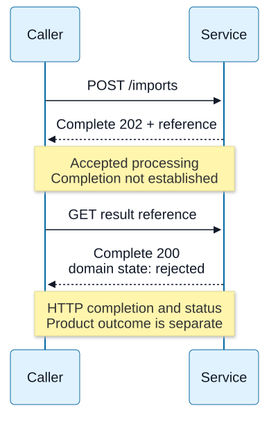

# Chapter 07 — HTTP semantics and representations

**Domain / competency:** D04 / D04-C07
**Editorial status:** approved_by_learner — Product Owner editorial approval recorded 2026-10-15; [approval scope](../evidence/editorial-approval.md).
**Learner assessment / portfolio implementation:** not_assessed / not_started.

## Outcomes and prerequisites

Interpret an HTTP exchange independently of its transport version; distinguish method semantics from product behavior; preserve representation, URL and origin distinctions at a backend boundary.

Prerequisites: Chapters [04](04-framing-and-incremental-parsers.md) and [06](06-tls-identity-and-negotiation.md), plus D02 runtime validation. Read [the curriculum](../curriculum.md) for the full dependency map.

## First principles: HTTP describes resource interactions

HTTP defines requests, responses, methods, fields and representation metadata. A resource is the thing identified; a representation is a transferable description of its state. JSON is one possible representation format, not the meaning of HTTP itself. HTTP/1.1, HTTP/2 and HTTP/3 encode exchanges differently while sharing core semantics.

A method communicates intent. Safe methods request semantics that do not ask for a state-changing action; incidental logging can still occur. Idempotence concerns the intended effect of repeating identical requests, not identical response bytes or absence of all side effects. PUT and DELETE have idempotent semantics; a second DELETE may return a different status. POST is not generically idempotent, although a specific application can define a deduplication contract. Do not infer actual correctness merely from a method label.

A GET endpoint that performs a purchase violates the expectations of clients, crawlers and caches even if its author calls it convenient. An idempotent PUT implementation can still be wrong if it increments a counter on every retry. D05 owns product API design; here the goal is to recognize what interoperating clients may reasonably assume.

## Status, metadata and content

Status codes describe the response semantics, not a universal business-state machine. A 202 response indicates accepted processing, not completed work. A 204 has no response content; HEAD obtains metadata corresponding to a GET without transferring its response content. A 304 participates in conditional retrieval and does not contain the selected representation. Informational responses precede a final response; receiving headers is not equivalent to receiving a complete body.

`Content-Type` describes the representation media type. `Accept` expresses preferences; `Content-Encoding` describes applied coding such as gzip, while `Accept-Encoding` offers supported codings. Character encoding, media type and compression are independent layers. A client that assumes every response is JSON can obscure an HTML gateway error with a misleading JSON parse failure. Preserve status, content type, size bounds and a sanitized error category.

Content length counts encoded octets, not JavaScript characters, and compressed versus decoded lengths can differ dramatically. A boundary should enforce limits at the relevant stages. Field names are case-insensitive, but arbitrary lowercasing of field values, paths or tokens is incorrect. Duplicate fields have field-specific combination rules; `Set-Cookie` is a familiar case that cannot be treated as an ordinary comma-joined list.

**Visual question:** How can complete HTTP responses still report unfinished or rejected work?



*Figure D04-V06 — A conceptual version of the import example below: the complete 202 reports acceptance and supplies a reference, then a later complete 200 representation reports a rejected domain result. A reference is an illustrative product contract, not a mandatory HTTP workflow. Informational responses, headers/body delivery detail, method safety and idempotence rules are covered in the retained text; neither 2xx status certifies durable product success. See [authoritative reference](https://www.rfc-editor.org/rfc/rfc9110.html#section-15.3.3).*

[Full-size SVG](../assets/07-http-semantics-and-representations/accepted-versus-completed.svg) · [Editable Mermaid source](../assets/07-http-semantics-and-representations/accepted-versus-completed.mmd).

## URL and origin reasoning

Parse URLs structurally. Scheme, authority, path, query and fragment have different jobs; fragments are client-side and are not sent as the HTTP request target. Percent-encoding is component-specific. Decoding the whole path before identifying segment boundaries can turn encoded data into routing separators. Repeated query keys are real inputs; choosing first, last or all values is an application policy, not a fact implied by a TypeScript type.

An origin is determined by scheme, host and port. Similar-looking hosts or shared parent domains are not the same origin. Browser cross-origin request rules differ from a Node HTTP client's capabilities. CORS controls browser exposure of responses and certain request behavior; it does not authenticate an API caller or stop a non-browser client. Cookies have their own scope and security attributes; complete session and CSRF policy belongs to D09.

Redirect status matters to method preservation and credential forwarding. A robust client has an explicit redirect boundary and count; it re-evaluates destinations rather than treating the first URL as permanent approval. Do not forward credentials to a newly selected origin just because a Location field was present.

## Backend debugging and counterexamples

A proxy's 502, an application's 404 and a client's body-decoding error describe different observations. Keep the last confirmed phase and response provenance. A 200 with an error JSON object can be a product contract, but transport success alone does not certify domain success. Conversely a 404 can be a complete, correctly delivered HTTP response.

Counterexample: `value as RequestBody` after `JSON.parse` proves no schema property. First validate media type and bounds, parse, then validate the resulting unknown value. This preserves the D02 distinction between compiler models and runtime inputs while adding HTTP's representation boundary.

## Work through method and representation edge cases

A complete exchange can be unsuccessful for the user without being a transport failure. For example: `POST /imports` returns 202 with a reference; polling that reference later returns a complete 200 whose domain state is rejected. The first response promised acceptance, not completion; the second response's HTTP success does not erase the application's refusal. Preserve both observations and their meanings.

Redirects also carry semantics. A 303 directs retrieval of a different resource using GET or HEAD as applicable; 307 and 308 preserve the method. For historical reasons, 301/302 permit POST-to-GET behavior in relevant clients. A replay-preserving redirect still needs a replayable body, destination checks and credential scope. These rules come from [RFC 9110 §15.4](https://www.rfc-editor.org/rfc/rfc9110.html#section-15.4), while a particular client's redirect policy must be verified separately.

| Metadata | Example | Boundary |
|---|---|---|
| Media type | `application/json` | Format of representation data |
| Content coding | `gzip` | Coding of those representation bytes |
| Transfer framing | HTTP/1.1 chunked | Message delimitation on this hop |
| Text encoding | UTF-8 | Character-to-byte interpretation |

If a compressed 20 KiB response expands to 200 MiB, an encoded-byte cap alone permits excessive memory/CPU. A decoded-byte cap needs to stop decompression and clean up upstream I/O, not merely refuse after constructing a huge string. Some client APIs transparently decode content; account for which byte layer each API exposes before comparing counts to Content-Length. The URL/octet lab verifies no decompression behavior.

### Conditional updates are protocol preconditions

Two clients read the same strong ETag. Client A sends an update with `If-Match` and changes the version. Client B sends its stale `If-Match`; 412 reports a failed precondition rather than a network fault. This avoids a blind overwrite only if the origin actually evaluates and applies the precondition coherently; a header alone supplies no database atomicity. Chapter 10 develops validator comparison.

**Advanced exercise:** annotate a 307 redirect of a streaming POST to another origin, followed by 202 and a failed background result. Full credit identifies body replayability, credential/destination checks, accepted-versus-completed status and the absence of a browser CORS authorization guarantee. Also explain why HEAD may carry a Content-Length describing a hypothetical GET while sending no response body. Product error wording and retry policy remain later decisions.

## Practical Node.js example — bounded educational lab

Save the following complete program as `lab-07.mjs`, then run `node lab-07.mjs`. It uses ESM and built-in modules only. It is an educational experiment, not portfolio implementation.

```javascript
import assert from 'node:assert/strict';
const url = new URL('https://api.example.test:443/a%2Fb?tag=x&tag=y#local');
assert.equal(url.origin, 'https://api.example.test');
assert.equal(url.pathname, '/a%2Fb');
assert.deepEqual(url.searchParams.getAll('tag'), ['x', 'y']);
assert.equal(url.hash, '#local');
const target = url.pathname + url.search;
assert.equal(target.includes('#'), false);
assert.equal(Buffer.byteLength('€'), 3);
assert.equal('€'.length, 1);
const other = new URL('http://api.example.test');
assert.notEqual(other.origin, url.origin);
console.log('URL components, repeated keys, origins and octet length: ok');
```

The lab tests URL parsing and byte accounting, not an HTTP server or browser CORS enforcement. Preserve the encoded path in the result; do not “fix” the assertion by decoding it.

## Hands-on exercises with expected results

1. Classify “DELETE returns 204 then 404” for idempotence. Expected: different responses do not disprove identical intended final effect.
2. Describe how to process a gzip JSON response with explicit encoded-byte, decoded-byte and schema boundaries. Expected: independent limits and distinct failure categories.
3. Explain why `https://api.example.test` and `http://api.example.test` differ, and why enabling CORS does not authorize a caller. Expected: origin tuple and browser-specific enforcement.

## Self-assessment and answer rubric

- **Does 202 prove completion?** Full credit: accepted processing only; completion needs the product's later evidence.
- **Is a fragment sent to the HTTP server?** Full credit: no; request target construction excludes it.
- **Can TypeScript prove a JSON body valid?** Full credit: only after actual runtime checks establish the required properties.
- **Safe versus idempotent?** Full credit: requested side effects versus repeated intended effect, with one concrete example.

## Reliable references and version notes

- [HTTP semantics, RFC 9110](https://www.rfc-editor.org/rfc/rfc9110.html), method/status/media semantics; use section headings to locate normative details.
- [WHATWG URL](https://url.spec.whatwg.org/), URL parsing model.
- [Fetch CORS protocol](https://fetch.spec.whatwg.org/#http-cors-protocol), browser behavior.
- [Node v24 URL](https://nodejs.org/docs/latest-v24.x/api/url.html), actual parser API.

Node API references use the v24 documentation line. Exact local execution environment, command, output and limitations are in [the execution record](../evidence/educational-execution.md). The canonical command `node scripts/check-d04.mjs` extracts and executes the single JavaScript lab from each lesson; prose exercises and TypeScript modeling tasks are not thereby tested. JavaScript is used so networking behavior is observable without a compiler. TypeScript cannot validate network bytes by annotation: keep input `unknown` or bytes until runtime validation, then narrow into explicit protocol states. No TypeScript compiler checks are claimed.

## Coverage gaps and review checklist

D04-P04 directly challenges representation and status interoperability. Detailed API resource design belongs to D05, and browser session security to D09. No browser matrix or application authorization is tested. See [the coverage matrix](../../../projects/coverage-matrix.md#d04--approved-editorial-coverage) for direct versus supporting project relevance. Example execution proves only its recorded assertions; editorial review, learner competence and portfolio delivery remain separate.

[Previous: Chapter 06](06-tls-identity-and-negotiation.md) · [Next: Chapter 08](08-http1-framing-and-server-lifetimes.md)
