# Chapter 08 — HTTP/1.1 framing and server lifetimes

**Domain / competency:** D04 / D04-C08
**Editorial status:** approved_by_learner — Product Owner editorial approval recorded 2026-10-15; [approval scope](../evidence/editorial-approval.md).
**Learner assessment / portfolio implementation:** not_assessed / not_started.

## Outcomes and prerequisites

Trace HTTP/1.1 message boundaries and persistent connections; reject ambiguous framing; distinguish server request receipt, response completion and socket lifetime.

Prerequisites: Chapters [03](03-tcp-delivery-and-connection-lifecycle.md), [04](04-framing-and-incremental-parsers.md) and [07](07-http-semantics-and-representations.md). Read [the curriculum](../curriculum.md) for the full dependency map.

## First principles: HTTP/1.1 needs unambiguous boundaries

An HTTP/1.1 message begins with a start line and fields, followed by content when its semantics and framing permit. A persistent connection can carry another message after the current one. The receiver must therefore know exactly where one message ends. One extra or missing byte can make the next message appear to begin inside attacker-controlled content.

Content-Length supplies an octet count for applicable messages. Chunked transfer coding carries content in size-delimited chunks ending with a final chunk and possible trailers. Chunked boundaries are transfer framing, not the application JSON records. Close-delimited response content ends with connection closure and prevents clean reuse for another message; it also has weaker evidence for distinguishing truncation from intended end. Requests do not acquire a legitimate body simply by reading until a persistent connection closes.

## Ambiguity and parser agreement

Transfer-Encoding together with Content-Length is a dangerous ambiguity; recipients follow the protocol's precedence/error rules and intermediaries must avoid forwarding conflicting interpretations. Duplicate or malformed length fields likewise require strict handling. Different parsing decisions across proxy and backend can produce request smuggling. Do not write a permissive custom HTTP parser for a product just because the educational framing exercise was small.

Node exposes parsed messages as streams; it does not automatically parse JSON, multipart forms or application record formats. Request body chunk boundaries are arbitrary. Multipart boundaries can cross chunks, and filenames are untrusted metadata rather than filesystem paths. Apply total body, per-part, count and decoded-expansion bounds when that format is selected later. A declared length is not a license to allocate that much memory.

Header counts and byte sizes matter independently of content. Slow headers, a stalled body and a slow response consumer tie up different resources. A server can use documented header and request-receipt timeout controls, but those controls do not supply an application's total processing deadline. Runtime defaults change across releases; record explicit settings where they are material and inspect the exact version.

## Request and response lifecycle

The server request stream describes incoming content. Response `end()` finishes output submission; finish concerns local completion, not remote application consumption. Socket close can occur before a complete HTTP message. Inspect message completeness and error/aborted paths rather than equating any close with success. A client may send a complete request then disconnect while server work continues; cancellation requires explicit application ownership and cannot retroactively undo side effects.

Persistent connections reduce repeated setup but retain resources. HTTP/1.1 responses are ordered on a connection; pipelining does not provide independent out-of-order response completion. A long response can delay later ones. Ordinary client pools typically manage several connections instead of assuming unlimited concurrency on one HTTP/1.1 socket. Chapter 09 examines that client boundary.

## Worked normal and failure paths

For a three-byte UTF-8 euro sign, Content-Length must be 3 even though JavaScript `.length` is 1. Declaring 1 creates inconsistent framing. The lab sends an explicitly sized Buffer and checks a complete response, sends conflicting request framing to the local parser, and compares short-length, unfinished-chunked and close-delimited raw responses.

A superficial “fix” for malformed requests is to ignore parse errors and keep using the socket. That can preserve a poisoned byte boundary. The lab's clientError handler terminates its disposable connection. This is an educational refusal path, not a complete production error policy or security qualification.

**Visual question:** Why does the same EOF establish different HTTP completion results?



*Figure D04-V07 — Three separate ordinary HTTP/1.1 response examples, after applying the body-length precedence rules below. Content-Length 3 plus only ab is incomplete; chunked content without its final chunk and trailer-section termination is incomplete. A response genuinely delimited by close can be HTTP-complete with ab at EOF, while still failing an application expectation of abc. The groups are alternatives, not three stages of one connection. HEAD, no-body statuses, CONNECT and ambiguous framing are intentionally outside these examples. See [authoritative reference](https://www.rfc-editor.org/rfc/rfc9112.html#section-8).*

[Full-size SVG](../assets/08-http1-framing-and-server-lifetimes/response-framing-at-eof.svg) · [Editable Mermaid source](../assets/08-http1-framing-and-server-lifetimes/response-framing-at-eof.mmd).

## Backend troubleshooting

If uploads hang only through a proxy, compare body limits, request-receipt timeouts, buffering and forwarding behavior on both hops. If responses truncate, preserve declared versus received length, message completeness, connection reuse and which hop closed. A server-side success log alone cannot establish client receipt. If memory grows during slow uploads, inspect application retention as well as stream pressure: buffering the entire body bypasses incremental processing benefits.

## Apply message-length precedence before counting body bytes

[RFC 9112 §6.3](https://www.rfc-editor.org/rfc/rfc9112.html#section-6.3) defines ordered rules; Content-Length is not always decisive:

| Earlier applicable rule | Receiver boundary |
|---|---|
| Response to HEAD, or status 1xx/204/304 | Ends at fields; no message body, regardless of apparent length metadata |
| Successful 2xx CONNECT response | After fields, the connection becomes a tunnel; disregard ordinary response length framing |
| Transfer-Encoding present | Apply its framing rules; chunked must be final where required |
| Valid Content-Length without Transfer-Encoding | Exactly that many octets |
| Request with neither length mechanism | Zero body length |
| Other response with neither | Body delimited by connection close |

A sender must not send Content-Length together with Transfer-Encoding. A server receiving both can reject or process according to the specified transfer-coding rule, but must close after its response; an intermediary choosing to forward must first remove Content-Length and process Transfer-Encoding. This is a protocol rule, not a claim that every parser accepts that combination. Node's default parser in this fixture rejects it before the handler. Conflicting length values are invalid; the narrowly permitted normalization of identical repeated values is not permission to accept arbitrary duplicates.

### Compare two incomplete and one apparently complete response

A declared length of three with bytes `ab` then FIN is incomplete. Chunked content `2\r\nab\r\n` then FIN is also incomplete because the terminating zero-sized chunk and trailer-section termination never arrived. A zero chunk alone is not the end of every possible trailer block. Conversely, a close-delimited response containing `ab` can be HTTP-complete at EOF even if the application expected `abc`. Without a stronger application representation check, HTTP framing cannot distinguish that semantic truncation. The revised lab uses a raw owned TCP peer and observes all three through the real Node HTTP client.

Node's `IncomingMessage.complete` concerns parser completion. `end` concerns consumption of readable content; `close` does not by itself distinguish the successful and interrupted cases. Check errors and completeness together. Server `headersTimeout` bounds header receipt; `requestTimeout` bounds receipt of the entire request, not execution of business work. Socket inactivity and post-response keepalive controls have different owners. Installing a timeout handler can transfer cleanup responsibility; never assume all methods abort automatically.

**Advanced exercise:** trace a HEAD response with Content-Length 100, a POST with neither framing field, and a close-delimited 200 missing expected application bytes. Full credit applies precedence before metadata, rejects request-until-close reasoning, separates syntactic completion from content integrity, and explains why one backend parser refusal cannot qualify a multi-hop proxy path against smuggling.

## Practical Node.js example — bounded educational lab

Save the following complete program as `lab-08.mjs`, then run `node lab-08.mjs`. It uses ESM and built-in modules only. It is an educational experiment, not portfolio implementation.

```javascript
import assert from 'node:assert/strict';
import http from 'node:http';
import net from 'node:net';
import { once } from 'node:events';
let calls = 0;
const server = http.createServer((req, res) => {
  calls++; req.resume();
  const body = Buffer.from('€');
  res.writeHead(200, { 'Content-Length': body.length }); res.end(body);
});
server.on('clientError', (error, socket) => {
  socket.end('HTTP/1.1 400 Bad Request\r\nConnection: close\r\nContent-Length: 0\r\n\r\n');
});
server.listen(0, '127.0.0.1'); await once(server, 'listening');
const port = server.address().port;
try {
  await new Promise((resolve, reject) => {
    const req = http.get({ host: '127.0.0.1', port, agent: false }, res => {
      const chunks = [];
      res.on('error', reject); res.on('data', c => chunks.push(c));
      res.on('end', () => {
        try { assert.equal(res.complete, true);
          assert.equal(Buffer.concat(chunks).toString(), '€'); resolve();
        } catch (e) { reject(e); }
      });
    }); req.on('error', reject);
  });
  const bad = net.connect(port, '127.0.0.1');
  bad.end('POST / HTTP/1.1\r\nHost: local\r\nContent-Length: 1\r\nTransfer-Encoding: chunked\r\n\r\n0\r\n\r\n');
  let reply = ''; for await (const c of bad) reply += c;
  assert.match(reply, /^HTTP\/1.1 400/);
  assert.equal(calls, 1);
} finally { await new Promise(resolve => server.close(resolve)); }

const raw = net.createServer(socket => {
  socket.on('error', () => {});
  socket.once('data', request => {
    const target = request.toString().split(' ')[1];
    const response = target === '/chunked'
      ? 'Transfer-Encoding: chunked\r\n\r\n2\r\nab\r\n'
      : target === '/close' ? '\r\nab' : 'Content-Length: 3\r\n\r\nab';
    socket.end('HTTP/1.1 200 OK\r\nConnection: close\r\n' + response);
  });
});
raw.listen(0, '127.0.0.1'); await once(raw, 'listening');
async function observe(path) {
  return new Promise((resolve, reject) => {
    http.get({ host: '127.0.0.1', port: raw.address().port, path, agent: false }, res => {
      let bytes = 0, ended = false, error;
      res.on('data', c => { bytes += c.length; });
      res.on('end', () => { ended = true; });
      res.on('error', e => { error = e.code; });
      res.on('close', () => resolve({ complete: res.complete, bytes, ended, error }));
    }).on('error', reject);
  });
}
try {
  for (const path of ['/length', '/chunked']) {
    const result = await observe(path);
    assert.equal(result.bytes, 2); assert.equal(result.complete, false);
    assert.equal(result.ended, false); assert.equal(result.error, 'ECONNRESET');
  }
  assert.deepEqual(await observe('/close'),
    { complete: true, bytes: 2, ended: true, error: undefined });
} finally { await new Promise(resolve => raw.close(resolve)); }
console.log('HTTP refusal; short length and missing zero chunk incomplete; close-delimited complete: ok');
```

The malformed request is sent only to the owned loopback fixture. It verifies this Node parser refusal and handler count, and observes response completeness/error events from the three raw peers. It does not test a proxy chain, request-smuggling resistance in general, body timeouts or multipart parsing.

## Hands-on exercises with expected results

1. Draw a byte-count timeline for a declared length of 3 followed by only 2 bytes and disconnect. Expected: incomplete message, not successful partial JSON.
2. Review a hypothetical whole-body accumulator with a Content-Length check only. Expected: chunked content, oversized actual input and decompression remain unbounded unless separately checked.
3. Explain why adding a server timeout listener can change cleanup responsibility. Expected: inspect the precise Node timeout API and terminate owned resources explicitly; no universal timeout recipe.

## Self-assessment and answer rubric

- **Are transfer chunks application messages?** Full credit: no; one record can span chunks and one chunk can contain many records.
- **Why must proxy and backend agree?** Full credit: divergent message boundaries allow the same bytes to represent different request sequences.
- **Does response finish prove receipt?** Full credit: local completion only; retain uncertainty after lost responses.

## Reliable references and version notes

- [HTTP/1.1 framing, RFC 9112 §§6–8](https://www.rfc-editor.org/rfc/rfc9112.html), body length and connection management.
- [Node v24 HTTP](https://nodejs.org/docs/latest-v24.x/api/http.html), `IncomingMessage.complete`, server timeouts and `clientError`.
- [Multipart form data, RFC 7578](https://www.rfc-editor.org/rfc/rfc7578.html), format details; no multipart implementation is claimed.

Node API references use the v24 documentation line. Exact local execution environment, command, output and limitations are in [the execution record](../evidence/educational-execution.md). The canonical command `node scripts/check-d04.mjs` extracts and executes the single JavaScript lab from each lesson; prose exercises and TypeScript modeling tasks are not thereby tested. JavaScript is used so networking behavior is observable without a compiler. TypeScript cannot validate network bytes by annotation: keep input `unknown` or bytes until runtime validation, then narrow into explicit protocol states. No TypeScript compiler checks are claimed.

## Coverage gaps and review checklist

D04-P02 directly challenges malformed boundary reporting and P03 incomplete transfers. Proxy parser agreement and adversarial multi-hop testing remain unverified; D09 owns the complete security review. See [the coverage matrix](../../../projects/coverage-matrix.md#d04--approved-editorial-coverage) for direct versus supporting project relevance. Example execution proves only its recorded assertions; editorial review, learner competence and portfolio delivery remain separate.

[Previous: Chapter 07](07-http-semantics-and-representations.md) · [Next: Chapter 09](09-http-clients-and-connection-pools.md)
