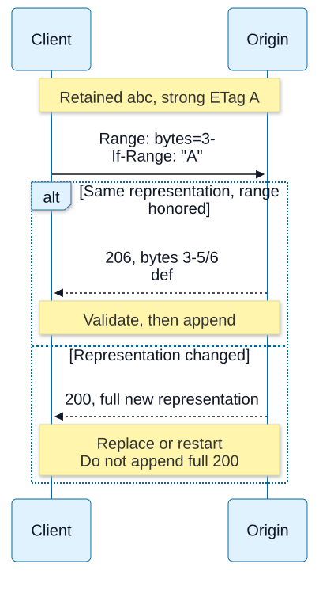

# Chapter 10 — Caching, validation and ranges

**Domain / competency:** D04 / D04-C10
**Editorial status:** approved_by_learner — Product Owner editorial approval recorded 2026-10-15; [approval scope](../evidence/editorial-approval.md).
**Learner assessment / portfolio implementation:** not_assessed / not_started.

## Outcomes and prerequisites

Distinguish cache freshness from validation; explain variant keys and validators; reason about conditional requests, byte ranges and compression without mixing incompatible representations.

Prerequisites: Chapters [07](07-http-semantics-and-representations.md)–[09](09-http-clients-and-connection-pools.md). Read [the curriculum](../curriculum.md) for the full dependency map.

## First principles: reuse needs a scope and a validity rule

A cache stores a response for possible reuse. Freshness determines whether it can ordinarily be reused without contacting the origin; validation asks whether the stored representation is still usable. A response can be stale yet valid after successful validation. A cache hit does not inherently mean old data, and a revalidation does not necessarily transfer the content again.

Private and shared caches have different authority. A browser cache serves one user's context; a shared intermediary can serve many callers. Incorrect reuse across authorization or representation boundaries can disclose data. `private` restricts shared-cache storage; `no-store` directs against storage; `no-cache` requires validation before reuse rather than simply meaning “never store.” These controls are protocol semantics, not a complete application privacy policy.

## Freshness and validators

Freshness uses response metadata and age calculations, not merely elapsed time since the current process read a value. Clock skew and intermediary residence matter. A diagnostic should distinguish origin generation time, reported age and local receipt time rather than labeling every response “fresh” from a new client timestamp.

An entity tag is an opaque validator. A strong validator supports byte-equivalence uses; a weak validator expresses a weaker equivalence suitable for some validation cases. Do not parse version numbers out of arbitrary ETags. `If-None-Match` can support cache revalidation; `If-Match` can protect a conditional change. The comparison rules and method context differ. A failed precondition and an unmodified representation are different outcomes.

For a matching conditional GET, 304 tells the client to reuse its stored representation under the protocol rules; it does not contain a fresh copy of the body. A caller with no corresponding stored body cannot conjure one from the status. Validation is scoped to the selected representation, so content negotiation must remain coherent.

## Variants and compressed bytes

`Vary` declares request-field dimensions that affect selection. If an origin selects language by Accept-Language but a shared cache ignores that dimension, one user's language can leak into another's result. `Vary: *` has special reuse consequences, not “cache every possible header.” Key design must reflect actual supported variants without assuming arbitrary cookies are harmless.

Compression changes representation bytes. A strong ETag for an uncompressed form is not automatically a strong validator for differently coded bytes. Content-Length must describe the transmitted coded content when supplied. Cache keys, validators and range requests need a coherent representation model; sprinkling gzip onto a response after calculating lengths and tags can break it.

## Partial transfers and ranges

A byte range selects part of the chosen representation. A satisfiable request can receive 206 with Content-Range; an unsatisfiable range can receive 416. Servers may ignore a Range request under applicable rules, so a downloader cannot assume every response is partial. Inspect status and metadata before appending bytes.

Resuming a download requires knowing that the retained prefix belongs to the same representation version. If the origin changed between attempts, blindly appending a range can produce a mixed artifact that never existed. `If-Range` can qualify range use with an appropriate validator; weak tags are not suitable for its strong-validator use. Multipart ranges and compressed representations add complexity. The educational lab exercises a few fixed range/validator cases; it does not implement their general grammar.

**Visual question:** When may a retained prefix safely be extended rather than replaced?



*Figure D04-V09 — Two alternatives from the later abcdef example: the client retains abc with strong tag A and asks for bytes 3 onward using If-Range A. An applicable matching response can provide def as 206 with inclusive range 3–5/6; validate identity, coding, offset, length and completeness before appending. A changed representation yields full 200 in this example and must be handled as replacement/restart, never appended. Servers can ignore Range under the rules, and 416 is a separate outcome; this is not a general downloader algorithm. See [authoritative reference](https://www.rfc-editor.org/rfc/rfc9110.html#section-13.1.5).*

[Full-size SVG](../assets/10-caching-validation-and-ranges/resume-representation-identity.svg) · [Editable Mermaid source](../assets/10-caching-validation-and-ranges/resume-representation-identity.mmd).

## Worked scenario and counterexamples

The fixture gives one tiny representation an opaque strong ETag and performs an unconditional GET followed by an exact-match conditional GET. The second response carries no content. It deliberately supports only this one exact tag, rather than claiming to parse every legal conditional field value.

Counterexample: a client stores bytes for version A, receives an unrelated 304 after losing its cache metadata, and reports that version B was downloaded. The status confirms no new content transfer; it cannot identify an absent local body. Another error is treating `no-cache` as `no-store` and promising that sensitive data never persists.

For backend diagnosis, preserve selected variant, validator, status, age and actual byte counts. A cache can correctly return 200 from storage or 304 after validation, so a status-only graph cannot establish origin traffic or bandwidth. Distinguish lesson-level protocol reasoning from later distributed cache invalidation and application consistency policy in D08/D10.

## Calculate freshness and conditional outcomes

A simplified age example: a response has freshness lifetime 60 seconds and corrected age 45 seconds when stored. Ten seconds later its current age is 55 seconds, leaving roughly five seconds of freshness, not a fresh 60-second allowance. Full calculations include request/response delay and apparent age; [RFC 9111 §4.2.3](https://www.rfc-editor.org/rfc/rfc9111.html#section-4.2.3) defines those terms. Re-receiving an already aged response does not reset origin age. `s-maxage` addresses shared caches; authorization and cacheability rules still matter beyond one directive.

For ETags `"v1"` and `W/"v1"`, weak comparison can match for If-None-Match while strong comparison does not match for If-Match. A matching If-None-Match on GET/HEAD produces 304; on other methods the precondition failure is 412. Lists and `*` have defined meaning; a naive string-equality responder implements only one educational fixture. Relevant preconditions precede Range processing, so a request cannot bypass a failed precondition by asking for fewer bytes.

### Resume timeline with explicit byte identity

Assume version A is `abcdef`, its strong ETag is `"A"`, and the client retains the first three bytes `abc`.

| New request / origin state | Response | Safe client interpretation |
|---|---|---|
| `Range: bytes=3-`, `If-Range: "A"`; still A | 206, `Content-Range: bytes 3-5/6`, `def` | Verify identity, start, size and completeness before appending |
| Same request; origin now version B | Full 200 representation | Replace/restart under policy; never append the full response |
| Start at 99 for six-byte representation | 416, `Content-Range: bytes */6` | Unsatisfied request; not proof the local file is intact |

Range end offsets are inclusive: `3-5` is three bytes. `Accept-Ranges` is capability metadata, not a promise the next request will return 206. Date-based If-Range has qualified validator rules; an arbitrary Last-Modified date is not automatically a strong identity guarantee. Weak entity tags must not be generated in If-Range. Content coding changes the selected bytes, so a decoded offset cannot blindly address a gzip-coded representation. Full multi-range parsing and automatically decoding clients need separate interoperability testing.

**Advanced exercise:** retain 1000 decoded bytes, then receive a gzip-coded 206 starting at encoded byte 1000 with a different validator. Explain why correct status and transport completion cannot establish safe continuation. Full credit checks coding, validator strength/identity, offset, total length and byte completeness, and handles a returned full 200 separately. The extended fixture now exercises fixed range responses; general range parsing, automatic decompression and CDN behavior remain unverified.

## Practical Node.js example — bounded educational lab

Save the following complete program as `lab-10.mjs`, then run `node lab-10.mjs`. It uses ESM and built-in modules only. It is an educational experiment, not portfolio implementation.

```javascript
import assert from 'node:assert/strict';
import http from 'node:http';
import { once } from 'node:events';
const tag = '"sample-v1"';
const server = http.createServer((req, res) => {
  res.setHeader('ETag', tag); res.setHeader('Cache-Control', 'private, max-age=0');
  if (req.headers['if-none-match'] === tag) { res.writeHead(304); res.end(); }
  else if (req.headers.range === 'bytes=3-' && req.headers['if-range'] === tag) {
    res.writeHead(206, { 'Content-Range': 'bytes 3-10/11', 'Content-Length': 8 });
    res.end('sion one');
  } else if (req.headers.range === 'bytes=99-') {
    res.writeHead(416, { 'Content-Range': 'bytes */11', 'Content-Length': 0 }); res.end();
  } else res.end('version one');
});
server.listen(0, '127.0.0.1'); await once(server, 'listening');
function get(headers = {}) {
  return new Promise((resolve, reject) => {
    http.get({ host: '127.0.0.1', port: server.address().port, agent: false, headers }, res => {
      let body = ''; res.on('data', c => { body += c; }); res.on('error', reject);
      res.on('end', () => resolve({ status: res.statusCode, tag: res.headers.etag, body, range: res.headers['content-range'] }));
    }).on('error', reject);
  });
}
try {
  assert.deepEqual(await get(), { status: 200, tag, body: 'version one', range: undefined });
  assert.deepEqual(await get({ 'If-None-Match': tag }), { status: 304, tag, body: '', range: undefined });
  assert.deepEqual(await get({ Range: 'bytes=3-', 'If-Range': tag }),
    { status: 206, tag, body: 'sion one', range: 'bytes 3-10/11' });
  assert.equal((await get({ Range: 'bytes=3-', 'If-Range': '"old"' })).status, 200);
  assert.deepEqual(await get({ Range: 'bytes=99-' }),
    { status: 416, tag, body: '', range: 'bytes */11' });
} finally { await new Promise(resolve => server.close(resolve)); }
console.log('exact-tag 304; fixed range 206; stale If-Range full 200; unsatisfied 416: ok');
```

The fixture is a narrowly scripted conditional/range responder: only `bytes=3-` with the exact tag and `bytes=99-` have special range handling. It exercises 206/200/416 and byte metadata through actual HTTP, not a general range grammar, multi-range server, cache or CDN. It checks no browser storage behavior.

## Hands-on exercises with expected results

1. Construct two language variants with distinct content and a valid cache-selection explanation. Expected: identify Vary/key scope and avoid assuming one validator means identical bytes across all variants.
2. Review “append any 206 to the old file.” Expected: require representation identity, correct range offset and complete byte accounting; handle a full 200 response separately.
3. Explain `no-cache`, `no-store` and `private` to a teammate. Expected: storage, validation and shared-cache scope remain separate; no unsupported privacy guarantee.

## Self-assessment and answer rubric

- **Does 304 carry the representation?** Full credit: no; reuse requires an appropriate stored response.
- **Can a weak ETag prove exact resume bytes?** Full credit: no; explain strong identity requirements for byte-sensitive operations.
- **Why can gzip break an ETag policy?** Full credit: selected coded representation bytes changed; strong equivalence needs qualification.

## Reliable references and version notes

- [HTTP caching, RFC 9111](https://www.rfc-editor.org/rfc/rfc9111.html), freshness, age and reuse controls.
- [HTTP conditional/range semantics, RFC 9110 §§13–14](https://www.rfc-editor.org/rfc/rfc9110.html#section-13), normative comparison and range rules.
- [Node v24 HTTP](https://nodejs.org/docs/latest-v24.x/api/http.html), message fields and response streams.

Node API references use the v24 documentation line. Exact local execution environment, command, output and limitations are in [the execution record](../evidence/educational-execution.md). The canonical command `node scripts/check-d04.mjs` extracts and executes the single JavaScript lab from each lesson; prose exercises and TypeScript modeling tasks are not thereby tested. JavaScript is used so networking behavior is observable without a compiler. TypeScript cannot validate network bytes by annotation: keep input `unknown` or bytes until runtime validation, then narrow into explicit protocol states. No TypeScript compiler checks are claimed.

## Coverage gaps and review checklist

D04-P03 directly challenges consistent partial retrieval; P04 challenges variant compatibility. General range parsing, multi-range abuse, CDN behavior and distributed invalidation remain unverified. See [the coverage matrix](../../../projects/coverage-matrix.md#d04--approved-editorial-coverage) for direct versus supporting project relevance. Example execution proves only its recorded assertions; editorial review, learner competence and portfolio delivery remain separate.

[Previous: Chapter 09](09-http-clients-and-connection-pools.md) · [Next: Chapter 11](11-proxies-routing-and-trust-boundaries.md)
