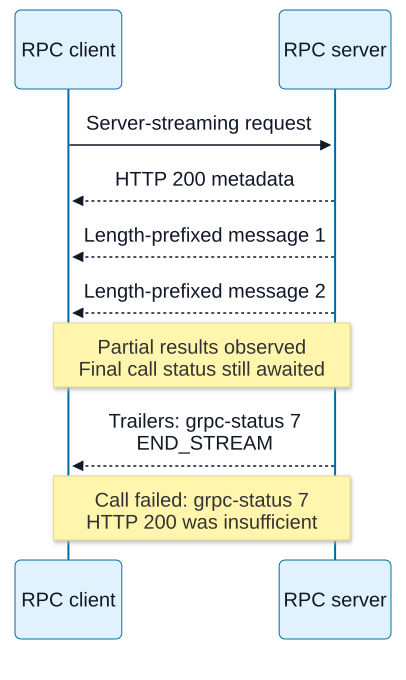

# Chapter 16 — RPC envelopes and protocol evolution

**Domain / competency:** D04 / D04-C16
**Editorial status:** approved_by_learner — Product Owner editorial approval recorded 2026-10-15; [approval scope](../evidence/editorial-approval.md).
**Learner assessment / portfolio implementation:** not_assessed / not_started.

## Outcomes and prerequisites

Separate RPC transport, envelopes, serialization and application status; reason about schema evolution across mixed-version peers; identify interoperability failures hidden by a successful HTTP status.

Prerequisites: Chapters [04](04-framing-and-incremental-parsers.md), [07](07-http-semantics-and-representations.md), [12](12-http2-streams-and-flow-control.md), and D02 runtime/type boundaries. Read [the curriculum](../curriculum.md) for the full dependency map.

## First principles: calling syntax hides a remote boundary

RPC presents operations with request and response messages. A generated function can look like a local call, but latency, partial failure, cancellation, serialization and version skew remain. The remote server may execute after the caller times out, and a response may arrive after local interest ended. A type-safe client stub cannot prove which remote version actually runs or whether incoming bytes obey the expected schema.

Separate four layers: transport carries bytes; framing identifies messages; serialization represents fields; operation semantics define business meaning. JSON, Protocol Buffers and other encodings occupy different positions from HTTP/2 or TCP. Choosing binary serialization does not provide ordering, authentication or retry safety by itself.

## A concrete protocol example: gRPC over HTTP/2

Standard gRPC over HTTP/2 uses request metadata, length-prefixed messages and trailing status metadata. The message envelope has a compression flag and four-byte big-endian message length. DATA frame boundaries need not align with envelope boundaries. Compressed-message handling also needs negotiated encoding and post-decompression bounds.

HTTP 200 alone is insufficient to declare a gRPC call successful; the gRPC status in the appropriate metadata matters. An intermediary can truncate a stream after headers or fail to preserve trailers. A client must distinguish a complete protocol status from missing status and transport failure. Streaming operations can deliver some messages before a terminal failure, so one Promise returning an array may hide important partial-result semantics.

Unary, client-streaming, server-streaming and bidirectional-streaming calls have different lifetime and flow needs. A transport reset does not establish business rollback. Deadlines can propagate as protocol metadata, but service work must cooperate with cancellation and preserve truthful outcomes. Complete library integration belongs to a later selected project, not this envelope lesson.

**Visual question:** Which later evidence is still needed after HTTP 200 and two RPC messages?



*Figure D04-V16 — One conceptual gRPC server-streaming response over h2: initial HTTP 200 metadata, two length-prefixed messages that need not align with DATA frames, then nonzero final grpc-status and stream completion. The messages remain observed partial results while the call fails at its protocol boundary. Missing final status is not zero. A trailers-only response is another legal shape omitted here; this is a wire-contract illustration, not an executed gRPC integration, complete status-mapping algorithm or claim about durable business effects. See [authoritative reference](https://github.com/grpc/grpc/blob/master/doc/PROTOCOL-HTTP2.md).*

[Full-size SVG](../assets/16-rpc-envelopes-and-protocol-evolution/grpc-final-status.svg) · [Editable Mermaid source](../assets/16-rpc-envelopes-and-protocol-evolution/grpc-final-status.mmd).

## Schema evolution and compatibility direction

Backward compatibility asks whether a new reader can handle old data; forward compatibility asks whether an old reader can handle new data, with precise definitions for the system being studied. Producer/consumer roles and deployment order matter. A field added to a schema can still break old readers if they reject unknown fields or if the new producer stops sending information old readers require.

For tagged binary formats, stable field numbers are part of the wire contract. Removing a field does not make its number safe to reuse for another meaning. Unknown-field preservation can matter for intermediaries that read and rewrite messages. Default values, field presence, oneof changes, enums and integer precision need specific format/version review rather than a generic “adding fields is safe” rule.

JSON has different risks: numbers may exceed JavaScript's safe-integer range, missing differs from explicit null under many contracts, and unknown enum strings may be rejected by exhaustive application switches. TypeScript unions compiled into one client version do not prevent new remote values. Validate unknown values and define fallback/refusal behavior at runtime.

**Visual question:** Which mixed-version direction and rewrite path must compatibility evidence name?



*Figure D04-V17 — Three distinct test paths, with no success asserted: old writer to new reader, new writer to old reader, and a read/rewrite path through an intermediary. Specify supported versions and verify decoding, retained fields and application interpretation in each. Wire acceptance can coexist with enum/default/presence meaning failures. The arrows express test direction, not guaranteed compatibility or deployment order; no schema or generated SDK is executed by this visual. See [authoritative reference](https://protobuf.dev/programming-guides/proto3/#updating).*

[Full-size SVG](../assets/16-rpc-envelopes-and-protocol-evolution/compatibility-directions.svg) · [Editable Mermaid source](../assets/16-rpc-envelopes-and-protocol-evolution/compatibility-directions.mmd).

## Compatibility matrix and test evidence

Test old producer → new consumer, new producer → old consumer, and relevant proxy/rewriter paths. Include actual supported format/runtime versions and positive plus negative fixtures. “Both compile” is weak evidence because the wire boundary is not a shared compiler invocation. A compatibility report must name the tested pair and direction; it cannot certify all future versions.

The lab manually builds and inspects an uncompressed gRPC-style envelope around opaque bytes. It checks a truncation case and that HTTP 200 with a nonzero modeled gRPC status is not success. It neither serializes Protocol Buffers nor performs a real gRPC call. This constrained test reinforces layer separation without introducing a package dependency or implying a project technology choice.

## Backend diagnosis and counterexamples

Counterexample: monitoring only HTTP status reports every failing RPC as successful because the HTTP response was complete with status 200. Another error is interpreting absent final trailers as status zero. Preserve transport completion, final protocol status and application outcome independently.

When mixed deployments fail, compare raw schema versions, field presence and compatibility direction before changing timeouts. If only messages above a threshold fail, inspect envelope lengths, compression expansion and intermediary limits. If generated clients disagree, verify generator/runtime compatibility from the specific library's current documentation during implementation.

## A concrete gRPC completion trace

For an uncompressed three-byte payload `abc`, the envelope is `00 00 00 00 03 61 62 63`: one compression flag, four big-endian length bytes, then payload. Any HTTP/2 DATA division may split those eight bytes or combine them with another envelope. A flag of one means per-message compression using the negotiated message encoding; it is different from HTTP Content-Encoding. Encoded and expanded lengths need separate bounds.

A normal response has initial HTTP metadata, zero or more length-prefixed messages, and final `grpc-status`. A trailers-only response can carry final status without a separate body/trailer sequence. Missing final status cannot be silently read as zero. Non-200 or non-gRPC intermediary responses need the client's defined mapping; the lesson's small Boolean is an illustrative success check, not that full mapping algorithm. Two observed stream messages followed by nonzero status are partial results plus a failed call, not “all messages invalid” or a fully successful RPC. Consult the [gRPC wire protocol](https://github.com/grpc/grpc/blob/master/doc/PROTOCOL-HTTP2.md) for ordering and status placement.

### Compatibility must include semantic readers

Consider a protobuf producer that adds enum value `PAUSED`. An older runtime may preserve its numeric value at the wire layer, yet an application's exhaustive switch may refuse it or map it incorrectly. Wire decodability is weaker than semantic compatibility. Unknown-field preservation can also be lost by translating a binary message into JSON or reconstructing only known fields. A read-rewrite-read path needs testing independently of direct producer/consumer exchange.

| Change | Risk to test explicitly |
|---|---|
| Reuse removed field number | Old bytes decode with new meaning; reserve deleted identifiers |
| Implicit default → explicit presence usage | Absent and explicit zero can acquire different meaning |
| Large 64-bit integer through JS number | Loss of exact identity beyond safe-integer range |
| Add required application meaning to optional field | Old producers remain syntactically valid but semantically unusable |
| Add enum/string value | Runtime accepts bytes while older application logic fails |

**Advanced exercise:** build an old/new writer-reader matrix including a JSON intermediary and an unknown enum value. Full credit separates byte decoding, field retention, application validation and operation result; predicts both deployment directions; and does not count generated TypeScript compilation as wire evidence. For a server stream interrupted after two messages, state what the user may retain and what remains unknown without final status. The lab still exercises an opaque envelope/status model only; no real gRPC, protobuf generator, HTTP trailers or SDK cancellation is verified.

## Practical Node.js example — bounded educational lab

Save the following complete program as `lab-16.mjs`, then run `node lab-16.mjs`. It uses ESM and built-in modules only. It is an educational experiment, not portfolio implementation.

```javascript
import assert from 'node:assert/strict';
const payload = Buffer.from('opaque');
const wire = Buffer.alloc(5 + payload.length);
wire[0] = 0; wire.writeUInt32BE(payload.length, 1); payload.copy(wire, 5);
function readOne(bytes) {
  if (bytes.length < 5) throw new Error('short header');
  if (bytes[0] !== 0) throw new Error('unsupported compression');
  const n = bytes.readUInt32BE(1);
  if (n > 64) throw new Error('oversize');
  if (bytes.length !== 5 + n) throw new Error('incomplete or extra');
  return bytes.subarray(5);
}
assert.deepEqual(readOne(wire), payload);
assert.throws(() => readOne(wire.subarray(0, -1)), /incomplete/);
const successful = (httpStatus, grpcStatus) => httpStatus === 200 && grpcStatus === 0;
assert.equal(successful(200, 7), false);
assert.equal(successful(200, undefined), false);
assert.equal(successful(200, 0), true);
console.log('one bounded opaque envelope; truncation and final-status model: ok');
```

The envelope reader accepts exactly one small uncompressed message. It is not an incremental parser or gRPC implementation. No generated client, protobuf schema, compression or actual trailers are tested.

## Hands-on exercises with expected results

1. Create a four-cell old/new producer-consumer compatibility table for adding a field. Expected: define reader unknown-field behavior and writer requirements before assigning outcomes.
2. Trace a server stream with two valid messages then a nonzero final status. Expected: partial data remains observed, whole operation is not silently successful.
3. Explain why reusing an old binary field number can corrupt meaning despite successful decoding. Expected: wire identity and semantic meaning are separate from parser acceptance.

## Self-assessment and answer rubric

- **Does binary encoding make RPC local-like?** Full credit: no; transport uncertainty and version skew remain.
- **Does HTTP 200 prove gRPC success?** Full credit: final gRPC status/completion must be established.
- **Is additive change always compatible?** Full credit: only under stated producer/reader semantics and tested directions.

## Reliable references and version notes

- [gRPC wire protocol](https://github.com/grpc/grpc/blob/master/doc/PROTOCOL-HTTP2.md), authoritative evolving protocol document, consulted 2026-10-15; this lesson implements no gRPC library API.
- [Protocol Buffers updating rules](https://protobuf.dev/programming-guides/proto3/#updating), format-specific compatibility qualifications.
- [JSON interoperability, RFC 8259](https://www.rfc-editor.org/rfc/rfc8259.html), syntax and numeric/interoperability considerations.
- [Node v24 Buffer](https://nodejs.org/docs/latest-v24.x/api/buffer.html), integer and payload operations.

Node API references use the v24 documentation line. Exact local execution environment, command, output and limitations are in [the execution record](../evidence/educational-execution.md). The canonical command `node scripts/check-d04.mjs` extracts and executes the single JavaScript lab from each lesson; prose exercises and TypeScript modeling tasks are not thereby tested. JavaScript is used so networking behavior is observable without a compiler. TypeScript cannot validate network bytes by annotation: keep input `unknown` or bytes until runtime validation, then narrow into explicit protocol states. No TypeScript compiler checks are claimed.

## Coverage gaps and review checklist

D04-P02 and P04 directly challenge mixed-version interpretation. Generated SDKs, schema migrations and real gRPC/trailer compatibility remain unverified; D05 owns the API product contract. See [the coverage matrix](../../../projects/coverage-matrix.md#d04--approved-editorial-coverage) for direct versus supporting project relevance. Example execution proves only its recorded assertions; editorial review, learner competence and portfolio delivery remain separate.

[Previous: Chapter 15](15-server-sent-events-and-resumption.md) · [Next: Chapter 17](17-deadlines-retries-and-uncertain-outcomes.md)
