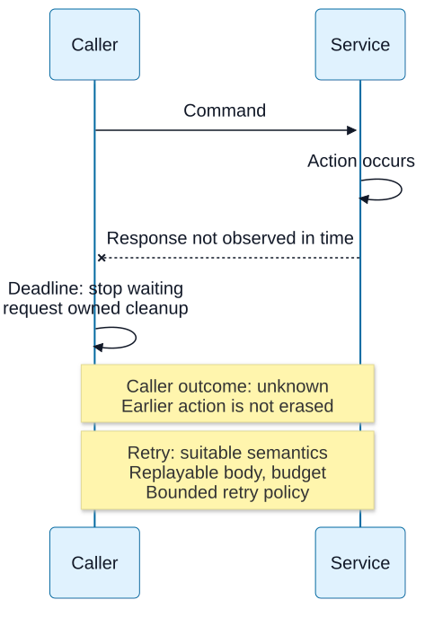

# Chapter 17 — Deadlines, retries and uncertain outcomes

**Domain / competency:** D04 / D04-C17
**Editorial status:** approved_by_learner — Product Owner editorial approval recorded 2026-10-15; [approval scope](../evidence/editorial-approval.md).
**Learner assessment / portfolio implementation:** not_assessed / not_started.

## Outcomes and prerequisites

Design a phase-aware deadline budget; distinguish idle, receipt and total deadlines; explain safe retry prerequisites and truthful unknown outcomes without promising remote rollback.

Prerequisites: Chapters [03](03-tcp-delivery-and-connection-lifecycle.md), [09](09-http-clients-and-connection-pools.md), [14](14-websocket-sessions-and-control.md)–[16](16-rpc-envelopes-and-protocol-evolution.md), and D02 cancellation. Read [the curriculum](../curriculum.md) for the full dependency map.

## First principles: a timeout is an observer decision

A deadline says when a caller stops waiting or admitting further work. It does not travel backward in time to prevent a remote action. A timeout before DNS completes has different implications from a timeout after the server accepted and committed a request. A client error category must preserve the last confirmed phase and avoid declaring “not executed” without evidence.

An idle timeout bounds a period without relevant progress. A total deadline bounds the whole operation, including continued trickle progress. Header receipt, request-body receipt and application processing are separate phases. Timers execute when the event loop can run them; they are not hard real-time preemption. If CPU blocks the loop, cleanup callbacks may run late.

**Visual question:** What can the caller conclude when its deadline expires after the server acted?



*Figure D04-V18 — A permitted lost-reply ordering: the service receives a command, performs an action, and its response does not reach the caller before the caller stops waiting. The caller requests local cleanup but lacks a complete receipt, so its remote outcome remains unknown. The prior action is drawn as scenario knowledge, not client evidence or a durable-commit claim. A retry additionally needs replayable content, suitable idempotent/product semantics, remaining total budget and bounded policy; adding an idempotency header alone guarantees nothing. No cancellation propagation, rollback or timer measurement is implied. See [authoritative reference](https://www.rfc-editor.org/rfc/rfc9110.html#section-9.2.2).*

[Full-size SVG](../assets/17-deadlines-retries-and-uncertain-outcomes/timeout-and-unknown-outcome.svg) · [Editable Mermaid source](../assets/17-deadlines-retries-and-uncertain-outcomes/timeout-and-unknown-outcome.mmd).

## Budget composition

Start one monotonic budget at the actual operation boundary, including local admission and pool wait. Each later phase receives the remaining budget rather than a fresh full timeout. Otherwise three serial five-second phases can consume fifteen seconds despite a claimed five-second request limit. Reserving cleanup time and refusing to start hopeless work may be sensible under an explicit policy.

Do not send raw local monotonic timestamps to another machine: the epoch is process/host-specific. A propagated duration or protocol-defined deadline needs clear units, clock/skew handling and forwarding rules. Remote services must cooperate to stop work, and stopping observation still does not prove nonexecution.

Cancellation support is API-specific. `Promise.race` alone settles a wrapper while the losing operation can keep running, hold a socket and perform side effects. An AbortSignal conveys a request to supported operations; uncooperative work remains. Lifecycle ownership must detach listeners, release queue slots, cancel timers and terminate owned I/O where the chosen API permits it.

## Retry is a correctness decision before a latency decision

A retry needs a replayable request body, a compatible method/product contract, enough remaining budget and a policy for uncertainty. A consumed stream cannot simply be replayed by calling the same function again. An idempotency identifier can help only if the server's approved semantics actually use it with the necessary scope and retention; adding a header by itself provides no deduplication.

Retrying every timeout can amplify load on an already slow dependency. Bounded attempts, backoff and jitter spread demand, but they do not create capacity or correctness. Coordinated retries across layers can multiply: three attempts at each of three layers can yield up to 27 downstream attempts under a fully nested failure pattern. Establish who owns retries and what evidence it uses.

Retry-After expresses server guidance in a defined format. It still needs parsing, bounds and remaining-budget checks. A circuit breaker can suppress repeated attempts under a chosen policy, but open/closed state is not proof of global service health. Detailed production resilience belongs to D13; this chapter teaches the underlying network outcome model.

## Resource bounds across lifetime dimensions

Bound concurrent operations, pending queue, bytes per message, decoded bytes, per-client backlog and time. One bound cannot replace all others. A small max body still permits millions of queued requests; a connection limit can coexist with an unbounded application queue. Deadlines without cleanup can leave abandoned work accumulating after callers have gone.

In TypeScript, a result union can separate confirmed success, confirmed refusal, pre-send failure and unknown remote outcome. That is more honest than coercing everything into `failed: true`. Product reconciliation and final user wording require learner-approved policies later; a lesson must not choose those policies for a Charter.

## Worked uncertain-outcome experiment

The local server records an in-memory action after full request-body receipt but withholds the response until the client closes. The client aborts its request through AbortSignal after receiving an explicit local signal that the complete request was received and the action occurred. Assertions then show client failure and server action can coexist. This avoids a fragile timing guess; the fixture has controlled knowledge unavailable to a real remote caller.

Counterexample: implementing a five-second wrapper with Promise.race and then retrying automatically while the first request still runs. It can create duplicate actions and hidden resource use. The correction begins with ownership and product semantics, not merely a shorter timer.

## Worked total budget and causal cancellation

Start with 1000 ms at admission. After 250 ms of pool queue and 150 ms of setup, 600 ms remains. If cleanup reserves 100 ms, only 500 ms is available for new response work. A retry after another 300 ms has at most 200 ms before that reserve; giving it a new 1000 ms violates the original boundary. Backoff also consumes the remaining budget. A task that cannot meaningfully start within the budget should be refused under the chosen policy, rather than launched and immediately abandoned.

An idle timer resets with relevant progress. A peer sending one byte per interval can evade it while never completing a length-prefixed body. Request/header receipt bounds, total elapsed bounds, byte limits and downstream admission therefore compose; none substitutes for the others. An event-loop stall can delay timer callbacks, so a timeout setting is not a hard upper bound on observed wall time.

### Abort changes local ownership, not established history

The strengthened fixture waits for full server request-body receipt before incrementing its in-memory action and signalling the client. Only then does the client abort through the actual HTTP AbortSignal option. It observes ABORT_ERR and its cause, waits for request close and server response close, and verifies that the earlier action count remains one. This proves a causal ordering rather than using a guessed timer to infer whether the action happened. It records no durability, transaction, remote rollback or automatic retry result.

| Last established evidence | Conservative statement after failure |
|---|---|
| Never sent under the controlled client contract | This attempt was not transmitted by that client |
| Request may have reached peer | Remote outcome unknown without stronger evidence |
| Server action observed in fixture | Local client abort did not erase that observation |
| Full protocol refusal received | Refusal observed; its business guarantees depend on the contract |
| Complete successful receipt with operation reference | Success at that named acknowledgment boundary |

### Retry safety has a memory and ownership boundary

An idempotency key needs scope, identity, payload equivalence, concurrency and retention rules. Reusing a key for a different payload can be an error; expiring its record can make a late repeat a new action. A deadline that prevents observation of the first result does not resolve any of those questions. Streaming request bodies also require a replay source; an already-consumed stream is not reconstructible by changing a retry counter. These remain product/module decisions, not a mandated deduplication design.

**Advanced exercise:** a 1000 ms budget has 700 ms elapsed, Retry-After requests 1 second, and the body is a consumed stream. Give three independent reasons the next attempt is ineligible. Full credit checks remaining time, replayability and operation semantics, then identifies cleanup owners for timer, listener, queue slot and response body. Explain how three nested layers each making three total attempts can produce 27 leaf attempts, and why jitter changes load timing rather than remote correctness.

## Practical Node.js example — bounded educational lab

Save the following complete program as `lab-17.mjs`, then run `node lab-17.mjs`. It uses ESM and built-in modules only. It is an educational experiment, not portfolio implementation.

```javascript
import assert from 'node:assert/strict';
import http from 'node:http';
import { once } from 'node:events';
let signalAction;
const actionObserved = new Promise(resolve => { signalAction = resolve; });
let actions = 0, markCleaned;
const cleaned = new Promise(resolve => { markCleaned = resolve; });
const server = http.createServer((req, res) => {
  res.once('close', markCleaned);
  req.resume(); req.once('end', () => { actions++; signalAction(); });
  // Deliberately withhold the response; no remote-rollback claim.
});
server.listen(0, '127.0.0.1'); await once(server, 'listening');
try {
  const controller = new AbortController();
  const req = http.request({ host: '127.0.0.1', port: server.address().port,
    method: 'POST', agent: false, signal: controller.signal });
  const errorSeen = new Promise(resolve => req.once('error', resolve));
  const closed = new Promise(resolve => req.once('close', resolve));
  req.end('command'); await actionObserved;
  controller.abort(new Error('caller deadline'));
  const failure = await errorSeen;
  assert.equal(failure.code, 'ABORT_ERR'); assert.equal(failure.cause.message, 'caller deadline');
  await closed; await cleaned; assert.equal(actions, 1);
} finally {
  server.closeAllConnections();
  await new Promise(resolve => server.close(resolve));
}
function remaining(start, total, now) { return Math.max(0, total - (now - start)); }
assert.equal(remaining(100, 500, 450), 150);
assert.equal(remaining(100, 500, 900), 0);
console.log('AbortSignal after full receipt preserves action; response close cleanup; shared budget: ok');
```

The action is an in-memory counter in an owned process. It proves coexistence for the controlled timeline, not external durability, a real timeout race, rollback behavior or a retry system. AbortSignal cancellation and response-close cleanup are explicit rather than dependent on a tiny timer.

## Hands-on exercises with expected results

1. Allocate a 1000 ms operation budget after 250 ms pool wait and 150 ms setup. Expected: at most 600 ms remains before any reserved cleanup; do not reset to 1000 ms.
2. Trace a lost response for an idempotent read and a non-deduplicated purchase. Expected: different replay safety, same possibility of incomplete observation.
3. Review a race-based timeout wrapper. Expected: identify the losing work, owner, cancellation support and cleanup; no claim that settling a Promise cancels I/O.

## Self-assessment and answer rubric

- **Does timeout prove failure remotely?** Full credit: observation ended; remote outcome depends on phase and evidence.
- **Why include pool wait?** Full credit: user-visible total latency includes local queueing.
- **Does backoff make retries correct?** Full credit: no; replayability and approved action semantics come first.
- **Why use monotonic time locally?** Full credit: elapsed budget should not jump with wall-clock adjustments; timestamps are not portable across hosts.

## Reliable references and version notes

- [Node v24 HTTP](https://nodejs.org/docs/latest-v24.x/api/http.html), client timeout/destruction and server cleanup.
- [Node v24 AbortController](https://nodejs.org/docs/latest-v24.x/api/globals.html#class-abortcontroller), cooperative signaling boundary.
- [HTTP method and retry semantics, RFC 9110 §9.2](https://www.rfc-editor.org/rfc/rfc9110.html#section-9.2), intended effects.
- [gRPC deadlines](https://grpc.io/docs/guides/deadlines/), propagated deadline semantics; no SDK behavior is executed.

Node API references use the v24 documentation line. Exact local execution environment, command, output and limitations are in [the execution record](../evidence/educational-execution.md). The canonical command `node scripts/check-d04.mjs` extracts and executes the single JavaScript lab from each lesson; prose exercises and TypeScript modeling tasks are not thereby tested. JavaScript is used so networking behavior is observable without a compiler. TypeScript cannot validate network bytes by annotation: keep input `unknown` or bytes until runtime validation, then narrow into explicit protocol states. No TypeScript compiler checks are claimed.

## Coverage gaps and review checklist

D04-P03 and P06 directly challenge interruption truth; retry mechanisms are supporting knowledge. Durable deduplication, distributed transactions and production breaker policies belong to D10/D13 and are not implemented. See [the coverage matrix](../../../projects/coverage-matrix.md#d04--approved-editorial-coverage) for direct versus supporting project relevance. Example execution proves only its recorded assertions; editorial review, learner competence and portfolio delivery remain separate.

[Previous: Chapter 16](16-rpc-envelopes-and-protocol-evolution.md) · [Next: Chapter 18](18-network-diagnostics-and-case-studies.md)
