# Chapter 18 — Network diagnostics and case studies

**Domain / competency:** D04 / D04-C18
**Editorial status:** approved_by_learner — Product Owner editorial approval recorded 2026-10-15; [approval scope](../evidence/editorial-approval.md).
**Learner assessment / portfolio implementation:** not_assessed / not_started.

## Outcomes and prerequisites

Produce a falsifiable network diagnosis with competing hypotheses; choose evidence at the relevant boundary; reconcile packet, runtime and application observations without overclaiming causality or learner mastery.

Prerequisites: Chapters [01](01-network-paths-and-addressing.md)–[17](17-deadlines-retries-and-uncertain-outcomes.md), [D03 diagnostics](../../03-nodejs-internals/lessons/17-runtime-diagnostics-and-measurement.md). Read [the curriculum](../curriculum.md) for the full dependency map.

## First principles: a symptom is an observation, not a cause

“Network slow” collapses discovery, local admission, connection setup, negotiation, remote processing, body transfer and client scheduling. A useful incident statement names observer, operation, expected behavior, actual behavior and interval. The first task is to locate the last confirmed boundary and preserve uncertainty beyond it.

Evidence has scope. A client trace measures the client experience. A backend log records what that backend observed. A packet capture records packets visible at its capture point, subject to capture loss and offload effects. A successful response in one environment cannot establish behavior for a different namespace, proxy path or runtime.

**Visual question:** What extra step turns a plausible network story into a falsifiable investigation?



*Figure D04-V19 — A diagnostic reasoning loop: preserve observer/attempt/phase evidence, state competing hypotheses with predictions, collect a scoped discriminating observation, and retain alternatives when it cannot decide. Explicit HTTP-completion evidence answers a different question from business outcome or root cause; missing/invalid completion remains unknown. Changed conditions narrow only the tested case. This diagram gathers no telemetry, invents no packet trace and establishes no production cause or learner competence. See [authoritative reference](https://www.rfc-editor.org/rfc/rfc9293.html#section-3.6).*

[Full-size SVG](../assets/18-network-diagnostics-and-case-studies/evidence-before-root-cause.svg) · [Editable Mermaid source](../assets/18-network-diagnostics-and-case-studies/evidence-before-root-cause.mmd).

## Evidence ladder and diagnostic tools

Start with a minimal reproducible exchange and a runtime/configuration manifest. Capture phase timings, chosen address/family, protocol, response status, bytes, completeness and terminal error. Correlate application references across hops where available, but do not assume wall-clock timestamps are perfectly synchronized. Monotonic durations are local; cross-machine ordering needs qualified clock or causal evidence.

A command-line HTTP client can inspect headers and timing, but its TLS stack, resolver, pool and defaults may differ from Node. A raw socket probe tests an even narrower boundary. Packet tools can reveal retransmission, resets, handshake traffic and direction, while encryption hides application content. Diagnostic success must be stated in terms of the contract the tool exercised.

Capture only authorized disposable traffic, apply useful filters and protect sensitive metadata. TLS keys, cookies and authorization fields do not belong in a public incident report. Packet loss in the capture pipeline and host segmentation offload can create misleading apparent packet sizes/counts; compare host counters and capture conditions before declaring a wire defect. This lesson does not require privileged capture or expose an Inspector endpoint.

## Case A — fast DNS, slow connection

Observation: lookup returns multiple candidates promptly, but connect is slow only from one network. Hypotheses: a broken address-family path, policy drops, unreachable endpoint, local admission delay or overloaded listener. Next evidence: attempted family/endpoint and connect timing after socket assignment, compared with queue wait. Disconfirm DNS slowness only for the measured lookup path, not for every caller.

Counterexample: force IPv4 globally after one successful IPv4 test and call the incident solved. That changes routing behavior without proving the cause or assessing other paths. A scoped experiment can support a hypothesis; a durable configuration decision needs its own review.

## Case B — upload succeeds but client reports reset

Observation: server recorded complete request receipt and an action, then the caller saw a reset before a complete response. Hypotheses include reply loss, proxy closure and caller cancellation. Outcome: action may have occurred; retry safety remains product-specific. Next evidence: message completeness, action reference and hop-close provenance. Do not convert an unavailable receipt into proof of rollback.

This integrates D03 shutdown with D04 transport truth. A server can emit local finish, a proxy can close upstream, and the client can still miss content. The lesson's Chapter 17 fixture supplies controlled evidence for one such ordering; it is not a production incident reproduction.

## Case C — all h2 downloads stall together

Hypotheses: shared connection flow control, TCP loss, event-loop blocking, application admission or a peer-wide limit. Evidence: per-stream progress, consumption, connection state, loop-delay metrics and authorized packet observations. If one stream continues while another waits, a connection-wide stall is weakened. If the event loop is blocked, a late timer is not proof of network delay.

## Case D — event stream bursts after long silence

Compare generated event references, writes, intermediary forwarding and client dispatch. Buffering and compression are hypotheses, as are no actual origin writes and local scheduling delay. A direct-origin success narrows the path but does not certify every browser or ingress configuration. Preserve the exact tested route and protocol.

## Case E — resumed file has invalid content

Check requested offset, selected representation validator, content coding, response status and Content-Range. Appending full 200 content or mixing version A and B can corrupt the file despite successful TCP. Use byte counts and representation identity before blaming unreliable transport. A local checksum mismatch detects inequality; it does not identify which hop introduced it.

## Integrating evidence into learning

A useful report separates observations, hypotheses, experiments, results, remaining alternatives and next action. Include environment and exact commands, sanitized outputs, a before/after condition and cleanup. Do not say “confirmed” when the evidence merely fails to contradict a theory. An educational model can expose a wrong inference without reproducing a production network.

The lab classifies finite evidence objects into known boundaries. Only Boolean `complete: true` confirms a complete HTTP response; `complete: false` confirms an incomplete one. Missing or non-Boolean completion evidence produces an explicit unknown outcome, even with status 200 or an observed action. HTTP completion does not establish business success. This conservative report model ties the curriculum together without becoming a monitoring product or assigning a learner grade.

## Worked diagnostic record: do not turn missing evidence into a fact

At local monotonic t=0 a request is admitted; t=180 ms gets a reused socket; t=210 receives 200 with Content-Length 4096; t=240 has read 2048 bytes; then response error/close occurs with `complete:false`. This establishes a 180 ms local assignment delay, a response header and a short body. It does not establish remote CPU time, the exact network segment that failed, or whether a business action committed. Keep the absent fields absent: no connect/TLS event on a reused socket is not a failed handshake.

The original classification function used `!e.connected`, incorrectly treating an empty object as evidence that connection establishment failed. The earlier correction required `connected === false` but retained `!e.complete` beside an observed action, turning missing completion evidence into an incomplete-reply claim. Both boundaries now use explicit Boolean evidence. For example, `{ actionObserved: true }` means the action was observed but response completion is unknown; adding `complete: false` confirms an incomplete reply, while `complete: true` confirms HTTP completion. Even an explicit Boolean needs a trustworthy source and attempt scope. Contradictory evidence, multiple attempts and later reconciliation require a richer report than this tiny classifier; do not silently prioritize inconsistent booleans in a production incident.

| Hypothesis for the short body | Prediction / discriminating evidence |
|---|---|
| Origin closed before finishing | Origin byte/completeness and close observation on the corresponding upstream attempt |
| Intermediary terminated transfer | Complete upstream body but incomplete downstream body at that intermediary |
| Caller cancelled | Client cancellation causally precedes local teardown; remote action still uncertain |
| Event loop blocked progress | Local loop-delay evidence overlaps the pause; does not alone explain byte truncation |

Repeat one controlled variable at a time: fresh versus reused connection, direct versus intermediary, identity/authority preserved versus deliberately mismatched, bounded small versus larger response. A changed result narrows a hypothesis under the exact conditions; it does not prove a universal root cause. Header-only command-line probes cannot validate response-body completion, and a HEAD response's semantics differ from a GET truncated to zero bytes.

### Preserve enough evidence to resume safely

Keep request/attempt references, runtime/client stack, network namespace, target and intended identity, actual peer, protocol per hop, bytes at the API's encoding layer, completeness and cancellation cause. Report local durations and causal barriers rather than subtracting unsynchronized host clocks. Sanitize secrets and protect packet/identity metadata. If evidence is unavailable, record the missing boundary and the next minimal authorized observation.

**Advanced incident exercise:** use the Chapter 08 short-body and close-delimited fixtures to write two reports. Full credit notes that the first is HTTP-incomplete while the second can be parser-complete yet application-incomplete, includes at least two competing causes, and names an observation capable of rejecting each. Add a contradiction (complete=false and a claimed complete receipt) and explain why it needs reconciliation rather than arbitrary classifier precedence. Neither running these labs nor reproducing the classifier certifies a production root cause or learner mastery.

## Practical Node.js example — bounded educational lab

Save the following complete program as `lab-18.mjs`, then run `node lab-18.mjs`. It uses ESM and built-in modules only. It is an educational experiment, not portfolio implementation.

```javascript
import assert from 'node:assert/strict';
function classify(e) {
  if (e.lookupFailed) return 'resolution failed';
  if (e.connected === false) return 'connection not established';
  if (e.complete === false) return e.actionObserved === true
    ? 'action observed; reply incomplete' : 'incomplete HTTP response';
  if (e.complete === true) return 'complete HTTP response';
  return e.actionObserved === true ? 'action observed; response completion unknown'
    : 'response completion unknown; insufficient evidence';
}
const cases = [
  [{ lookupFailed: true }, 'resolution failed'],
  [{ connected: false }, 'connection not established'],
  [{ connected: true, complete: true, status: 200 }, 'complete HTTP response'],
  [{ connected: true, complete: true, status: 404 }, 'complete HTTP response'],
  [{ complete: true }, 'complete HTTP response'],
  [{ complete: false, status: 200 }, 'incomplete HTTP response'],
  [{ complete: false, status: 404 }, 'incomplete HTTP response'],
  [{ actionObserved: true, complete: false }, 'action observed; reply incomplete'],
  [{ actionObserved: true, complete: true }, 'complete HTTP response'],
  [{}, 'response completion unknown; insufficient evidence'],
  [{ actionObserved: true }, 'action observed; response completion unknown']
];
// Missing/invalid completion is neither true nor false; status/action cannot fill the gap.
for (const complete of [undefined, null, 0, 1, 'false', 'true']) {
  cases.push([{ connected: true, status: 200, complete },
    'response completion unknown; insufficient evidence']);
  cases.push([{ actionObserved: true, status: 200, complete },
    'action observed; response completion unknown']);
}
for (const [evidence, expected] of cases) assert.equal(classify(evidence), expected);
console.log(`${cases.length} evidence cases: explicit complete/incomplete; missing or invalid completion remains unknown: ok`);
```

This is a report-classification model, not an automated root-cause detector. Its output depends on supplied facts; it does not collect or authenticate them. No packet capture, production incident or benchmark is executed.

## Hands-on exercises with expected results

1. Choose one case above and write two competing causes plus a discriminating observation. Expected: falsifiable predictions and explicit observer/phase.
2. Run one earlier lab, record its actual output and explain one limitation in your own words. Expected: executed observation plus independent reasoning, with no automatic mastery label.
3. Prepare sanitized incident notes for a 200 response with confirmed truncation and for status 200 without completion evidence. Expected: explicit false supports incompleteness; missing evidence supports only unknown completion. Keep business outcome separate and propose the next evidence rather than claiming a cause.

## Self-assessment and answer rubric

- **Can a client trace prove backend CPU time?** Full credit: no; phase boundaries contain multiple costs unless separately instrumented.
- **Does no observed retransmission prove no loss?** Full credit: only within capture scope and completeness; missing observation is not universal evidence.
- **When can a hypothesis be rejected?** Full credit: state a prediction and an observation incompatible with it under explicit assumptions.
- **Does an observed action or status 200 prove an incomplete or complete reply?** Full credit: neither supplies completion evidence; require explicit true/false, preserve unknown otherwise, and distinguish HTTP completion from business success.
- **Does passing these labs prove learner competence?** Full credit: no; learner explanation and independent work require their own evidence.

## Reliable references and version notes

- [Node v24 performance hooks](https://nodejs.org/docs/latest-v24.x/api/perf_hooks.html), runtime delay versus remote timing.
- [Wireshark capture limitations](https://www.wireshark.org/docs/wsug_html_chunked/ChapterCapture.html), capture scope and conditions.
- [TCP, RFC 9293](https://www.rfc-editor.org/rfc/rfc9293.html), transport evidence vocabulary.
- [Learning evidence policy](../../../docs/learning-evidence.md), observations versus assessed competency.

Node API references use the v24 documentation line. Exact local execution environment, command, output and limitations are in [the execution record](../evidence/educational-execution.md). The canonical command `node scripts/check-d04.mjs` extracts and executes the single JavaScript lab from each lesson; prose exercises and TypeScript modeling tasks are not thereby tested. JavaScript is used so networking behavior is observable without a compiler. TypeScript cannot validate network bytes by annotation: keep input `unknown` or bytes until runtime validation, then narrow into explicit protocol states. No TypeScript compiler checks are claimed.

## Coverage gaps and review checklist

D04-P01 directly challenges scoped diagnostic evidence. All production diagnosis, impaired-network captures and learner assessments remain unverified; later D12–D16 deepen measurement, reliability and operations. See [the coverage matrix](../../../projects/coverage-matrix.md#d04--approved-editorial-coverage) for direct versus supporting project relevance. Example execution proves only its recorded assertions; editorial review, learner competence and portfolio delivery remain separate.

[Previous: Chapter 17](17-deadlines-retries-and-uncertain-outcomes.md)
