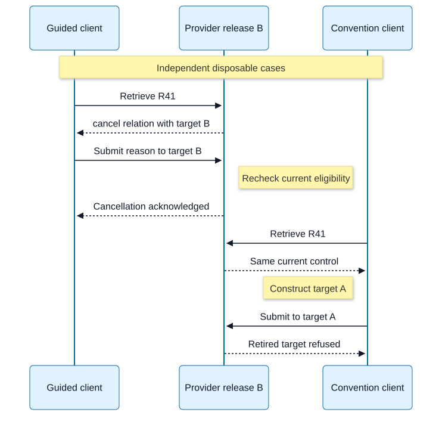

# Chapter 01 — APIs as Contracts and REST as an Architectural Style

**Domain / competency:** D05 — API Engineering / D05-C01

**Editorial status:** `in_review` — complete draft; Product Owner chapter approval pending.

**Curriculum authority:** [approved CD01–CD07](../evidence/curriculum-approval.md) and [controlling C01 profile](../depth-specification.md#d05-c01--apis-as-contracts-and-rest-as-an-architectural-style).

**Learner assessment:** deferred_until_learning_phase. **Portfolio implementation:** not_started.

## Outcomes, prerequisites and scope

After studying this chapter, you should be able to extract a contract from a consumer journey, predict which observations establish success, compare resource and operation interfaces, and audit a REST claim one constraint at a time. You should be able to explain a failure caused by relaxing a constraint, rather than recognize a collection of endpoint naming conventions.

Bring invariant and state-transition reasoning from D01 and the distinction between static types and public runtime contracts from D02. Review [D04-C07 HTTP semantics and representations](../../04-network-protocol-engineering/lessons/07-http-semantics-and-representations.md) and [D04-C11 intermediary trust boundaries](../../04-network-protocol-engineering/lessons/11-proxies-routing-and-trust-boundaries.md) if methods, media types, immediate peers or response provenance are unfamiliar. No earlier D05 lesson is required.

We use a fictional reservation service. A consumer wants to reserve one seat and later cancel it. All numbers, actors, paths and policies below are teaching assumptions. They select no architecture for a project. C02 will deepen resource/workflow modeling; C04 HTTP method mechanics; C08–C10 cache consistency, concurrency and retries; C19/C20 GraphQL and gRPC execution. The minimum concepts needed here are explained locally, without requiring those future chapters.

## 1. A contract makes independent decisions possible

An API is a boundary through which a consumer requests information or effects from a provider. A consumer can be a browser, another backend, a partner's integration, a batch job or a human-operated client. A provider owns the offered behavior. An API contract is the agreement that lets each side decide what to send, what it may assume, and what a result means without inspecting the other's implementation.

An interaction is an exchange, or a specified sequence of exchanges, across that boundary. A policy states a rule, such as which principal may cancel; a mechanism is the procedure that enforces or communicates it. A capability here means an offered ability to perform an action, not automatically an authorization credential. Independent evolution means either side can change its implementation while preserving the supported agreement.

The contract includes both guarantees and constraints. A guarantee says what follows when its assumptions hold; a constraint says what requests or reliance are permitted. A TypeScript declaration describes part of a programmer-facing shape. It does not establish that bytes arriving from another process have that shape, that a caller has authority, or that a timed-out request caused no effect. An OpenAPI description can document many exchanges; documentation alone does not enforce the behavior it describes.

A useful reasoning model is `request + authority + current state + policy → permitted effect + observable response`. A history of exchanges must preserve invariants even when attempts overlap or replies disappear. This is a model for asking questions, not a promise that every API is deterministic. Random allocation, time and external services require additional assumptions.

### Work a consumer journey into an agreement

Assume seat S7 is available; principal Alice may reserve it; the teaching provider supports an immediate reservation. Its owner writes the following contract before implementation:

| Dimension | Concrete teaching promise | What a consumer may conclude |
|---|---|---|
| Input | UTF-8 JSON with `seatId` identifying an offered seat; 1 KiB educational input bound | Accepted syntax is distinct from eligibility |
| Output | A complete 201 response identifies the created reservation and reports `held` | The provider acknowledges this reservation's creation, within its stated persistence policy |
| State | At most one active reservation for S7 | Two valid callers cannot both receive distinct successful active holds for that seat |
| Authority | Only a permitted principal can reserve; cancellation checks current ownership/permission | Knowing an identifier alone grants no authority |
| Time | A hold includes its expiry instant; server evaluation decides whether it is still active | A previously displayed hold can expire before the next action |
| Error | A documented validation refusal causes no reservation; a conflict reports no new hold for that attempt | These are defined application guarantees, beyond the status number |
| Observation | Losing a reply leaves the effect unknown until authoritative reconciliation | A local timeout is insufficient evidence of refusal |

Normal trace T1: Alice sends an eligible request for S7; the provider validates it, checks current permission, enforces the availability condition with creation, then returns a complete 201 identifying R41. Alice records R41 and shows the acknowledged state. The consumer has used observable promises; it has learned nothing about tables or server instances. Even a complete response establishes durability only to the extent that the contract defines it; an implementation violating that promise is defective.

Adverse trace T2: a partner sends the same valid shape after Alice has reserved S7. A provider that promises uniqueness must refuse creation or report the already-associated logical result under an explicit replay policy. Returning a second successful active reservation violates the state promise although both responses fit the same schema. Another adverse trace: renaming a transition while preserving every JSON field can break a client that constructed its address. Shape compatibility is only one dimension of contract compatibility.

A weak alternative publishes only examples and lets clients infer everything else. It is fast initially, but inferred behavior becomes hidden coupling: callers ship assumptions the provider never reviewed. A stronger alternative declares edge behavior and supported consumer assumptions. It costs design and compatibility work, but lets callers distinguish refusal, success and uncertainty. Backend engineers use that distinction in SDKs, job recovery and incident diagnosis.

### Audiences and accountable ownership

A public API has consumers the provider cannot coordinate individually. A partner API may negotiate narrower support windows. An internal API may have a known consumer inventory and coordinated releases. None eliminates the contract: a worker still running yesterday's build is an independently evolving consumer.

For T1, assign a reservation owner to the uniqueness and expiry promises, an identity-policy owner to the authority facts, and an ingress owner to message-size enforcement. The externally offered contract must identify who resolves a conflict between these rules. Normal governance: a proposed 2 KiB request is rejected under the published 1 KiB bound, and the owner either preserves the bound or versions the supported agreement. Adverse governance: the ingress lowers its bound to 512 bytes without coordinating the provider's 1 KiB promise; valid consumers now fail before reaching the provider. “Both teams passed tests” cannot resolve the contradictory contract.

Central ownership can make the offered contract coherent but can slow approvals. Delegated ownership can move faster if the accountable boundary owner reviews composed promises and communicates changes. For an internal notification API, inventorying supported consumers and the owner of delivery acknowledgment is often more valuable than adding a decorative version prefix. These are governance responsibilities, not a mandatory team structure. The distinction between description and behavior follows [OpenAPI 3.2.1 §Introduction](https://spec.openapis.org/oas/v3.2.1.html#introduction); HTTP interpretation follows [RFC 9110 §§3, 15](https://www.rfc-editor.org/rfc/rfc9110.html#section-3). The reservation and ownership policies are our assumptions.

**Independent exercise E1.** An internal export API returns `202 {"id":"J9"}`. Its gateway times out after 2 seconds, workers retain jobs for one day, and no owner documents retrieval or duplicate submission. Write four missing promises and a failure trace. **Answer rubric:** distinguish accepted work from completed output; define retrieval/retention, authority, repeated intent and timeout observations; identify accountable owners and a mixed-version consumer. Full credit connects each promise to a decision the consumer cannot currently make. Naming a schema or assuming that “internal” permits coordinated deployment is insufficient.

## 2. Interface style, transport and resource orientation are different choices

HTTP transports and interprets request/response messages. REST abstracts interaction constraints rather than prescribing one wire protocol; using another protocol would still require compatible interaction semantics to support a REST claim. JSON encodes data. Resource orientation organizes an interface around identifiable concepts and their representations. RPC organizes it around named operations with arguments and results. REST is an architectural style defined by constraints on interactions. None of the first three labels alone proves the fourth.

Compare the same cancellation workload: Alice knows R41, wants its current state and wants to request cancellation with a reason. In a resource-oriented design, `GET /reservations/R41` retrieves a representation; creating a cancellation request at an advertised target submits an intended change. A cancellation can be an identifiable resource with a receipt if the domain requires one. In an RPC design, `GetReservation(R41)` and `CancelReservation(R41, reason)` name the operations directly. Either design must define permission, legal states, duplicated attempts and what the returned result acknowledges.

Normal trace T3: the resource client retrieves R41, sees cancellation available, submits its representation, and receives a cancellation result; the RPC client calls `CancelReservation` and receives the same domain result. These can both be correct. The resource client can reuse general retrieval and representation handling; the RPC client can express a specialized method's input/result precisely.

Adverse trace T4: an endpoint accepts `POST /execute {"operation":"cancel","args":["R41"]}` but omits argument units, replay semantics and refusal effects. A generic envelope makes operation semantics opaque to generic HTTP components; clients need a separate operation catalog. Renaming it `POST /reservations/action` does not remove that coupling. Conversely, `GET /reservations/R41/cancel` that cancels on retrieval conflicts with safe retrieval semantics: a prefetching client can cause a cancellation. Nouns in the path do not repair the violation. See [RFC 9110 §9.2.1](https://www.rfc-editor.org/rfc/rfc9110.html#section-9.2.1).

Resource orientation is useful when independent consumers navigate durable identities, representations and workflows. A specialized operation interface can be a better fit for tightly coordinated computational calls, such as `ComputePackingPlan(items, constraints)`, where a separately navigable result has little value. General interfaces reduce bespoke connector behavior; specialized ones can reduce round trips and express domain operations compactly. REST permits meaningful operations through its uniform interface; it does not require every domain action to masquerade as an arbitrary property update.

GraphQL emphasizes a typed graph and consumer-selected fields; gRPC emphasizes service methods and message contracts. These are future mechanism chapters, not inferior grades on a REST ladder. SOAP/WSDL matters when an existing integration requires its message/service conventions; OData supplies query conventions for participating services; federation composes independently owned schemas. Those names locate further study, not qualification of their implementations here. No library or transport binding for them is selected.

**Independent exercise E2.** Compare an inventory lookup API used by 200 independent sellers with a private image-transform call used by one coordinated worker fleet. Defend either interface style for each. **Answer rubric:** identify consumer autonomy, stable identities, query/computation needs, generic intermediary visibility and coordination costs. Include one adverse trace and a replay promise in each defense. Do not award full credit for “HTTP means REST” or “RPC cannot use HTTP.” This comparison applies the separation of identification and interaction in [RFC 3986 §1.2.2](https://www.rfc-editor.org/rfc/rfc3986.html#section-1.2.2) to our invented workloads.

## 3. Client-server separation hides implementation behind behavior

In client-server interaction, the client initiates a request and the server offers the resource behavior. The separation lets a consumer own its task/presentation while a provider owns the implementation behind the boundary. A backend can be a server to its caller and a client of another service; the roles concern an interaction, not a permanent machine category.

Normal trace T5: a mobile client retrieves R41 through the documented interface; the provider changes its internal reservation storage layout; the next retrieval preserves the same meaning and permitted effects. No client change follows because the consumer depends on the contract rather than the layout. The causal chain is hidden implementation detail → fewer exposed assumptions → a smaller compatibility surface.

Adverse trace T6: the client receives `rowNumber: 83` and uses it as identity because the provider documented it that way. After storage compaction, row 83 represents another hold. The leaked storage identity is now a contract problem. Client-server deployment alone did not provide independent evolution. A stronger boundary would expose an identity whose meaning the provider preserves; it could still be generated by a database internally.

A shared in-process library or tightly coordinated private interface can deliberately expose more structure and avoid some serialization overhead. A remote contract sacrifices that convenience to permit independent implementations and releases. Backend engineers need this distinction when a “small internal refactor” changes observable ordering, units or error meaning. The property is independence under the preserved contract, not freedom to change arbitrary behavior. Architectural foundation: [Fielding, Chapter 5 §5.1.2](https://ics.uci.edu/~fielding/pubs/dissertation/rest_arch_style.htm#sec_5_1_2).

**Independent exercise E3.** A file-processing API exposes a worker's temporary pathname as its permanent download identifier. The worker is replaced. Predict the break and propose two boundaries. **Answer rubric:** trace identifier → consumer dependency → worker replacement failure; compare a stable artifact identifier with an explicitly expiring download capability. State expiry/authority semantics for the second. Neither requires selecting storage or a deployment topology.

## 4. Stateless interaction separates request context from resource state

REST statelessness concerns interpretation across requests: an interaction must not require a hidden server-held conversational history to explain what the request means. It does not remove reservations, accounts, permission records or other server resource state. A server can retrieve R41 and evaluate current policy. A client cannot require “use whichever reservation I selected on my previous connection” as the missing target of a request.

Keep three kinds of state distinct:

| State | Example | Role in the next request |
|---|---|---|
| Client application state | Alice is viewing R41 and chooses cancellation | Client selects the next interaction and carries its required context |
| Server resource state | R41 is held, owned by Alice, expiring at a stated instant | Provider evaluates the requested action against current truth |
| Hidden conversational state | Session X remembers that “current item” means R41 | Makes an otherwise incomplete request depend on prior conversation |

Normal trace T7: Alice retrieves R41 through server A. She sends the next request naming R41 with its required representation, authority context and relevant condition. Server B can interpret the request against the same authoritative resource/policy facts. It need not have seen Alice's previous browsing. This reduces conversation affinity and makes a single exchange more interpretable. It does not guarantee B has fresh data or can reach a dependency.

Adverse trace T8: `POST /select {"id":"R41"}` sets a private session variable on A, then `POST /cancel-current {}` reaches B. B has no selection, or a shared browser session has since selected R52. Replaying the latter request no longer names the same intent. Synchronizing session context can restore this chosen design's operation, but retains the conversational dependency and its coordination cost.

**Visual question:** Which information travels with a request, and which state is legitimately owned by the provider?



*Figure D05-C01-V01 — Conceptual ownership, not physical deployment or an observed HTTP exchange. Solid arrows show required request/evaluation information; the dashed edge shows an extra hidden conversation dependency. A credential can require server-side verification; its presence does not authorize an action by itself. The table above is the textual equivalent. [Editable Mermaid](../assets/01-api-contracts-and-rest/state-boundaries.mmd).*

A token is not proof of statelessness. A cookie can identify required credential context or select a hidden workflow conversation; its transport says neither. A self-contained token avoids some lookup but can increase request size and complicate timely revocation. An opaque credential may require a server-side identity lookup; that alone does not make the requested reservation target conversational. Analyze what the lookup supplies, and whether request meaning depends on earlier selections. Full authentication protocols belong to later security study.

Statelessness costs repeated context and client responsibility for choosing coherent actions. It does not provide atomicity, authentication, durable effects, replay protection or correct ordering. A stateful protocol may be appropriate for a tightly controlled interactive conversation; it accepts affinity/recovery obligations rather than obtaining statelessness by assertion. Backend applications include retryable job clients and interchangeable request handlers, but no scaling or availability guarantee follows from this constraint alone. Source qualification: [Fielding §5.1.3 and §5.2.2](https://ics.uci.edu/~fielding/pubs/dissertation/rest_arch_style.htm#sec_5_1_3) define the architectural constraint; the token distinctions and T7/T8 are applied analyses, not identity-provider recommendations.

**Independent exercise E4.** A stateless-looking request contains `reservationId`, a credential and `useLastQuotedPrice:true`. The last quote is remembered only in one server's session. Can another handler interpret the same intent? **Answer rubric:** identify the missing quote identity/meaning, distinguish resource state from conversation state, and compare carrying an explicit quote reference with synchronizing the session. Explain why either still needs current validity/authority checks and why statelessness cannot prevent double booking.

## 5. Cacheability is a reuse agreement with a correctness cost

Cacheability declares whether, where and under which conditions a response may satisfy a later request. A cache does not automatically know the provider's business truth. It selects a stored response using the request and applicable cache metadata, then decides whether reuse is allowed. REST's cache constraint enables avoiding exchanges; HTTP supplies concrete storage and reuse rules. A response explicitly marked non-cacheable is compatible with the constraint. REST does not require every response to be stored.

For a bounded example, assume anonymous `GET /seat-types/standard` reports descriptive seat metadata, uses `Cache-Control: public, max-age=30`, and has no selected variants. Normal trace T9: a conforming shared cache receives a fresh complete response at illustrative age 0; at age 10, an equivalent request is satisfied from that response. The provider saves a retrieval. At age 31, freshness alone no longer permits reuse; the cache must follow applicable validation/stale rules. Real HTTP age accounts for origin timestamps, transit and resident time; our explicit ages are a teaching clock, not a replacement algorithm.

Adverse trace T10: use the same public policy for `GET /my-reservation`, and let a cache key omit consumer identity. Alice's representation is served to Bob. The failure is reuse across an authority boundary. Another failure: at age 10 an availability display is protocol-fresh but S7 was sold at age 5. Freshness permits reuse; it does not promise “latest database state” or reserve capacity. A subsequent mutation must enforce current eligibility independently.

For private reservation data, an explicit `no-store` policy can avoid intended cache storage under HTTP rules; it is not a remote eraser for copies already made. `private` permits private-cache storage while preventing shared-cache storage; `no-cache` allows storage but requires validation for reuse. These differences matter to a backend returning personalized representations. The precise rules, including authorization restrictions and stale reuse, are in [RFC 9111 §§3–5](https://www.rfc-editor.org/rfc/rfc9111.html#section-3); do not generalize from the old architectural examples to modern HTTP cache defaults.

Compare caching a stable seat description with refusing cache storage for a sensitive cancellation receipt. The former trades tolerated staleness for fewer exchanges. The latter increases origin work but simplifies sensitive reuse promises. A short freshness lifetime still leaves a stale interval; validation can save bytes while adding a round trip and depending on valid representation identity. A cache directive does not solve origin consistency or revoke every past response.

**Independent exercise E5.** A public inventory count says `4 available` with 20 seconds of freshness. Two callers act during those seconds. A designer proposes `max-age=0` as the only overselling fix. **Answer rubric:** distinguish read freshness from atomic admission; trace both callers through the same read; compare display caching with authoritative mutation checks. For a personalized variant, state why its selection and authority scope must also be reflected in permitted reuse. Full credit avoids claiming that zero freshness makes writes serial.

## 6. Uniform interface, first constraint: resource identification

A uniform interface applies shared interaction semantics across resources, rather than inventing an unrelated connector protocol for each operation. Uniformity does not mean all resources have identical fields or allow every method. The next four sections explain its four distinct constraints; none can be inferred merely from consistent endpoint naming.

A resource is an identified concept that may have changing representations. A reservation is not its current JSON bytes or a table row; “R41's current reservation state” can remain the same resource while its state changes. An identifier provides a reference the contract can preserve. Two URLs returning equal bytes at one instant do not necessarily identify the same concept: “latest export” and “export revision 17” can coincide today and diverge tomorrow.

Normal trace T11: Alice retains `/reservations/R41`; retrieval first reports held, later cancelled. The provider preserved identity while representations changed. A client linking to R41 need not discover a new identity merely because its status changed. URI syntax establishes how to parse a reference; our contract establishes the identity's meaning and longevity. See [RFC 3986 §§1.1, 1.2](https://www.rfc-editor.org/rfc/rfc3986.html#section-1.1).

Adverse trace T12: `/reservations/current` means whichever row the server most recently viewed for this user, and the client stores it as a permanent reference to R41. After R52 is selected, the same reference retrieves R52. Either “current” was intentionally a different resource and the consumer assumed too much, or the provider failed its identity promise. A static reference is not interchangeable with a moving alias.

Opaque stable IDs reduce accidental dependencies on names. Human-readable IDs improve inspection but can collide, change or be recycled. Either can work if the mapping is explicit. An identifier is also not an access grant unless a deliberately specified capability contract makes it one. A backend that changes ownership must recheck authority while preserving or explicitly retiring identity. A resource need not correspond one-to-one with a database table.

**Independent exercise E6.** A notification system exposes `/reports/latest` and `/reports/17`, initially with identical bytes. A user bookmarks the first for an audit. Predict next week's observation and defend an alternative. **Answer rubric:** separate moving selection from immutable revision identity, state retention/authority assumptions, and explain why equal representations do not establish identical resources. This applies the identification/representation separation in [W3C Web Architecture §2](https://www.w3.org/TR/webarch/#identification).

## 7. Uniform interface, second constraint: manipulation through representations

A representation is data plus metadata that conveys a resource's current, intended or related state. The client interacts through agreed representations and general interaction semantics; it does not send instructions to mutate an undocumented storage layout. The provider remains responsible for interpreting the representation, checking authority and enforcing invariants.

Assume an advertised cancellation-submission target accepts a teaching representation `{"reason":"plans-changed"}`. Normal trace T13: Alice submits it; the provider interprets `reason` according to the agreed format, checks that R41 is cancellable, records the cancellation effect under its contract and returns the result representation. The client never needs the provider's `status_code=7` storage convention. The causal benefit is that representation meaning can remain stable across implementation changes.

Adverse trace T14: a provider exposes a generic update that accepts every field from its internal object, including `ownerId`, `settled` and `remainingSeats`. A consumer resubmits a stale object with `settled:false` and overwrites a protected fact. Valid JSON and matching field types did not establish legal manipulation. The agreed input model must separate client-controlled intent from server-owned state, and concurrent validity must be enforced at the effect boundary.

A full desired-state representation can be easy to compare and review but can overwrite concurrent changes without conditions. A targeted cancellation representation narrows intent and can have a separate receipt, but introduces additional domain meaning and possible resources. A dedicated RPC method can express the same narrow intent with a specialized interface. This chapter compares their coupling; it does not select URI spelling, patch formats or project persistence.

Backend applications include accepting an import specification while keeping computed checksums and processing status provider-owned. The provider may reject a representation even when its syntax is valid. The distinction between a representation and action semantics follows [RFC 9110 §§3.2, 6.4](https://www.rfc-editor.org/rfc/rfc9110.html#section-3.2) and the separation of identification, interaction and formats in [W3C Web Architecture](https://www.w3.org/TR/webarch/).

**Independent exercise E7.** A file-processing client resubmits an entire output object to request a rename, including a stale `scanResult:"safe"`. Compare full replacement and a rename intent. **Answer rubric:** identify client-owned versus provider-owned facts, show the stale overwrite, define refusal/no-effect assumptions, and discuss a current-state condition for either design. “Validate the JSON” earns only partial credit.

## 8. Uniform interface, third constraint: self-descriptive messages

A self-descriptive message provides the information needed to interpret the interaction according to shared semantics. That includes the target, method, status, representation metadata and applicable control information. It does not require every domain definition to be repeated in every body. Consumers still need to understand the relevant media types, relation meanings and contract vocabulary.

Normal trace T15: a consumer receives a complete `200`, `Content-Type: application/json`, an explicit no-storage policy, and the agreed reservation representation. It distinguishes retrieval success, representation decoding and the `held` domain state. A generic intermediary can reason about applicable method/cache semantics without executing a reservation-specific operation catalog. JSON tells it the syntax, not whether cancellation is permitted.

Adverse trace T16: an intermediary sends `502` with an HTML body, while the client unconditionally parses JSON and reports “reservation missing.” A decoding error erased the actual observation. Another failure: all requests are `POST /api` with a numeric operation code and all outcomes are `200 {"code":17}`. Such an interface can have a documented specialized contract, but generic HTTP tools cannot infer safe retrieval or business refusal from the envelope alone.

A media type's syntax is not its whole meaning. Consider `{"amount":100}`: without a currency and unit definition, a consumer cannot know whether it means 100 dollars or 100 minor units. A custom documented media type can carry domain semantics and affordances, at the cost of adoption work. Generic JSON plus a separately documented profile is common and easy to inspect, but must explicitly define meanings and does not become a hypermedia format merely by adding a `links` key. A TypeScript cast cannot repair unknown runtime data.

Backend engineers should preserve status, content type, bounded body evidence and response provenance when a response is unexpected. Do not log credentials or an unbounded sensitive body for interpretability. HTTP's field and content interpretation is specified in [RFC 9110 §§6, 8](https://www.rfc-editor.org/rfc/rfc9110.html#section-6); JSON syntax and interoperability in [RFC 8259](https://www.rfc-editor.org/rfc/rfc8259.html). The amount semantics and teaching formats here are explicitly local.

**Independent exercise E8.** A client receives `200 application/json {"status":"pending"}` after submitting a notification. It assumes delivery completed. Give a normal interpretation, a counterexample and a better acknowledgment contract. **Answer rubric:** distinguish message completion, operation acceptance and recipient delivery; define the meaning and owner of `pending`; preserve units/media/error meanings. An unchanged response schema does not protect a changed acknowledgment meaning.

## 9. Uniform interface, fourth constraint: hypermedia drives application state

Hypermedia lets the client select a next action from controls in representations, using understood relation and action semantics. The client retains its task goal; the provider supplies currently offered transitions. A URL alone is not enough to submit a mutation safely: the consumer also needs to know method, input format, fields and what the result means. Controls can refer to known semantics rather than restating all of them.

For this chapter only, define a tiny teaching format. `state` reports the reservation state. `actions` is a list of controls; each has `rel`, `method`, `href` and `type`. The extension relation `https://handbook.example/relations/cancel` means “submit this format's cancellation request for the represented reservation.” For that relation, POST submits JSON with the string `reason`; the result is the cancellation acknowledgment defined in §1. `href` is a target, not a template. The client understands this vocabulary before using the service. This is an invented, non-registered format, not a proposed standard or a complete REST implementation.

```json
{
  "id": "R41",
  "state": "held",
  "actions": [{
    "rel": "https://handbook.example/relations/cancel",
    "method": "POST",
    "href": "/cancellation-requests/R41",
    "type": "application/json"
  }]
}
```

### Trace the same release through two consumers

Assume the initial entry/resource reference and relation/input semantics remain stable. Release A advertises `/reservations/R41/cancellation`. Release B moves the submission target to `/cancellation-requests/R41` and stops serving the old target. It preserves the JSON fields and cancellation meaning. Under the teaching contract, target construction was **never documented**; consumers were required to use the current control.

Normal trace T17: a guided client retrieves R41 from release A, finds the understood cancel relation, reads its method/type/target, and submits the reason. On a fresh retrieval after release B, it finds the same relation with the new target and submits there. The selected action changes without changing client code. Discovery moved target knowledge from an embedded convention into a current representation. The client still depends on the relation semantics, representation format and a usable entry point.

Adverse trace T18: a convention-dependent client retrieves release B's otherwise identical reservation but constructs `/reservations/R41/cancellation`. The request reaches a retired target and fails. Preserving response shape did not preserve this consumer's undocumented workflow assumption. If the provider had documented that fixed template, retiring it would instead be a provider compatibility break; hypermedia cannot retroactively erase published guarantees.

A second adverse case tests a genuine limit. Alice retrieves a cancel control; another actor cancels R41 before Alice submits. The previously offered control is now stale. The provider must re-evaluate the transition and return the specified refusal or reconciled result. A control describes an available opportunity at representation time; it is neither a lock nor continuing authorization. If the representation omits a relation the client needs, a client with no supported alternative must stop or refresh, not guess an address. Unknown relations can be ignored according to the format; known relations with unsupported methods/types require explicit refusal.

**Visual question:** Where does the changed transition target enter the successful request?



*Figure D05-C01-V02 — Conceptual ordered comparison of independent disposable cases, not measured network timing. Release B retains the relation but changes its target. In the figure, target A is `/reservations/R41/cancellation`; target B is `/cancellation-requests/R41`. The guided client's success assumes a fresh control and unchanged semantics; revalidation still occurs at submission. T17/T18 above provide the complete text equivalent. [Editable Mermaid](../assets/01-api-contracts-and-rest/transition-change.mmd).*

Fixed templates are a legitimate alternative when published and maintained as a contract. They are easy to generate into clients, avoid some discovery exchanges and can suit coordinated services. Hypermedia adds representation/control processing and sometimes retrieval cost; it reduces knowledge of target construction and state-specific action availability. Neither eliminates semantic versioning, bootstrap assumptions, access checks or race handling. Returned links are not permission to forward credentials to an arbitrary origin; an executable client must validate destinations and supported control semantics. Our pure model makes no network calls.

Backend applications include an export resource offering a download only after completion and a reservation offering cancellation only while eligible. REST's hypermedia requirement is architectural; [Fielding's 2008 clarification](https://roy.gbiv.com/untangled/2008/rest-apis-must-be-hypertext-driven) emphasizes following runtime controls over coupling clients to undisclosed structures. [RFC 8288 §2](https://www.rfc-editor.org/rfc/rfc8288.html#section-2) defines link context, relation and target; it does not standardize our action object or supply a universal mutation form.

**Independent exercise E9.** Release C preserves `href` but changes the cancel relation's meaning to “cancel and charge a fee,” without changing fields. Does following controls solve this? What if a client cached release A's control? **Answer rubric:** distinguish target discovery from semantic compatibility; explain that the changed meaning breaks the known relation contract; trace stale-control refusal/recovery and authority re-evaluation. Compare maintaining a fixed template with discovering a target under the same published guarantees. Do not award full credit for saying links make all releases compatible.

## 10. Layered systems permit intermediaries while preserving meaning

In a layered interaction a component communicates through its immediate layer without needing a fixed picture of the whole system. A consumer can use the offered interface through a cache or gateway while the provider changes what lies behind it. This is an interaction constraint; it is not an instruction to build a particular multi-tier application.

Normal trace T19: a client retrieves public seat-description data through an intermediary. The intermediary evaluates the method and reuse metadata, then either answers from permitted cache state or forwards the request. The client interprets the resulting response using the same public contract. Shared semantics make intermediary behavior possible without a bespoke parser for each business operation. Multiple layers can add routing, transformation or admission behavior, but every externally visible change still has to honor the offered contract.

Adverse trace T20: an origin commits cancellation; a gateway's upstream timer expires before its reply arrives; the gateway returns 504. The client has a complete gateway-generated response and an unknown origin effect. A gateway that automatically retries an unqualified non-idempotent request can duplicate an effect. Another failure: an internal client bypasses the only authorization-enforcing gateway and calls an origin that assumes the check already occurred. A layer's existence establishes neither trust nor universal enforcement.

Layers can provide reuse and encapsulation at a latency, failure and policy-composition cost. A direct origin path reduces intermediate behavior but may reveal topology and lose shared services. If a public contract advertises origin hostnames that clients must follow, it may create extra topology coupling; an explicitly supported redirect can instead be part of the contract, with destination/credential rules. Backend engineers should assign ownership for validation, retries and refusals and preserve who generated a response. The networking details belong to the D04 prerequisite; later C22 develops API policy composition.

Source qualification: [Fielding §5.1.6](https://ics.uci.edu/~fielding/pubs/dissertation/rest_arch_style.htm#sec_5_1_6) supplies the layer constraint; [RFC 9110 §§3.7, 15.6.5](https://www.rfc-editor.org/rfc/rfc9110.html#section-3.7) supplies intermediary and 504 semantics. T20's effect uncertainty follows our explicitly possible commit-before-timeout ordering, not a claim that every gateway behaves alike.

**Independent exercise E10.** A notification gateway returns a timeout after the origin hands a message to its next dependency. The operator says “retry because the API failed.” Give two possible histories and a safe next observation. **Answer rubric:** one history may have no effect; another may have accepted the message; identify the observer and authoritative receipt or reconciliation contract. Compare direct and layered paths, and name the owner of automatic retry policy. Do not infer the origin's result from a gateway response alone.

## 11. Optional code-on-demand changes client capability

Code-on-demand lets a provider extend client behavior by sending executable code that the client runs in an understood environment. It is optional in REST: an interface without downloaded code does not fail the style for that reason. It differs from sending ordinary data to already-installed client logic.

Normal trace T21: a browser obtains a trusted application script with an understood execution policy; the script adds a local reservation-date picker; it then sends the same explicitly validated reservation request. Downloaded behavior can add a client capability without shipping a new native application. It does not transfer the provider's authority checks to the browser.

Adverse trace T22: a script refuses past dates, but a non-browser client bypasses the script and submits one. A server relying only on the downloaded check accepts a prohibited reservation. Another client cannot execute that script at all. Code delivery therefore reduces generic visibility and introduces runtime/trust/availability dependencies; it cannot define the sole enforceable boundary for all consumers.

A data-only representation with installed behavior makes clients easier to inspect and support across runtimes, but new client functionality can require a release. Downloadable code can accelerate capability changes while increasing execution policy and compatibility obligations. For backend APIs, keep server validation and authorization authoritative even if a browser receives helpful code. No code download or execution-from-network experiment occurs here. Source: [Fielding §5.1.7](https://ics.uci.edu/~fielding/pubs/dissertation/rest_arch_style.htm#sec_5_1_7); examples are contemporary teaching applications, not endorsement of the dissertation's historical applet platforms.

**Independent exercise E11.** A file uploader downloads a checksum script, then the backend trusts the submitted checksum as proof that the content is safe. Trace the mistake and compare preinstalled and downloaded client code. **Answer rubric:** separate local assistance, integrity evidence and safety/authority; show an alternative caller bypassing the script; explain the runtime/trust trade-off and why absence of code-on-demand is not a REST violation.

## 12. Correctness first boundary: malformed input is not permitted intent

A provider sees bytes and metadata before it sees a valid request object. Malformed input includes unparseable syntax; well-formed but invalid input can have the wrong structure, unsupported values or an illegal domain intent. The contract must say which refusal implies no effect, and enforcement must make that implication true.

Normal trace T23: bounded JSON text `{"seatId":"S7"}` is parsed, checked as an object with the supported seat field, checked for current permission/eligibility, and only then reaches an effect boundary. The provider creates at most the permitted effect. The order matters causally: mutations performed before discovering invalid intent cannot be undone by merely returning an error.

Adverse trace T24: the provider decrements inventory as soon as it sees a seat field, then later discovers that the request has an unsupported operation or missing authority. Returning a validation error would contradict a no-effect promise. Another input, `{"seatId":7}`, is valid JSON but violates the teaching string requirement. A TypeScript assertion after parsing changes no runtime facts. The bounded example below deliberately distinguishes syntax refusal from shape refusal and checks that neither changes effects.

Strictly rejecting unknown fields catches mistakes but can constrain additive evolution; ignoring unknown fields can support evolution but may hide misspellings or unsafe assignments. Either policy must be explicit and must not let consumer-controlled fields overwrite provider-owned facts. Detailed validators, decoding limits and error taxonomies belong to C05/C06. Here a backend engineer's task is to specify and preserve the order and no-effect guarantee; HTTP status vocabulary alone does not define it. See [RFC 8259 §§4, 9](https://www.rfc-editor.org/rfc/rfc8259.html#section-4) and [RFC 9110 §15.5.1](https://www.rfc-editor.org/rfc/rfc9110.html#section-15.5.1). Duplicate-name interoperability and production streaming parsers are outside the toy model's support.

**Independent exercise E12.** An import API creates its job record before checking whether the file description names a supported format. It returns “invalid request; nothing accepted.” Is the record an effect? **Answer rubric:** state the external contract's effect boundary; distinguish an inaccessible diagnostic record from an observable queued job; trace a worker observing the latter; compare validation-before-admission with an explicit accepted-then-rejected job lifecycle. Do not assume that every internal write violates every no-effect promise.

## 13. Correctness second boundary: retrying an attempt can repeat an intent

An attempt is one submission; a logical intent is the consumer's goal that may span attempts. A retry repeats an attempt after an observed failure or missing result. Idempotent semantics mean that repeated identical requests have the same intended effect as one; they do not require equal status codes or response bytes. HTTP provides method semantics, but an implementation must enforce them. A particular POST can have an explicit replay agreement; POST alone supplies none. See [RFC 9110 §§9.2.2, 9.3.3](https://www.rfc-editor.org/rfc/rfc9110.html#section-9.2.2).

Normal trace T25: a teaching reservation intent has client reference I9 under an agreed single-process model. First submission creates R41 and records the result for I9. An identical replay in that model returns R41 without creating another reservation. The invariant is one effect for that scoped intent. A different request with I9 must be rejected rather than silently reusing the old result. A real replay contract must specify principal/scope, comparison, retention and crash/concurrency behavior; C10 owns those mechanisms.

Adverse trace T26: without such an agreement, attempt A commits R41 but its reply is lost. The consumer observes a timeout and sends attempt B as a new create request. The provider creates R42. The timeout did not undo A. Returning 201 on both attempts can be consistent with an API that permits independent creates and inconsistent with a consumer's one-intent expectation. Another counterexample: a provider returns an error while serializing its response after committing; even an origin-generated failure may need reconciliation rather than an assumption of rollback.

| Observation | Established fact in the stated contract | Fact still unknown |
|---|---|---|
| Local timeout | Caller stopped waiting | Whether the provider received, refused or committed the request |
| Complete validation refusal with no-effect promise | This refused attempt caused no defined reservation effect | Whether a previous attempt committed |
| Complete 201 naming R41 | Provider acknowledges the named creation under its documented policy | Whether a separate earlier submission also created another reservation |
| Current read says R41 is cancelled | Current reported resource state | Which actor or attempt performed the transition, absent a correlated receipt |

Blind retry favors progress when duplication is harmless; it can be wrong for charges, notifications and allocations. Refusing automatic retries preserves uncertainty but can leave an unfinished user journey. A documented lookup/replay route can resolve some uncertainty, subject to its scope and retention. Neither an open connection nor stateless interaction supplies durable exactly-once effects. The runnable example keeps intent and result in one synchronous in-memory step explicitly; it demonstrates the difference, not a production deduplication design or an Idempotency-Key standard.

**Independent exercise E13.** A notification send times out. A later read says the recipient has received a notification, but the read contains no intent identifier. Can the client safely conclude its own attempt succeeded? **Answer rubric:** enumerate another sender/previous intent as a competing history; distinguish current state from correlated effect evidence; compare harmless repeat delivery with a strict one-notification contract. State what authoritative evidence would resolve the question and what remains unknown after record expiry.

## 14. Correctness third boundary: concurrency makes old observations conditional

Concurrency means independently initiated actions can overlap between observing state and enforcing an effect. A state invariant constrains all permitted interleavings, not only one request in isolation. A request carrying complete context can still be stale; statelessness does not serialize it.

Assume R41 is held at version 7. Cancellation and extension are competing transitions that each require that version. Normal trace T27: cancellation atomically checks version 7 and changes state/version to cancelled/8; extension then checks its expected 7 against current 8 and is refused without an extension effect. The condition and change have one indivisible enforcement point in this teaching model. A real backend must establish that property at the authoritative state boundary; adding an `If-Match` header does not establish it by itself.

Adverse trace T28: both requests separately read version 7 and pass a check; cancellation writes cancelled/8; extension then writes held/8 with a later expiry. Both callers may have received success although the later blind write erased an acknowledged transition. The provider must either forbid this interleaving or explicitly define a weaker competing-write policy. The stale client did nothing syntactically malformed.

A version condition avoids some lost updates on the represented resource. It is not a general solution for every multi-resource invariant. Two distinct reservations could each pass a per-reservation version check and still allocate the same last seat if seat availability is not protected at a shared effect boundary. Similarly, an advertised cancel action must be re-evaluated against current authority and state when submitted. Our version model is intentionally single-object and synchronous, not database-isolation evidence.

Blind last-writer-wins can be acceptable for a low-value preference if overwriting is the published policy. Conditional updates expose conflicts and require consumers to refresh/reconsider intent. Serializing competing commands simplifies some reasoning but creates ordering/admission costs and still needs a failure contract. Backend applications include inventory holds and cancellation/extension races; this chapter sets their contract questions without selecting transactions, locks or queues. HTTP precondition semantics are in [RFC 9110 §13](https://www.rfc-editor.org/rfc/rfc9110.html#section-13); the required atomic application property is an explicit teaching assumption, not supplied by a transport.

**Independent exercise E14.** Two callers each read `remaining=1` and different reservation versions, then each successfully updates its own reservation conditionally. Explain why both version checks can pass while overselling occurs. **Answer rubric:** name the cross-resource availability invariant, show the two read/check/effect histories and identify the missing common enforcement boundary. Compare rejecting a conflicting admission with a published oversubscription policy. No particular database mechanism is required to answer.

## 15. From constraints to properties, and a defensible style claim

An architectural constraint is a restriction chosen to induce properties. A property is conditional: if clients interpret the same semantics and providers preserve the agreement, generic interaction can reduce coupling. It is not an automatic result of applying a label. For this chapter, use the following causal audit alongside the worked cases:

| Constraint | Restriction and resulting opportunity | Relaxation demonstrated here | Cost that remains |
|---|---|---|---|
| Client-server | Hide provider implementation behind the offered boundary → independent changes within it | T6 exposes unstable storage identity | Serialization and compatibility obligations |
| Stateless interaction | Name required interaction context in each request → reduced conversation affinity | T8 needs hidden last selection | Repeated context, stale state, client correctness |
| Cacheability | Declare permitted reuse → some exchanges can be avoided | T10 crosses authority or freshness assumptions | Staleness and reuse-scope reasoning |
| Resource identification | Preserve reference meaning → links can outlive a state change | T12 confuses moving alias and fixed identity | Identity ownership and retention |
| Manipulation through representations | Express intent/state through agreed data → hide storage layout | T14 allows overwriting provider-owned facts | Validation, authority and concurrency |
| Self-descriptive messages | Carry shared interpretation/control metadata → generic visibility | T16 loses response meaning or hides it in private codes | Domain vocabulary still must be understood |
| Hypermedia | Select currently supplied controls → less embedded target/workflow knowledge | T18 constructs a retired, undocumented target | Stable semantics, entry point and race handling |
| Layered system | Depend on the offered adjacent interface → intermediary substitution/encapsulation | T20 confuses gateway observation and origin effect | Added latency/failure/policy composition |
| Optional code-on-demand | Transfer executable capability → extend supported clients | T22 confuses client assistance with enforcement | Runtime/trust and reduced visibility |

For an explicit conformance review, examine three concrete interfaces under the same reservation workload:

1. **A — CRUD-shaped JSON/HTTP.** It has stable reservation identities, self-contained requests, explicit cache directives and correct method semantics. Clients must construct every next workflow target using a documented fixed template. It has useful resource-oriented HTTP properties; the stated interaction does not demonstrate hypermedia-driven application state. Calling it fully REST-conformant would overstate this evidence.
2. **B — Guided teaching interface.** T17 uses supplied controls and understood relation/input meanings; state and metadata are explicit. This demonstrates one uniform-interface mechanism in a pure model. It does not establish the whole deployed system's layer behavior, actual message descriptions, authentication or cache implementation. “The model demonstrates target-discovery decoupling” is a supported claim; “certified REST API” is not.
3. **C — Explicit cancellation RPC.** It defines the operation, input and replay/refusal meanings and uses a coordinated client contract. It can be correct for its audience even while choosing specialized semantics instead of a uniform resource interface. Its correctness must be reviewed independently of its style.

This is a design comparison under stated assumptions, not a maturity ranking. Consumer autonomy and provider control remain in tension: allowing independent navigation can reduce release coordination while requiring more stable shared meanings. A specialized coordinated operation can use fewer exchanges while increasing client/server release coupling. An interface can use HTTP correctly without satisfying every REST constraint; relaxing a constraint should be an explained trade-off with an observed or predicted consequence.

**Independent exercise E15.** Audit an interface where all reads are POST, all responses are 200 JSON, clients construct transitions, and the service keeps a hidden current-reservation session. The author says “we use HTTPS and noun paths, so it is REST.” Identify which evidence is missing or contradictory and defend a useful alternative. **Answer rubric:** inspect each individual constraint, separate HTTP legality from lost generic method/cache visibility, identify the session dependency and fixed workflow knowledge, and avoid treating optional code-on-demand as mandatory. A specialized RPC label with a complete correctness contract can be defensible; changing names alone proves nothing. The constraint taxonomy is from [Fielding Chapter 5](https://ics.uci.edu/~fielding/pubs/dissertation/rest_arch_style.htm); the audit is an original application to the stated interface.

## 16. Runnable bounded educational experiments

These are **pure synchronous models**, not HTTP, schema-tool, provider or database integration tests. They make selected dependencies executable while deliberately leaving network, authentication, durable storage and real concurrent execution unmodeled. Run from the repository root with Node; no dependencies, flags, credentials, services or ports are needed. Both scripts terminate after a fixed number of checks and keep all state in local memory. A new invocation resets the disposable state; there is nothing to stop or delete.

### Experiment A — Compare selected targets after a release

The canonical runnable source is [contract-traces.mjs](../examples/c01/contract-traces.mjs). Its complete program is reproduced here so the chapter can be read independently; edit the canonical file and synchronize this block together.

```javascript
import assert from 'node:assert/strict';

const cancel = 'https://handbook.example/relations/cancel';
const targetA = '/reservations/R41/cancellation';
const targetB = '/cancellation-requests/R41';

function representation(target, state = 'held') {
  return {
    id: 'R41',
    state,
    actions: state === 'held'
      ? [{ rel: cancel, method: 'POST', href: target, type: 'application/json' }]
      : [],
  };
}

function guided(document) {
  const action = document.actions.find(item => item.rel === cancel);
  if (!action) return null;
  if (action.method !== 'POST' || action.type !== 'application/json') {
    throw new Error('unsupported control');
  }
  return { method: action.method, target: action.href, body: { reason: 'plans-changed' } };
}

function conventional(document) {
  return {
    method: 'POST',
    target: `/reservations/${document.id}/cancellation`,
    body: { reason: 'plans-changed' },
  };
}

// Each call models an independent disposable provider, not shared mutable state.
function submit(request, currentTarget, currentState = 'held') {
  if (!request) return 'no-action';
  if (request.target !== currentTarget) return 'retired-target';
  if (currentState !== 'held') return 'state-refusal';
  return 'cancelled';
}

assert.equal(submit(guided(representation(targetA)), targetA), 'cancelled');
assert.equal(submit(conventional(representation(targetA)), targetA), 'cancelled');
console.log('A: guided and conventional -> cancelled');

const guidedB = guided(representation(targetB));
const conventionalB = conventional(representation(targetB));
assert.equal(guidedB.target, targetB);
assert.equal(conventionalB.target, targetA);
assert.equal(submit(guidedB, targetB), 'cancelled');
assert.equal(submit(conventionalB, targetB), 'retired-target');
console.log(`B guided: ${guidedB.target} -> cancelled`);
console.log(`B conventional: ${conventionalB.target} -> retired-target`);

assert.equal(guided(representation(targetB, 'cancelled')), null);
assert.equal(submit(null, targetB), 'no-action');
console.log('B unavailable: no-action');

assert.equal(submit(guidedB, targetB, 'cancelled'), 'state-refusal');
console.log('B stale control: state-refusal');

const unsupported = representation(targetB);
unsupported.actions[0].method = 'DELETE';
assert.throws(() => guided(unsupported), /unsupported control/);
console.log('B unsupported control: refused locally');
```

```sh
node handbook/domains/05-api-engineering/examples/c01/contract-traces.mjs
```

Expected and actually observed output is the six printed lines above: release A succeeds for both clients; release B selects different targets; the convention client fails; an unavailable action yields no request; a stale action is refused; an unsupported method is refused locally. `submit` is a deliberately tiny oracle: it compares the supplied target and current state. It does not check actual POST handling, credentials, JSON validity or transport completion. In particular its atomic-looking function call is not evidence for a concurrent server.

### Experiment B — Refusal, duplicated intent and competing versions

The second canonical source, [correctness-boundaries.mjs](../examples/c01/correctness-boundaries.mjs), is a complete bounded script. Read it before running. It models four cases: syntax/shape refusal before effects, a lost observation followed by a fresh intent versus a replayed intent, split check/write versus indivisible conditional change, and two per-object checks failing to protect a shared capacity invariant. Its outputs are intentionally educational categories rather than fabricated HTTP statuses. The retry fixture deliberately permits independent creates for the same seat to isolate duplicate-intent effects; it does not implement the earlier uniqueness promise. The parsing fixture uses a fixed small input list and does not qualify the 1 KiB HTTP bound or duplicate-member handling.

```sh
node handbook/domains/05-api-engineering/examples/c01/correctness-boundaries.mjs
```

Expected observations: `malformed/invalid: refused; effects=0`; `unqualified retry: effects=2; replay agreement: effects=1`; `split check/write: stale overwrite; atomic condition: second refused`; `per-object versions: both pass; shared capacity violated`. The script's assertions check these concrete outcomes. These passing assertions demonstrate counterexamples and model behavior; they do not prove a storage design correct.

Before running either script, predict which client/action succeeds and which facts remain unknown. Then change a scenario on paper: preserve the old published target as an alias; change the cancel relation's meaning; let replay evidence expire; or protect availability separately from each reservation version. Explain the changed observation before proposing code.

**Execution qualification.** Both scripts were executed on 2026-10-16 using Node **v24.22.0**, V8 **13.6.233.17-node.57**, **darwin arm64**, ESM `.mjs`, no experimental flags. Exact commands, source/output hashes, exit codes and limitations are in [validation evidence](../evidence/c01/validation.md). The API documentation lookup used Context7 `/nodejs/node` (official high-reputation repository index, living main) for strict assertions; it is documentation evidence rather than an exact v24 source pin. Only the named local runtime was executed. No TypeScript compiler was used; JavaScript removes an unnecessary compiler dependency for these state/contract models.

## 17. Independent integrated review and self-assessment

Do this without rerunning the demonstrated trace first. A partner client reads a reservation through a shared intermediary. The response contains a cancellation control and an expiry instant. A release changes the control target but preserves its meaning. The client constructs the previous address, times out, and retries a create-style cancellation request. Meanwhile a second client extends the reservation. An operator sees a current `cancelled` representation and concludes the first client cancelled it exactly once.

Produce a timeline with two plausible histories, identify each observer's evidence, and compare a guided-resource interface with an explicit cancellation RPC for this partner. Then propose a minimal contract clarification for each defect you find; do not choose a project architecture.

**Answer rubric:** a reasoned answer must distinguish current state from causally correlated evidence; a timeout from refusal; fresh control discovery from stale/changed semantics; identity from representation; current permission from a previously offered action; per-resource conditions from broader invariants; and HTTP use from REST conformance. It should identify shared-cache authority/reuse scope, the undocumented target dependency and the duplicate-intent risk. At least one history has a committed effect with a lost observation; another attributes the final state to a different actor or ordering. Compare the same partner's coordination/latency needs in both interface styles. State assumptions needed to resolve uncertainty and the limits of the evidence. Naming verbs, adding a version path or declaring “use a transaction” without explaining the protected invariant is insufficient.

Self-check: can you explain every causal arrow in §15 using a normal trace, an adverse trace and a trade-off? Can you justify all four uniform-interface subconstraints separately? Can you name a condition under which hypermedia does not save a client? If not, revisit the corresponding section and exercise. These are opportunities for future learner evidence; no answer or competency is recorded by the authored rubric.

## 18. References, source qualifications and editorial audit

The architectural source is [Roy Fielding's 2000 dissertation, Chapter 5](https://ics.uci.edu/~fielding/pubs/dissertation/rest_arch_style.htm), especially §§5.1.2–5.1.7, §5.2 and §5.3. It describes an architectural model; historical protocol examples are not a substitute for modern HTTP specifications. [Chapter 6](https://ics.uci.edu/~fielding/pubs/dissertation/evaluation.htm) provides historical evaluation, while [the author's 2008 hypertext clarification](https://roy.gbiv.com/untangled/2008/rest-apis-must-be-hypertext-driven) is commentary explaining intended coupling constraints, not an IETF standard.

Use [RFC 9110 (2022)](https://www.rfc-editor.org/rfc/rfc9110.html) for current HTTP semantics, [RFC 9111 (2022)](https://www.rfc-editor.org/rfc/rfc9111.html) for caching, [RFC 3986 (2005)](https://www.rfc-editor.org/rfc/rfc3986.html) for URI syntax, [RFC 8288 (2017)](https://www.rfc-editor.org/rfc/rfc8288.html) for Web Linking, and [RFC 8259 (2017)](https://www.rfc-editor.org/rfc/rfc8259.html) for JSON. [W3C Web Architecture Volume One (2004 Recommendation)](https://www.w3.org/TR/webarch/) separates identification, interaction and formats. Normative claims in this chapter are scoped to the cited sections; the finite reservation histories are original teaching analyses, not quotations or standard-mandated domain policies.

The approved description reference line remains [OpenAPI 3.2.1](https://spec.openapis.org/oas/v3.2.1.html) and [JSON Schema 2020-12](https://json-schema.org/draft/2020-12). Neither is executed here: this chapter has no schema validator, OpenAPI generator or assertion about tool conformance. [Node strict-assert documentation](https://github.com/nodejs/node/blob/main/doc/api/assert.md) supports the small assertion API surface; live documentation and exact observed runtime are distinguished above. References were checked for this authoring on 2026-10-16; [the source/validation record](../evidence/c01/validation.md) records lookup limits and section-level verification.

The [mechanism-by-mechanism ledger](../evidence/c01/depth-ledger.md) maps all C01 profile obligations to definitions, causal steps, normal/adverse traces, comparisons, backend applications, independent rubrics and sources. Required rows reach the editorial rating `reasoned`; that is an author review judgment subject to Product Owner review. No mechanism is knowingly left merely named or explained. The references to SOAP/OData/federation are intentionally signposts under CD06, with no deep coverage claim.

**Coverage boundary:** C01 is authored `in_review`; there is no approved D05 lesson or D05 Charter. Direct/supporting D05 Charter relevance is therefore genuinely **unmapped**. Existing approved Charters are not expanded to manufacture coverage. There is no actual HTTP exchange, authentication implementation, schema execution, durable deduplication, database concurrency test, production conformance qualification or learner assessment in this deliverable. Those limits bound execution evidence; the required architectural reasoning is taught here.

**Editorial handoff:** review [the reproducible guide](../evidence/c01/review-guide.md). Keep C01 `in_review`; stop before C02 and wait for explicit Product Owner approval and authorization.
