# Chapter 02 — Resources, Operations and Workflow Modeling

**Domain / competency:** D05 — API Engineering / D05-C02

**Editorial status:** `in_review` — complete chapter draft; Product Owner approval pending.

**Controlling contract:** [approved C02 depth profile](../depth-specification.md#d05-c02--resources-operations-and-workflow-modeling) and [CD07 mechanism depth gate](../depth-specification.md#shared-depth-and-completion-gate).

**Prerequisites:** [C01 — APIs as contracts](01-apis-as-contracts-and-rest.md), especially identity, observable promises and uncertain observations; [D01-C12 — state transitions and invariants](../../01-computer-science-foundations/lessons/12-state-machines-and-formal-reasoning.md). If that link or terminology is unfamiliar, the minimum model is defined in §8. **Learner assessment:** deferred_until_learning_phase. **Portfolio implementation:** not_started.

## Reading goals and boundaries

A resource model decides which things a consumer can refer to, what persists when those things change, and which requested effects the provider acknowledges. Its quality shows up when a workflow stops halfway, an owner changes, or a name is reused. A pleasing list of nouns does not settle those questions.

After study, you should be able to derive a model from a user journey, distinguish domain concepts from API resources and storage entities, defend two plausible models for the same requirements, and predict legal transitions under changing state and authority. You should also be able to explain exactly what a cancellation receipt establishes and what remains unknown after a lost reply.

This chapter develops modeling decisions. It uses illustrative paths and JSON as notation, not a finished HTTP contract. C03 owns serialization and representation precision; C04 owns methods and mutation formats; C06 errors; C07 pagination; C09 concurrent enforcement; C10 replay; C11 authorization mechanisms; C14 compatibility; C16 full long-running-operation protocols; C17 bulk/file protocols. We explain the minimum needed to model their boundaries here without starting those chapters. No route catalog, schema, framework, database or production implementation is selected.

The chapter has eighteen modeling mechanisms, each with changed-assumption reasoning and an independent exercise. Read §§1–8 first, then follow the lifecycle through §§9–15. §§16–18 connect the choices to consumers and future change. The [depth ledger](../evidence/c02/depth-ledger.md) is a review aid, not a substitute for this teaching.

## 1. Begin with a workflow and observable requirements

A **workflow** is a sequence of user intentions and externally meaningful outcomes over time. An **observable requirement** says what an actor can request, know or rely on at the interface. An **invariant** is a condition that every allowed history must preserve. A workflow need not be represented by one resource: following a journey is how we discover the candidate boundaries, not proof of their number.

We extend C01's fictional single-seat reservation. These are local educational assumptions, not approved product policies:

- Alice acts for tenant T1. S7 identifies a seat for one scheduled session. At most one active allocation may cover S7 in that session.
- An eligible caller can acquire a hold, expiring at teaching clock time 600. Before expiry, its owner can confirm it. Confirmation records a payment reference already accepted for this example; this chapter makes no payment-provider integration claim.
- The owner can release an unconfirmed hold. A confirmed booking can be cancelled before a fixed teaching cutoff. Accepted cancellation releases its seat immediately and records a refund obligation; external refund completion may occur later or require attention.
- A consumer must be able to revisit the allocated object and, for paid cancellation, distinguish acceptance from refund settlement. Retained history lasts for the teaching review period; its production duration is intentionally unspecified.
- Permission is evaluated at the current boundary. Possession of an identifier, an earlier link or a display name confers no permission. Some observations and replies may be lost.

Do not begin by turning these sentences into endpoints. First extract actors, intentions, acknowledgments, identities and refusal conditions. Alice's goal is confidence that she either has S7 or has released it with a visible refund obligation. A staff operator's goal is to inspect an unresolved refund without confusing it with an active seat allocation. Those goals already separate seat allocation from financial settlement.

**Normal worked case N1.** At clock 100, S7 is available and Alice is eligible. Acquiring a hold creates a stable reference and acknowledges an allocation ending at 600. At 200 Alice confirms; the provider checks the hold still exists, is active and belongs to her authority context, then acknowledges confirmation. At 300 Alice cancels. The provider acknowledges seat release and a refund obligation, not settled money. At 350 settlement is observed and reported. Each acknowledgment answers a different question; putting the whole journey under one word, `success`, would erase information Alice needs.

**Adverse case A1.** Start with the same shape of requests but move confirmation to 600. The rule is `now < expiresAt`; equality is outside the interval. If the provider had already offered S7 to Bob at 600, accepting Alice's confirmation would violate the allocation invariant. “The UI still showed held” describes an older observation, not eligibility. Deriving only create/read/update/delete from a reservation table misses this clock-dependent refusal.

A useful derivation procedure is: state the actor's decision; list what evidence that decision needs; name things that must remain referable between steps; state the legal transitions; name effects that can finish independently; then compare candidate boundaries. An alternative starts with existing tables and exposes their columns. That can be quick for a coordinated administrative tool, but imports storage distinctions and often omits outcomes such as pending settlement. For backend engineers this procedure exposes missing contract questions before handlers or persistence choices obscure them.

**Independent exercise E1.** A venue adds an operator who may release an abandoned hold but may not refund money. Derive two new observable promises and one refusal history without drawing endpoints. **Answer rubric:** distinguish actor authority from state eligibility; require a retained acknowledgment naming the hold and released effect; separate the refund boundary; show a request that is syntactically valid yet refused. Do not award full credit for adding an `admin` column. The workflow method is our analysis; [Fielding §5.2.1.1](https://ics.uci.edu/~fielding/pubs/dissertation/rest_arch_style.htm#sec_5_2_1_1) supplies the resource abstraction, not these business policies.

## 2. Separate concepts, resources, representations and entities

A **domain concept** is a meaning in the problem space: a seat, a claim on it, confirmation, or a refund obligation. An **API resource** is an identifiable abstraction with an offered interface. A **representation** communicates some state of that abstraction for a particular interaction. A **database entity** is a storage-model unit with implementation-specific identity and structure. None of the four implies a one-to-one mapping to the others.

A refund obligation may matter to the business without being a separately addressable resource in a small interface. A collection can be a resource without a single corresponding database row. A resource can combine facts held in several stores. Two different resources can have identical representations today while differing in identity or future meaning. Conversely, two consumers may see different projections of the same resource because their tasks or permissions differ.

**Normal worked case N2.** A read of reservation R41 returns its identity, `held`, S7 and expiry 600. An authorized staff read of that same identity also includes an escalation flag. The resource is still R41; the representation is selected for the interaction. Internally the provider might have an allocation entity, an ownership record and a payment-reference entity. Replacing those with one storage record should require no consumer change if identity and behavior are preserved. In the reverse direction, splitting the storage record should not create three externally distinct reservations.

**Adverse case A2.** A provider serializes its entire allocation row. Alice receives internal `refundWorkerState` and `ownerTenantId`, echoes them in an update, and thereby overwrites state she was never meant to control. The failure begins with the assumption that readable storage attributes are writable public facts. Merely calling the serialized object a DTO changes nothing unless the boundary defines which facts the consumer supplies, which the provider owns, and what each field means. A second failure occurs if a client treats a missing staff-only field as proof that no escalation exists; projection is not a universal statement about hidden state.

Compare a deliberately designed resource representation with a table facade under the same administrative workload. A table facade can reduce mapping work and be appropriate when users explicitly manipulate records and releases are coordinated. It couples clients to schema evolution and requires explicit authorization even then. A task-facing model can expose fewer accidental details and survive storage changes, at the cost of deliberate projection and consistency decisions. The decision boundary is the consumer's supported task and independence, not whether the backend uses an ORM.

For backend engineers this distinction determines validation ownership: `seatId` may identify a requested subject, while `state` and refund settlement are provider-owned facts. It also prevents a storage join from being mistaken for a promised atomic snapshot. The abstraction follows [RFC 9110 §3.1–3.2](https://www.rfc-editor.org/rfc/rfc9110.html#section-3.1) and [W3C Web Architecture §3](https://www.w3.org/TR/webarch/#interaction); neither specifies the implementation behind R41.

**Independent exercise E2.** A file-processing API stores upload parts, a scan record and a generated report. A reader only needs to submit a file and revisit the report. Propose resources and two projections, then explain what a storage reorganization may change. **Answer rubric:** justify referable identities from the workflow; separate upload/process/report lifetimes when necessary; identify provider-owned scan facts and caller-owned labels; preserve observable promises across storage changes. An endpoint per table without a user need is insufficient.

## 3. Make identity survive attribute changes

**Identity** answers “which continuing thing?” Attributes answer “what is true of it now?” A **stable identifier** retains its referent over the documented lifetime. An **opaque identifier** asks the consumer not to infer meaning from its components; opacity does not imply randomness or secrecy. A readable identifier can also be stable if its naming policy supports that promise. A **URI** identifies a resource within its naming context; a short `R41` needs a stated service and scope to be unambiguous.

Assume reservation identity is service-wide within the teaching API, while seat label `A-7` and tenant display name are mutable. `R41` is shorthand; `/reservations/R41` is an illustrative relative reference resolved against a known base. The uppercase teaching label is not claimed to follow Google's lowercase resource-name convention. Decide scope explicitly: if IDs are unique only within T1, the canonical identity is at least the pair `(T1, R41)`, and moving across tenants demands a further identity policy.

**Normal worked case N3.** At 100, Alice stores R41 and its current human confirmation label `SUMMER-7`. At 200 the venue corrects that label to `SUMMER-8`; R41 remains the subject of confirmation and later cancellation. A lookup by the old label may stop resolving under a documented alias policy, but the canonical reference stays attached to R41. A renamed seat display label likewise changes a description, not the seat-session identity S7.

**Adverse case A3.** Suppose the confirmation label is the identity and reusable. R41 is archived; its label is reassigned to a new reservation R90. An old refund report now follows the saved label and reaches R90. This is not an ordinary stale representation: the reference denotes a different booking. Prevent it by reserving canonical names, including a non-reused generation in identity, or treating the readable label as a lookup returning the current canonical identity. If identifiers themselves are reused after soft deletion, retaining old links becomes unsafe even when the display name never changed.

Opaque IDs reduce dependence on mutable business structure and simplify rename/transfer. They cost human recognition and do not eliminate information leakage, authorization or migration obligations. Readable natural keys can be suitable when the name itself is the product identity, such as a versioned public document name; renaming then has a declared move or new-identity consequence. A mutable slug is convenient for browsing but weak as the sole enduring financial reference. Backend systems need this reasoning for audit records, client bookmarks, exports and callbacks.

URI syntax does not mandate a noun spelling, UUID format or tenant hierarchy. [RFC 3986 §§1.1, 1.2.2](https://www.rfc-editor.org/rfc/rfc3986.html#section-1.1) and [W3C Web Architecture §2](https://www.w3.org/TR/webarch/#identification) explain identification. [Google AIP-122](https://google.aip.dev/122) is one concrete resource-name convention; adopting it imports its own rules, not universal REST law. Here all identifier/retention choices are explicit teaching policies.

**Independent exercise E3.** Inventory item name `red-chair` can be renamed and later reused. A supplier retains references for returns. Compare a fixed ID plus slug with a permanently reserved readable name, and predict an old return's referent after reuse. **Answer rubric:** state uniqueness scope and retention, show the old-reference timeline, distinguish lookup alias from canonical identity, and explain why unpredictable IDs still need permission checks. “Use UUID” without these policies is incomplete.

## 4. Distinguish collections, members and singletons

A **collection resource** offers a set or sequence of references/representations under a declared membership rule. An **individual resource** is a member that may continue to exist after it leaves a particular collection view. A **singleton** has one position in its parent context, such as a venue's cancellation policy, rather than a caller-chosen member ID. These are interface meanings, not table cardinalities.

Define `/reservations` as a caller-authorized view of reservation resources. Define `/active-reservations` as a changing view of currently active ones. A collection representation observed at one instant does not freeze future membership. No pagination or snapshot algorithm is specified here; C07 will need those additional rules. Define `/venues/V1/cancellation-policy` as the current policy singleton. Its current version is distinct from the historical policy used to decide an earlier cancellation.

**Normal worked case N4.** At 250, R41 is confirmed and appears in Alice's active view. At 300 it is cancelled and disappears from that view. A retained read of R41 still describes the cancellation and refund obligation. Membership changed; identity did not. At 310 the current policy singleton changes. The retained cancellation evidence names the decision policy revision used at 300, so the consumer can explain the result without assuming the singleton's current bytes are historical truth.

**Adverse case A4.** Alice finds no R41 in one collection result and concludes it was erased. It might have become inactive, moved outside the filter, become unauthorized, or simply fallen outside the delivered page. Even an unpaginated view needs a scope rule before absence proves anything. Another failure uses `/current-reservation` as if it were an enduring reservation identity; tomorrow it may select R52. A moving selector is useful, but consumers must not confuse the selector with the selected member.

Compare one broad collection plus views with separate lifecycle-specific collections. A broad collection offers a stable discovery surface and requires filters/meaningful state distinctions. Separate active/history views can simplify tasks but increase membership and navigation promises. Neither requires creating a new identity when a member changes state. A singleton saves unnecessary member selection when there is truly one current policy, but historical or parallel policies require separate versioned identities or an explicit history relation. Backend relevance includes dashboards, resumable jobs and policy audits: a missing list item is weaker evidence than an authoritative resource receipt.

[Fielding §5.2.1.1](https://ics.uci.edu/~fielding/pubs/dissertation/rest_arch_style.htm#sec_5_2_1_1) permits abstractions such as collections and temporally varying mappings; the specific view rules here are local. [AIP-121](https://google.aip.dev/121) illustrates a published resource-oriented design approach, not a rule that every collection must mirror storage.

**Independent exercise E4.** A file-processing job disappears from `running-jobs`. Propose two compatible histories and a contract that lets the caller revisit its result. Include a current-settings singleton whose change must not alter old results. **Answer rubric:** identify view scope, terminal-state retention, canonical job/result references and settings revision; do not equate list absence with failure, deletion or lack of authority without an explicit promise.

## 5. Choose containment and association boundaries deliberately

A **relationship** connects resources with a stated meaning and cardinality. **Containment** says a child belongs within a parent context with defined identity/lifecycle consequences. An **association** relates independently meaningful resources. A nested path can express either a child namespace or a navigational view; its spelling alone does not decide which.

In the reservation case, a reservation refers to one seat-session and one current owner tenant. A cancellation record belongs to one reservation and exists to explain its release. A venue has many seats; a seat may be referenced by many historical reservations but only one active allocation for its session. These constraints answer different questions: cardinality over all history differs from simultaneous eligibility.

**Normal worked case N5.** R41 refers to S7. It is reachable both through its canonical reference and an illustrative venue view `/venues/V1/reservations`. Cancelling R41 changes the active-allocation relationship while preserving its historical reference to S7. If the venue updates its display grouping, R41 does not become a different reservation. A cancellation C9 has no meaningful target other than R41, so a contained reference such as `/reservations/R41/cancellations/C9` is plausible. It still needs a retention and authorization policy.

**Adverse case A5.** A file F8 is identified only by `/folders/F1/files/F8`, and the interface says the whole path is canonical identity. Moving it to F2 changes the path. If clients retain the old path, simply changing a parent column breaks references. There are two coherent responses: define the move as new identity and document old-reference behavior, or preserve a canonical `/files/F8` identity with a mutable folder association and let nested paths be views. Saying “IDs are stable” while changing the canonical name's meaning is incoherent. If IDs are parent-local, two `F8` members may already exist, so global stability cannot be assumed retroactively.

**Visual question:** Which relationships may change while a reservation reference continues to identify the same thing?



*Figure D05-C02-V01 — Conceptual references, not tables or deployment. R41's seat association persists as history after release; “current owner” is mutable under an explicit transfer policy. C9 is contained in R41's history. Equivalent relationships and cardinalities are stated above. [Editable Mermaid](../assets/02-resources-operations-and-workflows/relationships.mmd).*

Deep containment can make a stable hierarchy explicit and local identifiers convenient. Independent canonical identities plus relationship views support reparenting and multiple memberships, at the cost of an extra navigation/lookup rule and potentially less readable addresses. Decide by whether changing the parent changes the continuing thing, whether the child can exist independently, and what old references must do. URL hierarchy provides no enforcement of tenant authority. Backend applications include asset moves, organization transfers and long-lived cancellation records. Identification principles come from [W3C Web Architecture §2](https://www.w3.org/TR/webarch/#identification); [AIP-122](https://google.aip.dev/122) is a comparison convention with its own hierarchical naming commitments.

**Independent exercise E5.** A venue reorganizes rooms; a seat-session moves from room A to room B without changing the event allocation. Compare a room-contained canonical name with a stable seat-session name and mutable room relation. **Answer rubric:** state whether this is truly the same sellable thing, preserve or deliberately replace identity, explain old references and authority checks, and separate historical room-at-booking from current room. Choosing shallower paths alone earns no credit.

## 6. Decide what embedding promises compared with linking

An **embedded relationship representation** includes related data inside the containing representation. A **linked relationship** supplies a reference for another interaction. Embedding is a delivery choice; it neither proves shared ownership nor guarantees a common snapshot. A link promises a reference meaning and interpretation, not automatic permission or an eternally available target.

Assume R41 reports seat label, venue name and a refund summary. Decide whether each is current data, a historical snapshot or an independently observed summary. If the contract says `seatLabelAtConfirmation`, later relabeling should not silently rewrite that historical fact. If it says `currentSeat`, the consumer must accept that the representation can change.

**Normal worked case N6.** At 200, confirmation captures S7's label `A-7` as the confirmation-time label. At 250 the venue renames it `B-7`. A read at 260 returns that historical label plus a link to current S7, whose label is now `B-7`. Alice can explain the old receipt and navigate to current seating. In a different coherent model, R41 embeds only a current seat summary, explicitly observed at 260, and provides a separately retained confirmation receipt. Both models can support the journey if meanings are clear.

**Adverse case A6.** The provider reads R41 before cancellation, then reads a refund summary after cancellation and returns them together as `confirmed` plus `refund pending`. If it promises a single coherent decision snapshot, that combination violates its promise. If it promises independently sampled components, the reader needs observation scopes and must not infer an atomic state from the envelope. A second failure: a client modifies an embedded `seat` object and expects it to rename S7 although the provider defined that object as read-only context. Inclusion does not imply mutation ownership.

Embedding saves round trips and supports a task needing related facts together. It increases payload size, duplicates changing facts and can encourage false consistency or update assumptions. Linking keeps independent lifetimes and authority more visible but requires another exchange and recovery if the target is unavailable or no longer visible. A mixed approach—small named summaries plus canonical links—can serve display and follow-up, if the summary's freshness and historical/current meaning are explicit. Backend engineering relevance includes composite dashboards and export records assembled from multiple sources; a nested JSON object is not a distributed transaction.

[Fielding §5.2.1.2](https://ics.uci.edu/~fielding/pubs/dissertation/rest_arch_style.htm#sec_5_2_1_2) distinguishes representation from resource. [RFC 8288 §2](https://www.rfc-editor.org/rfc/rfc8288.html#section-2) defines the link model, not a universal embedded-mutation format. Our snapshot alternatives are domain design analyses; C03 and C08 own serialization and read-consistency detail.

**Independent exercise E6.** An inventory response embeds a supplier's current address, while a shipment needs the address agreed at dispatch. Design a representation boundary and predict what happens after supplier relocation. **Answer rubric:** distinguish historical fact from current association, compare embedded snapshot and linked current record, specify mutation ownership and unavailable-target behavior, and explain why one JSON response alone proves no shared observation instant.

## 7. Express operations as intentions with defined effects

A **query** requests an observation without asking for a business state change. A **command** asks the provider to attempt a domain effect. Operational logging may occur during a query without making it a domain command. A **resource-oriented operation** applies agreed semantics to an identifiable target, such as requesting a changed contact label. An **explicit domain command** names a specialized intention, such as cancelling a paid booking. A command can be exposed through a resource: creating a cancellation request does not stop being a command merely because the target name is a noun.

An **action resource** gives a meaningful domain action or request its own identity and representation. An **operation resource** reports the progress/outcome of accepted work. These can coincide when a cancellation's business lifecycle is exactly the work being observed; they can differ when one business request has several execution attempts. Creating a resource solely to disguise a verb brings little value unless consumers need to revisit its identity, outcome or relationships.

**Normal worked case N7.** Alice requests cancellation of confirmed R41 with reason `plans-changed`. The boundary checks current eligibility, releases S7 and records cancellation C9 with refund obligation `pending`. Its acknowledgment explicitly says those effects were accepted. Alice later revisits C9 to learn settlement. A narrow command `CancelReservation(R41, reason)` can offer the same acknowledgment without assigning C9 if a retained result on R41 suffices. The choice is about referable outcomes and lifecycle, not noun purity.

**Adverse case A7, the required chapter counterexample.** A generic update accepts `{state:'cancelled'}` and changes only the reservation row. The caller assumes a refund; the backend neither accepts nor records one. Adding a second blind update to the payment row permits a crash between release and refund. A valid state string does not express which effects form the promised transition. If the contract instead defines setting `state` to `cancelled` as the complete guarded cancellation with a distinct refund summary, a generic update can be coherent. The defect is missing effect semantics, not the presence of a field named `state`.

Compare a desired-state update with a named command under the same requirements. Desired state can converge well for simple preferences; intermediate transitions and reasons may be irrelevant. Named commands expose intent, inputs, authority and refusal conditions clearly when several effects or paths lead to the same final state. They require consumers to understand more operations and their replay rules. Neither endpoint shape supplies atomicity. A read-only state field plus permitted commands reduces accidental mass assignment, but semantic validation is still necessary.

Backend relevance includes inventory adjustment versus setting a stock count: `adjust by -1 due to damage` and `set count to 10 after audit` are different intentions even if one current result coincides. [AIP-136](https://google.aip.dev/136) shows one published custom-method convention; [AIP-121](https://google.aip.dev/121) allows resource-oriented designs beyond simple CRUD. They are Google conventions, not universal requirements. C04 owns exact HTTP mapping and C10 owns repeated-intent behavior.

**Independent exercise E7.** Two inventory clients both report `count=9`: one sold an item, the other completed a physical recount. Model their intentions and failure cases. **Answer rubric:** separate relative effect from replacement observation, define actor authority and concurrent-state assumptions, compare a command with a constrained desired-state update, and state what the acknowledgment proves. Merely replacing PATCH with POST does not repair ambiguous effects.

## 8. Derive a state machine with guards and invariants

A **state machine** describes permitted states and transitions triggered by events. A **guard** is a condition that must hold for a particular transition. An **effect** is the resulting acknowledged change. A guard concerns one attempted step; an invariant constrains all admitted states/histories. For example, `now < expiresAt` guards confirmation; “no two active allocations for S7” constrains all reservations together.

Use a sequential abstract model first. Let `held` allocate until expiry, `confirmed` allocate without that hold deadline, and `cancelled`, `released`, `expired` be terminal allocation states. Terminal here means no further allocation transition in this teaching model; refund settlement can still change on a related record. The initial creation and its guard produce `held`; `absent` is a modeling starting condition, not necessarily a retrievable state.

| Current state | Event and guard | Next state / acknowledged effect | Refusal meaning |
|---|---|---|---|
| absent | acquire; eligible actor and S7 available | held; allocate S7 until 600 | No new allocation if guard fails |
| held | confirm; current owner, time < 600, accepted payment reference | confirmed; retain allocation, record confirmation | No confirmation if guard fails |
| held | release; current owner, time < 600 | released; release allocation, no refund owed | No caller release if guard fails |
| held | expiry; time >= 600 | expired; allocation no longer eligible | No refund; not caller cancellation |
| confirmed | cancel; current owner and before cutoff | cancelled; release allocation, accept refund obligation | No accepted cancellation if guard fails |
| terminal allocation state | confirm or release or fresh cancellation | no transition under this model | Current state unchanged; earlier effects remain |

**Normal worked case N8.** At 100, creation moves absent → held. At 200, Alice's authority, time and payment-reference guards all hold, so confirmation moves held → confirmed. At 300, cancellation before cutoff moves confirmed → cancelled. Check invariants at each point: one active seat claim until cancellation; no confirmation of an expired hold; each paid cancellation has a corresponding refund obligation; terminal allocation cannot be resurrected by an arbitrary state write.

**Adverse case A8.** Change only the actor at 200 to Bob. The state and time guards still hold, but authority fails; the transition is refused. Change only the time to 600 and keep Alice: time fails, so confirmation is refused even if a cleanup task has not updated the stored status. Then attempt expired → confirmed by writing a string: that edge is absent. A representation may lag the clock; effective eligibility must follow the stated time policy. There is no exception implied by a slow expiry worker.

**Visual question:** Which allocation transitions exist, and why does cancellation not mean refund settlement?



*Figure D05-C02-V02 — Sequential teaching state machine. Labels name events; the table supplies their full time, authority and input guards. Refund progress is intentionally a separate dimension. Arrows express permitted changes, not observed timing or a storage implementation. [Editable Mermaid](../assets/02-resources-operations-and-workflows/allocation-lifecycle.mmd).*

Compare an enumerated guarded machine with a set of booleans such as `isHeld`, `isPaid`, `isCancelled`. Independent booleans permit combinations like active and expired unless constrained. A state machine makes missing edges and terminal behavior reviewable. A single enum can also hide independent dimensions; refund progress should not force `cancelled-but-refunding-but-worker-retrying` into the allocation vocabulary. Use separate state dimensions when consumers need to reason about them independently, then specify cross-dimension invariants. Backend engineers use this to reject impossible transitions before implementation, while recognizing a diagram alone cannot enforce races. C09 owns real concurrent enforcement.

[W3C SCXML §3.5 and §3.13](https://www.w3.org/TR/scxml/#transition) provide a formal event/condition/transition reference. This chapter uses a much smaller original sequential model, not the SCXML execution algorithm or a chosen state-machine library.

**Independent exercise E8.** Add a rule that staff can extend an active hold once, but never beyond 900. Derive state needed for the guard, a legal trace and two illegal traces. **Answer rubric:** include current authority, active-time check, extension-used fact, new-deadline bound and unchanged allocation identity; show repeat extension and expiry refusal. A new `extended` string alone is insufficient; state the invariant it protects.

## 9. Define creation and update as distinct promises

**Creation** establishes a new resource identity and its initial externally acknowledged state. It need not mean “ready for every action.” **Update** changes facts or requests a transition of an existing resource under specified constraints. Neither means “copy arbitrary caller properties into a record.” Distinguish input acceptance, allocation acceptance and eventual usability before choosing a response shape.

Assume this chapter's acquire operation acknowledges a usable hold synchronously. A successful creation therefore names R41, allocates S7, reports `held` and gives deadline 600. An accepted request that is still waiting to discover availability would need a different acknowledgment. The initial state is part of the contract, even if both implementations create some internal row immediately.

**Normal worked case N9.** Alice acquires S7 at 100. The provider checks seat and principal eligibility with allocation and returns R41/held/600. At 150 she changes a caller-owned contact label from `Alice` to `A. Smith`. The provider checks current authority and allowed fields, changes that label and leaves identity, seat and deadline unchanged. Confirmation at 200 is a separate transition with its own payment and time guards. A consumer can now predict which changes are harmless descriptive edits and which consume a workflow opportunity.

**Adverse case A9.** A generic “update reservation” accepts `{seatId:'S8', expiresAt:900, state:'confirmed'}` from an old representation. It has silently attempted a seat transfer, an extension and confirmation, although each has different guards and effects. If only S8 is available, should it release S7 before acquiring S8? If payment is missing, should the label update still happen? Without an explicit all-or-nothing or per-effect contract, consumers cannot interpret a successful envelope. Restricting updates to caller-owned descriptive properties avoids this ambiguity for this model; explicitly defining a composite transition is another coherent choice, with a larger invariant to enforce.

Compare client-selected creation identity with provider-selected identity. The former can let callers retain a reference before receiving a reply, but needs name-claim, conflict, scope and replay rules. The latter centralizes name allocation but requires a recovery path after a lost creation receipt. Neither alone prevents two intentions from reserving the same seat. Compare narrow updates with whole desired-state replacement: narrow updates reduce accidental ownership but require field/operation semantics; replacement simplifies some declarative clients but needs explicit provider-owned facts and stale-state behavior. C04/C09/C10 develop those mechanics later.

Backend relevance includes an import whose resource exists but is not yet usable, and edits that must not reset processing. [RFC 9110 §§3.2, 9.3.3–9.3.4](https://www.rfc-editor.org/rfc/rfc9110.html#section-9.3.3) supplies general representation/method semantics; the initial state, field ownership and grouped effects here are teaching contract choices. A row insertion or complete response is not evidence of unspecified durability.

**Independent exercise E9.** A file import resource is created before scanning. Its owner can edit a title but cannot declare it safe. Define the creation acknowledgment, editable facts and two refused updates. **Answer rubric:** distinguish existence from usable result, identify provider-owned safety/processing facts, preserve identity during title edits, compare initial `accepted` with initial `ready`, and trace what the caller may safely do next. No specific HTTP status, framework or database is required.

## 10. Separate release, cancellation and expiry

**Release** relinquishes an unconfirmed allocation. **Cancellation** terminates a confirmed booking under its policy and can create further obligations. **Expiry** ends eligibility when a time condition becomes true. All three may make a seat available, but they differ in cause, authority, history and financial meaning. They are not interchangeable labels for a missing row.

Our hold is active over `[createdAt, expiresAt)` when still `held`. “Expiry at 600” means confirmation eligibility ends at that boundary, not whenever a cleanup job runs. If retrieval materializes `expired` lazily, its interpretation must agree with that rule. Provider evaluation time is authoritative in this example; a client's local clock is merely an observation aid. A confirmed reservation no longer expires at the old hold deadline.

**Normal worked case N10.** R41 is held at 100. Alice releases it at 200; the acknowledgment means no active allocation and no refund obligation because no confirmation occurred. In an independent reset case, Alice confirms at 200 and cancels at 300; the seat is free and refund obligation pending. In another reset case, no caller acts; at 600 the hold is expired and S7 is eligible for a new hold. The same seat-availability result has three distinct explanations, which matter to staff reports and consumer next actions.

**Adverse case A10.** A scheduler wakes at 610. At 605 an old representation still says `held`. Accepting confirmation based only on that stored label violates the time promise and can collide with a new allocation. Conversely, applying the old hold deadline to a confirmed booking at 600 incorrectly releases an acknowledged booking. The deadline is conditional on lifecycle state. Another boundary: cancellation at the fixed cutoff is refused under our `now < cutoff` rule; a displayed button from one moment earlier is no exception.

Compare inferred expiry on every relevant operation with eagerly materialized expiry transitions. Inferred expiry can keep eligibility correct despite delayed cleanup, but needs consistent effective-state semantics across reads and writes. Materialized expiry can simplify reporting and event history, but cannot use worker punctuality as a substitute for the authoritative time guard. Both may coexist. Compare release/cancel as explicit domain intentions with a single `inactive` desired state: the latter can work only if it still unambiguously defines the financial and historical effects for each prior state. A smaller vocabulary can shift complexity into hidden policy rather than remove it.

Backend relevance includes inventory leases, download capabilities and temporary file uploads; time ends eligibility without a caller instruction. The interval and refund policies are original assumptions. [SCXML transition conditions](https://www.w3.org/TR/scxml/#transition) ground guarded reasoning; [AIP-136](https://google.aip.dev/136) is a convention for expressing specialized actions. No timer or queue implementation is prescribed or tested here.

**Independent exercise E10.** An upload expires at 600; finalization starts at 599 but completes at 601. Compare an admission-time rule with a completion-time rule. **Answer rubric:** state the authoritative evaluation instant and any claimed reservation of eligibility, trace a normal and refused case for each, distinguish object cleanup from eligibility, and explain what an accepted finalization receipt promises. Assuming client send time decides everything is insufficient.

## 11. Give deletion, tombstones, restoration and cascades their own semantics

**Deletion** removes offered resource functionality according to a contract. **Physical erasure** concerns retained bytes across storage, backups and copies. **Soft deletion** retains a recoverable resource state while removing ordinary use. A **tombstone** retains limited evidence that an identity previously existed or was retired; it need not contain all old data. **Restoration** makes a retained resource usable again under stated guards. These are different promises. HTTP DELETE by itself does not promise physical erasure; see [RFC 9110 §9.3.5](https://www.rfc-editor.org/rfc/rfc9110.html#section-9.3.5).

For the reservation example, do not delete the allocation to express paid cancellation. Suppose a separate hide-history operation can soft-delete an already terminal record from Alice's default history view while leaving its refund obligation and authorized audit access intact. Canonical R41 remains reserved. Restoration restores visibility, not its former seat allocation. These are illustrative retention choices, not legal-compliance advice or a real product retention schedule.

**Normal worked case N11.** At 400 R41 is cancelled and its refund is settled. Alice hides it. R41 leaves her default list but an authorized retained read reports its hidden/terminal state; the tombstone preserves the identity where fuller details are unavailable. At 450 she restores visibility. R41 is still cancelled, and no active allocation is reacquired. Restoring an asset's representation and reversing a business cancellation are different transitions.

**Adverse case A11.** A naïve undelete restores the entire pre-cancellation row including `held`. Bob already owns S7. Restoring a backup image has now violated the allocation invariant. A second failure deletes tenant T1 and cascades removal of C9 while its refund is pending. Seat release may already be final, yet the consumer loses evidence of the unresolved obligation. A parent deletion needs a policy for active descendants and independent obligations: refuse until settled, retain an authorized audit subject, transfer responsibility, or start an explicit cleanup workflow. A foreign-key cascade is an implementation behavior, not a sufficient consumer contract.

Compare hard removal with a tombstone and recoverable soft deletion. Hard removal reduces ordinary retained data but needs explicit old-reference, obligation and recovery consequences; it does not automatically erase backups. Tombstones help distinguish retired identities and avoid reuse but retain metadata whose visibility needs a policy. Soft deletion helps recover mistakes but complicates lists, uniqueness, permissions and eventual purge. [AIP-164](https://google.aip.dev/164) demonstrates one concrete undelete/list/get convention; our alternative policies need not follow it. A not-found observation alone does not prove erasure, prior absence or the cause of unavailability.

Backend relevance includes customer offboarding and file deletion during processing. If a file source disappears while a report job runs, distinguish deletion accepted, processing stopped, output removed and data erased. Changing one flag cannot establish all four. C16/C17 own complete asynchronous cleanup protocols; the modeling obligation here is to name the effects and who can revisit them.

**Independent exercise E11.** Delete a folder while F8 is processing and later restore it. Compare refusing deletion with accepting a cleanup workflow. **Answer rubric:** enumerate child/source/result effects, explain whether processing may finish, preserve or intentionally retire identities, state what restoration reacquires and what guards it rechecks, and distinguish retained evidence from physical erasure. “Cascade delete then undo” without these outcomes is incomplete.

## 12. Model ownership, tenant scope and transfer authority

**Ownership** is a domain relationship with rights and responsibilities defined by policy. **Tenant scope** partitions an offered namespace or authority context. **Authority** is the current permission for a principal to perform a specific operation on a specific target. **Eligibility** combines that authority with current state, time, inputs and cross-resource rules. Being the current owner may be necessary but not sufficient; an owner cannot confirm an expired hold in this model.

Assume canonical R41 remains service-wide and a supported teaching extension permits transfer of an active hold from T1 to T2 with current T1 approval and T2 acceptance. We use this extension to reason about a changed requirement, not to retroactively authorize it for a portfolio project. The baseline cancellation policy otherwise remains fixed.

**Normal worked case N12.** At 150 Alice, currently authorized for T1, proposes transfer. A T2 principal accepts. The provider checks both current authority facts, active state and unchanged target seat, then acknowledges R41 now owned by T2. R41's ID and deadline stay the same. Alice's earlier cancellation link does not authorize action at 160; the new owner may act subject to current guards. Historical confirmation/cancellation records retain the actor/owner context relevant to their own effects; changing the current owner does not rewrite history.

**Adverse case A12.** The route says `/tenants/T1/reservations/R41`, but the handler loads R41 without comparing its current scope and actor permission. A T1 caller can now act on transferred R41 using an old path. Deep nesting did not authorize anything. Conversely, a globally unique opaque ID does not prove T1 may access it. If a transfer changes the canonical parent-scoped name, the provider must define old-reference behavior and prevent the old owner from using an alias to bypass current policy. A former owner's ability to inspect limited historical evidence is a separate deliberate permission, not automatically all current access.

Compare immutable tenant-contained identity with stable service-wide identity and mutable ownership. Containment makes the namespace boundary clear and can simplify per-tenant naming, but transfer may mean new identity, explicit move semantics or no transfer support. Service-wide identity supports continuity, but every direct and indirect route must check current authority; IDs cannot enforce it. A copy-and-retire transfer can be coherent when it is truly a new contractual object, provided the consumer can correlate old and new identities and distinguish obligations. The decision depends on what must continue across ownership changes.

Backend relevance includes asset transfers, organization mergers and staff delegation. [OWASP API1:2023](https://api-security.owasp.org/editions/2023/en/0xa1-broken-object-level-authorization/) identifies missing object-level authorization; it is a risk taxonomy, not a complete implementation prescription. [AIP-122](https://google.aip.dev/122) offers a naming comparison. This section defines required facts, leaving credentials, revocation mechanisms and policy engines to C11/security study.

**Independent exercise E12.** Transfer inventory asset F8 between tenants while an export for T1 is active. Defend either retaining the export's original authority snapshot or revoking access on transfer. **Answer rubric:** separate asset identity, current authority and export-result rights; state who may initiate/accept the transfer; trace an old-link attempt and explain the acknowledged boundary. Do not infer snapshot permission from stable identity or select a policy without naming its disclosure consequences.

## 13. Expose consumer state without exporting worker state

**Consumer-visible state** is a supported vocabulary that lets consumers decide what they may do and what has been acknowledged. **Internal processing state** describes how the provider currently carries out that work. A projection maps internal situations to public meanings; it is valid only when situations grouped under one public state support the same promised consumer decisions.

For cancellation, public allocation state can be `cancelled` while refund state is `pending`, `settled` or `attention_required`. Internal refund processing might be queued, worker-claimed, provider-retrying or waiting for reconciliation. These private phases are not necessarily stable concepts for consumers. However, “private” is not a reason to hide a failure that changes what the consumer must do.

**Normal worked case N13.** At 300, cancellation releases S7 and accepts a refund obligation. A worker's first external attempt fails before a known effect; the provider schedules another. Public R41 remains `cancelled` and C9's refund remains `pending`. At 350 an authoritative result confirms settlement; C9 reports `settled`. Replacing worker scheduling does not alter that public sequence. If automatic recovery stops and staff must act, `attention_required` conveys a meaningful change: the consumer should not infer ordinary automatic progress.

**Adverse case A13.** An API exports integer worker phase 4 as `status`. A release inserts a new processing phase and renumbers it. Consumers now label a retry as settlement even though schema type remains integer. Alternatively, the API hides every internal state under `done` as soon as the command is accepted; Alice reasonably concludes money returned while reconciliation is unresolved. A projection can be too detailed or too coarse. The test is whether the consumer's permitted inference stays true across all mapped internal cases.

Compare one composite status with orthogonal state dimensions. `cancelled_refund_pending` is readable for a small fixed system, but combinations grow with independently evolving allocation, money and processing concerns. Separate allocation and refund states let each express its own lifecycle, at the cost of explicit cross-dimension rules: in this model a refund obligation cannot exist without an accepted paid cancellation. Hiding implementation phases reduces compatibility costs; exposing meaningful pending or intervention states supports honest recovery. Never claim pending guarantees eventual success unless a separate liveness/settlement promise supports it.

Backend relevance includes file-processing: `processing` may cover several internal tools, but `ready` must mean the published result is usable under the contract. A worker completing its CPU task is insufficient if result publication failed. [Fielding's resource/representation separation](https://ics.uci.edu/~fielding/pubs/dissertation/rest_arch_style.htm#sec_5_2_1_2) grounds abstraction; [AIP-151](https://google.aip.dev/151) illustrates progress/outcome separation. The projection and intervention policies are our teaching choices, not a claimed Google operation schema.

**Independent exercise E13.** A file job has internal phases upload, scan, transform and publish. Design three or four public states and decide where a publish failure belongs. **Answer rubric:** define usability and intervention meaning for every public state, trace normal and failed publication, compare hidden retries with explicit action-needed state, and predict whether changing worker order breaks consumers. An exhaustive list of private queue states is insufficient.

## 14. Choose a synchronous boundary or a long-running workflow

A **synchronous completion boundary** returns after the stated effect is complete. A **long-running workflow boundary** acknowledges admitted work and gives a way to observe its later outcome. The distinction is what the acknowledgment promises, not whether code uses a JavaScript Promise. The same user operation can have an immediate domain effect and a later independent obligation.

Our cancellation completes seat release and refund-obligation recording before its initial acknowledgment; external settlement is later. Alternatively, a provider could admit a cancellation request first and release the seat only after policy evaluation. Both can be coherent, but they offer different meanings for “accepted.” A caller must know whether another reservation can already claim S7 and whether its cancellation can still be refused after admission.

**Normal worked case N14.** At 300, the provider admits C9, checks cancellation guards, releases the seat and records refund pending in the same abstract step. The receipt identifies R41 and C9, says `seatReleased:true`, and directs Alice to revisit C9. At 350 she observes settlement. A synchronous alternative waits for authoritative settlement before returning a final result. It saves later observation when settlement is predictably quick, but keeps the caller waiting and still needs an uncertainty story if the reply disappears after completion.

**Adverse case A14.** An accepted-work response arrives while a worker has not evaluated the cutoff. Alice discards her ticket, but the worker later refuses cancellation and leaves the booking active. That can be valid only if the initial acknowledgment clearly said “request admitted, booking still confirmed.” Reporting `cancelled` at admission was false. Another adverse case: Alice loses the receipt. The existence of an operation resource helps only if she has its reference or an agreed authorized lookup/reconciliation path. Waiting longer on the same connection cannot guarantee observation of a committed effect.

**Visual question:** Where do acceptance, seat release and settlement become different observable facts?



*Figure D05-C02-V03 — Effect boundaries in this teaching model. A receipt acknowledges release and obligation, not returned money; later settlement does not depend on the caller receiving that receipt. Observer timeout is deliberately absent from the provider graph: it changes knowledge, not workflow state. The normal/adverse cases above and §15 give the textual equivalent. [Editable Mermaid](../assets/02-resources-operations-and-workflows/cancellation-effects.mmd).*

Compare a domain cancellation resource with a generic operation monitor. The domain resource can retain the business reason and obligation after execution attempts end. A generic monitor can offer uniform progress across many operations but must link to the business result and define monitor retention separately. One may serve both roles if its semantics and lifetime fit. In file processing, the job and produced artifact often need distinct identities: monitor expiry need not erase the artifact. Conversely, deleting a monitor need not cancel work unless explicitly promised.

Backend engineers use these distinctions to choose an honest acknowledgment boundary under external dependencies. [RFC 9110 §15.3.3](https://www.rfc-editor.org/rfc/rfc9110.html#section-15.3.3) qualifies HTTP acceptance; [AIP-151](https://google.aip.dev/151) is a concrete operation convention. Neither selects the business effect boundary, promises settlement success or solves durable coupling. C16 will own full polling, cancellation races, expiry and recovery protocols.

**Independent exercise E14.** A report takes several minutes and its monitor expires after completion while the report remains available. Compare returning a final report synchronously with returning an accepted job reference. **Answer rubric:** define exact acknowledgment, result/monitor identities, authorized revisit path, lost-receipt uncertainty and independent retention. State why stopping polling or deleting the monitor need not stop work. Do not invent a complete retry implementation.

## 15. Model partial effects, aggregate results and uncertain observations

A **partial effect** means only some requested effects occurred. A **partial observation** means the observer has incomplete evidence, even when the actual effects were all-or-nothing. An **uncertain outcome** means multiple provider histories remain consistent with the available evidence. Keep the provider's actual state separate from the consumer's knowledge. Uncertainty is not necessarily a state stored on the business resource.

An **aggregate operation** requests work over several subjects. An **atomic aggregate** promises all defined effects or none. A **per-item aggregate** reports independently admitted results for stable item identities. These are different contracts; the presence of an array or one success envelope decides neither. Even a per-item operation needs to distinguish refused, completed and unresolved items at its own acknowledgment boundary.

**Normal worked case N15.** Alice requests cancellation of R41 and R42, each confirmed, through a teaching per-item aggregate. R41 is eligible: its result names C9, seat released and refund pending. R42 is past cutoff: its result says refused with no cancellation effect. The aggregate is complete as a report of two decisions, yet it did not cancel both and did not settle either refund. Alice can retain item references and act on each result. An atomic alternative would refuse the entire group because R42 is ineligible; R41 would remain confirmed. Neither should be silently inferred from `success:true`.

**Adverse case A15.** R41 is cancelled and its refund settles, but the aggregate reply is lost before Alice sees it. She cannot classify R41 as refused. Repeating the whole operation as fresh work may repeat effects under an inadequate contract. Another history has the aggregate refused before any effect, producing the same local timeout. A later read showing `cancelled` narrows current state but may not establish Alice's particular attempt caused it; staff may have acted independently. A correlated, authoritative receipt can establish more, subject to its retention, authority and contents. An expired or inaccessible receipt does not retroactively prove no effect.

A paid cancellation's partial failure can also be **between effects**: seat release succeeds but refund execution requires attention. Our model accepts the obligation with release, so unresolved refund is an acknowledged pending obligation, not a rollback of cancellation. If the record of that obligation can be lost after release, the implementation violates the offered coupling. The pure fixture assumes indivisible release/obligation recording; it cannot prove a real backend can uphold it. Compensation, such as later rebooking, is a new effect with new guards, not time reversal that restores the old history.

Compare atomic grouping with per-item outcomes under group travel requirements. All-or-none can preserve a party's explicit shared intention, but restricts admission and requires a defensible shared effect boundary. Per-item admission supports progress and clear recovery when members differ, but leaves the consumer responsible for an acceptable partial booking/cancellation outcome. Merely assigning each item an ID does not enforce group atomicity. Backend relevance includes inventory moves, multi-file processing and batch cancellations. [RFC 9110 §§9.2.2, 15.3.3](https://www.rfc-editor.org/rfc/rfc9110.html#section-9.2.2) bounds protocol inference; the per-item and uncertainty analyses are original. C10/C17 develop replay and bulk mechanics.

**Independent exercise E15.** Three file jobs are requested. One produces a report, one is refused, and the third's response is lost. Give two histories for the third and compare atomic/per-item admission. **Answer rubric:** separate effects from observations, retain item identity and authority, refuse to infer failure from timeout, state what later evidence discriminates histories and what expiry removes. A total count of successes cannot replace item outcomes.

## 16. Make available actions discoverable without treating them as permission

**Discoverability** lets a consumer find relevant resources or operations through an understood entry point and vocabulary. An **affordance** here is a supplied control describing an available interaction: target, relation/intention and necessary input semantics. A link alone can identify a related resource; it does not universally specify a mutation form. Absence of an action can mean ineligible, undisclosed, omitted by projection or unsupported by that representation. The contract must say which inference is supported.

Assume a representation includes an invented `actions` vocabulary understood by this teaching consumer. A cancel control means “this action appeared eligible when this representation was produced for this principal.” It is not a transferable authorization credential, a guaranteed reservation of eligibility, or an Internet-standard JSON action object. A later request must pass current guards. C01 explains hypermedia's architectural role; here we use it to test workflow eligibility and state-dependent navigation.

**Normal worked case N16.** At 250 Alice reads confirmed R41 with a supplied cancellation control. She knows its relation means release plus accepted refund obligation and supplies the required reason. At 260 her request passes current state, authority and cutoff guards; C9 acknowledges those effects. After cancellation the representation no longer offers a fresh cancellation action and instead links to refund progress. The consumer follows the lifecycle without having to manufacture an illegal `confirmed → held` transition.

**Adverse case A16.** Alice saves the control at 250; ownership transfers at 255 or the cutoff passes before 260. Reusing the target is refused without a new effect. Rediscovering the same target cannot override the changed guard. Another consumer gets a restricted summary without actions; assuming “no action means cancelled” would be invalid unless that projection explicitly guarantees complete eligibility reporting. A static documented operation can also be unavailable now; permanent endpoint existence is not evidence of operation eligibility.

Compare a published fixed operation catalog with state-dependent controls. Fixed operations support simple coordinated clients and can be fully documented, but consumers must either derive eligibility from supplied state under a stable rule or handle refusal. Controls can reduce embedded target and workflow assumptions, but need understood semantics and still require refusal handling. A display-only UI button is not enforcement. If the provider promises a control is valid for a reservation interval, that is an additional lease/capability contract with its own scope and revocation implications; do not infer it from a link.

Backend relevance includes artifact downloads: a report link might expire independently of the report identity, and knowing the report exists need not grant download rights. A separate “refresh authorized download” interaction can preserve identity while replacing access material. No capability credential is actually implemented in this chapter. [RFC 8288 §2](https://www.rfc-editor.org/rfc/rfc8288.html#section-2) supports the link/context/relation distinction; [OWASP object authorization guidance](https://api-security.owasp.org/editions/2023/en/0xa1-broken-object-level-authorization/) supports checking current access. Our action vocabulary and timing promise are local assumptions.

**Independent exercise E16.** A file result representation advertises delete and download actions. Another actor deletes the result before submission; a tenant transfer then occurs. Predict the two stale-control attempts and compare a fixed operation catalog. **Answer rubric:** separate target existence, action semantics, current authority and current state; name supported absence inferences; explain why refreshing a link or keeping a button cannot authorize an action. Include a refusal path without inventing a standard `actions` schema.

## 17. Compare two complete models for the same reservation journey

A plausible model must cover the same actors, allocation invariant, time guards and acknowledged effects from §1. Do not give one model stronger failure behavior and then call its resource names superior. Compare their semantics under identical assumptions. Both models below require indivisible allocation decisions at their authoritative boundary; neither specifies how to implement them.

**Model A — One continuing reservation identity.** R41 begins `held`, becomes `confirmed`, then may become `cancelled`. Its canonical reference remains constant. Cancellation C9 belongs to R41 and reports the accepted refund obligation. Release and expiry are terminal states of unconfirmed R41. A consumer can retain R41 from the first acknowledgment and revisit the whole allocation history through it. The model treats “reservation” as a continuing claim whose legal state changes.

**Model B — Distinct hold and booking identities.** H8 represents a temporary allocation. Confirmation consumes H8 and establishes booking B6; H8 becomes `converted` and retains a link to B6. B6 begins `confirmed` and cancellation C9 belongs to B6. An expired/released hold never produces a booking. The model treats temporary allocation and confirmed entitlement as different continuing things, and makes their relationship explicit. Neither copying a row nor changing a table name establishes a new identity; the offered semantics do.

**Normal worked case N17, side by side.** At 100, A acknowledges R41/held/600; B acknowledges H8/held/600. At 200 Alice confirms before expiry. A acknowledges R41/confirmed. B acknowledges H8/converted and B6/confirmed, with a stable relation from H8 to B6. The conversion must transfer the existing S7 allocation without a gap that admits a second claimant and without treating H8 and B6 as two independent live claims. At 300 Alice cancels the confirmed entitlement. A identifies R41+C9; B identifies B6+C9. In both, S7 is released and refund pending; at 350 settlement becomes visible. Alice has the same product outcomes through different identity paths.

| Consumer decision | Model A | Model B | Cost / decision boundary |
|---|---|---|---|
| Retain reference before confirmation | R41 continues | Retain H8, then follow conversion to B6 | A simplifies one-reference journeys; B must retain conversion evidence |
| Reason about expiry | Deadline applies while R41 held | H8 expires; B6 has no hold expiry | B separates vocabularies; A must document state-conditional attributes |
| Inspect abandoned demand | Query terminal reservations | Inspect released/expired holds | B offers a distinct hold concept; A needs clear views/state definitions |
| Cancel paid entitlement | Cancel confirmed R41 | Cancel B6; H8 is no longer actionable | Both require current authority and refund-effect semantics |
| Diagnose missing confirmation reply | Revisit R41 and correlated confirmation evidence | Revisit H8's conversion relation and B6/evidence | Neither current state alone always attributes the caller's attempt |
| Change implementation | Preserve continuing R41 semantics | Preserve H8/B6 relation and conversion semantics | Both decouple storage if they avoid leaking it |

**Adverse case A17.** In B, an implementation marks H8 converted before B6 and its allocation exist, then fails. Alice has neither an active hold nor a usable booking even though confirmation was acknowledged. Reversing the order without a shared invariant boundary can leave both active and appear to double-allocate. The contract must define the conversion as one coherent externally acknowledged allocation decision, or expose an honest intermediate operation with its own admission/outcome promises. A relationship field is not enforcement. In A, a careless handler accepts `state='confirmed'` after expiry or carries the hold deadline into confirmed-state expiry. One identity reduces conversion navigation but does not remove guards.

After a lost confirmation reply, B can provide an authorized lookup from retained H8 to B6; A can provide retained confirmation evidence on R41. If Bob or staff could also confirm, current `confirmed` state is not necessarily attribution to Alice's attempt. Both still need later C10-style correlation/replay agreements for stronger recovery. Under the same cutoff and authority rules, both refuse late or unauthorized cancellation and retain pending refund evidence; neither deserves credit merely for more resources.

Choose A when consumers conceptualize a continuing reservation and benefit from one enduring reference across commitment. Choose B when holds and bookings have meaningfully distinct audiences, retention rules or later operations, and consumers can manage conversion navigation. B can make independent lifetimes explicit; it also expands identity, authorization and consistency surfaces. A can hide internal restructuring; it can also accumulate overloaded states if temporary and confirmed concepts later diverge. For backend engineers, the comparison identifies what the boundary must protect before choosing a storage or application architecture. [Fielding's resource abstraction](https://ics.uci.edu/~fielding/pubs/dissertation/rest_arch_style.htm#sec_5_2_1_1) permits both; no source mandates one fictional domain model.

**Independent exercise E17.** Product requirements change: a group holds three seats but confirms only two, leaving the third active until expiry. Adapt both models and defend one for an independent partner consumer. **Answer rubric:** identify the unit of allocation, stable group/member identities, partial conversion and per-item versus group acknowledgment, remaining hold deadline, authority and lost-reply evidence. Compare consumer coupling and failure histories under the same requirements. Neither “use separate tables” nor “one REST resource per noun” answers the question.

## 18. Predict evolution costs before committing to a model

**Compatibility** concerns preserved supported consumer behavior, not only unchanged field shapes. A **version** distinguishes a declared contract line; it does not repair a broken assumption by existing consumers. A resource model creates future obligations about identity, lifecycle, actions, retention and interpretation. C14 will analyze directional producer/consumer compatibility; the modeling task now is to identify which promises a proposed change would affect.

Assume an existing consumer retains R41, treats `cancelled` as seat released with refund pending unless settlement is explicit, and recognizes only this chapter's allocation states. A provider cannot silently reinterpret `cancelled` as “request waiting for approval” without breaking a decision the consumer already makes. A new state is not automatically safe simply because it is another valid string in a provider's own schema.

**Normal worked case N18.** The provider introduces a different refund executor while preserving initial cancellation acknowledgment, pending/settled/attention meanings and retained C9 access. Consumers remain correct because they do not depend on worker phases. Another safe-under-stated-assumptions addition offers an optional link to detailed refund evidence while preserving the old summary and allowing old clients to ignore unknown links. Safety depends on the old contract permitting that extension and its clients actually handling it; the model alone cannot establish all deployed clients do.

**Adverse case A18.** The provider switches A to B and makes the old R41 reference point to a hold that no longer leads to booking history. Alice's saved cancellation/report reference loses meaning. Merely moving the new paths under `/v2` does not preserve `/v1` consumers. A migration could retain an adapter preserving R41's continuing identity and semantics while new consumers adopt H8/B6, or explicitly introduce a new version with coexistence, mappings and retirement support. An adapter must preserve refusal, authority and effect meanings too; copying JSON fields is insufficient. If old R41 IDs are reused for new holds, even a shape-preserving adapter cannot safely infer the old referent without additional identity evidence.

Compare keeping a stable model with adapting it internally against exposing a new model. Internal adaptation supports old clients and costs translation plus potentially long-lived history. A new model can express materially changed workflows more clearly but creates consumer migration and mixed-version responsibilities. Prematurely exposing every internal phase increases future compatibility obligations; hiding meaningful consumer uncertainty creates a different correctness defect. The model should publish distinctions consumers need, with deliberately documented extension behavior, rather than speculative fields for every imagined future.

Backend relevance includes adding manual review to file publication or making previously immediate inventory movement asynchronous. If `ready` formerly meant downloadable, repurposing it to mean merely admitted is a behavioral break. [AIP-180](https://google.aip.dev/180) describes one published compatibility discipline including semantics; it is guidance for its API ecosystem, not evidence that an arbitrary added field/state is safe here. [W3C Web Architecture §2](https://www.w3.org/TR/webarch/#identification) grounds stable-reference concerns. No new API version, migration project or C14 chapter is implemented.

**Independent exercise E18.** Change cancellation so that staff approval is required before seat release. Design an evolution path for consumers who currently discard their ticket after a cancellation acknowledgment. **Answer rubric:** identify the original acknowledged effect, keep it true for supported old consumers or require an explicit new contract, model admitted versus effective cancellation, retain identity/correlation and compare coexistence with migration. Adding `pending` to an enum without explaining old-client behavior is insufficient.

## 19. Run bounded models and explain their limits

The canonical examples are [reservation-model.mjs](../examples/c02/reservation-model.mjs) and [boundaries-and-observations.mjs](../examples/c02/boundaries-and-observations.mjs). Both are plain JavaScript ES modules using Node's strict assertions. They run synchronously over fixed inputs with an explicit integer teaching clock; no service, dependency, credential, filesystem mutation or port is needed. JavaScript avoids a compiler dependency where static types would not demonstrate the modeled invariant. TypeScript could describe the state vocabulary, but runtime legality would still need checks.

Before execution, write down three predictions: whether confirmation at 600 is allowed; whether a generic state assignment creates a refund obligation; and whether two provider histories can produce the same observer timeout. Predictions make the exercise about causal reasoning rather than recognizing passing output.

```sh
node handbook/domains/05-api-engineering/examples/c02/reservation-model.mjs
node handbook/domains/05-api-engineering/examples/c02/boundaries-and-observations.mjs
```

The first program models only Model A's allocation/refund boundary. A selected core fragment shows why changing a string is not equivalent to a domain transition; the complete canonical source includes the guards and checks used here:

```javascript
// Inside the guarded, synchronous transition function:
if (event === 'cancel' && current.state === 'confirmed' && now < current.cutoff) {
  return {
    ok: true,
    reservation: { ...current, state: 'cancelled', refund: 'pending' },
    acknowledged: ['seat-released', 'refund-obligation-accepted'],
  };
}
```

The function assumes indivisible guard/effect evaluation over its supplied current state. A real service must establish that property at its authoritative boundary; a synchronous function is not proof of database, external refund or concurrent behavior. The negative generic-update example deliberately omits that coupling to demonstrate the invariant failure. It is not sample handler code to deploy.

The second program contrasts a coherent Model B conversion with a split conversion counterexample, then models identity-preserving transfer, stale controls, visibility restoration, shared-seat admission, per-item outcomes and observer uncertainty. It reports the same `timeout` for a no-effect history and an accepted-cancellation history, while retaining their different actual model states. That is a constructive proof that the observation alone cannot distinguish those particular histories; it is not evidence of a real dropped network reply.

| Experiment | Expected observations / independent prediction | Evidence kind and limit |
|---|---|---|
| A — guarded reservation | Legal confirm/cancel; refund pending then settled; boundary/actor/terminal/payment refusals unchanged; all enumerated state/event guard combinations checked; raw status update lacks refund | Pure finite model, no genuine time/concurrency or refund provider |
| B — boundaries and knowledge | Conversion preserves one allocation or split counterexample loses it; transfer preserves ID and refuses former owner; stale control refused; restore does not reacquire seat; second seat claim refused; group can have accepted/refused items; identical timeout across distinct effects | Pure deterministic traces, no HTTP transport, persistence, policy service or crash recovery implementation |

Actual execution used **Node v24.22.0**, **V8 13.6.233.17-node.57**, **darwin arm64**, ESM `.mjs`, no flags, during 2026-10-17 local authoring. Both exited 0 with expected retained stdout. [Execution evidence](../evidence/c02/execution.json) identifies exact invocations, source/output hashes, environment and observations; [validation](../evidence/c02/validation.md) records the reviewed source snapshot and limitations. Context7 resolved Node documentation to `/websites/nodejs_latest-v24_x_api` for strict assertions; that living v24 index is not an exact v24.22.0 source pin. Only the named runtime/platform was executed.

These examples are finite witnesses and checks against a separately enumerated teaching transition table, not a complete proof of all implementations or workflows. They do not implement production admission, atomic storage, provider retries, HTTP, schema validation, multi-process authority or erasure. Model B's check does not prescribe a transaction implementation. No learner has run or answered these exercises on the strength of the agent's output. Each process exits on its own; rerunning starts fresh in-memory fixtures with no cleanup.

For transfer practice, change assumptions on paper first: allow an active hold transfer at 599 but attempt confirmation at 600; restore a hidden cancellation while Bob holds the seat; let a refund monitor expire while the obligation persists. Predict the observable outcomes, then state what additional contract each change would require. Do not loosen the invariant just to make all inputs succeed.

## 20. Independent synthesis and editorial review

Without copying the demonstrated traces, model a group reservation where two seats confirm, one hold expires, cancellation of one confirmed seat releases it, and that refund later requires staff attention. The original owner changes tenant before the last observation, and a confirmation reply was lost. A reader later sees a group summary saying `partially completed`.

Produce two resource models, an identity/relationship map, a transition table, two plausible histories for the lost reply, and a statement of what the group summary acknowledges. Include deletion during the unresolved refund and restoration after another caller acquires a released seat. Defend a synchronous or accepted-work boundary without choosing implementation technology.

**Integrated answer rubric.** A reasoned answer identifies each allocation unit and its non-overlap invariant; distinguishes stable identity from mutable ownership, labels and views; names transition guards and current authority; preserves expiry at the stated evaluation boundary; states whether confirmation consumes a hold or changes a continuing resource; separates release, refund obligation and settlement; reports aggregate versus per-item effects and observer uncertainty; gives deletion/restore rules that cannot resurrect an occupied seat; and compares the same requirements under both models. It specifies retained/correlated evidence and its limits rather than inferring a particular attempt from current state. At least one counterexample must change only one assumption and predict its consequences. No preferred URI spelling, storage layout or framework earns credit by itself.

Use the [mechanism ledger](../evidence/c02/depth-ledger.md) to inspect every required profile mechanism. Ratings are `absent`, `named`, `explained` and `reasoned`; only the last includes definitions, causal steps, worked normal/adverse cases, comparison, backend relevance, independent exercise/rubric and qualified sources. The completed ledger records an agent editorial judgment, not Product Owner approval or a learner grade. [The separate review pass](../evidence/c02/validation.md#mechanism-review-and-findings) records findings, corrections and unresolved limits honestly.

## 21. Sources, coverage and handoff

Primary references serve distinct roles. [Fielding's 2000 dissertation §5.2.1](https://ics.uci.edu/~fielding/pubs/dissertation/rest_arch_style.htm#sec_5_2_1) supports resource/representation abstraction; [RFC 3986 (2005)](https://www.rfc-editor.org/rfc/rfc3986.html) and [W3C Web Architecture Volume One (2004 Recommendation)](https://www.w3.org/TR/webarch/) support identification/interaction distinctions. [RFC 9110 (2022)](https://www.rfc-editor.org/rfc/rfc9110.html) governs HTTP meanings where cited, not our domain policy. [RFC 8288 (2017)](https://www.rfc-editor.org/rfc/rfc8288.html) defines web links without standardizing the invented action controls. [SCXML (2015 Recommendation)](https://www.w3.org/TR/scxml/) is a formal state-machine reference; this chapter neither teaches its full semantics nor executes an SCXML engine.

Google [AIP-121](https://google.aip.dev/121), [122](https://google.aip.dev/122), [136](https://google.aip.dev/136), [151](https://google.aip.dev/151), [164](https://google.aip.dev/164) and [180](https://google.aip.dev/180) are primary published design conventions useful for comparing resource naming, custom operations, monitors, soft deletion and compatibility. Their ecosystem requirements are qualified as such; this chapter is not a conformance guide. [OWASP API Security 2023](https://api-security.owasp.org/editions/2023/en/0x11-t10/) is a risk taxonomy supporting authority-boundary reasoning, not a security certification. [Node's v24 strict-assert documentation](https://nodejs.org/docs/latest-v24.x/api/assert.html) supports the executable assertion surface. Source availability and claim checks are recorded in [validation](../evidence/c02/validation.md); living sources were consulted during 2026-10-16/17 authoring, not pinned as immutable normative revisions.

All reservation, inventory and file-processing histories, numerical clocks and business policies are original teaching assumptions. They establish no payment-provider behavior, commercial integration, persistence guarantee or actual portfolio requirement. The chapter supplies no Final PRD, Module Plan, architecture, specification or implementation ticket. D05 has zero educational Charters, so direct/supporting Charter mapping remains **unmapped**; existing D01–D04 mappings are preserved.

C01 has explicit [Product Owner editorial approval](../evidence/c01/editorial-approval.md). Its original submitted text and evidence are preserved; their historical pending labels are superseded by that record and canonical tracking. C02 remains **in_review**. Open [the reproducible C02 review guide](../evidence/c02/review-guide.md); first compare the two identity paths in §17 and predict the failed conversion boundary. Human evaluation and learner assessment remain pending. **Stop after C02; wait for explicit Product Owner approval and authorization before D05-C03.**
